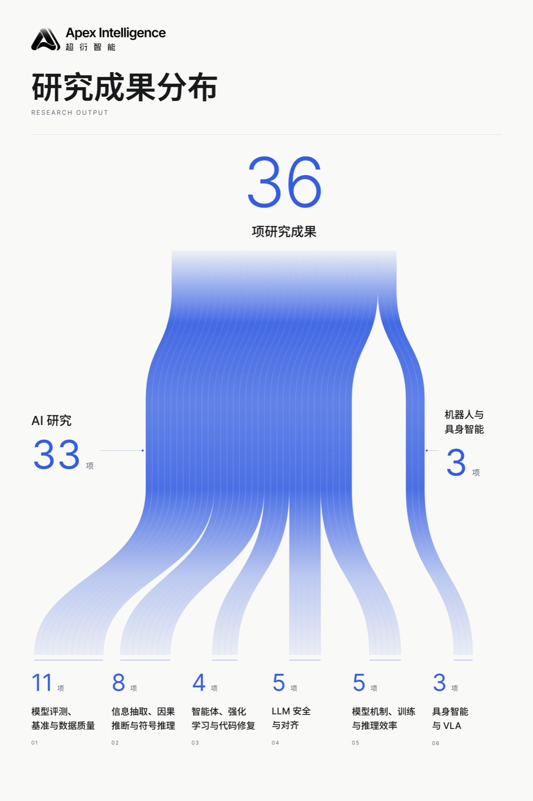

[English](README.md) | **简体中文**

# Apex Research

**从研究问题到可检查证据的自主科研。**

Apex Research 由 Apex Intelligence 构建，汇集模型评测、推理、智能体、安全、具身智能和模型效率等方向的研究。

**5 篇精选论文** · **36 个研究项目** · **6 个研究方向**

[精选论文](highlight/README.md) · [按方向浏览全部论文](categories/README.md) · [完整论文目录](CONTENTS.md)

## 精选论文

从这 5 篇论文开始阅读；“项目资料”提供代码、实验结果及研究过程记录。

| 论文 | 阅读与资料 |
|---|---|
| Observe but Don’t Optimize: Structural Rewards Trigger Goodhart Effects in Neurosymbolic Reasoning | [PDF](highlight/observe-but-don-t-optimize-structural-rewards-trigger-goodhart-effects-in-neurosymbolic-reasoning.pdf) · [项目资料](paper-assets/solver-trace-ablation/README.md) |
| Depth Profiling: Classifying Recursive Generation Depth in Base-Model LLM Text | [PDF](highlight/depth-profiling-classifying-recursive-generation-depth-in-base-model-llm-text.pdf) · [项目资料](paper-assets/gen-depth-fingerprint/README.md) |
| Reproducibility Budgets for Open-Weight LLM Evaluation: A Generalizability Theory Study of 7–9B Instruction-Tuned Models | [PDF](highlight/reproducibility-budgets-for-open-weight-llm-evaluation-a-generalizability-theory-study-of-7-9b-instruction-tuned-models.pdf) · [项目资料](paper-assets/nlp_variance_gtheory/README.md) |
| Layer Selection Sensitivity in Hidden-State Safety Probes for Reasoning Models | [PDF](highlight/layer-selection-sensitivity-in-hidden-state-safety-probes-for-reasoning-models.pdf) · [项目资料](paper-assets/contrastive_trace_safety/README.md) |
| Instruction Routing in Fine-Tuned Vision-Language-Action Models: A Cross-Architecture Analysis | [PDF](highlight/instruction-routing-in-fine-tuned-vision-language-action-models-a-cross-architecture-analysis.pdf) · [项目资料](paper-assets/vla-ssd/README.md) |

[打开精选论文文件夹](highlight/README.md)

## 浏览全部研究方向

全部 36 篇论文按方向列在分类页面，也可在[完整目录](CONTENTS.md)中按标题或项目名查找。

| 编号 | 研究方向 | 项目数 |
|---:|---|---:|
| **01** | [模型评测、基准与数据质量](categories/model-evaluation-and-data-quality/README.md) | **11** |
| **02** | [信息抽取、因果推断与符号推理](categories/information-extraction-causal-and-symbolic-reasoning/README.md) | **8** |
| **03** | [智能体、强化学习与代码修复](categories/agents-reinforcement-learning-and-code-repair/README.md) | **4** |
| **04** | [LLM 安全与对齐](categories/llm-safety-and-alignment/README.md) | **5** |
| **05** | [具身智能与 VLA](categories/embodied-ai-and-vla/README.md) | **3** |
| **06** | [模型机制、训练与推理效率](categories/model-mechanisms-training-and-inference-efficiency/README.md) | **5** |

  

## 仓库导航

| 位置 | 用途 |
|---|---|
| [highlight/](highlight/README.md) | 精选 5 篇论文的 PDF 和项目资料入口 |
| [categories/](categories/README.md) | 按 6 个研究方向浏览全部 36 篇论文 |
| [CONTENTS.md](CONTENTS.md) | 检索全部论文，查看项目资料统计 |
| [paper-assets/](paper-assets/README.md) | 各项目的完整资料；从资料指南进入论文、代码、实验和过程记录 |
| [assets/](assets/) | 首页配图 |

阅读路径：**精选论文 → 研究方向 → 项目资料**。每个项目的七类资料目录见[项目资料指南](paper-assets/README.md)。
