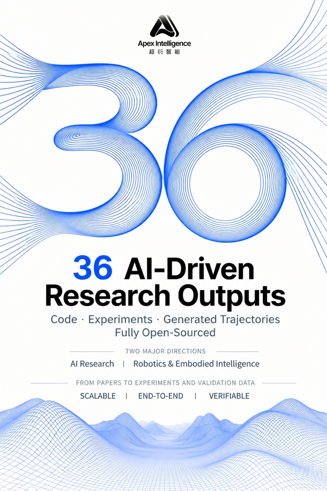
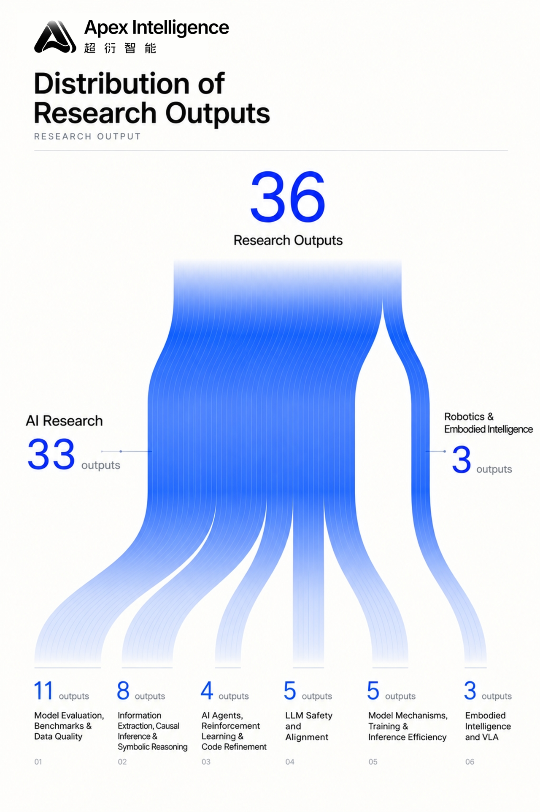
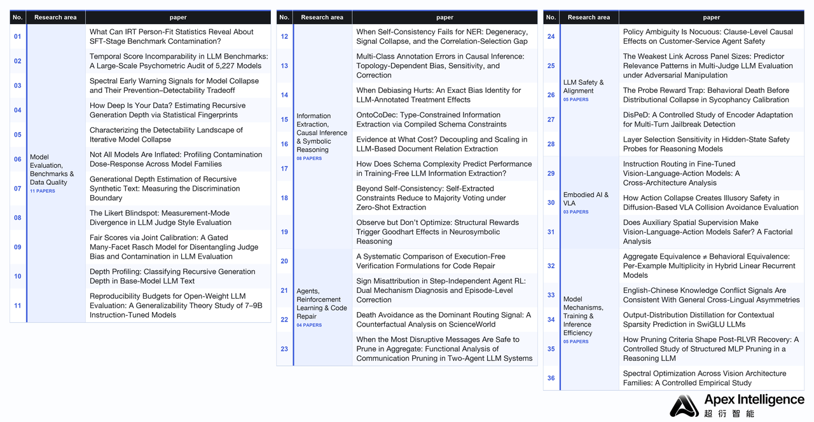
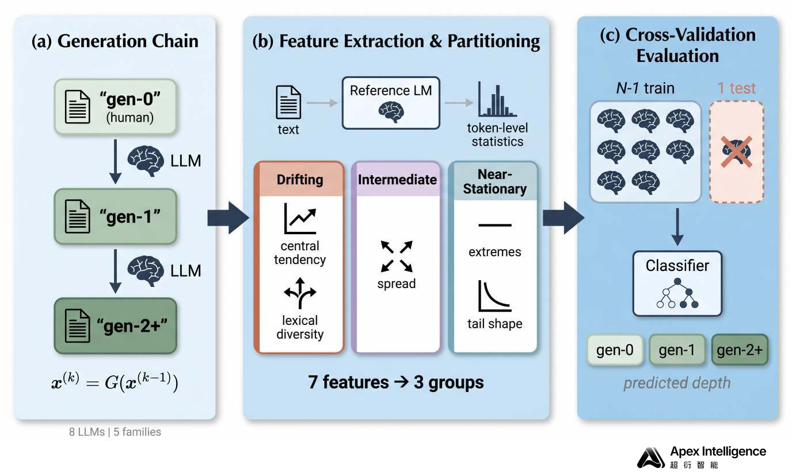
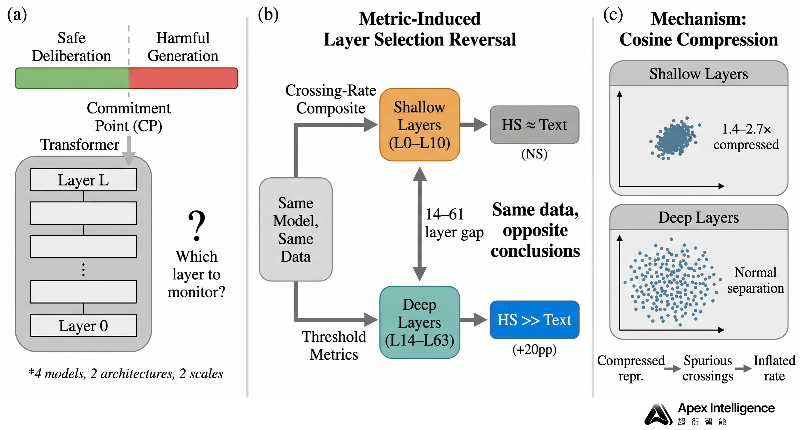
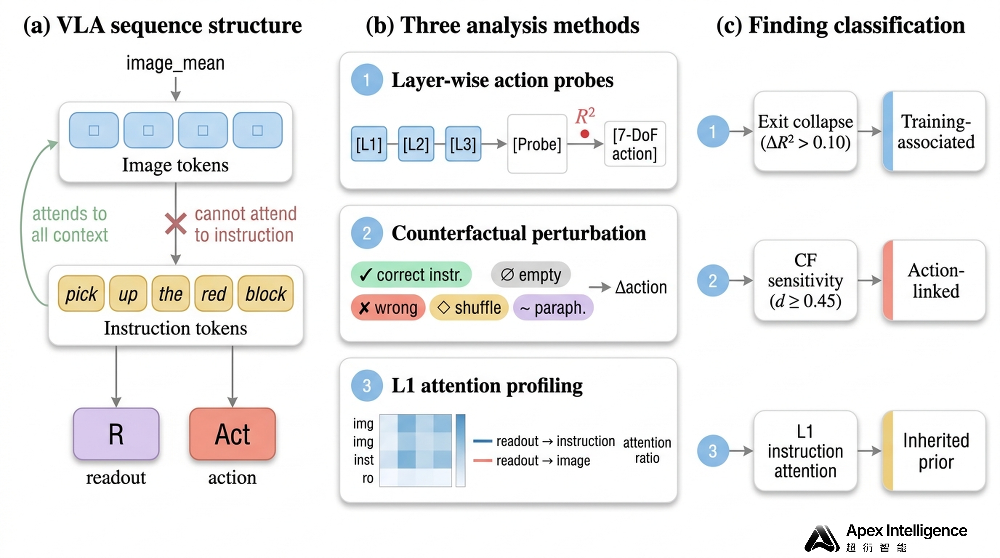
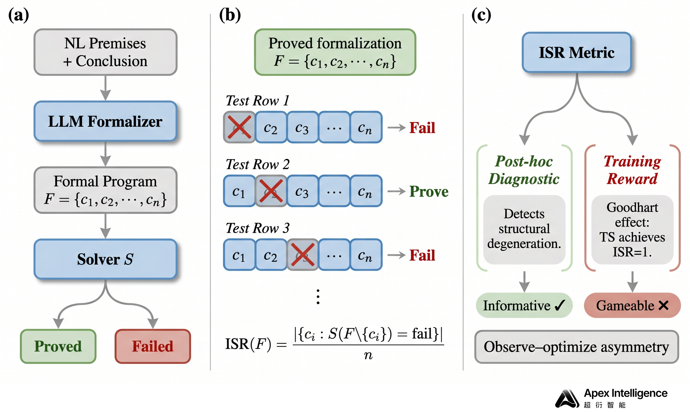
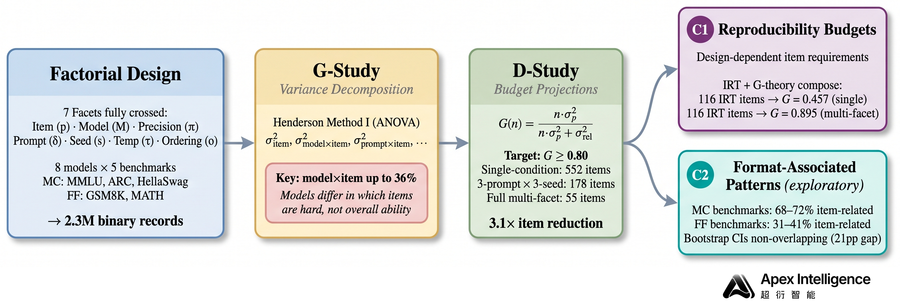

**English** | [简体中文](README.zh-CN.md)

[Home](../README.md) · [Five paper PDFs](PAPERS.md) · [All 36 papers](../CONTENTS.md) · [Original article PDF](originals/article.en.pdf)

---

<!-- BEGIN ORIGINAL ARTICLE -->

# Apex Intelligence Releases 36 AI Autonomous Research Results: Code, Experiments, and Generation Traces Fully Open-Sourced

Today, Apex Intelligence is officially releasing 36 research results produced by our AI system, spanning two directions: AI research and robotics & embodied intelligence. Papers, code, and related research materials will be open-sourced through GitHub repositories, available for researchers in relevant fields to read, review, reproduce, and discuss.

  
  

---

## 01 What We Built

The Apex Intelligence team has built an autonomous system capable of completing scientific research end-to-end with minimal human intervention. Over the past few months, our autonomous AI research system has independently completed the entire process — from literature review and method design, to code implementation, experimental analysis, figure plotting, LaTeX paper writing, and self-review with iterative optimization.

The 36 research results released this time were almost entirely produced by AI, with only minimal non-expert human intervention. This demonstrates that Apex Intelligence's AI system is truly capable of independently formulating scientific questions, designing rigorous experiments, and drawing insightful conclusions.

This batch of research spans two directions: AI research and robotics & embodied intelligence. Within the AI research direction, we explored five categories of problems:

- Model evaluation, benchmarks, and data quality
- Information extraction, causal inference, and symbolic reasoning
- Agents, reinforcement learning, and code repair
- LLM safety and alignment
- Model mechanisms, training, and inference efficiency

The robotics & embodied intelligence direction focuses on embodied control and Vision-Language-Action (VLA) models.

---

## 02 Five Representative Studies

We selected the following five representative research results for detailed interpretation.

---

### 01 | AI-Generated Content Tracing: Differential Statistical Responses in Recursive Generation

**Depth Profiling: Classifying Recursive Generation Depth in Base-Model LLM Text**

As AI-generated text increasingly enters the internet and model training corpora, an important yet understudied question arises: how do statistical distributions evolve when text passes through multiple rounds of LLM generation? Can these changes be used to identify how many rounds of AI generation a text has undergone?

Traditional AI-text detection focuses on the Human-vs-AI binary classification, while existing recursive-generation research mostly discusses distribution convergence or model collapse. Apex AI System introduces the task of Generation Depth Profiling, extending the research goal from determining whether text is AI-generated to identifying its recursive generation depth.

Based on 8 base LLMs from 5 model families, the study constructs approximately 37,000 multi-round generated texts, computes token-level negative log-likelihood (NLL) distributions using a fixed reference model, and combines statistical features such as lexical diversity to systematically analyze how different features change with generation depth.

The research identifies a consistent statistical phenomenon: location features of the NLL distribution drift continuously with generation rounds, while some distribution shape features remain approximately stable. Features such as mean NLL and lexical diversity show clear changes, with effect sizes of approximately d = 0.74–1.05; effect sizes of some tail-distribution and extreme-value-related features are below 0.10.

The study defines this asymmetry as Differential Depth Response (DDR).

Building on DDR, the paper constructs a lightweight feature classifier that classifies text into Gen-0 (original text), Gen-1 (one round of generation), and Gen-2+ (two or more rounds of generation), and evaluates cross-model transferability through leave-one-generator-out evaluation. In the leave-one-out setting across 8 generation models, the binary F1 reaches 0.694; in a specific cross-model generation chain experiment, it reaches 0.830.

The core novelty of this work lies in decomposing distributional changes in recursive generation into two types of responses — "continuous drift" and "relative stability" — and using this structural difference to build a generation-depth identification method. Compared with traditional detection methods that only identify text provenance, this study explores the possibility of inferring generation history from text statistical distributions, offering new methods for synthetic data provenance, training-corpus auditing, and multi-round generation research.

Note that this pattern has so far been validated mainly on base pretrained models; instruction-tuned and more complex real-world generation environments require further study.

---

### 02 | Safety Monitoring for Reasoning Models: Layer Selection Bias in Hidden-State Probes

**Layer Selection Sensitivity in Hidden-State Safety Probes for Reasoning Models**

Reasoning models may gradually shift from following safety constraints to generating harmful content during continuous reasoning. Such internal safety-state transitions make detection methods that rely only on inputs or final text outputs limited. In recent years, researchers have begun training safety probes on model internal hidden states, hoping to more precisely identify changes occurring during reasoning.

However, hidden-state probes require selecting specific Transformer layers as monitoring targets, and how layers are selected is usually treated as an implementation detail; its impact on final safety-detection conclusions has not been systematically studied.

Apex AI System addresses this question by proposing a cross-layer, cross-metric analysis framework for hidden-state safety probes.

The study compares safety-state representations across different Transformer layers in 4 reasoning models, and evaluates probe performance in identifying safety-state transitions using multiple metrics, including threshold-crossing frequency, precision, balanced accuracy, and false positive rate.

Experiments reveal systematic divergence among different layer-selection metrics: metrics based on threshold-crossing frequency tend to select shallow layers (L0–L10), while metrics based on threshold-detection performance tend to select deep layers (L14–L63). Across models, the layers selected by the two approaches differ by 14–61 layers.

This divergence affects not only the monitoring location, but also directly changes judgments about hidden-state detection capability.

In some shallow layers, hidden-state probes perform similarly to text probes; while at properly selected deep layers, hidden-state probes in 7B–8B models achieve approximately 20–22 percentage-point improvements in precision over text probes, confirmed through cross-validation.

To further explain this phenomenon, the study analyzes the geometric properties of hidden representations across layers, finding Cosine Compression in shallow-layer representations: directional differences between representations of adjacent reasoning steps are compressed by approximately 1.4–2.7×, making some frequency-based metrics more susceptible to noise and leading to erroneous layer-selection preferences.

This bias is further validated across models and on the AdvBench dataset.

The core innovation of this study is discovering and explaining the Metric-Induced Layer Selection Bias in hidden-state safety probes. Compared with existing work that trains safety classifiers at fixed layers, the paper demonstrates that layer-selection strategy itself is an important methodological variable affecting safety-monitoring conclusions.

The research also compares multiple alternative detection methods and discusses the possibility of multi-layer ensemble probes, providing experimental evidence for building more reliable, reproducible internal safety-monitoring methods for reasoning models.

Note that conclusions on the 32B model remain limited by test sample size, and the advantage of hidden states over text also depends on the specific model and text-encoder configuration.

---

### 03 | Internal Mechanisms of Embodied Intelligence: Disentangling Action-Training-Induced Representation Changes from Pretraining Priors

**Instruction Routing in Fine-Tuned Vision-Language-Action Models: A Cross-Architecture Analysis**

Vision-Language-Action (VLA) models achieve the mapping from images and natural-language instructions to robot actions by fine-tuning pretrained vision-language models (VLMs) on robot action data.

However, a key question about VLA internal information processing remains: does the instruction-processing capability exhibited after action training come from the newly added action training, or is it inherited from the pretrained vision-language model?

Existing studies mostly focus on task success rates, language-instruction-following performance, and internal representations of single models, lacking systematic cross-architecture, pre/post-training comparative analyses.

To address this, Apex AI System conducted a cross-architecture VLA instruction routing study.

The study selects three different backbone architectures — OpenVLA, TraceVLA, and NORA — and compares trained models with reference checkpoints on four task categories in LIBERO. TraceVLA and NORA are used to analyze the VLM-to-VLA training transition, while OpenVLA is used to analyze further fine-tuning on top of an existing VLA.

Methodologically, the study combines three complementary analyses: layer-wise probing to measure the decodability of action-related information across Transformer layers; counterfactual instruction perturbation to analyze the impact of instruction-content changes on internal representations; and attention profiling to study attention patterns toward language-instruction information across layers.

The study obtains three main findings.

First, VLM-to-VLA action training is accompanied by specific output-layer representation changes. In the two tested VLM-to-VLA transitions, the decodability of action information near the output layers drops markedly relative to the middle layers (ΔR² = 0.16–0.46); the corresponding change in VLA-to-VLA fine-tuning is below 0.10, and no similar change is observed in ordinary NLP instruction-tuning controls.

Second, action-trained VLAs show significant sensitivity to instruction-content changes. Counterfactual instruction experiments observe medium-to-large internal representation changes (Cohen's d = 0.45–1.52), indicating a measurable association between language-instruction information and action-related representations.

Third, some shallow-layer instruction-attention structures are actually inherited from the pretrained model. Comparing attention patterns before and after training reveals that some dominant instruction-attention features in the first layer are not newly formed by action fine-tuning, but already exist in the base model.

The main innovation of this study lies in decomposing VLA internal mechanisms into "action-training-related changes" and "pretrained-model-inherited structures" through cross-architecture, pre/post-training comparisons, and multiple representation-analysis methods.

Compared with studies that only investigate whether VLAs follow instructions through task success rates, this work further analyzes how instruction information is represented and processed inside the model, providing new experimental evidence for understanding the transition from base vision-language models to robot action models.

These findings also provide references for representation diagnostics, architecture analysis, and training-method design of future VLA models, but they are currently mainly based on open-loop experiments; closed-loop robot tasks are still needed to further validate their practical effects.

---

### 04 | Neurosymbolic Reasoning: Goodhart Effects Triggered by Structural Rewards

**Observe but Don't Optimize: Structural Rewards Trigger Goodhart Effects in Neurosymbolic Reasoning**

In neurosymbolic reasoning systems, large language models are usually responsible for converting natural-language problems into formal logical expressions, which symbolic solvers then validate to determine whether the conclusions hold. Existing training methods often directly use the solver's execution success rate as the reinforcement learning reward, but this objective has a structural flaw: models can pass validation without performing genuine logical derivation, by directly embedding the conclusion to be proven into the premises, constructing logical tautologies, and similar shortcuts.

To address this, Apex AI System proposes Solver Trace Ablation (STA), applying item-wise ablation to the structural diagnosis of neurosymbolic reasoning. For each model-generated formal expression, STA removes premises or components one by one and re-invokes the symbolic solver to determine whether each part is necessary for the proof to hold.

Based on this process, the study constructs the Intensional Structural Reward (ISR) metric, which quantifies the proportion of components whose removal causes proof failure, thereby measuring the necessity of the proof structure without requiring additional human step-by-step reasoning annotations.

The study uses Qwen3-4B with the GRPO reinforcement learning framework, analyzes model training behavior under multiple reward conditions, and validates the findings through first-order logic (FOL), Prolog, and cross-dataset experiments.

Experiments show that when only the execution success rate is used as the reward, models can still see the proportion of non-speculative proofs drop below 6.2% even when their proof success rate exceeds 90%. This indicates that models can gradually rely on structural shortcuts while formal verification metrics keep improving.

More importantly, the study further finds: when ISR — originally designed to identify structural cheating — is directly added to the training reward, models can still score high by constructing tautological structures that satisfy the metric's requirements.

Across 5 random-seed experiments, 3 exhibit this Goodhart effect, while the other 2 maintain relatively reasonable reasoning structures. Experiments across logical formalisms further show that the asymmetry between diagnostic metrics and optimization targets is not confined to a single logical representation.

The novelty of this study lies in designing a proof-structure diagnosis method that requires no human process annotations, and in revealing, through reinforcement learning experiments, the exploitability of structural diagnostic metrics themselves. The research advances the analysis of reward hacking from the level of final results to the compositional structure of formal proofs, and reveals an important boundary: metrics suitable for observing reasoning quality are not necessarily suitable for direct use as optimization targets.

This finding provides important methodological evidence for reward design in reinforcement learning with verifiable rewards (RLVR), neurosymbolic reasoning, and automated formalization systems.

---

### 05 | Reliability of LLM Evaluation: From Multi-Factor Variance Decomposition to Evaluation Budget Optimization

**Reproducibility Budgets for Open-Weight LLM Evaluation: A Generalizability Theory Study of 7–9B Instruction-Tuned Models**

Existing LLM benchmarks usually run under fixed prompts, random seeds, and inference configurations, measuring model capability with a single score. However, prompt templates, randomness, numerical precision, and option order can all affect results. Previous studies mostly analyzed each factor in isolation, lacking a unified characterization of multiple uncertainty sources and their interactions, and unable to answer a practical question: what evaluation configurations and how many items are needed to obtain statistically reliable estimates of model capability?

To address this, Apex AI System introduces Generalizability Theory (G-Theory) from psychometrics into LLM evaluation, establishing an analysis framework from multi-factor variance decomposition to evaluation budget estimation.

The study covers 8 open-weight 7–9B instruction-tuned models and 5 benchmarks, cross-analyzing 7 classes of evaluation factors, totaling approximately 2.3 million evaluation records. The system uses G-study to identify the contributions of different factors and their interactions to evaluation variance, and then D-study to estimate the number of items needed for different evaluation designs to reach target reliability.

Experiments find that in multiple-choice benchmarks, item difficulty explains approximately 34%–38% of variance, and the model–item interaction explains approximately 30%–36% of variance. The effects of these two factors are significantly larger than those of varying prompts, random seeds, numerical precision, or answer order alone. The results indicate that differences among models manifest not only in average capability, but also in different difficulty judgments and response patterns on specific items.

Building on this, the study further proposes reliability-oriented evaluation budget design. For MMLU, under the target of a generalizability coefficient G ≥ 0.80, an evaluation scheme with 3 prompts × 3 random seeds reduces the required number of independent items from 552 under a single configuration to 178.

---

## 03 Welcome to Discussion: From Papers to Research Process

For ease of reading and verification, each result is organized into unified research materials. We hope that by open-sourcing these complete materials, researchers can not only read the papers, but also trace how questions were posed, how methods were implemented, how experiments were conducted, and what checks the results underwent. The public availability, reproduction conditions, and known limitations of each paper's materials will be described separately in the repository.

Each directory mainly contains:

- 01-manuscript: paper text, LaTeX source files, and related manuscript materials.
- 02-code/source: method implementation, training and inference code.
- 03-experiments/source: experiment configurations, run scripts, result records, and figure materials.
- 04-generation-trace: generation process records from task kickoff to paper production.
- 05-validation/source: result-checking, validation scripts, and review materials.
- 06-maintenance/source: version updates, revision records, and maintenance materials.
- 07-index: results index, navigation, and cross-references.

We welcome researchers in mathematics, computer science, and artificial intelligence to read the results, run the code, review the experiments, offer suggestions, and join the Apex community discussions. We also value independent academic review and feedback: experts are welcome to validate AI-produced research results, offer suggestions, or conduct follow-up research, and we will continue to revise how results are presented accordingly.

Three types of researchers are especially welcome:

- **Reproducers:** run the code, review the experiments, and point out anything that cannot be reproduced;
- **Reviewers:** offer suggestions on methods, experimental design, and the rigor of conclusions;
- **Follow-up researchers:** build on these results, or refute some of the conclusions.

We believe that the value of AI-driven research lies not only in generating papers, but in forming knowledge that is testable, cumulative, and can be continuously advanced by the community — this requires the joint participation of researchers, reviewers, reproducers, and tool developers.

Discord: https://discord.gg/n4GcamcgFp

<!-- END ORIGINAL ARTICLE -->

---

[Five paper PDFs & project materials](PAPERS.md) · [Browse all research areas](../categories/README.md) · [简体中文](README.zh-CN.md)
