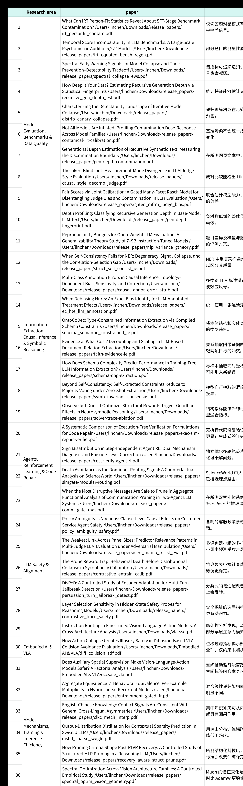

[English](README.md) | **简体中文**

[首页](../README.zh-CN.md) · [五篇论文 PDF](PAPERS.zh-CN.md) · [全部 36 篇论文](../CONTENTS.zh-CN.md) · [原始文稿 PDF](originals/article.zh-CN.pdf)

---

<!-- BEGIN ORIGINAL ARTICLE -->

# paper解读【确定版】

---

## 01｜AI 生成内容溯源：发现递归生成过程中的差异化统计响应

> Depth Profiling: Classifying Recursive Generation Depth in Base-Model LLM Text

随着AI生成文本不断进入互联网和模型训练语料，一个重要但尚未得到充分研究的问题是：当文本经过多轮语言模型生成后，其统计分布会如何演化？是否能够利用这些变化，识别文本经历了多少轮AI生成？

传统AI文本检测主要关注Human-vs-AI二分类，已有递归生成研究则更多讨论文本分布趋同或模型坍缩。Apex AI System 提出了Generation Depth Profiling（生成深度分析）任务，将研究目标从判断文本是否由AI生成，扩展为识别其递归生成代际。

研究基于5个模型家族的8种基础语言模型，构建约3.7万条多轮生成文本，并使用固定参考模型计算Token级负对数似然（NLL）分布，结合词汇多样性等统计特征，系统分析不同特征随生成深度的变化规律。

研究发现了一种具有一致性的统计现象：**NLL分布的位置特征随生成轮数持续漂移，而部分分布形状特征保持近似稳定。** 其中，平均NLL及词汇多样性等特征呈现明显变化，效应量约为d=0.74–1.05；部分尾部分布与极值相关特征的效应量则小于0.10。

研究将这一不对称性定义为**Differential Depth Response（DDR，差异化深度响应）**。

基于DDR，论文构建轻量级特征分类器，将文本区分为Gen-0（原始文本）、Gen-1（一轮生成）和Gen-2+（两轮及以上生成），并通过留一生成器评测检验其跨模型迁移能力。在8个生成模型的留一测试设置中，二分类F1达到0.694；在特定跨模型生成链实验中达到0.830。

**这项工作的核心新颖性在于，将递归生成中的分布变化拆解为“持续漂移”与“相对稳定”的两类响应，并利用这种结构性差异建立生成深度识别方法。** 相比只识别文本来源的传统检测方法，该研究探索了从文本统计分布中推断其生成历史的可能性，为合成数据溯源、训练语料审计和多轮生成规律研究提供了新的方法。

目前这一规律主要在基础预训练模型中得到验证，指令微调和更复杂的真实生成环境仍需进一步研究。

---

## 02｜推理模型安全监测：发现隐藏状态探针中的选层偏差

> Layer Selection Sensitivity in Hidden-State Safety Probes for Reasoning Models

推理模型可能在连续推理过程中，从遵循安全约束逐渐转向生成有害内容。这类内部发生的安全状态转变，使仅依赖输入或最终文本输出的检测方法面临局限。近年来，研究者开始使用模型内部隐藏状态（Hidden States）训练安全探针，希望更精细地识别推理过程中发生的变化。

然而，隐藏状态探针需要选择特定Transformer层作为监测对象，而**如何选择网络层通常被视为技术实现细节，其对最终安全检测结论的影响尚缺乏系统研究。**

Apex AI System 围绕这一问题，提出了对隐藏状态安全探针的跨层、跨指标分析框架。

研究在4个推理模型上，比较不同Transformer层的安全状态表示，并采用多种指标评估探针在识别安全状态转变时的表现，包括阈值跨越频率、精确率、平衡准确率及误报率等。

实验发现，**不同的选层指标存在系统性分歧**：基于阈值跨越频率的指标倾向于选择浅层（L0–L10），而基于阈值检测表现的指标更倾向于选择深层（L14–L63）。在不同模型中，两类方法选择的层相差14–61层。

这种差异不仅影响模型监测位置，还会直接改变对隐藏状态检测能力的判断。

在部分浅层，隐藏状态探针与文本探针表现接近；而在合理选择的深层，7B–8B模型中的隐藏状态探针相比文本探针取得约20–22个百分点的精确率提升，并通过交叉验证。

为了进一步解释这一现象，研究分析了不同网络层隐藏表示的几何性质，发现浅层表示存在**Cosine Compression（余弦距离压缩）**：相邻推理步骤之间的表示方向差异被压缩约1.4–2.7倍，使部分频率型指标更容易受到噪声影响，进而产生错误的选层偏好。

这一偏差在跨模型和AdvBench数据集实验中也得到了进一步验证。

**该研究的核心创新，是发现并解释了隐藏状态安全探针中的指标诱导选层偏差（Metric-Induced Layer Selection Bias）。** 相比仅在固定网络层训练安全分类器的现有工作，论文证明选层策略本身是影响安全监测结论的重要方法学变量。

研究还比较了多种替代检测方法，并讨论了多层集成探针的可能性，为未来建立更加可靠、可复现的推理模型内部安全监测方法提供了实验依据。

需要注意的是，32B模型上的结论仍受测试样本量限制，隐藏状态相对于文本的优势也依赖具体模型和文本编码器配置。

---

## 03｜具身智能内部机制：区分动作训练引起的表示变化与预训练先验

> Instruction Routing in Fine-Tuned Vision-Language-Action Models: A Cross-Architecture Analysis

视觉—语言—动作模型（Vision-Language-Action，VLA）通过在预训练视觉语言模型（VLM）上进行机器人动作数据微调，实现从图像与自然语言指令到机器人动作的映射。

但目前对于VLA内部信息处理机制仍存在一个关键问题：**模型在动作训练后表现出的指令处理能力，究竟来自新增的动作训练，还是继承自预训练视觉语言模型？**

已有研究较多关注VLA的任务成功率、语言指令遵循表现以及单一模型的内部表示，但缺少跨架构、训练前后对照的系统分析。

针对这一问题，Apex AI System 开展了**跨架构VLA指令路由（Instruction Routing）研究**。

研究选择OpenVLA、TraceVLA和NORA三种不同骨干架构，在LIBERO的四类任务上对比训练模型与参考检查点。其中，TraceVLA和NORA用于分析VLM到VLA的训练转变，OpenVLA则用于分析已有VLA基础上的进一步微调。

方法上，研究结合三类互补分析：一是使用逐层探针（Layer-wise Probing）测量动作相关信息在不同Transformer层中的可解码性；二是通过反事实指令扰动（Counterfactual Instruction Perturbation），分析指令内容变化对模型内部表示的影响；三是利用注意力分析（Attention Profiling）研究不同网络层对语言指令信息的关注模式。

研究获得了三个主要发现。

**第一，VLM到VLA的动作训练伴随着特定的输出层表示变化。** 在测试的两个VLM-to-VLA转换中，输出层附近的动作信息可解码性相对于中间层出现明显下降，ΔR²达到0.16–0.46；而VLA-to-VLA微调中的对应变化小于0.10，普通NLP指令微调对照中则未观察到类似变化。

**第二，经过动作训练的VLA对指令内容变化表现出显著敏感性。** 反事实指令实验观察到中等至较大的内部表示变化（Cohen's d=0.45–1.52），说明语言指令信息与动作相关表示之间存在可测量的关联。

**第三，部分浅层指令注意力结构实际上继承自预训练模型。** 研究比较训练前后的注意力模式发现，第一层中占主导地位的一些指令注意力特征并非动作微调新形成，而是已经存在于基础模型中。

**这项研究的主要创新，在于通过跨架构、训练前后对照及多种表示分析方法，将VLA内部机制拆解为“动作训练相关变化”与“预训练模型继承结构”两部分。**

相比仅通过任务成功率研究VLA是否能够遵循指令，该工作进一步分析了指令信息在模型内部如何被表示和处理，为理解基础视觉语言模型向机器人动作模型的转变提供了新的实验证据。

这些发现也为后续VLA模型的表示诊断、架构分析及训练方法设计提供了参考，但目前仍主要基于开放环路实验，尚需通过闭环机器人任务进一步验证其实际作用。

---

## 04｜神经符号推理：揭示结构奖励中的 Goodhart 效应

> Observe but Don’t Optimize: Structural Rewards Trigger Goodhart Effects in Neurosymbolic Reasoning

在神经符号推理系统中，大语言模型通常负责将自然语言问题转化为形式逻辑表达式，再由符号求解器验证结论是否成立。现有训练方法往往直接将求解器的执行成功率作为强化学习奖励，但这一目标存在结构性缺陷：**模型可以通过将待证明结论直接嵌入前提、构造逻辑重言式等方式使证明通过验证，而不需要完成真正的逻辑推导。**

针对这一问题，Apex AI System 提出**Solver Trace Ablation（STA）**，将逐项消融方法应用于神经符号推理的结构诊断。对于模型生成的形式化表达式，STA依次移除其中的前提或组成部分，并重新调用符号求解器，判断每个部分是否对证明成立具有必要性。

基于这一过程，研究构建了Intensional Structural Reward（ISR）指标，以移除后导致证明失败的组成部分比例，量化证明结构的必要性，而无需额外的人工逐步推理标注。

研究使用Qwen3-4B和GRPO强化学习框架，在多种奖励条件下分析模型的训练行为，并通过一阶逻辑（FOL）、Prolog及跨数据集实验进行验证。

实验发现，仅以执行成功率为奖励时，模型即使取得超过90%的证明成功率，其非投机性证明比例仍可能下降至6.2%以下。这表明模型可以在形式验证指标持续改善的同时，逐渐依赖结构性捷径。

更重要的是，研究进一步发现：**当原本用于识别结构性作弊的ISR被直接加入训练奖励时，模型仍可能通过构造满足指标要求的重言式结构获得高分。**

在5组随机种子实验中，3组出现了这种Goodhart效应，另外2组保持了相对合理的推理结构。跨逻辑形式的实验进一步表明，这种诊断指标与优化目标之间的不对称性并非局限于单一逻辑表示。

**该研究的新颖性在于，不仅设计了无需人工过程标注的证明结构诊断方法，还通过强化学习实验揭示了结构诊断指标本身的可利用性。** 研究将Reward Hacking的分析从最终结果层面推进到形式化证明的组成结构层面，并揭示一个重要边界：适合用来观察推理质量的指标，未必适合直接作为优化目标。

这一发现为可验证奖励强化学习（RLVR）、神经符号推理和自动形式化系统的奖励设计提供了重要的方法学依据。

---

## 05｜大模型评测可靠性：从多因素方差分解到评测预算优化

> Reproducibility Budgets for Open-Weight LLM Evaluation: A Generalizability Theory Study of 7–9B Instruction-Tuned Models

现有大模型 Benchmark 通常在固定提示词、随机种子和推理配置下运行，并以单次得分衡量模型能力。然而，提示词模板、随机性、数值精度和选项顺序等因素都可能影响结果。此前的研究大多单独分析某一种因素，缺少对多种不确定性来源及其交互作用的统一刻画，也难以回答一个实际问题：**究竟需要怎样的评测配置和多少道题，才能获得具有足够统计可靠性的模型能力估计？**

针对这一问题，Apex AI System 将心理测量学中的概化理论（Generalizability Theory，G-Theory）引入大模型评测，建立了一套从多因素方差分解到评测预算估算的分析框架。

研究覆盖8个7–9B开源指令模型、5个Benchmark，交叉分析7类评测因素，形成约230万条评测记录。系统采用G-study识别不同因素及其交互作用对评测结果方差的贡献，再通过D-study推算不同评测设计达到目标可靠性所需要的题目数量。

实验发现，在选择题Benchmark中，**题目难度解释了约34%–38%的方差，模型与题目的交互作用解释了约30%–36%的方差**。这两项因素的影响显著高于单独改变提示词、随机种子、数值精度或答案顺序所产生的影响。结果说明，模型间的差异不仅体现为平均能力高低，更表现为不同模型对具体题目的难度判断和作答表现存在差异。

在此基础上，研究进一步提出面向可靠性目标的评测预算设计。对于MMLU，在概化系数G≥0.80的目标下，采用**3种Prompt × 3个随机种子**的评测方案，可将所需独立题目数量从单一配置下的552道降至178道。

**这项工作的主要创新，不是提出新的评测题库，而是将多因素统计建模与评测预算优化结合起来，使Benchmark从一次性的分数比较，转变为可以量化可靠性、分析误差来源并优化实验设计的测量体系。** 论文还提供了相应的G-Theory分析工具与预算计算方法，为更严谨的大模型评测提供了可复用的技术框架。

<!-- END ORIGINAL ARTICLE -->

---

[五篇论文 PDF 与项目资料](PAPERS.zh-CN.md) · [按研究方向浏览](../categories/README.zh-CN.md) · [English](README.md)
