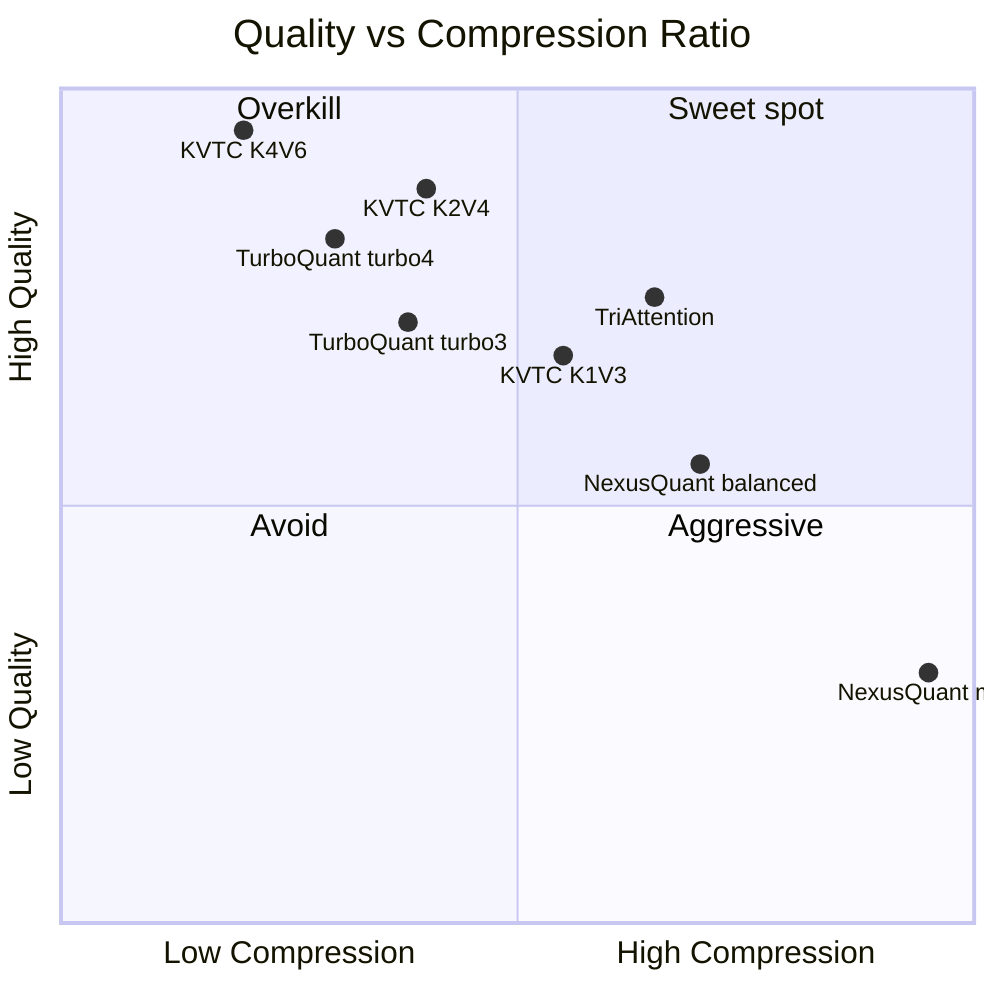
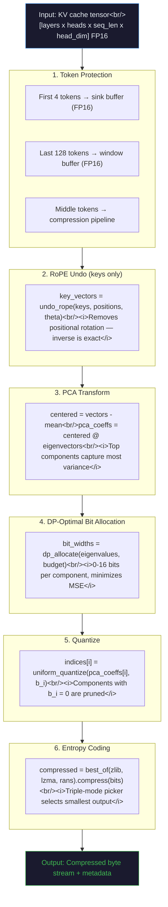

# research kvtc code survey

**distill kv rag cache** · Worker execution logs

This page is a human-readable rendering of one source record. It preserves the recorded order and wording; the linked JSON keeps the complete machine-readable structure.

## Record overview

- **Events:** 62
- **Recorded user turns:** 0
- **Tool calls:** 23
- **Original source:** `logs/workers/worker_research_kvtc-code-survey_20260514T042154.log`
- **Structured JSON:** [`25f5e5d5781e3a8a1f07.json`](../../sessions/25/25f5e5d5781e3a8a1f07.json)

## Before a recorded user message

62 recorded events

### Log line

_source line 1_

Warning: no stdin data received in 3s, proceeding without it. If piping from a slow command, redirect stdin explicitly: < /dev/null to skip, or wait longer.

---

### System

_source line 2_

```json
{
  "type": "system",
  "subtype": "init",
  "cwd": "/home/ubuntu/.agent-ml-research-idea_gen_0513_2/projects/distill_kv_rag_cache",
  "session_id": "5b6d8e7a-5202-4c2b-b47c-536c7d186b2e",
  "tools": [
    "Task",
    "AskUserQuestion",
    "Bash",
    "CronCreate",
    "CronDelete",
    "CronList",
    "Edit",
    "EnterPlanMode",
    "EnterWorktree",
    "ExitPlanMode",
    "ExitWorktree",
    "Glob",
    "Grep",
    "ListMcpResourcesTool",
    "Monitor",
    "NotebookEdit",
    "PushNotification",
    "Read",
    "ReadMcpResourceTool",
    "RemoteTrigger",
    "ScheduleWakeup",
    "Skill",
    "TaskOutput",
    "TaskStop",
    "TodoWrite",
    "ToolSearch",
    "WebFetch",
    "WebSearch",
    "Write",
    "mcp__agent-ml-research__append_idea",
    "mcp__agent-ml-research__clone_repo",
    "mcp__agent-ml-research__list_repo_tree",
    "mcp__agent-ml-research__read_project_file",
    "mcp__agent-ml-research__read_repo_file",
    "mcp__agent-ml-research__register_artifact",
    "mcp__agent-ml-research__save_project_file",
    "mcp__agent-ml-research__search_repo",
    "mcp__agent-ml-research__sync_code_to_remote"
  ],
  "mcp_servers": [
    {
      "name": "agent-ml-research",
      "status": "connected"
    }
  ],
  "model": "claude-opus-4-6",
  "permissionMode": "bypassPermissions",
  "slash_commands": [
    "update-config",
    "debug",
    "simplify",
    "batch",
    "fewer-permission-prompts",
    "loop",
    "schedule",
    "claude-api",
    "clear",
    "compact",
    "context",
    "heapdump",
    "init",
    "review",
    "security-review",
    "extra-usage",
    "usage",
    "insights",
    "team-onboarding"
  ],
  "apiKeySource": "none",
  "claude_code_version": "2.1.126",
  "output_style": "default",
  "agents": [
    "claude",
    "Explore",
    "general-purpose",
    "Plan",
    "statusline-setup"
  ],
  "skills": [
    "update-config",
    "debug",
    "simplify",
    "batch",
    "fewer-permission-prompts",
    "loop",
    "schedule",
    "claude-api"
  ],
  "plugins": [],
  "analytics_disabled": false,
  "uuid": "a91560a1-2e95-4ab6-9e85-51f1b111fe40",
  "memory_paths": {
    "auto": "/home/ubuntu/.claude-account-1/projects/-home-ubuntu--agent-ml-research-idea-gen-0513-2-projects-distill-kv-rag-cache/memory/"
  },
  "fast_mode_state": "off"
}
```

---

### Runtime record

_source line 3_

```json
{
  "type": "rate_limit_event",
  "rate_limit_info": {
    "status": "allowed",
    "resetsAt": 1778748000,
    "rateLimitType": "five_hour",
    "overageStatus": "rejected",
    "overageDisabledReason": "org_level_disabled",
    "isUsingOverage": false
  },
  "uuid": "3bf86a56-894a-45ee-936a-61275509d190",
  "session_id": "5b6d8e7a-5202-4c2b-b47c-536c7d186b2e"
}
```

---

### Assistant

_source line 4_

I'll clone the KVTC repo and perform a deep analysis. Let me start by cloning and exploring the codebase.

<details><summary>Recorded metadata</summary>

```json
{
  "recorded_role": "assistant",
  "type": "assistant",
  "parent_tool_use_id": null,
  "session_id": "5b6d8e7a-5202-4c2b-b47c-536c7d186b2e",
  "uuid": "0322423b-7e1d-4a83-b99a-8d7d66339945",
  "message": {
    "model": "claude-opus-4-6",
    "id": "msg_01NycFF4M8LETFoq4EShGXHC",
    "type": "message",
    "stop_reason": null,
    "stop_sequence": null,
    "stop_details": null,
    "usage": {
      "input_tokens": 3,
      "cache_creation_input_tokens": 11628,
      "cache_read_input_tokens": 11841,
      "cache_creation": {
        "ephemeral_5m_input_tokens": 0,
        "ephemeral_1h_input_tokens": 11628
      },
      "output_tokens": 4,
      "service_tier": "standard",
      "inference_geo": "not_available"
    },
    "diagnostics": null,
    "context_management": null
  }
}
```

</details>

---

### Tool call

_source line 5_

<details open><summary>🔧 Tool call — Bash · `toolu_01VtVAi7h32wLWBcxprUmmpb`</summary>

```json
{
  "command": "mkdir -p /tmp/kvtc-survey && git clone https://github.com/OnlyTerp/kvtc.git /tmp/kvtc-survey/kvtc 2>&1",
  "timeout": 60000
}
```

</details>

<details><summary>Recorded metadata</summary>

```json
{
  "recorded_role": "assistant",
  "type": "assistant",
  "parent_tool_use_id": null,
  "session_id": "5b6d8e7a-5202-4c2b-b47c-536c7d186b2e",
  "uuid": "beb6d5c1-6ec9-4f78-9cfd-8e080e6a8fe2",
  "message": {
    "model": "claude-opus-4-6",
    "id": "msg_01NycFF4M8LETFoq4EShGXHC",
    "type": "message",
    "stop_reason": null,
    "stop_sequence": null,
    "stop_details": null,
    "usage": {
      "input_tokens": 3,
      "cache_creation_input_tokens": 11628,
      "cache_read_input_tokens": 11841,
      "cache_creation": {
        "ephemeral_5m_input_tokens": 0,
        "ephemeral_1h_input_tokens": 11628
      },
      "output_tokens": 4,
      "service_tier": "standard",
      "inference_geo": "not_available"
    },
    "diagnostics": null,
    "context_management": null
  }
}
```

</details>

---

### Tool result

_source line 6 · 2026-05-14T04:22:09.270Z_

<details><summary>↩ Tool result · `toolu_01VtVAi7h32wLWBcxprUmmpb`</summary>

```text
Cloning into '/tmp/kvtc-survey/kvtc'...
```

</details>

<details><summary>Recorded metadata</summary>

```json
{
  "recorded_role": "user",
  "type": "user",
  "parent_tool_use_id": null,
  "session_id": "5b6d8e7a-5202-4c2b-b47c-536c7d186b2e",
  "uuid": "ca5b812c-4b32-4eef-b837-5c006f04c351",
  "tool_use_result": {
    "stdout": "Cloning into '/tmp/kvtc-survey/kvtc'...",
    "stderr": "",
    "interrupted": false,
    "isImage": false,
    "noOutputExpected": false
  }
}
```

</details>

---

### Tool call

_source line 7_

<details open><summary>🔧 Tool call — Bash · `toolu_01FDivu8QAi8kgxKHrAWDcgP`</summary>

```json
{
  "command": "find /tmp/kvtc-survey/kvtc -type f | head -100"
}
```

</details>

<details><summary>Recorded metadata</summary>

```json
{
  "recorded_role": "assistant",
  "type": "assistant",
  "parent_tool_use_id": null,
  "session_id": "5b6d8e7a-5202-4c2b-b47c-536c7d186b2e",
  "uuid": "958d0283-2dea-4957-aaee-8a57fce6aa6d",
  "message": {
    "model": "claude-opus-4-6",
    "id": "msg_01L15CWmwqLT8zRb1vk8xom1",
    "type": "message",
    "stop_reason": null,
    "stop_sequence": null,
    "stop_details": null,
    "usage": {
      "input_tokens": 1,
      "cache_creation_input_tokens": 176,
      "cache_read_input_tokens": 23469,
      "cache_creation": {
        "ephemeral_5m_input_tokens": 0,
        "ephemeral_1h_input_tokens": 176
      },
      "output_tokens": 57,
      "service_tier": "standard",
      "inference_geo": "not_available"
    },
    "diagnostics": null,
    "context_management": null
  }
}
```

</details>

---

### Tool result

_source line 8 · 2026-05-14T04:22:12.679Z_

<details><summary>↩ Tool result · `toolu_01FDivu8QAi8kgxKHrAWDcgP`</summary>

```text
/tmp/kvtc-survey/kvtc/wsl_proof.sh
/tmp/kvtc-survey/kvtc/src/vllm_triton.py
/tmp/kvtc-survey/kvtc/src/vllm_backend.py
/tmp/kvtc-survey/kvtc/src/triton_kernels.py
/tmp/kvtc-survey/kvtc/src/test_real_model.py
/tmp/kvtc-survey/kvtc/src/test_kvtc.py
/tmp/kvtc-survey/kvtc/src/quantize.py
/tmp/kvtc-survey/kvtc/src/pipeline_fast.py
/tmp/kvtc-survey/kvtc/src/pipeline.py
/tmp/kvtc-survey/kvtc/src/pca.py
/tmp/kvtc-survey/kvtc/src/gpu_ops.py
/tmp/kvtc-survey/kvtc/src/fused_ops.py
/tmp/kvtc-survey/kvtc/src/entropy.py
/tmp/kvtc-survey/kvtc/src/common.py
/tmp/kvtc-survey/kvtc/src/calibrate_vllm.py
/tmp/kvtc-survey/kvtc/src/calibrate.py
/tmp/kvtc-survey/kvtc/src/cache.py
/tmp/kvtc-survey/kvtc/src/benchmark_gpu.py
/tmp/kvtc-survey/kvtc/src/ans_entropy.py
/tmp/kvtc-survey/kvtc/src/adaptive_budget.py
/tmp/kvtc-survey/kvtc/src/__init__.py
/tmp/kvtc-survey/kvtc/setup.py
/tmp/kvtc-survey/kvtc/run_on_5090.bat
/tmp/kvtc-survey/kvtc/run_5090_benchmark.bat
/tmp/kvtc-survey/kvtc/proof.py
/tmp/kvtc-survey/kvtc/notebooks/kvtc_demo.ipynb
/tmp/kvtc-survey/kvtc/notebooks/demo.ipynb
/tmp/kvtc-survey/kvtc/deploy/run.sh
/tmp/kvtc-survey/kvtc/deploy/Dockerfile
/tmp/kvtc-survey/kvtc/cuda/test_kvtc_kernels.cu
/tmp/kvtc-survey/kvtc/cuda/patch_setrows.py
/tmp/kvtc-survey/kvtc/cuda/patch_kvtc_real_compression.py
/tmp/kvtc-survey/kvtc/cuda/patch_fa_remap.py
/tmp/kvtc-survey/kvtc/cuda/patch_fa_dispatch.py
/tmp/kvtc-survey/kvtc/cuda/kvtc_kernels.cu
/tmp/kvtc-survey/kvtc/cuda/kvtc.h
/tmp/kvtc-survey/kvtc/cuda/integrate_llamacpp.py
/tmp/kvtc-survey/kvtc/cuda/CMakeLists.txt
/tmp/kvtc-survey/kvtc/benchmarks/results_v4.json
/tmp/kvtc-survey/kvtc/benchmarks/results_v3.json
/tmp/kvtc-survey/kvtc/benchmarks/results_v2.json
/tmp/kvtc-survey/kvtc/benchmarks/results_v1.json
/tmp/kvtc-survey/kvtc/benchmarks/benchmark_v4.py
/tmp/kvtc-survey/kvtc/benchmarks/benchmark_v3.py
/tmp/kvtc-survey/kvtc/benchmarks/benchmark_v2.py
/tmp/kvtc-survey/kvtc/benchmarks/benchmark_v1.py
/tmp/kvtc-survey/kvtc/benchmarks/benchmark_perplexity.py
/tmp/kvtc-survey/kvtc/benchmarks/TURBOQUANT_BASELINE.md
/tmp/kvtc-survey/kvtc/bench_mistral.py
/tmp/kvtc-survey/kvtc/assets/prefill_throughput.png
/tmp/kvtc-survey/kvtc/assets/pipeline_overview.png
/tmp/kvtc-survey/kvtc/assets/context_window_extension.png
/tmp/kvtc-survey/kvtc/assets/compression_vs_quality.png
/tmp/kvtc-survey/kvtc/assets/banner.svg
/tmp/kvtc-survey/kvtc/TASK_VLLM.md
/tmp/kvtc-survey/kvtc/TASK_GPU.md
/tmp/kvtc-survey/kvtc/RESEARCH_NOTES.md
/tmp/kvtc-survey/kvtc/README.md
/tmp/kvtc-survey/kvtc/LICENSE
/tmp/kvtc-survey/kvtc/IMPLEMENTATION_NOTES.md
/tmp/kvtc-survey/kvtc/CONTRIBUTING.md
/tmp/kvtc-survey/kvtc/BENCHMARKS.md
/tmp/kvtc-survey/kvtc/.gitignore
/tmp/kvtc-survey/kvtc/.github/workflows/test.yml
/tmp/kvtc-survey/kvtc/.github/pull_request_template.md
/tmp/kvtc-survey/kvtc/.github/ISSUE_TEMPLATE/feature_request.md
/tmp/kvtc-survey/kvtc/.github/ISSUE_TEMPLATE/bug_report.md
/tmp/kvtc-survey/kvtc/.git/index
/tmp/kvtc-survey/kvtc/.git/config
/tmp/kvtc-survey/kvtc/.git/HEAD
/tmp/kvtc-survey/kvtc/.git/logs/HEAD
/tmp/kvtc-survey/kvtc/.git/logs/refs/heads/master
/tmp/kvtc-survey/kvtc/.git/logs/refs/remotes/origin/HEAD
/tmp/kvtc-survey/kvtc/.git/packed-refs
/tmp/kvtc-survey/kvtc/.git/refs/remotes/origin/HEAD
/tmp/kvtc-survey/kvtc/.git/refs/heads/master
/tmp/kvtc-survey/kvtc/.git/objects/pack/pack-84f777b8ddf15b8e378b74a9928569d6cf6136c7.idx
/tmp/kvtc-survey/kvtc/.git/objects/pack/pack-84f777b8ddf15b8e378b74a9928569d6cf6136c7.rev
/tmp/kvtc-survey/kvtc/.git/objects/pack/pack-84f777b8ddf15b8e378b74a9928569d6cf6136c7.pack
/tmp/kvtc-survey/kvtc/.git/info/exclude
/tmp/kvtc-survey/kvtc/.git/hooks/fsmonitor-watchman.sample
/tmp/kvtc-survey/kvtc/.git/hooks/prepare-commit-msg.sample
/tmp/kvtc-survey/kvtc/.git/hooks/sendemail-validate.sample
/tmp/kvtc-survey/kvtc/.git/hooks/pre-merge-commit.sample
/tmp/kvtc-survey/kvtc/.git/hooks/push-to-checkout.sample
/tmp/kvtc-survey/kvtc/.git/hooks/pre-push.sample
/tmp/kvtc-survey/kvtc/.git/hooks/pre-commit.sample
/tmp/kvtc-survey/kvtc/.git/hooks/pre-applypatch.sample
/tmp/kvtc-survey/kvtc/.git/hooks/commit-msg.sample
/tmp/kvtc-survey/kvtc/.git/hooks/update.sample
/tmp/kvtc-survey/kvtc/.git/hooks/pre-receive.sample
/tmp/kvtc-survey/kvtc/.git/hooks/pre-rebase.sample
/tmp/kvtc-survey/kvtc/.git/hooks/post-update.sample
/tmp/kvtc-survey/kvtc/.git/hooks/applypatch-msg.sample
/tmp/kvtc-survey/kvtc/.git/description
```

</details>

<details><summary>Recorded metadata</summary>

```json
{
  "recorded_role": "user",
  "type": "user",
  "parent_tool_use_id": null,
  "session_id": "5b6d8e7a-5202-4c2b-b47c-536c7d186b2e",
  "uuid": "edf08d8d-f4f8-4cf6-b24d-677875ff4598",
  "tool_use_result": {
    "stdout": "/tmp/kvtc-survey/kvtc/wsl_proof.sh\n/tmp/kvtc-survey/kvtc/src/vllm_triton.py\n/tmp/kvtc-survey/kvtc/src/vllm_backend.py\n/tmp/kvtc-survey/kvtc/src/triton_kernels.py\n/tmp/kvtc-survey/kvtc/src/test_real_model.py\n/tmp/kvtc-survey/kvtc/src/test_kvtc.py\n/tmp/kvtc-survey/kvtc/src/quantize.py\n/tmp/kvtc-survey/kvtc/src/pipeline_fast.py\n/tmp/kvtc-survey/kvtc/src/pipeline.py\n/tmp/kvtc-survey/kvtc/src/pca.py\n/tmp/kvtc-survey/kvtc/src/gpu_ops.py\n/tmp/kvtc-survey/kvtc/src/fused_ops.py\n/tmp/kvtc-survey/kvtc/src/entropy.py\n/tmp/kvtc-survey/kvtc/src/common.py\n/tmp/kvtc-survey/kvtc/src/calibrate_vllm.py\n/tmp/kvtc-survey/kvtc/src/calibrate.py\n/tmp/kvtc-survey/kvtc/src/cache.py\n/tmp/kvtc-survey/kvtc/src/benchmark_gpu.py\n/tmp/kvtc-survey/kvtc/src/ans_entropy.py\n/tmp/kvtc-survey/kvtc/src/adaptive_budget.py\n/tmp/kvtc-survey/kvtc/src/__init__.py\n/tmp/kvtc-survey/kvtc/setup.py\n/tmp/kvtc-survey/kvtc/run_on_5090.bat\n/tmp/kvtc-survey/kvtc/run_5090_benchmark.bat\n/tmp/kvtc-survey/kvtc/proof.py\n/tmp/kvtc-survey/kvtc/notebooks/kvtc_demo.ipynb\n/tmp/kvtc-survey/kvtc/notebooks/demo.ipynb\n/tmp/kvtc-survey/kvtc/deploy/run.sh\n/tmp/kvtc-survey/kvtc/deploy/Dockerfile\n/tmp/kvtc-survey/kvtc/cuda/test_kvtc_kernels.cu\n/tmp/kvtc-survey/kvtc/cuda/patch_setrows.py\n/tmp/kvtc-survey/kvtc/cuda/patch_kvtc_real_compression.py\n/tmp/kvtc-survey/kvtc/cuda/patch_fa_remap.py\n/tmp/kvtc-survey/kvtc/cuda/patch_fa_dispatch.py\n/tmp/kvtc-survey/kvtc/cuda/kvtc_kernels.cu\n/tmp/kvtc-survey/kvtc/cuda/kvtc.h\n/tmp/kvtc-survey/kvtc/cuda/integrate_llamacpp.py\n/tmp/kvtc-survey/kvtc/cuda/CMakeLists.txt\n/tmp/kvtc-survey/kvtc/benchmarks/results_v4.json\n/tmp/kvtc-survey/kvtc/benchmarks/results_v3.json\n/tmp/kvtc-survey/kvtc/benchmarks/results_v2.json\n/tmp/kvtc-survey/kvtc/benchmarks/results_v1.json\n/tmp/kvtc-survey/kvtc/benchmarks/benchmark_v4.py\n/tmp/kvtc-survey/kvtc/benchmarks/benchmark_v3.py\n/tmp/kvtc-survey/kvtc/benchmarks/benchmark_v2.py\n/tmp/kvtc-survey/kvtc/benchmarks/benchmark_v1.py\n/tmp/kvtc-survey/kvtc/benchmarks/benchmark_perplexity.py\n/tmp/kvtc-survey/kvtc/benchmarks/TURBOQUANT_BASELINE.md\n/tmp/kvtc-survey/kvtc/bench_mistral.py\n/tmp/kvtc-survey/kvtc/assets/prefill_throughput.png\n/tmp/kvtc-survey/kvtc/assets/pipeline_overview.png\n/tmp/kvtc-survey/kvtc/assets/context_window_extension.png\n/tmp/kvtc-survey/kvtc/assets/compression_vs_quality.png\n/tmp/kvtc-survey/kvtc/assets/banner.svg\n/tmp/kvtc-survey/kvtc/TASK_VLLM.md\n/tmp/kvtc-survey/kvtc/TASK_GPU.md\n/tmp/kvtc-survey/kvtc/RESEARCH_NOTES.md\n/tmp/kvtc-survey/kvtc/README.md\n/tmp/kvtc-survey/kvtc/LICENSE\n/tmp/kvtc-survey/kvtc/IMPLEMENTATION_NOTES.md\n/tmp/kvtc-survey/kvtc/CONTRIBUTING.md\n/tmp/kvtc-survey/kvtc/BENCHMARKS.md\n/tmp/kvtc-survey/kvtc/.gitignore\n/tmp/kvtc-survey/kvtc/.github/workflows/test.yml\n/tmp/kvtc-survey/kvtc/.github/pull_request_template.md\n/tmp/kvtc-survey/kvtc/.github/ISSUE_TEMPLATE/feature_request.md\n/tmp/kvtc-survey/kvtc/.github/ISSUE_TEMPLATE/bug_report.md\n/tmp/kvtc-survey/kvtc/.git/index\n/tmp/kvtc-survey/kvtc/.git/config\n/tmp/kvtc-survey/kvtc/.git/HEAD\n/tmp/kvtc-survey/kvtc/.git/logs/HEAD\n/tmp/kvtc-survey/kvtc/.git/logs/refs/heads/master\n/tmp/kvtc-survey/kvtc/.git/logs/refs/remotes/origin/HEAD\n/tmp/kvtc-survey/kvtc/.git/packed-refs\n/tmp/kvtc-survey/kvtc/.git/refs/remotes/origin/HEAD\n/tmp/kvtc-survey/kvtc/.git/refs/heads/master\n/tmp/kvtc-survey/kvtc/.git/objects/pack/pack-84f777b8ddf15b8e378b74a9928569d6cf6136c7.idx\n/tmp/kvtc-survey/kvtc/.git/objects/pack/pack-84f777b8ddf15b8e378b74a9928569d6cf6136c7.rev\n/tmp/kvtc-survey/kvtc/.git/objects/pack/pack-84f777b8ddf15b8e378b74a9928569d6cf6136c7.pack\n/tmp/kvtc-survey/kvtc/.git/info/exclude\n/tmp/kvtc-survey/kvtc/.git/hooks/fsmonitor-watchman.sample\n/tmp/kvtc-survey/kvtc/.git/hooks/prepare-commit-msg.sample\n/tmp/kvtc-survey/kvtc/.git/hooks/sendemail-validate.sample\n/tmp/kvtc-survey/kvtc/.git/hooks/pre-merge-commit.sample\n/tmp/kvtc-survey/kvtc/.git/hooks/push-to-checkout.sample\n/tmp/kvtc-survey/kvtc/.git/hooks/pre-push.sample\n/tmp/kvtc-survey/kvtc/.git/hooks/pre-commit.sample\n/tmp/kvtc-survey/kvtc/.git/hooks/pre-applypatch.sample\n/tmp/kvtc-survey/kvtc/.git/hooks/commit-msg.sample\n/tmp/kvtc-survey/kvtc/.git/hooks/update.sample\n/tmp/kvtc-survey/kvtc/.git/hooks/pre-receive.sample\n/tmp/kvtc-survey/kvtc/.git/hooks/pre-rebase.sample\n/tmp/kvtc-survey/kvtc/.git/hooks/post-update.sample\n/tmp/kvtc-survey/kvtc/.git/hooks/applypatch-msg.sample\n/tmp/kvtc-survey/kvtc/.git/description",
    "stderr": "",
    "interrupted": false,
    "isImage": false,
    "noOutputExpected": false
  }
}
```

</details>

---

### Tool call

_source line 9_

<details open><summary>🔧 Tool call — Bash · `toolu_018bJZF4jZms8qDmFHaq7NLm`</summary>

```json
{
  "command": "cat /tmp/kvtc-survey/kvtc/README.md 2>/dev/null || echo \"NO README\""
}
```

</details>

<details><summary>Recorded metadata</summary>

```json
{
  "recorded_role": "assistant",
  "type": "assistant",
  "parent_tool_use_id": null,
  "session_id": "5b6d8e7a-5202-4c2b-b47c-536c7d186b2e",
  "uuid": "33bbae81-ad5f-44b6-9dc1-6ca0e70873ce",
  "message": {
    "model": "claude-opus-4-6",
    "id": "msg_01L15CWmwqLT8zRb1vk8xom1",
    "type": "message",
    "stop_reason": null,
    "stop_sequence": null,
    "stop_details": null,
    "usage": {
      "input_tokens": 1,
      "cache_creation_input_tokens": 176,
      "cache_read_input_tokens": 23469,
      "cache_creation": {
        "ephemeral_5m_input_tokens": 0,
        "ephemeral_1h_input_tokens": 176
      },
      "output_tokens": 57,
      "service_tier": "standard",
      "inference_geo": "not_available"
    },
    "diagnostics": null,
    "context_management": null
  }
}
```

</details>

---

### Tool result

_source line 10 · 2026-05-14T04:22:12.957Z_

<details><summary>↩ Tool result · `toolu_018bJZF4jZms8qDmFHaq7NLm`</summary>

````text
&lt;div align="center">

&lt;picture>
  &lt;source media="(prefers-color-scheme: dark)" srcset="assets/banner.svg">
  &lt;source media="(prefers-color-scheme: light)" srcset="assets/banner.svg">
  &lt;img alt="KVTC — KV-Cache Tensor Compression" src="assets/banner.svg" width="100%">
&lt;/picture>

&lt;br>

**The first open-source implementation of NVIDIA's KVTC ([arXiv 2511.01815](https://arxiv.org/abs/2511.01815), ICLR 2026)**

Compress LLM KV caches **6-9x** with negligible quality loss. Run **2M+ token context** on a single RTX 5090.

&lt;br>

[](https://github.com/OnlyTerp/kvtc/actions/workflows/test.yml)
[](https://colab.research.google.com/github/OnlyTerp/kvtc/blob/master/notebooks/kvtc_demo.ipynb)
[](https://arxiv.org/abs/2511.01815)
[](LICENSE)
[](https://www.python.org/downloads/)
[](https://pytorch.org/)
[](https://developer.nvidia.com/cuda-toolkit)

[Quick Start](#-quick-start) · [How It Works](#-how-it-works) · [Benchmarks](#-benchmarks) · [Landscape](#-the-kv-cache-compression-landscape-april-2026) · [Roadmap](#-roadmap) · [Contributing](#-contributing)

&lt;/div>

---

## Why KV Cache Compression Matters

Every token an LLM generates stores key-value pairs across every attention layer. This **KV cache** grows linearly with context length and is now the dominant memory bottleneck in LLM inference — often exceeding the model weights themselves.

```
Model            Context    KV Cache (FP16)    GPU Required
Llama-3.1-8B     128K       16.7 GB            > 1x A100 80GB
Qwen3.5-27B      128K       ~48 GB             > 1x H100 80GB
Qwen3.5-27B      1M         ~384 GB            5x H100 80GB
```

**KVTC compresses this cache 6-9x** — fitting a 1M-token context into the memory that previously held 128K, or serving 6x more concurrent users on the same hardware.

---

## Results

### Compression Quality (RTX 5090, Qwen2.5-7B)

| Config | K bits | V bits | Compression | V Cosine Sim | Quality |
|--------|--------|--------|:-----------:|:------------:|---------|
| K1V3 | 1 | 3 | **8.8x** | 0.981 | Good |
| K2V4 | 2 | 4 | **6.1x** | 0.996 | Excellent |
| K2V4 + adaptive | 2 | 4 | **5.9x** | 0.998 | Excellent |
| K4V6 + adaptive | 4 | 6 | **3.4x** | 0.9999 | Near-lossless |

### Context Window Extension (Qwen3.5-27B, RTX 5090 32GB)

| Method | Max Context | Gen Speed | VRAM | Status |
|--------|:-----------:|:---------:|:----:|--------|
| FP16 KV cache | 232K | 70 tok/s | 32 GB | Baseline |
| TurboQuant turbo2 | **1M** | 67 tok/s | 17 GB | Confirmed |
| **KVTC K2V4** | **~1.4M** | ~65 tok/s | ~18 GB | Integration in progress |
| **KVTC K1V3** | **~2.1M** | ~60 tok/s | ~15 GB | Integration in progress |

### Visual Benchmarks

&lt;p align="center">
  &lt;img src="assets/compression_vs_quality.png" alt="Compression vs Quality" width="48%">
  &lt;img src="assets/context_window_extension.png" alt="Context Window Extension" width="48%">
&lt;/p>
&lt;p align="center">
  &lt;img src="assets/prefill_throughput.png" alt="Prefill Throughput" width="48%">
  &lt;img src="assets/pipeline_overview.png" alt="Pipeline Overview" width="48%">
&lt;/p>

---

## How It Works

KVTC applies **media-compression techniques** (the same ideas behind JPEG and H.264) to KV cache vectors. The pipeline has three stages, each inspired by classical signal processing:

```mermaid
graph LR
    A["KV Cache Tensor&lt;br/>&lt;small>FP16, ~16 GB&lt;/small>"] --> B["RoPE Undo&lt;br/>&lt;small>keys only&lt;/small>"]
    B --> C["PCA Transform&lt;br/>&lt;small>decorrelate&lt;/small>"]
    C --> D["DP-Optimal&lt;br/>Quantization&lt;br/>&lt;small>0-16 bits/component&lt;/small>"]
    D --> E["Entropy Coding&lt;br/>&lt;small>DEFLATE/LZMA&lt;/small>"]
    E --> F["Compressed&lt;br/>&lt;small>~2 GB&lt;/small>"]

    style A fill:#1a1a2e,stroke:#58a6ff,color:#e6edf3
    style B fill:#1a1a2e,stroke:#58a6ff,color:#e6edf3
    style C fill:#1a1a2e,stroke:#58a6ff,color:#e6edf3
    style D fill:#1a1a2e,stroke:#58a6ff,color:#e6edf3
    style E fill:#1a1a2e,stroke:#58a6ff,color:#e6edf3
    style F fill:#1a1a2e,stroke:#3fb950,color:#3fb950
```



### Stage 1 — PCA Feature Decorrelation

Raw KV vectors have correlated dimensions, especially within attention head groups. **PCA decorrelates** these dimensions and orders them by variance, so Stage 2 can allocate bits efficiently.

**RoPE handling** is critical for keys: Rotary Position Embeddings rotate key vectors based on position, obscuring the low-rank structure PCA needs. We **undo RoPE before PCA** and **reapply after decompression**. The inverse is exact (rotation by -theta), verified to < 1e-5 error. Values don't use RoPE, so no special handling is needed.

### Stage 2 — Adaptive Quantization via Dynamic Programming

Given eigenvalues from PCA and a total bit budget B, find per-component bit widths that **minimize total reconstruction error**:

```
minimize   sum_i  lambda_i / 4^b_i        (quantization MSE per component)
subject to sum_i  b_i <= B                 (total bit budget)
           0 <= b_i <= 16                  (per-component width)
```

When the DP assigns **0 bits**, that component is pruned entirely — the algorithm discovers it's cheaper to drop it than to keep it at any precision. High-variance components get more bits; trailing low-variance components get pruned.

### Stage 3 — Entropy Coding

After quantization, many components share the same few values. **DEFLATE** (zlib) or **LZMA2** compression exploits this statistical redundancy. A dual-mode picker selects whichever produces a smaller output. Typical boost: **1.2-1.5x** additional compression beyond quantization alone.

### Key Innovations

| Innovation | What it does | Why it matters |
|---|---|---|
| **Asymmetric K/V budgets** | Keys get fewer bits, values get more | RoPE gives keys exploitable structure — they compress better |
| **Per-layer adaptive budgets** | Final layers (23-26) get extra bits | These layers have higher value entropy (measured via calibration) |
| **RoPE undo/reapply** | Remove positional rotation before PCA | Exposes low-rank structure; reapply is exact |
| **Attention sink protection** | First 4 tokens kept in FP16 | These receive disproportionate attention regardless of content |
| **Sliding window protection** | Last 128 tokens kept in FP16 | Recent context is critical; compressing it adds latency for no gain |
---

## Interactive Demo

Try KVTC in your browser — no install required:

[](https://colab.research.google.com/github/OnlyTerp/kvtc/blob/master/notebooks/kvtc_demo.ipynb)

The notebook walks through all three pipeline stages with visualizations:
- **PCA eigenvalue spectrum** — see which components carry the most information
- **DP bit allocation** — watch the optimizer distribute bits across components  
- **Quality vs compression curve** — measure reconstruction quality at different budgets

---

## Quick Start

### Requirements

- Python 3.10+
- PyTorch 2.10+ with CUDA support
- A CUDA-capable GPU (benchmarks run on RTX 5090, works on any CUDA GPU)

### Install

```bash
git clone https://github.com/OnlyTerp/kvtc.git
cd kvtc
pip install torch transformers datasets
pip install -e .
```

### Run Benchmarks

```bash
# Full benchmark suite (uses Qwen2.5-7B by default)
python benchmarks/benchmark_v3.py --model Qwen/Qwen2.5-7B-Instruct --device cuda

# With a different model
python benchmarks/benchmark_v3.py --model meta-llama/Llama-3.1-8B-Instruct --device cuda

# Unit tests (38 tests, no GPU required)
pytest src/test_kvtc.py -v
```

### Basic Usage

```python
import torch
from src.common import CalibrationData
from src.pipeline_fast import KVTCCompressorFast

# Load calibration data (pre-computed PCA bases)
calibration = torch.load("calibration.pt")

# Set asymmetric bit budgets: K=2 bits, V=4 bits
for (layer, group, kind), entry in calibration.entries.items():
    entry.bit_budget = 128 * (2 if kind == "keys" else 4)

# Compress a KV cache
compressor = KVTCCompressorFast(calibration, device="cuda")
compressed = compressor.compress(kv_cache, positions)
print(f"Compression: {compressed.metadata.compression_ratio:.1f}x")

# Decompress back to full precision
reconstructed = compressor.decompress(compressed)
```

### Calibration (One-Time Setup)

KVTC needs PCA bases computed from a small calibration dataset (~10 texts). This runs once per model:

```python
from src.calibrate import calibrate_model

calibration = calibrate_model(
    model_name="Qwen/Qwen2.5-7B-Instruct",
    num_samples=10,
    max_length=2048
)
torch.save(calibration, "calibration.pt")
```
---

## Benchmarks

### Full v4 Results (RTX 5090, Qwen2.5-7B)

All optimizations applied: fused PCA+quantize, entropy-adaptive budgets, ANS coding, per-layer K/V split.

| Config | K | V | Ratio | K Cosine | V Cosine | Compress | Decompress | Quality |
|--------|---|---|:-----:|:--------:|:--------:|:--------:|:----------:|---------|
| K2V4-FULL | 2 | 4 | **5.9x** | 0.9970 | 0.9974 | 290 ms | 5,421 ms | Excellent |
| K1V3-FULL | 1 | 3 | **8.9x** | 0.9925 | 0.9874 | 267 ms | 4,796 ms | Good |
| K3V4-FULL | 3 | 4 | **5.0x** | 0.9993 | 0.9974 | 324 ms | 5,494 ms | Excellent |
| K1V4-FULL | 1 | 4 | **7.1x** | 0.9925 | 0.9974 | 266 ms | 4,800 ms | Excellent |
| K2V3-FULL | 2 | 3 | **7.2x** | 0.9970 | 0.9874 | 278 ms | 5,407 ms | Good |
| K1V2-FULL | 1 | 2 | **12.8x** | 0.9925 | 0.9120 | 256 ms | 4,737 ms | Low |

### TurboQuant Baseline (RTX 5090, Qwen3.5-27B)

First public TurboQuant CUDA benchmark on Blackwell hardware. See [`benchmarks/TURBOQUANT_BASELINE.md`](benchmarks/TURBOQUANT_BASELINE.md) for full data.

**Prefill throughput** — TurboQuant is *faster* than FP16 at every context length (less memory bandwidth):

| Context | FP16 (tok/s) | turbo3 (tok/s) | Speedup |
|--------:|:------------:|:--------------:|:-------:|
| 512 | 3,534 | 3,541 | 1.00x |
| 8,192 | 3,291 | 3,470 | **1.05x** |
| 32,768 | 2,482 | 3,068 | **1.24x** |
| 65,536 | OOM | 2,498 | **-** |
| 131,072 | OOM | 1,731 | **-** |
---

## The KV Cache Compression Landscape (April 2026)

KV cache compression has become one of the hottest areas in LLM inference. Here's how the major approaches compare, and where KVTC fits:

### Method Comparison

| Method | Approach | Compression | Quality | Training | Calibration | Framework | Status |
|--------|----------|:-----------:|---------|:--------:|:-----------:|-----------|--------|
| **KVTC** (NVIDIA, ICLR 2026) | PCA + DP quantization + entropy coding | 6-9x | V cos 0.996 @ 6x | No | **Yes** (one-time PCA) | PyTorch, CUDA kernels | This repo |
| [**TurboQuant**](https://arxiv.org/abs/2504.19874) (Google, ICLR 2026) | Random rotation + Lloyd-Max VQ + QJL | 4-6x | ~0% PPL @ 5x | No | No | llama.cpp, vLLM, MLX | [Multiple impls](https://github.com/TheTom/turboquant_plus) |
| [**TriAttention**](https://arxiv.org/abs/2604.04921) (MIT/NVIDIA/ZJU) | Pre-RoPE trigonometric scoring + eviction | 10.7x | 0% accuracy loss | No | No | vLLM plugin | [GitHub](https://github.com/WeianMao/triattention) |
| [**NexusQuant**](https://github.com/jagmarques/nexusquant) | E8 lattice VQ + token eviction | 10-33x | +0.4-2.6% PPL | No | No | HuggingFace | Early research |
| [**KVPress**](https://github.com/NVIDIA/kvpress) (NVIDIA) | Scoring-based eviction (multiple strategies) | 2-8x | Varies by strategy | No | No | HuggingFace | v0.5.2 |
| **KIVI** / **KVQuant** | Per-channel asymmetric quantization | 2-4x | Low degradation | No | Yes | Custom | Academic |

### Why So Many Approaches?

KV cache compression methods optimize different trade-offs:



> See [assets/compression_vs_quality.png](assets/compression_vs_quality.png) for a detailed scatter plot with all methods.

### KVTC vs TurboQuant — The Two ICLR 2026 Papers

These are the two dominant approaches right now, and they take fundamentally different paths:

| | **KVTC** (This Repo) | **TurboQuant** (Google) |
|---|---|---|
| **Core idea** | Learned PCA rotation + DP-optimal variable-width quantization | Random Hadamard rotation + fixed-width Lloyd-Max codebook |
| **Rotation** | Data-dependent (PCA eigenvectors from calibration) | Data-independent (random sign-flip + FWHT) |
| **Bit allocation** | Variable per component (0-16 bits, DP-optimal) | Fixed per element (2-4 bits uniform) |
| **Why it's better** | Higher quality at same compression (cos 0.996 vs ~0.95 @ 6x) | Zero calibration, simpler decode kernel |
| **Trade-off** | Needs one-time calibration per model | Slightly lower quality at high compression |
| **Best for** | Quality-critical deployments, long-context reasoning | Maximum portability, edge devices, Apple Silicon |

**Key insight from research** ([dhawalc/turboQuantDC](https://github.com/dhawalc/turboQuantDC)): *"The bigger the model, the better compression works"* — larger KV caches have more redundancy, so the rotation maps to a tighter distribution. This benefits both KVTC and TurboQuant.

### TriAttention — The New Contender (April 2026)

[TriAttention](https://github.com/WeianMao/triattention) (MIT/NVIDIA/ZJU) exploits a property most methods overlook: **pre-RoPE query and key vectors cluster tightly around fixed centers**. It uses trigonometric scoring to determine which KV tokens actually matter, achieving 10.7x memory reduction with zero accuracy loss on reasoning benchmarks.

- **2.5x throughput** on AIME25 long reasoning (matching full attention accuracy: 40.8 vs 40.8)
- Ships as a **vLLM plugin** — drop-in integration
- Enables running OpenClaw (32B) on a single RTX 4090

TriAttention is complementary to KVTC: it evicts unimportant tokens (reducing count), while KVTC compresses the remaining tokens (reducing precision). **Combining both could yield 30-50x+ compression**.

### What's Viral Right Now (Week of April 14, 2026)

- **TurboQuant in vLLM** — [Official 3-bit and 4-bit grouped modes PR](https://github.com/vllm-project/vllm/pull/39890) landed, making TurboQuant a first-class vLLM feature
- **TurboQuant on Apple Silicon** — [Ensue's agent swarm](https://ensue.dev/blog/gemma-inference-48-hours/) implemented TurboQuant on Metal in 48 hours; [ParoQuant](https://paroquant.z-lab.ai/) (ICLR 2026) achieved 2.4% accuracy improvement over AWQ on reasoning tasks
- **TriAttention** gaining rapid adoption — [vLLM feature request](https://github.com/vllm-project/vllm/issues/39193), [NVlabs integration](https://github.com/NVlabs/LongLive/issues/50), 307 GitHub stars in 2 weeks
- **NexusQuant** pushing boundaries at 33x compression via E8 lattice quantization — [HuggingFace integration PR](https://github.com/huggingface/transformers/issues/45304)
- **MLX native TurboQuant** — Apple's MLX framework [adding quantized KV cache support](https://github.com/ml-explore/mlx/issues/3404) to `scaled_dot_product_attention`
---

## Architecture

### Project Structure

```
kvtc/
├── src/
│   ├── common.py              # Core data structures (CalibrationData, CompressedKVCache)
│   ├── pca.py                 # PCA transform, RoPE undo/reapply
│   ├── quantize.py            # DP bit allocation, uniform quantization
│   ├── gpu_ops.py             # Vectorized GPU operations (PyTorch)
│   ├── entropy.py             # zlib/LZMA entropy coding
│   ├── ans_entropy.py         # rANS (range Asymmetric Numeral Systems) coding
│   ├── adaptive_budget.py     # Per-layer entropy-based bit allocation
│   ├── fused_ops.py           # Fused PCA + quantize single-pass kernel
│   ├── pipeline.py            # Reference pipeline (CPU, readable)
│   ├── pipeline_fast.py       # GPU-accelerated pipeline (production)
│   ├── triton_kernels.py      # Triton GPU kernels for bit packing
│   ├── cache.py               # HuggingFace DynamicCache wrapper
│   ├── calibrate.py           # PCA calibration from model + dataset
│   ├── calibrate_vllm.py      # Calibration utilities for vLLM models
│   ├── vllm_backend.py        # vLLM attention backend integration
│   ├── vllm_triton.py         # Fused Triton decode attention kernel
│   ├── test_kvtc.py           # 38 unit tests
│   └── test_real_model.py     # Integration test with TinyLlama
├── cuda/
│   ├── kvtc.h                 # C header for CUDA kernel API
│   ├── kvtc_kernels.cu        # CUDA kernel implementations
│   └── test_kvtc_kernels.cu   # CUDA kernel test harness
├── benchmarks/
│   ├── benchmark_v1.py        # Basic symmetric benchmark
│   ├── benchmark_v2.py        # Asymmetric K/V benchmark
│   ├── benchmark_v3.py        # Full sweep: adaptive + dual entropy
│   ├── benchmark_v4.py        # All optimizations: fused + ANS + adaptive
│   ├── benchmark_perplexity.py # Perplexity evaluation
│   └── TURBOQUANT_BASELINE.md # TurboQuant comparison numbers
├── notebooks/                 # Jupyter notebooks for exploration
├── deploy/                    # Deployment configurations
├── BENCHMARKS.md              # Full v4 results table
├── IMPLEMENTATION_NOTES.md    # Deep technical notes
├── RESEARCH_NOTES.md          # Landscape analysis and findings
├── CONTRIBUTING.md            # Contributor guide
├── TASK_GPU.md                # GPU acceleration task spec
├── TASK_VLLM.md               # vLLM integration task spec
└── setup.py                   # Package installation
```

### Compression Pipeline (Detailed)



### Decompression (Reverse Pipeline)


The decompression path is the critical path for inference. For serving, entropy coding is skipped (too slow per-attention-op), and PCA-quantized indices are stored directly for on-the-fly reconstruction.
---

## Technical Deep Dive

&lt;details>
&lt;summary>&lt;b>Why PCA instead of random rotation?&lt;/b>&lt;/summary>

TurboQuant uses a random Hadamard rotation to spread outlier energy uniformly. This is elegant — no calibration needed, O(d log d) computation.

KVTC uses PCA (data-dependent rotation). This requires a one-time calibration pass, but produces **demonstrably better compression quality**:

- PCA eigenvectors align with the actual data distribution, not a random one
- Variable bit allocation (0-16 bits) means PCA can completely prune irrelevant components
- Random rotation treats all dimensions equally — but KV cache dimensions are NOT equal

The cost is a one-time calibration (~10 texts through the model). For production deployments where quality matters, this is a negligible one-time cost.

&lt;/details>

&lt;details>
&lt;summary>&lt;b>How does the DP bit allocation work?&lt;/b>&lt;/summary>

The dynamic programming formulation:

```
State: dp[i][b] = minimum MSE using components 0..i with total budget b
Transition: dp[i][b] = min over w in {0..16}: dp[i-1][b-w] + lambda_i / 4^w
```

- `lambda_i` is the eigenvalue (variance) of component i
- `4^w` is the MSE reduction from w bits of quantization
- Components with large lambda_i benefit most from additional bits
- Components with small lambda_i are pruned to 0 bits (cost of keeping them exceeds the reconstruction error)

For production, we use a **greedy approximation** that's O(B log d) instead of O(d x B x 16) — assign each bit to the component where it reduces MSE the most, using a priority queue.

&lt;/details>

&lt;details>
&lt;summary>&lt;b>Why asymmetric K/V budgets?&lt;/b>&lt;/summary>

Keys and values have fundamentally different structure:

- **Keys** use RoPE (rotary position embeddings), which adds exploitable periodic structure. After RoPE undo, keys are more compressible.
- **Values** have higher entropy in the final attention layers (layers 23-26 in a 28-layer model). They need more bits to maintain quality.

Empirically, K=2 bits + V=4 bits (6.1x compression) achieves 0.996 value cosine similarity. The symmetric alternative (K=3, V=3) at the same total budget gives worse quality because it over-allocates bits to keys and under-allocates to values.

&lt;/details>

&lt;details>
&lt;summary>&lt;b>Paper vs implementation differences&lt;/b>&lt;/summary>

| Paper | Our Implementation | Reasoning |
|-------|-------------------|-----------|
| nvCOMP GPU DEFLATE | zlib/LZMA CPU + rANS | Cross-platform, no CUDA dependency for entropy |
| Offline calibration server | `CalibrationData` with save/load | Self-contained, serializable |
| Layer-by-layer chunked decompression | Full batch decompression | Simpler for reference; pipelined version in roadmap |
| Production inference integration | HuggingFace DynamicCache wrapper | Correctness over performance for v1 |
| Grouped head PCA | Per-head PCA (head_group_size=1) | Maximizes per-head decorrelation quality |

&lt;/details>
---

## Benchmarked Hardware

- **GPU:** NVIDIA GeForce RTX 5090 (32 GB VRAM, SM120 Blackwell)
- **CUDA:** 12.8
- **PyTorch:** 2.11.0+cu128
- **Model:** Qwen/Qwen2.5-7B-Instruct (28 layers, 4 KV heads, dim=128)

KVTC works on any CUDA GPU. The RTX 5090 benchmarks represent the first consumer GPU KVTC implementation.

---

## Roadmap

### Completed

- [x] Reference pipeline (CPU, Python)
- [x] GPU-accelerated pipeline (PyTorch)
- [x] Fused PCA + quantize single-pass kernel
- [x] Entropy-adaptive per-layer bit budgets
- [x] ANS (Asymmetric Numeral Systems) entropy coding
- [x] Triton bit-packing kernels
- [x] Native CUDA kernels (PCA transform, quantize, RoPE, bit allocation)
- [x] HuggingFace DynamicCache integration
- [x] TurboQuant comparison benchmarks on Blackwell

### In Progress

- [ ] **vLLM integration** — Attention backend with fused Triton decode kernel ([spec](TASK_VLLM.md))
- [ ] **Decompression speedup** — Currently 5.4s; target < 500ms via GPU-accelerated entropy decode ([spec](TASK_GPU.md))

### Planned

- [ ] **TriAttention + KVTC combo** — Token eviction (TriAttention) + precision compression (KVTC) for 30-50x+ compression
- [ ] **llama.cpp integration** — C/C++ kernels for CPU and CUDA inference
- [ ] **MLX support** — Apple Silicon Metal kernels for local inference on Mac
- [ ] **Perplexity benchmarks** — End-to-end quality validation on LongBench, RULER, NIAH
- [ ] **Pre-computed calibration files** — Downloadable PCA bases for popular models (Llama-3, Qwen, Gemma, Mistral)
- [ ] **Streaming compression** — Compress KV tokens incrementally during generation (not just after prefill)
- [ ] **Multi-GPU support** — Tensor-parallel KV cache compression for large model deployments

---

## Contributing

We need help! See [`CONTRIBUTING.md`](CONTRIBUTING.md) for setup instructions.

### High-Impact Areas

| Area | Difficulty | Impact | Description |
|------|:----------:|:------:|-------------|
| **vLLM integration** | Hard | Critical | Fused Triton decode attention kernel |
| **Decompression speed** | Medium | High | GPU-accelerated entropy decode to replace CPU zlib |
| **More model benchmarks** | Easy | High | Test on Llama-3, Gemma-4, Mistral, etc. |
| **Pre-computed calibrations** | Easy | High | Share PCA bases for popular models |
| **TriAttention combo** | Hard | Very High | Combine token eviction with KVTC compression |
| **MLX/Metal kernels** | Hard | High | Apple Silicon support for local Mac inference |
| **Perplexity evaluation** | Medium | High | End-to-end quality metrics beyond cosine similarity |
| **Pipelined decompression** | Medium | Medium | Layer-by-layer decompress overlapped with attention |

### Quick Setup

```bash
git clone https://github.com/OnlyTerp/kvtc.git
cd kvtc
pip install -e ".[dev]"
pytest src/test_kvtc.py -v  # 38 tests should pass
```
---

## Research Context

### Key Findings from the Ecosystem

1. **QJL residual is unnecessary** — Multiple independent implementations (TurboQuant+, ik_llama.cpp) confirmed the paper's QJL correction stage adds complexity without meaningful quality improvement. Skip it.

2. **Larger models compress better** — Qwen2.5-3B: 0.9959 cosine -> Qwen2.5-14B: 0.9964 -> Qwen3.5-27B: 0.9932 (100% top-5 match). More redundancy in larger KV caches means the rotation maps to a tighter distribution.

3. **Keys deserve fewer bits than values** — The softmax amplifies key quantization noise across all positions. Asymmetric K=2/V=4 dramatically outperforms symmetric K=3/V=3. This is consistent across KVTC, TurboQuant+, and NexusQuant.

4. **Always measure with perplexity, not "looks coherent"** — Coherent text output tells you almost nothing about compression quality. Quantitative metrics (perplexity, cosine similarity, top-k match) are essential.

5. **Real VRAM savings require freeing the paged cache** — In vLLM, compressing KV tokens is not enough; you must replace the paged cache tensors with dummies and call `torch.cuda.empty_cache()` to actually reclaim VRAM.

### Related Papers

- **KVTC** — Staniszewski & Lancucki. *"KV-Cache Tensor Compression via Joint Decorrelation, Quantization, and Entropy Coding."* ICLR 2026. [arXiv 2511.01815](https://arxiv.org/abs/2511.01815)
- **TurboQuant** — Zandieh et al. *"Online Vector Quantization with Near-optimal Distortion Rate."* ICLR 2026. [arXiv 2504.19874](https://arxiv.org/abs/2504.19874)
- **TriAttention** — Mao et al. *"Efficient Long Reasoning with Trigonometric KV Compression."* 2026. [arXiv 2604.04921](https://arxiv.org/abs/2604.04921)
- **TurboAngle** — *"Near-Lossless KV Cache Compression Without Calibration"* — 14.8x less perplexity degradation than TurboQuant by quantizing angles instead of coordinates.
- **KVPress** — NVIDIA. *"LLM KV cache compression made easy."* [GitHub](https://github.com/NVIDIA/kvpress)
- **ELSA** — *"Extreme LLM Sparsity via Surrogate-free ADMM."* ICLR 2026. Achieves up to 90% model sparsity.
- **ParoQuant** — Liang et al. *"Pairwise Rotation Quantization for Efficient Reasoning LLM Inference."* ICLR 2026. 2.4% accuracy improvement over AWQ on reasoning.
---

## Citation

```bibtex
@inproceedings{staniszewski2026kvtc,
  title={KV-Cache Tensor Compression via Joint Decorrelation, Quantization, and Entropy Coding},
  author={Staniszewski, Konrad and {\L}a{\'n}cucki, Adrian},
  booktitle={International Conference on Learning Representations (ICLR)},
  year={2026}
}
```

## License

MIT — use it for anything.

---

&lt;div align="center">

Built by [@OnlyTerp](https://x.com/OnlyTerp) / [Terp AI Labs](https://github.com/OnlyTerp)&lt;br>
Benchmarked on RTX 5090 — the first consumer GPU KVTC implementation

**If this helps your research or deployment, give it a star** :star:

&lt;/div>
````

</details>

<details><summary>Recorded metadata</summary>

````json
{
  "recorded_role": "user",
  "type": "user",
  "parent_tool_use_id": null,
  "session_id": "5b6d8e7a-5202-4c2b-b47c-536c7d186b2e",
  "uuid": "2bf9e4a7-2824-46ee-8cef-983f09bf2017",
  "tool_use_result": {
    "stdout": "&lt;div align=\"center\">\n\n&lt;picture>\n  &lt;source media=\"(prefers-color-scheme: dark)\" srcset=\"assets/banner.svg\">\n  &lt;source media=\"(prefers-color-scheme: light)\" srcset=\"assets/banner.svg\">\n  &lt;img alt=\"KVTC — KV-Cache Tensor Compression\" src=\"assets/banner.svg\" width=\"100%\">\n&lt;/picture>\n\n&lt;br>\n\n**The first open-source implementation of NVIDIA's KVTC ([arXiv 2511.01815](https://arxiv.org/abs/2511.01815), ICLR 2026)**\n\nCompress LLM KV caches **6-9x** with negligible quality loss. Run **2M+ token context** on a single RTX 5090.\n\n&lt;br>\n\n[](https://github.com/OnlyTerp/kvtc/actions/workflows/test.yml)\n[](https://colab.research.google.com/github/OnlyTerp/kvtc/blob/master/notebooks/kvtc_demo.ipynb)\n[](https://arxiv.org/abs/2511.01815)\n[](LICENSE)\n[](https://www.python.org/downloads/)\n[](https://pytorch.org/)\n[](https://developer.nvidia.com/cuda-toolkit)\n\n[Quick Start](#-quick-start) · [How It Works](#-how-it-works) · [Benchmarks](#-benchmarks) · [Landscape](#-the-kv-cache-compression-landscape-april-2026) · [Roadmap](#-roadmap) · [Contributing](#-contributing)\n\n&lt;/div>\n\n---\n\n## Why KV Cache Compression Matters\n\nEvery token an LLM generates stores key-value pairs across every attention layer. This **KV cache** grows linearly with context length and is now the dominant memory bottleneck in LLM inference — often exceeding the model weights themselves.\n\n```\nModel            Context    KV Cache (FP16)    GPU Required\nLlama-3.1-8B     128K       16.7 GB            > 1x A100 80GB\nQwen3.5-27B      128K       ~48 GB             > 1x H100 80GB\nQwen3.5-27B      1M         ~384 GB            5x H100 80GB\n```\n\n**KVTC compresses this cache 6-9x** — fitting a 1M-token context into the memory that previously held 128K, or serving 6x more concurrent users on the same hardware.\n\n---\n\n## Results\n\n### Compression Quality (RTX 5090, Qwen2.5-7B)\n\n| Config | K bits | V bits | Compression | V Cosine Sim | Quality |\n|--------|--------|--------|:-----------:|:------------:|---------|\n| K1V3 | 1 | 3 | **8.8x** | 0.981 | Good |\n| K2V4 | 2 | 4 | **6.1x** | 0.996 | Excellent |\n| K2V4 + adaptive | 2 | 4 | **5.9x** | 0.998 | Excellent |\n| K4V6 + adaptive | 4 | 6 | **3.4x** | 0.9999 | Near-lossless |\n\n### Context Window Extension (Qwen3.5-27B, RTX 5090 32GB)\n\n| Method | Max Context | Gen Speed | VRAM | Status |\n|--------|:-----------:|:---------:|:----:|--------|\n| FP16 KV cache | 232K | 70 tok/s | 32 GB | Baseline |\n| TurboQuant turbo2 | **1M** | 67 tok/s | 17 GB | Confirmed |\n| **KVTC K2V4** | **~1.4M** | ~65 tok/s | ~18 GB | Integration in progress |\n| **KVTC K1V3** | **~2.1M** | ~60 tok/s | ~15 GB | Integration in progress |\n\n### Visual Benchmarks\n\n&lt;p align=\"center\">\n  &lt;img src=\"assets/compression_vs_quality.png\" alt=\"Compression vs Quality\" width=\"48%\">\n  &lt;img src=\"assets/context_window_extension.png\" alt=\"Context Window Extension\" width=\"48%\">\n&lt;/p>\n&lt;p align=\"center\">\n  &lt;img src=\"assets/prefill_throughput.png\" alt=\"Prefill Throughput\" width=\"48%\">\n  &lt;img src=\"assets/pipeline_overview.png\" alt=\"Pipeline Overview\" width=\"48%\">\n&lt;/p>\n\n---\n\n## How It Works\n\nKVTC applies **media-compression techniques** (the same ideas behind JPEG and H.264) to KV cache vectors. The pipeline has three stages, each inspired by classical signal processing:\n\n```mermaid\ngraph LR\n    A[\"KV Cache Tensor&lt;br/>&lt;small>FP16, ~16 GB&lt;/small>\"] --> B[\"RoPE Undo&lt;br/>&lt;small>keys only&lt;/small>\"]\n    B --> C[\"PCA Transform&lt;br/>&lt;small>decorrelate&lt;/small>\"]\n    C --> D[\"DP-Optimal&lt;br/>Quantization&lt;br/>&lt;small>0-16 bits/component&lt;/small>\"]\n    D --> E[\"Entropy Coding&lt;br/>&lt;small>DEFLATE/LZMA&lt;/small>\"]\n    E --> F[\"Compressed&lt;br/>&lt;small>~2 GB&lt;/small>\"]\n\n    style A fill:#1a1a2e,stroke:#58a6ff,color:#e6edf3\n    style B fill:#1a1a2e,stroke:#58a6ff,color:#e6edf3\n    style C fill:#1a1a2e,stroke:#58a6ff,color:#e6edf3\n    style D fill:#1a1a2e,stroke:#58a6ff,color:#e6edf3\n    style E fill:#1a1a2e,stroke:#58a6ff,color:#e6edf3\n    style F fill:#1a1a2e,stroke:#3fb950,color:#3fb950\n```\n\n### Stage 1 — PCA Feature Decorrelation\n\nRaw KV vectors have correlated dimensions, especially within attention head groups. **PCA decorrelates** these dimensions and orders them by variance, so Stage 2 can allocate bits efficiently.\n\n**RoPE handling** is critical for keys: Rotary Position Embeddings rotate key vectors based on position, obscuring the low-rank structure PCA needs. We **undo RoPE before PCA** and **reapply after decompression**. The inverse is exact (rotation by -theta), verified to < 1e-5 error. Values don't use RoPE, so no special handling is needed.\n\n### Stage 2 — Adaptive Quantization via Dynamic Programming\n\nGiven eigenvalues from PCA and a total bit budget B, find per-component bit widths that **minimize total reconstruction error**:\n\n```\nminimize   sum_i  lambda_i / 4^b_i        (quantization MSE per component)\nsubject to sum_i  b_i <= B                 (total bit budget)\n           0 <= b_i <= 16                  (per-component width)\n```\n\nWhen the DP assigns **0 bits**, that component is pruned entirely — the algorithm discovers it's cheaper to drop it than to keep it at any precision. High-variance components get more bits; trailing low-variance components get pruned.\n\n### Stage 3 — Entropy Coding\n\nAfter quantization, many components share the same few values. **DEFLATE** (zlib) or **LZMA2** compression exploits this statistical redundancy. A dual-mode picker selects whichever produces a smaller output. Typical boost: **1.2-1.5x** additional compression beyond quantization alone.\n\n### Key Innovations\n\n| Innovation | What it does | Why it matters |\n|---|---|---|\n| **Asymmetric K/V budgets** | Keys get fewer bits, values get more | RoPE gives keys exploitable structure — they compress better |\n| **Per-layer adaptive budgets** | Final layers (23-26) get extra bits | These layers have higher value entropy (measured via calibration) |\n| **RoPE undo/reapply** | Remove positional rotation before PCA | Exposes low-rank structure; reapply is exact |\n| **Attention sink protection** | First 4 tokens kept in FP16 | These receive disproportionate attention regardless of content |\n| **Sliding window protection** | Last 128 tokens kept in FP16 | Recent context is critical; compressing it adds latency for no gain |\n---\n\n## Interactive Demo\n\nTry KVTC in your browser — no install required:\n\n[](https://colab.research.google.com/github/OnlyTerp/kvtc/blob/master/notebooks/kvtc_demo.ipynb)\n\nThe notebook walks through all three pipeline stages with visualizations:\n- **PCA eigenvalue spectrum** — see which components carry the most information\n- **DP bit allocation** — watch the optimizer distribute bits across components  \n- **Quality vs compression curve** — measure reconstruction quality at different budgets\n\n---\n\n## Quick Start\n\n### Requirements\n\n- Python 3.10+\n- PyTorch 2.10+ with CUDA support\n- A CUDA-capable GPU (benchmarks run on RTX 5090, works on any CUDA GPU)\n\n### Install\n\n```bash\ngit clone https://github.com/OnlyTerp/kvtc.git\ncd kvtc\npip install torch transformers datasets\npip install -e .\n```\n\n### Run Benchmarks\n\n```bash\n# Full benchmark suite (uses Qwen2.5-7B by default)\npython benchmarks/benchmark_v3.py --model Qwen/Qwen2.5-7B-Instruct --device cuda\n\n# With a different model\npython benchmarks/benchmark_v3.py --model meta-llama/Llama-3.1-8B-Instruct --device cuda\n\n# Unit tests (38 tests, no GPU required)\npytest src/test_kvtc.py -v\n```\n\n### Basic Usage\n\n```python\nimport torch\nfrom src.common import CalibrationData\nfrom src.pipeline_fast import KVTCCompressorFast\n\n# Load calibration data (pre-computed PCA bases)\ncalibration = torch.load(\"calibration.pt\")\n\n# Set asymmetric bit budgets: K=2 bits, V=4 bits\nfor (layer, group, kind), entry in calibration.entries.items():\n    entry.bit_budget = 128 * (2 if kind == \"keys\" else 4)\n\n# Compress a KV cache\ncompressor = KVTCCompressorFast(calibration, device=\"cuda\")\ncompressed = compressor.compress(kv_cache, positions)\nprint(f\"Compression: {compressed.metadata.compression_ratio:.1f}x\")\n\n# Decompress back to full precision\nreconstructed = compressor.decompress(compressed)\n```\n\n### Calibration (One-Time Setup)\n\nKVTC needs PCA bases computed from a small calibration dataset (~10 texts). This runs once per model:\n\n```python\nfrom src.calibrate import calibrate_model\n\ncalibration = calibrate_model(\n    model_name=\"Qwen/Qwen2.5-7B-Instruct\",\n    num_samples=10,\n    max_length=2048\n)\ntorch.save(calibration, \"calibration.pt\")\n```\n---\n\n## Benchmarks\n\n### Full v4 Results (RTX 5090, Qwen2.5-7B)\n\nAll optimizations applied: fused PCA+quantize, entropy-adaptive budgets, ANS coding, per-layer K/V split.\n\n| Config | K | V | Ratio | K Cosine | V Cosine | Compress | Decompress | Quality |\n|--------|---|---|:-----:|:--------:|:--------:|:--------:|:----------:|---------|\n| K2V4-FULL | 2 | 4 | **5.9x** | 0.9970 | 0.9974 | 290 ms | 5,421 ms | Excellent |\n| K1V3-FULL | 1 | 3 | **8.9x** | 0.9925 | 0.9874 | 267 ms | 4,796 ms | Good |\n| K3V4-FULL | 3 | 4 | **5.0x** | 0.9993 | 0.9974 | 324 ms | 5,494 ms | Excellent |\n| K1V4-FULL | 1 | 4 | **7.1x** | 0.9925 | 0.9974 | 266 ms | 4,800 ms | Excellent |\n| K2V3-FULL | 2 | 3 | **7.2x** | 0.9970 | 0.9874 | 278 ms | 5,407 ms | Good |\n| K1V2-FULL | 1 | 2 | **12.8x** | 0.9925 | 0.9120 | 256 ms | 4,737 ms | Low |\n\n### TurboQuant Baseline (RTX 5090, Qwen3.5-27B)\n\nFirst public TurboQuant CUDA benchmark on Blackwell hardware. See [`benchmarks/TURBOQUANT_BASELINE.md`](benchmarks/TURBOQUANT_BASELINE.md) for full data.\n\n**Prefill throughput** — TurboQuant is *faster* than FP16 at every context length (less memory bandwidth):\n\n| Context | FP16 (tok/s) | turbo3 (tok/s) | Speedup |\n|--------:|:------------:|:--------------:|:-------:|\n| 512 | 3,534 | 3,541 | 1.00x |\n| 8,192 | 3,291 | 3,470 | **1.05x** |\n| 32,768 | 2,482 | 3,068 | **1.24x** |\n| 65,536 | OOM | 2,498 | **-** |\n| 131,072 | OOM | 1,731 | **-** |\n---\n\n## The KV Cache Compression Landscape (April 2026)\n\nKV cache compression has become one of the hottest areas in LLM inference. Here's how the major approaches compare, and where KVTC fits:\n\n### Method Comparison\n\n| Method | Approach | Compression | Quality | Training | Calibration | Framework | Status |\n|--------|----------|:-----------:|---------|:--------:|:-----------:|-----------|--------|\n| **KVTC** (NVIDIA, ICLR 2026) | PCA + DP quantization + entropy coding | 6-9x | V cos 0.996 @ 6x | No | **Yes** (one-time PCA) | PyTorch, CUDA kernels | This repo |\n| [**TurboQuant**](https://arxiv.org/abs/2504.19874) (Google, ICLR 2026) | Random rotation + Lloyd-Max VQ + QJL | 4-6x | ~0% PPL @ 5x | No | No | llama.cpp, vLLM, MLX | [Multiple impls](https://github.com/TheTom/turboquant_plus) |\n| [**TriAttention**](https://arxiv.org/abs/2604.04921) (MIT/NVIDIA/ZJU) | Pre-RoPE trigonometric scoring + eviction | 10.7x | 0% accuracy loss | No | No | vLLM plugin | [GitHub](https://github.com/WeianMao/triattention) |\n| [**NexusQuant**](https://github.com/jagmarques/nexusquant) | E8 lattice VQ + token eviction | 10-33x | +0.4-2.6% PPL | No | No | HuggingFace | Early research |\n| [**KVPress**](https://github.com/NVIDIA/kvpress) (NVIDIA) | Scoring-based eviction (multiple strategies) | 2-8x | Varies by strategy | No | No | HuggingFace | v0.5.2 |\n| **KIVI** / **KVQuant** | Per-channel asymmetric quantization | 2-4x | Low degradation | No | Yes | Custom | Academic |\n\n### Why So Many Approaches?\n\nKV cache compression methods optimize different trade-offs:\n\n```mermaid\nquadrantChart\n    title Quality vs Compression Ratio\n    x-axis Low Compression --> High Compression\n    y-axis Low Quality --> High Quality\n    quadrant-1 Sweet spot\n    quadrant-2 Overkill\n    quadrant-3 Avoid\n    quadrant-4 Aggressive\n    KVTC K4V6: [0.20, 0.95]\n    KVTC K2V4: [0.40, 0.88]\n    TurboQuant turbo4: [0.30, 0.82]\n    TurboQuant turbo3: [0.38, 0.72]\n    KVTC K1V3: [0.55, 0.68]\n    TriAttention: [0.65, 0.75]\n    NexusQuant balanced: [0.70, 0.55]\n    NexusQuant max: [0.95, 0.30]\n```\n\n> See [assets/compression_vs_quality.png](assets/compression_vs_quality.png) for a detailed scatter plot with all methods.\n\n### KVTC vs TurboQuant — The Two ICLR 2026 Papers\n\nThese are the two dominant approaches right now, and they take fundamentally different paths:\n\n| | **KVTC** (This Repo) | **TurboQuant** (Google) |\n|---|---|---|\n| **Core idea** | Learned PCA rotation + DP-optimal variable-width quantization | Random Hadamard rotation + fixed-width Lloyd-Max codebook |\n| **Rotation** | Data-dependent (PCA eigenvectors from calibration) | Data-independent (random sign-flip + FWHT) |\n| **Bit allocation** | Variable per component (0-16 bits, DP-optimal) | Fixed per element (2-4 bits uniform) |\n| **Why it's better** | Higher quality at same compression (cos 0.996 vs ~0.95 @ 6x) | Zero calibration, simpler decode kernel |\n| **Trade-off** | Needs one-time calibration per model | Slightly lower quality at high compression |\n| **Best for** | Quality-critical deployments, long-context reasoning | Maximum portability, edge devices, Apple Silicon |\n\n**Key insight from research** ([dhawalc/turboQuantDC](https://github.com/dhawalc/turboQuantDC)): *\"The bigger the model, the better compression works\"* — larger KV caches have more redundancy, so the rotation maps to a tighter distribution. This benefits both KVTC and TurboQuant.\n\n### TriAttention — The New Contender (April 2026)\n\n[TriAttention](https://github.com/WeianMao/triattention) (MIT/NVIDIA/ZJU) exploits a property most methods overlook: **pre-RoPE query and key vectors cluster tightly around fixed centers**. It uses trigonometric scoring to determine which KV tokens actually matter, achieving 10.7x memory reduction with zero accuracy loss on reasoning benchmarks.\n\n- **2.5x throughput** on AIME25 long reasoning (matching full attention accuracy: 40.8 vs 40.8)\n- Ships as a **vLLM plugin** — drop-in integration\n- Enables running OpenClaw (32B) on a single RTX 4090\n\nTriAttention is complementary to KVTC: it evicts unimportant tokens (reducing count), while KVTC compresses the remaining tokens (reducing precision). **Combining both could yield 30-50x+ compression**.\n\n### What's Viral Right Now (Week of April 14, 2026)\n\n- **TurboQuant in vLLM** — [Official 3-bit and 4-bit grouped modes PR](https://github.com/vllm-project/vllm/pull/39890) landed, making TurboQuant a first-class vLLM feature\n- **TurboQuant on Apple Silicon** — [Ensue's agent swarm](https://ensue.dev/blog/gemma-inference-48-hours/) implemented TurboQuant on Metal in 48 hours; [ParoQuant](https://paroquant.z-lab.ai/) (ICLR 2026) achieved 2.4% accuracy improvement over AWQ on reasoning tasks\n- **TriAttention** gaining rapid adoption — [vLLM feature request](https://github.com/vllm-project/vllm/issues/39193), [NVlabs integration](https://github.com/NVlabs/LongLive/issues/50), 307 GitHub stars in 2 weeks\n- **NexusQuant** pushing boundaries at 33x compression via E8 lattice quantization — [HuggingFace integration PR](https://github.com/huggingface/transformers/issues/45304)\n- **MLX native TurboQuant** — Apple's MLX framework [adding quantized KV cache support](https://github.com/ml-explore/mlx/issues/3404) to `scaled_dot_product_attention`\n---\n\n## Architecture\n\n### Project Structure\n\n```\nkvtc/\n├── src/\n│   ├── common.py              # Core data structures (CalibrationData, CompressedKVCache)\n│   ├── pca.py                 # PCA transform, RoPE undo/reapply\n│   ├── quantize.py            # DP bit allocation, uniform quantization\n│   ├── gpu_ops.py             # Vectorized GPU operations (PyTorch)\n│   ├── entropy.py             # zlib/LZMA entropy coding\n│   ├── ans_entropy.py         # rANS (range Asymmetric Numeral Systems) coding\n│   ├── adaptive_budget.py     # Per-layer entropy-based bit allocation\n│   ├── fused_ops.py           # Fused PCA + quantize single-pass kernel\n│   ├── pipeline.py            # Reference pipeline (CPU, readable)\n│   ├── pipeline_fast.py       # GPU-accelerated pipeline (production)\n│   ├── triton_kernels.py      # Triton GPU kernels for bit packing\n│   ├── cache.py               # HuggingFace DynamicCache wrapper\n│   ├── calibrate.py           # PCA calibration from model + dataset\n│   ├── calibrate_vllm.py      # Calibration utilities for vLLM models\n│   ├── vllm_backend.py        # vLLM attention backend integration\n│   ├── vllm_triton.py         # Fused Triton decode attention kernel\n│   ├── test_kvtc.py           # 38 unit tests\n│   └── test_real_model.py     # Integration test with TinyLlama\n├── cuda/\n│   ├── kvtc.h                 # C header for CUDA kernel API\n│   ├── kvtc_kernels.cu        # CUDA kernel implementations\n│   └── test_kvtc_kernels.cu   # CUDA kernel test harness\n├── benchmarks/\n│   ├── benchmark_v1.py        # Basic symmetric benchmark\n│   ├── benchmark_v2.py        # Asymmetric K/V benchmark\n│   ├── benchmark_v3.py        # Full sweep: adaptive + dual entropy\n│   ├── benchmark_v4.py        # All optimizations: fused + ANS + adaptive\n│   ├── benchmark_perplexity.py # Perplexity evaluation\n│   └── TURBOQUANT_BASELINE.md # TurboQuant comparison numbers\n├── notebooks/                 # Jupyter notebooks for exploration\n├── deploy/                    # Deployment configurations\n├── BENCHMARKS.md              # Full v4 results table\n├── IMPLEMENTATION_NOTES.md    # Deep technical notes\n├── RESEARCH_NOTES.md          # Landscape analysis and findings\n├── CONTRIBUTING.md            # Contributor guide\n├── TASK_GPU.md                # GPU acceleration task spec\n├── TASK_VLLM.md               # vLLM integration task spec\n└── setup.py                   # Package installation\n```\n\n### Compression Pipeline (Detailed)\n\n```mermaid\nflowchart TB\n    Input[\"Input: KV cache tensor&lt;br/>[layers x heads x seq_len x head_dim] FP16\"]\n    \n    subgraph protect[\"1. Token Protection\"]\n        P1[\"First 4 tokens → sink buffer (FP16)\"]\n        P2[\"Last 128 tokens → window buffer (FP16)\"]\n        P3[\"Middle tokens → compression pipeline\"]\n    end\n    \n    subgraph rope[\"2. RoPE Undo (keys only)\"]\n        R1[\"key_vectors = undo_rope(keys, positions, theta)&lt;br/>&lt;i>Removes positional rotation — inverse is exact&lt;/i>\"]\n    end\n    \n    subgraph pca[\"3. PCA Transform\"]\n        PC1[\"centered = vectors - mean&lt;br/>pca_coeffs = centered @ eigenvectors&lt;br/>&lt;i>Top components capture most variance&lt;/i>\"]\n    end\n    \n    subgraph dp[\"4. DP-Optimal Bit Allocation\"]\n        D1[\"bit_widths = dp_allocate(eigenvalues, budget)&lt;br/>&lt;i>0-16 bits per component, minimizes MSE&lt;/i>\"]\n    end\n    \n    subgraph quant[\"5. Quantize\"]\n        Q1[\"indices[i] = uniform_quantize(pca_coeffs[i], b_i)&lt;br/>&lt;i>Components with b_i = 0 are pruned&lt;/i>\"]\n    end\n    \n    subgraph entropy[\"6. Entropy Coding\"]\n        E1[\"compressed = best_of(zlib, lzma, rans).compress(bits)&lt;br/>&lt;i>Triple-mode picker selects smallest output&lt;/i>\"]\n    end\n    \n    Output[\"Output: Compressed byte stream + metadata\"]\n\n    Input --> protect --> rope --> pca --> dp --> quant --> entropy --> Output\n\n    style Input fill:#1a1a2e,stroke:#58a6ff,color:#e6edf3\n    style Output fill:#1a1a2e,stroke:#3fb950,color:#3fb950\n```\n\n### Decompression (Reverse Pipeline)\n\n```mermaid\ngraph LR\n    A[\"Compressed\"] --> B[\"Entropy Decode\"] --> C[\"Dequantize\"] --> D[\"PCA Inverse\"] --> E[\"RoPE Reapply\"] --> F[\"FP16 KV Cache\"]\n    style A fill:#1a1a2e,stroke:#3fb950,color:#3fb950\n    style F fill:#1a1a2e,stroke:#58a6ff,color:#e6edf3\n```\n\nThe decompression path is the critical path for inference. For serving, entropy coding is skipped (too slow per-attention-op), and PCA-quantized indices are stored directly for on-the-fly reconstruction.\n---\n\n## Technical Deep Dive\n\n&lt;details>\n&lt;summary>&lt;b>Why PCA instead of random rotation?&lt;/b>&lt;/summary>\n\nTurboQuant uses a random Hadamard rotation to spread outlier energy uniformly. This is elegant — no calibration needed, O(d log d) computation.\n\nKVTC uses PCA (data-dependent rotation). This requires a one-time calibration pass, but produces **demonstrably better compression quality**:\n\n- PCA eigenvectors align with the actual data distribution, not a random one\n- Variable bit allocation (0-16 bits) means PCA can completely prune irrelevant components\n- Random rotation treats all dimensions equally — but KV cache dimensions are NOT equal\n\nThe cost is a one-time calibration (~10 texts through the model). For production deployments where quality matters, this is a negligible one-time cost.\n\n&lt;/details>\n\n&lt;details>\n&lt;summary>&lt;b>How does the DP bit allocation work?&lt;/b>&lt;/summary>\n\nThe dynamic programming formulation:\n\n```\nState: dp[i][b] = minimum MSE using components 0..i with total budget b\nTransition: dp[i][b] = min over w in {0..16}: dp[i-1][b-w] + lambda_i / 4^w\n```\n\n- `lambda_i` is the eigenvalue (variance) of component i\n- `4^w` is the MSE reduction from w bits of quantization\n- Components with large lambda_i benefit most from additional bits\n- Components with small lambda_i are pruned to 0 bits (cost of keeping them exceeds the reconstruction error)\n\nFor production, we use a **greedy approximation** that's O(B log d) instead of O(d x B x 16) — assign each bit to the component where it reduces MSE the most, using a priority queue.\n\n&lt;/details>\n\n&lt;details>\n&lt;summary>&lt;b>Why asymmetric K/V budgets?&lt;/b>&lt;/summary>\n\nKeys and values have fundamentally different structure:\n\n- **Keys** use RoPE (rotary position embeddings), which adds exploitable periodic structure. After RoPE undo, keys are more compressible.\n- **Values** have higher entropy in the final attention layers (layers 23-26 in a 28-layer model). They need more bits to maintain quality.\n\nEmpirically, K=2 bits + V=4 bits (6.1x compression) achieves 0.996 value cosine similarity. The symmetric alternative (K=3, V=3) at the same total budget gives worse quality because it over-allocates bits to keys and under-allocates to values.\n\n&lt;/details>\n\n&lt;details>\n&lt;summary>&lt;b>Paper vs implementation differences&lt;/b>&lt;/summary>\n\n| Paper | Our Implementation | Reasoning |\n|-------|-------------------|-----------|\n| nvCOMP GPU DEFLATE | zlib/LZMA CPU + rANS | Cross-platform, no CUDA dependency for entropy |\n| Offline calibration server | `CalibrationData` with save/load | Self-contained, serializable |\n| Layer-by-layer chunked decompression | Full batch decompression | Simpler for reference; pipelined version in roadmap |\n| Production inference integration | HuggingFace DynamicCache wrapper | Correctness over performance for v1 |\n| Grouped head PCA | Per-head PCA (head_group_size=1) | Maximizes per-head decorrelation quality |\n\n&lt;/details>\n---\n\n## Benchmarked Hardware\n\n- **GPU:** NVIDIA GeForce RTX 5090 (32 GB VRAM, SM120 Blackwell)\n- **CUDA:** 12.8\n- **PyTorch:** 2.11.0+cu128\n- **Model:** Qwen/Qwen2.5-7B-Instruct (28 layers, 4 KV heads, dim=128)\n\nKVTC works on any CUDA GPU. The RTX 5090 benchmarks represent the first consumer GPU KVTC implementation.\n\n---\n\n## Roadmap\n\n### Completed\n\n- [x] Reference pipeline (CPU, Python)\n- [x] GPU-accelerated pipeline (PyTorch)\n- [x] Fused PCA + quantize single-pass kernel\n- [x] Entropy-adaptive per-layer bit budgets\n- [x] ANS (Asymmetric Numeral Systems) entropy coding\n- [x] Triton bit-packing kernels\n- [x] Native CUDA kernels (PCA transform, quantize, RoPE, bit allocation)\n- [x] HuggingFace DynamicCache integration\n- [x] TurboQuant comparison benchmarks on Blackwell\n\n### In Progress\n\n- [ ] **vLLM integration** — Attention backend with fused Triton decode kernel ([spec](TASK_VLLM.md))\n- [ ] **Decompression speedup** — Currently 5.4s; target < 500ms via GPU-accelerated entropy decode ([spec](TASK_GPU.md))\n\n### Planned\n\n- [ ] **TriAttention + KVTC combo** — Token eviction (TriAttention) + precision compression (KVTC) for 30-50x+ compression\n- [ ] **llama.cpp integration** — C/C++ kernels for CPU and CUDA inference\n- [ ] **MLX support** — Apple Silicon Metal kernels for local inference on Mac\n- [ ] **Perplexity benchmarks** — End-to-end quality validation on LongBench, RULER, NIAH\n- [ ] **Pre-computed calibration files** — Downloadable PCA bases for popular models (Llama-3, Qwen, Gemma, Mistral)\n- [ ] **Streaming compression** — Compress KV tokens incrementally during generation (not just after prefill)\n- [ ] **Multi-GPU support** — Tensor-parallel KV cache compression for large model deployments\n\n---\n\n## Contributing\n\nWe need help! See [`CONTRIBUTING.md`](CONTRIBUTING.md) for setup instructions.\n\n### High-Impact Areas\n\n| Area | Difficulty | Impact | Description |\n|------|:----------:|:------:|-------------|\n| **vLLM integration** | Hard | Critical | Fused Triton decode attention kernel |\n| **Decompression speed** | Medium | High | GPU-accelerated entropy decode to replace CPU zlib |\n| **More model benchmarks** | Easy | High | Test on Llama-3, Gemma-4, Mistral, etc. |\n| **Pre-computed calibrations** | Easy | High | Share PCA bases for popular models |\n| **TriAttention combo** | Hard | Very High | Combine token eviction with KVTC compression |\n| **MLX/Metal kernels** | Hard | High | Apple Silicon support for local Mac inference |\n| **Perplexity evaluation** | Medium | High | End-to-end quality metrics beyond cosine similarity |\n| **Pipelined decompression** | Medium | Medium | Layer-by-layer decompress overlapped with attention |\n\n### Quick Setup\n\n```bash\ngit clone https://github.com/OnlyTerp/kvtc.git\ncd kvtc\npip install -e \".[dev]\"\npytest src/test_kvtc.py -v  # 38 tests should pass\n```\n---\n\n## Research Context\n\n### Key Findings from the Ecosystem\n\n1. **QJL residual is unnecessary** — Multiple independent implementations (TurboQuant+, ik_llama.cpp) confirmed the paper's QJL correction stage adds complexity without meaningful quality improvement. Skip it.\n\n2. **Larger models compress better** — Qwen2.5-3B: 0.9959 cosine -> Qwen2.5-14B: 0.9964 -> Qwen3.5-27B: 0.9932 (100% top-5 match). More redundancy in larger KV caches means the rotation maps to a tighter distribution.\n\n3. **Keys deserve fewer bits than values** — The softmax amplifies key quantization noise across all positions. Asymmetric K=2/V=4 dramatically outperforms symmetric K=3/V=3. This is consistent across KVTC, TurboQuant+, and NexusQuant.\n\n4. **Always measure with perplexity, not \"looks coherent\"** — Coherent text output tells you almost nothing about compression quality. Quantitative metrics (perplexity, cosine similarity, top-k match) are essential.\n\n5. **Real VRAM savings require freeing the paged cache** — In vLLM, compressing KV tokens is not enough; you must replace the paged cache tensors with dummies and call `torch.cuda.empty_cache()` to actually reclaim VRAM.\n\n### Related Papers\n\n- **KVTC** — Staniszewski & Lancucki. *\"KV-Cache Tensor Compression via Joint Decorrelation, Quantization, and Entropy Coding.\"* ICLR 2026. [arXiv 2511.01815](https://arxiv.org/abs/2511.01815)\n- **TurboQuant** — Zandieh et al. *\"Online Vector Quantization with Near-optimal Distortion Rate.\"* ICLR 2026. [arXiv 2504.19874](https://arxiv.org/abs/2504.19874)\n- **TriAttention** — Mao et al. *\"Efficient Long Reasoning with Trigonometric KV Compression.\"* 2026. [arXiv 2604.04921](https://arxiv.org/abs/2604.04921)\n- **TurboAngle** — *\"Near-Lossless KV Cache Compression Without Calibration\"* — 14.8x less perplexity degradation than TurboQuant by quantizing angles instead of coordinates.\n- **KVPress** — NVIDIA. *\"LLM KV cache compression made easy.\"* [GitHub](https://github.com/NVIDIA/kvpress)\n- **ELSA** — *\"Extreme LLM Sparsity via Surrogate-free ADMM.\"* ICLR 2026. Achieves up to 90% model sparsity.\n- **ParoQuant** — Liang et al. *\"Pairwise Rotation Quantization for Efficient Reasoning LLM Inference.\"* ICLR 2026. 2.4% accuracy improvement over AWQ on reasoning.\n---\n\n## Citation\n\n```bibtex\n@inproceedings{staniszewski2026kvtc,\n  title={KV-Cache Tensor Compression via Joint Decorrelation, Quantization, and Entropy Coding},\n  author={Staniszewski, Konrad and {\\L}a{\\'n}cucki, Adrian},\n  booktitle={International Conference on Learning Representations (ICLR)},\n  year={2026}\n}\n```\n\n## License\n\nMIT — use it for anything.\n\n---\n\n&lt;div align=\"center\">\n\nBuilt by [@OnlyTerp](https://x.com/OnlyTerp) / [Terp AI Labs](https://github.com/OnlyTerp)&lt;br>\nBenchmarked on RTX 5090 — the first consumer GPU KVTC implementation\n\n**If this helps your research or deployment, give it a star** :star:\n\n&lt;/div>",
    "stderr": "",
    "interrupted": false,
    "isImage": false,
    "noOutputExpected": false
  }
}
````

</details>

---

### Assistant

_source line 11_

<details><summary>Logged reasoning block</summary>

```text
Good, I have the README and file structure. Now I need to read the key source files in depth. Let me read the most critical files in parallel:
1. `quantize.py` - DP bit allocation (most important for RABA)
2. `pca.py` - PCA transform
3. `entropy.py` - Entropy coding
4. `common.py` - Core data structures
5. `pipeline.py` - Reference pipeline
6. `pipeline_fast.py` - GPU pipeline
7. `adaptive_budget.py` - Adaptive budget
8. `setup.py` - Dependencies
```

</details>

<details><summary>Recorded metadata</summary>

```json
{
  "recorded_role": "assistant",
  "type": "assistant",
  "parent_tool_use_id": null,
  "session_id": "5b6d8e7a-5202-4c2b-b47c-536c7d186b2e",
  "uuid": "63f6b5de-55e5-4da6-8e76-50e1a880ab9d",
  "message": {
    "model": "claude-opus-4-6",
    "id": "msg_01NBTDwkE37N8hT2z3z5NQpH",
    "type": "message",
    "stop_reason": null,
    "stop_sequence": null,
    "stop_details": null,
    "usage": {
      "input_tokens": 1,
      "cache_creation_input_tokens": 12076,
      "cache_read_input_tokens": 23645,
      "cache_creation": {
        "ephemeral_5m_input_tokens": 0,
        "ephemeral_1h_input_tokens": 12076
      },
      "output_tokens": 8,
      "service_tier": "standard",
      "inference_geo": "not_available"
    },
    "diagnostics": null,
    "context_management": null
  }
}
```

</details>

---

### Assistant

_source line 12_

Now let me read the core source files in parallel.

<details><summary>Recorded metadata</summary>

```json
{
  "recorded_role": "assistant",
  "type": "assistant",
  "parent_tool_use_id": null,
  "session_id": "5b6d8e7a-5202-4c2b-b47c-536c7d186b2e",
  "uuid": "ee352ce4-b42a-4100-8433-2ab4f6dd7d55",
  "message": {
    "model": "claude-opus-4-6",
    "id": "msg_01NBTDwkE37N8hT2z3z5NQpH",
    "type": "message",
    "stop_reason": null,
    "stop_sequence": null,
    "stop_details": null,
    "usage": {
      "input_tokens": 1,
      "cache_creation_input_tokens": 12076,
      "cache_read_input_tokens": 23645,
      "cache_creation": {
        "ephemeral_5m_input_tokens": 0,
        "ephemeral_1h_input_tokens": 12076
      },
      "output_tokens": 8,
      "service_tier": "standard",
      "inference_geo": "not_available"
    },
    "diagnostics": null,
    "context_management": null
  }
}
```

</details>

---

### Tool call

_source line 13_

<details open><summary>🔧 Tool call — Read · `toolu_01VPBP8FiVm2C9v2kMiBWe8D`</summary>

```json
{
  "file_path": "/tmp/kvtc-survey/kvtc/src/quantize.py"
}
```

</details>

<details><summary>Recorded metadata</summary>

```json
{
  "recorded_role": "assistant",
  "type": "assistant",
  "parent_tool_use_id": null,
  "session_id": "5b6d8e7a-5202-4c2b-b47c-536c7d186b2e",
  "uuid": "c4db3502-bd4d-4d14-a68f-b2f815f66eca",
  "message": {
    "model": "claude-opus-4-6",
    "id": "msg_01NBTDwkE37N8hT2z3z5NQpH",
    "type": "message",
    "stop_reason": null,
    "stop_sequence": null,
    "stop_details": null,
    "usage": {
      "input_tokens": 1,
      "cache_creation_input_tokens": 12076,
      "cache_read_input_tokens": 23645,
      "cache_creation": {
        "ephemeral_5m_input_tokens": 0,
        "ephemeral_1h_input_tokens": 12076
      },
      "output_tokens": 8,
      "service_tier": "standard",
      "inference_geo": "not_available"
    },
    "diagnostics": null,
    "context_management": null
  }
}
```

</details>

---

### Tool result

_source line 14 · 2026-05-14T04:22:20.122Z_

<details><summary>↩ Tool result · `toolu_01VPBP8FiVm2C9v2kMiBWe8D`</summary>

```text
1	"""Quantization utilities for KVTC."""
2	
3	from __future__ import annotations
4	
5	from typing import List
6	
7	import torch
8	
9	from .common import QuantizationParams
10	
11	
12	def _component_groups(eigenvalues: torch.Tensor, group_size: int) -> List[torch.Tensor]:
13	    return [eigenvalues[i : i + group_size] for i in range(0, eigenvalues.numel(), group_size)]
14	
15	
16	def dp_bit_allocation(
17	    eigenvalues: torch.Tensor,
18	    bit_budget: int,
19	    max_bits: int = 16,
20	    group_size: int = 1,
21	) -> torch.Tensor:
22	    """Allocate per-component bit widths with dynamic programming."""
23	
24	    values = eigenvalues.detach().to(torch.float64).flatten()
25	    groups = _component_groups(values, group_size)
26	    max_budget = max(int(bit_budget), 0)
27	    num_groups = len(groups)
28	    inf = float("inf")
29	    dp = [[inf] * (max_budget + 1) for _ in range(num_groups + 1)]
30	    back = [[0] * (max_budget + 1) for _ in range(num_groups + 1)]
31	    dp[0][0] = 0.0
32	    for idx, group in enumerate(groups, start=1):
33	        variance = float(group.sum().item())
34	        width = group.numel()
35	        for used in range(max_budget + 1):
36	            if dp[idx - 1][used] == inf:
37	                continue
38	            for bits in range(0, max_bits + 1):
39	                cost = used + bits * width
40	                if cost > max_budget:
41	                    continue
42	                error = variance if bits == 0 else variance / (4 ** bits)
43	                candidate = dp[idx - 1][used] + error
44	                if candidate < dp[idx][cost]:
45	                    dp[idx][cost] = candidate
46	                    back[idx][cost] = bits
47	    best_budget = min(range(max_budget + 1), key=lambda budget: dp[num_groups][budget])
48	    widths = torch.zeros(values.numel(), dtype=torch.int64)
49	    remaining = best_budget
50	    for idx in range(num_groups, 0, -1):
51	        bits = back[idx][remaining]
52	        group = groups[idx - 1]
53	        start = (idx - 1) * group_size
54	        widths[start : start + group.numel()] = bits
55	        remaining -= bits * group.numel()
56	    return widths
57	
58	
59	def uniform_quantize(values: torch.Tensor, n_bits: int, scale: float, zero_point: float) -> torch.Tensor:
60	    """Quantize values with uniform affine quantization."""
61	
62	    if n_bits == 0:
63	        return torch.zeros_like(values, dtype=torch.int64)
64	    qmax = (1 << n_bits) - 1
65	    indices = torch.round(values / scale + zero_point)
66	    return indices.clamp(0, qmax).to(torch.int64)
67	
68	
69	def uniform_dequantize(indices: torch.Tensor, n_bits: int, scale: float, zero_point: float) -> torch.Tensor:
70	    """Dequantize integer indices back to floating-point values."""
71	
72	    if n_bits == 0:
73	        return torch.zeros_like(indices, dtype=torch.float32)
74	    return (indices.to(torch.float32) - zero_point) * scale
75	
76	
77	def compute_quant_params(pca_values: torch.Tensor, bit_widths: torch.Tensor) -> QuantizationParams:
78	    """Compute affine quantization parameters per PCA component."""
79	
80	    if pca_values.dim() != 2:
81	        raise ValueError("Expected pca_values shape [num_rows, components].")
82	    mins = pca_values.min(dim=0).values.to(torch.float32)
83	    maxs = pca_values.max(dim=0).values.to(torch.float32)
84	    scales = torch.ones_like(mins)
85	    zero_points = torch.zeros_like(mins)
86	    for idx, bits in enumerate(bit_widths.tolist()):
87	        if bits == 0:
88	            mins[idx] = 0.0
89	            scales[idx] = 1.0
90	            zero_points[idx] = 0.0
91	            continue
92	        qmax = float((1 << bits) - 1)
93	        span = max(float(maxs[idx] - mins[idx]), 1e-8)
94	        scales[idx] = span / qmax
95	        zero_points[idx] = -mins[idx] / scales[idx]
96	    return QuantizationParams(
97	        bit_widths=bit_widths.to(torch.int64),
98	        scales=scales,
99	        zero_points=zero_points,
100	        mins=mins,
101	    )
102	
103	
```

</details>

<details><summary>Recorded metadata</summary>

```json
{
  "recorded_role": "user",
  "type": "user",
  "parent_tool_use_id": null,
  "session_id": "5b6d8e7a-5202-4c2b-b47c-536c7d186b2e",
  "uuid": "283af442-101c-48dd-a94c-c99db6aac71c",
  "tool_use_result": {
    "type": "text",
    "file": {
      "filePath": "/tmp/kvtc-survey/kvtc/src/quantize.py",
      "content": "\"\"\"Quantization utilities for KVTC.\"\"\"\n\nfrom __future__ import annotations\n\nfrom typing import List\n\nimport torch\n\nfrom .common import QuantizationParams\n\n\ndef _component_groups(eigenvalues: torch.Tensor, group_size: int) -> List[torch.Tensor]:\n    return [eigenvalues[i : i + group_size] for i in range(0, eigenvalues.numel(), group_size)]\n\n\ndef dp_bit_allocation(\n    eigenvalues: torch.Tensor,\n    bit_budget: int,\n    max_bits: int = 16,\n    group_size: int = 1,\n) -> torch.Tensor:\n    \"\"\"Allocate per-component bit widths with dynamic programming.\"\"\"\n\n    values = eigenvalues.detach().to(torch.float64).flatten()\n    groups = _component_groups(values, group_size)\n    max_budget = max(int(bit_budget), 0)\n    num_groups = len(groups)\n    inf = float(\"inf\")\n    dp = [[inf] * (max_budget + 1) for _ in range(num_groups + 1)]\n    back = [[0] * (max_budget + 1) for _ in range(num_groups + 1)]\n    dp[0][0] = 0.0\n    for idx, group in enumerate(groups, start=1):\n        variance = float(group.sum().item())\n        width = group.numel()\n        for used in range(max_budget + 1):\n            if dp[idx - 1][used] == inf:\n                continue\n            for bits in range(0, max_bits + 1):\n                cost = used + bits * width\n                if cost > max_budget:\n                    continue\n                error = variance if bits == 0 else variance / (4 ** bits)\n                candidate = dp[idx - 1][used] + error\n                if candidate < dp[idx][cost]:\n                    dp[idx][cost] = candidate\n                    back[idx][cost] = bits\n    best_budget = min(range(max_budget + 1), key=lambda budget: dp[num_groups][budget])\n    widths = torch.zeros(values.numel(), dtype=torch.int64)\n    remaining = best_budget\n    for idx in range(num_groups, 0, -1):\n        bits = back[idx][remaining]\n        group = groups[idx - 1]\n        start = (idx - 1) * group_size\n        widths[start : start + group.numel()] = bits\n        remaining -= bits * group.numel()\n    return widths\n\n\ndef uniform_quantize(values: torch.Tensor, n_bits: int, scale: float, zero_point: float) -> torch.Tensor:\n    \"\"\"Quantize values with uniform affine quantization.\"\"\"\n\n    if n_bits == 0:\n        return torch.zeros_like(values, dtype=torch.int64)\n    qmax = (1 << n_bits) - 1\n    indices = torch.round(values / scale + zero_point)\n    return indices.clamp(0, qmax).to(torch.int64)\n\n\ndef uniform_dequantize(indices: torch.Tensor, n_bits: int, scale: float, zero_point: float) -> torch.Tensor:\n    \"\"\"Dequantize integer indices back to floating-point values.\"\"\"\n\n    if n_bits == 0:\n        return torch.zeros_like(indices, dtype=torch.float32)\n    return (indices.to(torch.float32) - zero_point) * scale\n\n\ndef compute_quant_params(pca_values: torch.Tensor, bit_widths: torch.Tensor) -> QuantizationParams:\n    \"\"\"Compute affine quantization parameters per PCA component.\"\"\"\n\n    if pca_values.dim() != 2:\n        raise ValueError(\"Expected pca_values shape [num_rows, components].\")\n    mins = pca_values.min(dim=0).values.to(torch.float32)\n    maxs = pca_values.max(dim=0).values.to(torch.float32)\n    scales = torch.ones_like(mins)\n    zero_points = torch.zeros_like(mins)\n    for idx, bits in enumerate(bit_widths.tolist()):\n        if bits == 0:\n            mins[idx] = 0.0\n            scales[idx] = 1.0\n            zero_points[idx] = 0.0\n            continue\n        qmax = float((1 << bits) - 1)\n        span = max(float(maxs[idx] - mins[idx]), 1e-8)\n        scales[idx] = span / qmax\n        zero_points[idx] = -mins[idx] / scales[idx]\n    return QuantizationParams(\n        bit_widths=bit_widths.to(torch.int64),\n        scales=scales,\n        zero_points=zero_points,\n        mins=mins,\n    )\n\n",
      "numLines": 103,
      "startLine": 1,
      "totalLines": 103
    }
  }
}
```

</details>

---

### Tool call

_source line 15_

<details open><summary>🔧 Tool call — Read · `toolu_01CAcbtc2kYP41HdcYajo27p`</summary>

```json
{
  "file_path": "/tmp/kvtc-survey/kvtc/src/pca.py"
}
```

</details>

<details><summary>Recorded metadata</summary>

```json
{
  "recorded_role": "assistant",
  "type": "assistant",
  "parent_tool_use_id": null,
  "session_id": "5b6d8e7a-5202-4c2b-b47c-536c7d186b2e",
  "uuid": "5c538955-1eab-48f6-a9fa-d0802e3a4853",
  "message": {
    "model": "claude-opus-4-6",
    "id": "msg_01NBTDwkE37N8hT2z3z5NQpH",
    "type": "message",
    "stop_reason": null,
    "stop_sequence": null,
    "stop_details": null,
    "usage": {
      "input_tokens": 1,
      "cache_creation_input_tokens": 12076,
      "cache_read_input_tokens": 23645,
      "cache_creation": {
        "ephemeral_5m_input_tokens": 0,
        "ephemeral_1h_input_tokens": 12076
      },
      "output_tokens": 8,
      "service_tier": "standard",
      "inference_geo": "not_available"
    },
    "diagnostics": null,
    "context_management": null
  }
}
```

</details>

---

### Tool result

_source line 16 · 2026-05-14T04:22:20.595Z_

<details><summary>↩ Tool result · `toolu_01CAcbtc2kYP41HdcYajo27p`</summary>

```text
1	"""PCA and RoPE utilities for KVTC."""
2	
3	from __future__ import annotations
4	
5	from collections import defaultdict
6	from dataclasses import dataclass, field
7	from typing import Dict, List, Optional, Tuple
8	
9	import torch
10	import math
11	
12	from .common import CalibrationData, CalibrationKey, PCAEntry
13	from .quantize import dp_bit_allocation
14	
15	
16	def pca_transform(centered: torch.Tensor, eigenvectors: torch.Tensor) -> torch.Tensor:
17	    """Project centered data into PCA space.
18	    
19	    Args:
20	        centered: [num_rows, dim] centered data (mean already subtracted)
21	        eigenvectors: [dim, dim] or [k, dim] PCA basis (rows are eigenvectors)
22	    
23	    Returns:
24	        [num_rows, k] PCA coefficients
25	    """
26	    # eigenvectors from SVD: Vh has shape [k, dim], each row is an eigenvector
27	    # projection = centered @ Vh.T
28	    return centered @ eigenvectors.T
29	
30	
31	def pca_inverse(pca_values: torch.Tensor, eigenvectors: torch.Tensor) -> torch.Tensor:
32	    """Reconstruct from PCA space back to original space.
33	    
34	    Args:
35	        pca_values: [num_rows, k] PCA coefficients
36	        eigenvectors: [k, dim] PCA basis
37	    
38	    Returns:
39	        [num_rows, dim] reconstructed data (without mean)
40	    """
41	    return pca_values @ eigenvectors
42	
43	
44	def _rotary_embedding(positions: torch.Tensor, dim: int, theta: float = 10000.0) -> torch.Tensor:
45	    """Compute rotary position embeddings (cos, sin).
46	    
47	    Args:
48	        positions: [seq_len] position indices
49	        dim: head dimension
50	        theta: RoPE base frequency
51	    
52	    Returns:
53	        (cos, sin) each of shape [seq_len, dim//2]
54	    """
55	    half_dim = dim // 2
56	    freqs = 1.0 / (theta ** (torch.arange(0, half_dim, dtype=torch.float32, device=positions.device) / half_dim))
57	    # [seq_len, half_dim]
58	    angles = positions.float().unsqueeze(1) * freqs.unsqueeze(0)
59	    return torch.cos(angles), torch.sin(angles)
60	
61	
62	def _apply_rotary_emb(x: torch.Tensor, cos: torch.Tensor, sin: torch.Tensor) -> torch.Tensor:
63	    """Apply rotary embeddings to input tensor.
64	    
65	    Args:
66	        x: [seq_len, heads, dim] or [seq_len, dim]
67	        cos: [seq_len, dim//2]
68	        sin: [seq_len, dim//2]
69	    
70	    Returns:
71	        Tensor with same shape as x, with RoPE applied
72	    """
73	    if x.dim() == 3:
74	        # [seq_len, heads, dim]
75	        seq_len, heads, dim = x.shape
76	        half_dim = dim // 2
77	        x1 = x[..., :half_dim]
78	        x2 = x[..., half_dim:]
79	        # Broadcast cos/sin: [seq_len, 1, half_dim]
80	        cos_b = cos.unsqueeze(1)
81	        sin_b = sin.unsqueeze(1)
82	        out1 = x1 * cos_b - x2 * sin_b
83	        out2 = x2 * cos_b + x1 * sin_b
84	        return torch.cat([out1, out2], dim=-1)
85	    elif x.dim() == 2:
86	        # [seq_len, dim]
87	        dim = x.shape[-1]
88	        half_dim = dim // 2
89	        x1 = x[..., :half_dim]
90	        x2 = x[..., half_dim:]
91	        out1 = x1 * cos - x2 * sin
92	        out2 = x2 * cos + x1 * sin
93	        return torch.cat([out1, out2], dim=-1)
94	    else:
95	        raise ValueError(f"Expected 2D or 3D tensor, got {x.dim()}D")
96	
97	
98	def apply_rope(
99	    x: torch.Tensor,
100	    positions: torch.Tensor,
101	    rope_theta: float = 10000.0,
102	    head_dim: int = 128,
103	) -> torch.Tensor:
104	    """Apply RoPE rotation to key/value tensor.
105	    
106	    Args:
107	        x: [seq_len, heads, dim] tensor
108	        positions: [seq_len] position indices
109	        rope_theta: RoPE base frequency
110	        head_dim: dimension of each head
111	    
112	    Returns:
113	        Tensor with RoPE applied
114	    
115	    Raises:
116	        ValueError: If head_dim is odd (RoPE requires even dimensions).
117	    """
118	    if head_dim % 2 != 0:
119	        raise ValueError(f"head_dim must be even for RoPE, got {head_dim}")
120	    cos, sin = _rotary_embedding(positions, head_dim, rope_theta)
121	    cos = cos.to(x.dtype).to(x.device)
122	    sin = sin.to(x.dtype).to(x.device)
123	    return _apply_rotary_emb(x, cos, sin)
124	
125	
126	def apply_rope_inverse(
127	    x: torch.Tensor,
128	    positions: torch.Tensor,
129	    rope_theta: float = 10000.0,
130	    head_dim: int = 128,
131	) -> torch.Tensor:
132	    """Undo RoPE rotation (apply inverse rotation).
133	    
134	    RoPE inverse is just applying with negated sin (rotation in opposite direction).
135	    
136	    Args:
137	        x: [seq_len, heads, dim] tensor with RoPE already applied
138	        positions: [seq_len] position indices
139	        rope_theta: RoPE base frequency
140	        head_dim: dimension of each head
141	    
142	    Returns:
143	        Tensor with RoPE undone
144	    """
145	    cos, sin = _rotary_embedding(positions, head_dim, rope_theta)
146	    cos = cos.to(x.dtype).to(x.device)
147	    sin = sin.to(x.dtype).to(x.device)
148	    # Inverse rotation: negate sin
149	    return _apply_rotary_emb(x, cos, -sin)
150	
151	
152	# ---------------------------------------------------------------------------
153	# PCACalibrator — collects KV samples and computes PCA calibration data
154	# ---------------------------------------------------------------------------
155	
156	
157	@dataclass
158	class PCACalibrator:
159	    """Collect KV cache samples and compute PCA calibration artifacts.
160	
161	    Usage:
162	        calibrator = PCACalibrator(head_group_size=2)
163	        for layer_idx in range(num_layers):
164	            calibrator.collect(layer_idx, "keys", key_tensor, positions)
165	            calibrator.collect(layer_idx, "values", value_tensor)
166	        calibration = calibrator.compute(bit_budget_ratio=0.25)
167	    """
168	
169	    head_group_size: int = 1
170	    rope_theta: float = 10000.0
171	
172	    # Internal accumulators: {(layer, group, kind): [list of tensors]}
173	    _samples: Dict[CalibrationKey, List[torch.Tensor]] = field(
174	        default_factory=lambda: defaultdict(list), init=False, repr=False
175	    )
176	    _positions: Dict[int, List[torch.Tensor]] = field(
177	        default_factory=lambda: defaultdict(list), init=False, repr=False
178	    )
179	
180	    def collect(
181	        self,
182	        layer_idx: int,
183	        kind: str,
184	        tensor: torch.Tensor,
185	        positions: Optional[torch.Tensor] = None,
186	    ) -> None:
187	        """Accumulate KV cache samples for one layer/kind.
188	
189	        Args:
190	            layer_idx: Transformer layer index.
191	            kind: ``"keys"`` or ``"values"``.
192	            tensor: ``[seq_len, heads, dim]`` KV tensor (already detached, on CPU).
193	            positions: ``[seq_len]`` position indices (required for keys).
194	        """
195	        if tensor.numel() == 0:
196	            return
197	
198	        # tensor shape: [seq_len, heads, dim]
199	        seq_len = tensor.shape[0]
200	        if tensor.dim() == 2:
201	            # [seq_len, dim] — single head
202	            tensor = tensor.unsqueeze(1)
203	        heads = tensor.shape[1]
204	        dim = tensor.shape[2]
205	
206	        # Undo RoPE for keys so PCA sees the underlying low-rank structure
207	        if kind == "keys" and positions is not None:
208	            tensor = apply_rope_inverse(tensor, positions, rope_theta=self.rope_theta, head_dim=dim)
209	
210	        # Group heads
211	        for group_start in range(0, heads, self.head_group_size):
212	            group_end = min(group_start + self.head_group_size, heads)
213	            group_idx = group_start // self.head_group_size
214	            key: CalibrationKey = (layer_idx, group_idx, kind)
215	            # Flatten group heads into rows: [seq_len * group_heads, dim]
216	            group_data = tensor[:, group_start:group_end, :].reshape(-1, dim).float()
217	            self._samples[key].append(group_data)
218	
219	        if positions is not None:
220	            self._positions[layer_idx].append(positions)
221	
222	    def compute(self, bit_budget_ratio: float = 0.25) -> CalibrationData:
223	        """Compute PCA bases and bit allocations from accumulated samples.
224	
225	        Args:
226	            bit_budget_ratio: Fraction of original bits to allocate (0-1).
227	                              E.g. 0.25 means 4 bits per 16-bit component on average.
228	
229	        Returns:
230	            :class:`CalibrationData` ready for the compressor.
231	        """
232	        entries: Dict[CalibrationKey, PCAEntry] = {}
233	
234	        for key, sample_list in self._samples.items():
235	            layer_idx, group_idx, kind = key
236	
237	            if not sample_list:
238	                continue
239	
240	            # Concatenate all collected samples
241	            data = torch.cat(sample_list, dim=0)  # [total_rows, dim]
242	            dim = data.shape[1]
243	
244	            # Compute PCA via SVD
245	            mean = data.mean(dim=0)
246	            centered = data - mean
247	            _, singular_values, vh = torch.linalg.svd(centered, full_matrices=False)
248	            # eigenvalues from singular values
249	            eigenvalues = singular_values.square() / max(centered.shape[0] - 1, 1)
250	
251	            # vh has shape [k, dim] where k = min(num_rows, dim).
252	            # When k < dim, pad with zero-eigenvalue directions to get [dim, dim].
253	            k = vh.shape[0]
254	            if k < dim:
255	                pad = torch.zeros(dim - k, dim, dtype=vh.dtype, device=vh.device)
256	                vh_full = torch.cat([vh, pad], dim=0)
257	                eigenvalues = torch.cat(
258	                    [eigenvalues, torch.zeros(dim - k, dtype=eigenvalues.dtype, device=eigenvalues.device)]
259	                )
260	            else:
261	                vh_full = vh
262	
263	            # eigenvectors: [dim, dim] — rows are eigenvectors (same convention as SVD vh)
264	            eigenvectors = vh_full
265	
266	            # Determine bit budget
267	            total_bits = int(dim * 16 * bit_budget_ratio)
268	            bit_widths = dp_bit_allocation(eigenvalues, bit_budget=total_bits, max_bits=16)
269	            bit_budget = int(bit_widths.sum().item())
270	
271	            # Compute per-component ranges for quantization
272	            pca_coeffs = pca_transform(centered, eigenvectors)
273	            pca_mins = pca_coeffs.min(dim=0).values
274	            pca_maxs = pca_coeffs.max(dim=0).values
275	
276	            # Build head indices for this group
277	            group_start = group_idx * self.head_group_size
278	            head_indices = list(range(group_start, group_start + self.head_group_size))
279	
280	            entries[key] = PCAEntry(
281	                eigenvectors=eigenvectors,  # [dim, dim] — rows are eigenvectors
282	                eigenvalues=eigenvalues,
283	                mean=mean,
284	                head_indices=head_indices,
285	                kind=kind,
286	                bit_budget=bit_budget,
287	                pca_mins=pca_mins,
288	                pca_maxs=pca_maxs,
289	                bit_widths=bit_widths,
290	            )
291	
292	        return CalibrationData(
293	            entries=entries,
294	            head_group_size=self.head_group_size,
295	            rope_theta=self.rope_theta,
296	        )
297	
```

</details>

<details><summary>Recorded metadata</summary>

```json
{
  "recorded_role": "user",
  "type": "user",
  "parent_tool_use_id": null,
  "session_id": "5b6d8e7a-5202-4c2b-b47c-536c7d186b2e",
  "uuid": "88a376e9-1632-44a5-ae09-4f492381c379",
  "tool_use_result": {
    "type": "text",
    "file": {
      "filePath": "/tmp/kvtc-survey/kvtc/src/pca.py",
      "content": "\"\"\"PCA and RoPE utilities for KVTC.\"\"\"\n\nfrom __future__ import annotations\n\nfrom collections import defaultdict\nfrom dataclasses import dataclass, field\nfrom typing import Dict, List, Optional, Tuple\n\nimport torch\nimport math\n\nfrom .common import CalibrationData, CalibrationKey, PCAEntry\nfrom .quantize import dp_bit_allocation\n\n\ndef pca_transform(centered: torch.Tensor, eigenvectors: torch.Tensor) -> torch.Tensor:\n    \"\"\"Project centered data into PCA space.\n    \n    Args:\n        centered: [num_rows, dim] centered data (mean already subtracted)\n        eigenvectors: [dim, dim] or [k, dim] PCA basis (rows are eigenvectors)\n    \n    Returns:\n        [num_rows, k] PCA coefficients\n    \"\"\"\n    # eigenvectors from SVD: Vh has shape [k, dim], each row is an eigenvector\n    # projection = centered @ Vh.T\n    return centered @ eigenvectors.T\n\n\ndef pca_inverse(pca_values: torch.Tensor, eigenvectors: torch.Tensor) -> torch.Tensor:\n    \"\"\"Reconstruct from PCA space back to original space.\n    \n    Args:\n        pca_values: [num_rows, k] PCA coefficients\n        eigenvectors: [k, dim] PCA basis\n    \n    Returns:\n        [num_rows, dim] reconstructed data (without mean)\n    \"\"\"\n    return pca_values @ eigenvectors\n\n\ndef _rotary_embedding(positions: torch.Tensor, dim: int, theta: float = 10000.0) -> torch.Tensor:\n    \"\"\"Compute rotary position embeddings (cos, sin).\n    \n    Args:\n        positions: [seq_len] position indices\n        dim: head dimension\n        theta: RoPE base frequency\n    \n    Returns:\n        (cos, sin) each of shape [seq_len, dim//2]\n    \"\"\"\n    half_dim = dim // 2\n    freqs = 1.0 / (theta ** (torch.arange(0, half_dim, dtype=torch.float32, device=positions.device) / half_dim))\n    # [seq_len, half_dim]\n    angles = positions.float().unsqueeze(1) * freqs.unsqueeze(0)\n    return torch.cos(angles), torch.sin(angles)\n\n\ndef _apply_rotary_emb(x: torch.Tensor, cos: torch.Tensor, sin: torch.Tensor) -> torch.Tensor:\n    \"\"\"Apply rotary embeddings to input tensor.\n    \n    Args:\n        x: [seq_len, heads, dim] or [seq_len, dim]\n        cos: [seq_len, dim//2]\n        sin: [seq_len, dim//2]\n    \n    Returns:\n        Tensor with same shape as x, with RoPE applied\n    \"\"\"\n    if x.dim() == 3:\n        # [seq_len, heads, dim]\n        seq_len, heads, dim = x.shape\n        half_dim = dim // 2\n        x1 = x[..., :half_dim]\n        x2 = x[..., half_dim:]\n        # Broadcast cos/sin: [seq_len, 1, half_dim]\n        cos_b = cos.unsqueeze(1)\n        sin_b = sin.unsqueeze(1)\n        out1 = x1 * cos_b - x2 * sin_b\n        out2 = x2 * cos_b + x1 * sin_b\n        return torch.cat([out1, out2], dim=-1)\n    elif x.dim() == 2:\n        # [seq_len, dim]\n        dim = x.shape[-1]\n        half_dim = dim // 2\n        x1 = x[..., :half_dim]\n        x2 = x[..., half_dim:]\n        out1 = x1 * cos - x2 * sin\n        out2 = x2 * cos + x1 * sin\n        return torch.cat([out1, out2], dim=-1)\n    else:\n        raise ValueError(f\"Expected 2D or 3D tensor, got {x.dim()}D\")\n\n\ndef apply_rope(\n    x: torch.Tensor,\n    positions: torch.Tensor,\n    rope_theta: float = 10000.0,\n    head_dim: int = 128,\n) -> torch.Tensor:\n    \"\"\"Apply RoPE rotation to key/value tensor.\n    \n    Args:\n        x: [seq_len, heads, dim] tensor\n        positions: [seq_len] position indices\n        rope_theta: RoPE base frequency\n        head_dim: dimension of each head\n    \n    Returns:\n        Tensor with RoPE applied\n    \n    Raises:\n        ValueError: If head_dim is odd (RoPE requires even dimensions).\n    \"\"\"\n    if head_dim % 2 != 0:\n        raise ValueError(f\"head_dim must be even for RoPE, got {head_dim}\")\n    cos, sin = _rotary_embedding(positions, head_dim, rope_theta)\n    cos = cos.to(x.dtype).to(x.device)\n    sin = sin.to(x.dtype).to(x.device)\n    return _apply_rotary_emb(x, cos, sin)\n\n\ndef apply_rope_inverse(\n    x: torch.Tensor,\n    positions: torch.Tensor,\n    rope_theta: float = 10000.0,\n    head_dim: int = 128,\n) -> torch.Tensor:\n    \"\"\"Undo RoPE rotation (apply inverse rotation).\n    \n    RoPE inverse is just applying with negated sin (rotation in opposite direction).\n    \n    Args:\n        x: [seq_len, heads, dim] tensor with RoPE already applied\n        positions: [seq_len] position indices\n        rope_theta: RoPE base frequency\n        head_dim: dimension of each head\n    \n    Returns:\n        Tensor with RoPE undone\n    \"\"\"\n    cos, sin = _rotary_embedding(positions, head_dim, rope_theta)\n    cos = cos.to(x.dtype).to(x.device)\n    sin = sin.to(x.dtype).to(x.device)\n    # Inverse rotation: negate sin\n    return _apply_rotary_emb(x, cos, -sin)\n\n\n# ---------------------------------------------------------------------------\n# PCACalibrator — collects KV samples and computes PCA calibration data\n# ---------------------------------------------------------------------------\n\n\n@dataclass\nclass PCACalibrator:\n    \"\"\"Collect KV cache samples and compute PCA calibration artifacts.\n\n    Usage:\n        calibrator = PCACalibrator(head_group_size=2)\n        for layer_idx in range(num_layers):\n            calibrator.collect(layer_idx, \"keys\", key_tensor, positions)\n            calibrator.collect(layer_idx, \"values\", value_tensor)\n        calibration = calibrator.compute(bit_budget_ratio=0.25)\n    \"\"\"\n\n    head_group_size: int = 1\n    rope_theta: float = 10000.0\n\n    # Internal accumulators: {(layer, group, kind): [list of tensors]}\n    _samples: Dict[CalibrationKey, List[torch.Tensor]] = field(\n        default_factory=lambda: defaultdict(list), init=False, repr=False\n    )\n    _positions: Dict[int, List[torch.Tensor]] = field(\n        default_factory=lambda: defaultdict(list), init=False, repr=False\n    )\n\n    def collect(\n        self,\n        layer_idx: int,\n        kind: str,\n        tensor: torch.Tensor,\n        positions: Optional[torch.Tensor] = None,\n    ) -> None:\n        \"\"\"Accumulate KV cache samples for one layer/kind.\n\n        Args:\n            layer_idx: Transformer layer index.\n            kind: ``\"keys\"`` or ``\"values\"``.\n            tensor: ``[seq_len, heads, dim]`` KV tensor (already detached, on CPU).\n            positions: ``[seq_len]`` position indices (required for keys).\n        \"\"\"\n        if tensor.numel() == 0:\n            return\n\n        # tensor shape: [seq_len, heads, dim]\n        seq_len = tensor.shape[0]\n        if tensor.dim() == 2:\n            # [seq_len, dim] — single head\n            tensor = tensor.unsqueeze(1)\n        heads = tensor.shape[1]\n        dim = tensor.shape[2]\n\n        # Undo RoPE for keys so PCA sees the underlying low-rank structure\n        if kind == \"keys\" and positions is not None:\n            tensor = apply_rope_inverse(tensor, positions, rope_theta=self.rope_theta, head_dim=dim)\n\n        # Group heads\n        for group_start in range(0, heads, self.head_group_size):\n            group_end = min(group_start + self.head_group_size, heads)\n            group_idx = group_start // self.head_group_size\n            key: CalibrationKey = (layer_idx, group_idx, kind)\n            # Flatten group heads into rows: [seq_len * group_heads, dim]\n            group_data = tensor[:, group_start:group_end, :].reshape(-1, dim).float()\n            self._samples[key].append(group_data)\n\n        if positions is not None:\n            self._positions[layer_idx].append(positions)\n\n    def compute(self, bit_budget_ratio: float = 0.25) -> CalibrationData:\n        \"\"\"Compute PCA bases and bit allocations from accumulated samples.\n\n        Args:\n            bit_budget_ratio: Fraction of original bits to allocate (0-1).\n                              E.g. 0.25 means 4 bits per 16-bit component on average.\n\n        Returns:\n            :class:`CalibrationData` ready for the compressor.\n        \"\"\"\n        entries: Dict[CalibrationKey, PCAEntry] = {}\n\n        for key, sample_list in self._samples.items():\n            layer_idx, group_idx, kind = key\n\n            if not sample_list:\n                continue\n\n            # Concatenate all collected samples\n            data = torch.cat(sample_list, dim=0)  # [total_rows, dim]\n            dim = data.shape[1]\n\n            # Compute PCA via SVD\n            mean = data.mean(dim=0)\n            centered = data - mean\n            _, singular_values, vh = torch.linalg.svd(centered, full_matrices=False)\n            # eigenvalues from singular values\n            eigenvalues = singular_values.square() / max(centered.shape[0] - 1, 1)\n\n            # vh has shape [k, dim] where k = min(num_rows, dim).\n            # When k < dim, pad with zero-eigenvalue directions to get [dim, dim].\n            k = vh.shape[0]\n            if k < dim:\n                pad = torch.zeros(dim - k, dim, dtype=vh.dtype, device=vh.device)\n                vh_full = torch.cat([vh, pad], dim=0)\n                eigenvalues = torch.cat(\n                    [eigenvalues, torch.zeros(dim - k, dtype=eigenvalues.dtype, device=eigenvalues.device)]\n                )\n            else:\n                vh_full = vh\n\n            # eigenvectors: [dim, dim] — rows are eigenvectors (same convention as SVD vh)\n            eigenvectors = vh_full\n\n            # Determine bit budget\n            total_bits = int(dim * 16 * bit_budget_ratio)\n            bit_widths = dp_bit_allocation(eigenvalues, bit_budget=total_bits, max_bits=16)\n            bit_budget = int(bit_widths.sum().item())\n\n            # Compute per-component ranges for quantization\n            pca_coeffs = pca_transform(centered, eigenvectors)\n            pca_mins = pca_coeffs.min(dim=0).values\n            pca_maxs = pca_coeffs.max(dim=0).values\n\n            # Build head indices for this group\n            group_start = group_idx * self.head_group_size\n            head_indices = list(range(group_start, group_start + self.head_group_size))\n\n            entries[key] = PCAEntry(\n                eigenvectors=eigenvectors,  # [dim, dim] — rows are eigenvectors\n                eigenvalues=eigenvalues,\n                mean=mean,\n                head_indices=head_indices,\n                kind=kind,\n                bit_budget=bit_budget,\n                pca_mins=pca_mins,\n                pca_maxs=pca_maxs,\n                bit_widths=bit_widths,\n            )\n\n        return CalibrationData(\n            entries=entries,\n            head_group_size=self.head_group_size,\n            rope_theta=self.rope_theta,\n        )\n",
      "numLines": 297,
      "startLine": 1,
      "totalLines": 297
    }
  }
}
```

</details>

---

### Tool call

_source line 17_

<details open><summary>🔧 Tool call — Read · `toolu_01MMjV3xxZChxXUtpxTY4Hcs`</summary>

```json
{
  "file_path": "/tmp/kvtc-survey/kvtc/src/common.py"
}
```

</details>

<details><summary>Recorded metadata</summary>

```json
{
  "recorded_role": "assistant",
  "type": "assistant",
  "parent_tool_use_id": null,
  "session_id": "5b6d8e7a-5202-4c2b-b47c-536c7d186b2e",
  "uuid": "bdaef8aa-264d-4cc1-a23f-5d9a79cc41c6",
  "message": {
    "model": "claude-opus-4-6",
    "id": "msg_01NBTDwkE37N8hT2z3z5NQpH",
    "type": "message",
    "stop_reason": null,
    "stop_sequence": null,
    "stop_details": null,
    "usage": {
      "input_tokens": 1,
      "cache_creation_input_tokens": 12076,
      "cache_read_input_tokens": 23645,
      "cache_creation": {
        "ephemeral_5m_input_tokens": 0,
        "ephemeral_1h_input_tokens": 12076
      },
      "output_tokens": 8,
      "service_tier": "standard",
      "inference_geo": "not_available"
    },
    "diagnostics": null,
    "context_management": null
  }
}
```

</details>

---

### Tool result

_source line 18 · 2026-05-14T04:22:21.082Z_

<details><summary>↩ Tool result · `toolu_01MMjV3xxZChxXUtpxTY4Hcs`</summary>

```text
1	"""Shared data structures for KVTC."""
2	
3	from __future__ import annotations
4	
5	from dataclasses import dataclass, field
6	from typing import Dict, List, Tuple
7	
8	import torch
9	
10	
11	CalibrationKey = Tuple[int, int, str]
12	
13	
14	@dataclass
15	class PCAEntry:
16	    """PCA statistics for one layer, head-group, and tensor kind."""
17	
18	    eigenvectors: torch.Tensor
19	    eigenvalues: torch.Tensor
20	    mean: torch.Tensor
21	    head_indices: List[int]
22	    kind: str
23	    bit_budget: int
24	    pca_mins: torch.Tensor | None = None
25	    pca_maxs: torch.Tensor | None = None
26	    bit_widths: torch.Tensor | None = None
27	    scales: torch.Tensor | None = None
28	    zero_points: torch.Tensor | None = None
29	
30	
31	@dataclass
32	class CalibrationData:
33	    """Serialized calibration artifact consumed by the compressor."""
34	
35	    entries: Dict[CalibrationKey, PCAEntry]
36	    head_group_size: int
37	    rope_theta: float = 10000.0
38	    sink_tokens: int = 4
39	    window_tokens: int = 128
40	
41	
42	@dataclass
43	class QuantizationParams:
44	    """Uniform quantization parameters per PCA component."""
45	
46	    bit_widths: torch.Tensor
47	    scales: torch.Tensor
48	    zero_points: torch.Tensor
49	    mins: torch.Tensor
50	
51	
52	@dataclass
53	class CompressedSection:
54	    """Compressed payload for one layer/group/kind middle region."""
55	
56	    layer_idx: int
57	    group_idx: int
58	    kind: str
59	    compressed_bytes: bytes
60	    packed_size: int
61	    lengths: List[int]
62	    num_rows: int
63	    group_heads: int
64	    bit_widths: List[int]
65	    scales: List[float]
66	    zero_points: List[float]
67	    mins: List[float]
68	
69	
70	@dataclass
71	class CompressionMetadata:
72	    """Metadata required for reconstruction."""
73	
74	    positions_middle: List[int]
75	    original_shape: Tuple[int, int, int, int]
76	    sink_len: int
77	    middle_len: int
78	    window_len: int
79	    compression_ratio: float
80	
81	
82	@dataclass
83	class CompressedKVCache:
84	    """Container returned by the full KVTC pipeline."""
85	
86	    sinks: Dict[str, torch.Tensor]
87	    window: Dict[str, torch.Tensor]
88	    compressed_sections: List[CompressedSection] = field(default_factory=list)
89	    metadata: CompressionMetadata | None = None
90	
91	
```

</details>

<details><summary>Recorded metadata</summary>

```json
{
  "recorded_role": "user",
  "type": "user",
  "parent_tool_use_id": null,
  "session_id": "5b6d8e7a-5202-4c2b-b47c-536c7d186b2e",
  "uuid": "c5d4c66e-c940-441b-8438-f51628a4b5d9",
  "tool_use_result": {
    "type": "text",
    "file": {
      "filePath": "/tmp/kvtc-survey/kvtc/src/common.py",
      "content": "\"\"\"Shared data structures for KVTC.\"\"\"\n\nfrom __future__ import annotations\n\nfrom dataclasses import dataclass, field\nfrom typing import Dict, List, Tuple\n\nimport torch\n\n\nCalibrationKey = Tuple[int, int, str]\n\n\n@dataclass\nclass PCAEntry:\n    \"\"\"PCA statistics for one layer, head-group, and tensor kind.\"\"\"\n\n    eigenvectors: torch.Tensor\n    eigenvalues: torch.Tensor\n    mean: torch.Tensor\n    head_indices: List[int]\n    kind: str\n    bit_budget: int\n    pca_mins: torch.Tensor | None = None\n    pca_maxs: torch.Tensor | None = None\n    bit_widths: torch.Tensor | None = None\n    scales: torch.Tensor | None = None\n    zero_points: torch.Tensor | None = None\n\n\n@dataclass\nclass CalibrationData:\n    \"\"\"Serialized calibration artifact consumed by the compressor.\"\"\"\n\n    entries: Dict[CalibrationKey, PCAEntry]\n    head_group_size: int\n    rope_theta: float = 10000.0\n    sink_tokens: int = 4\n    window_tokens: int = 128\n\n\n@dataclass\nclass QuantizationParams:\n    \"\"\"Uniform quantization parameters per PCA component.\"\"\"\n\n    bit_widths: torch.Tensor\n    scales: torch.Tensor\n    zero_points: torch.Tensor\n    mins: torch.Tensor\n\n\n@dataclass\nclass CompressedSection:\n    \"\"\"Compressed payload for one layer/group/kind middle region.\"\"\"\n\n    layer_idx: int\n    group_idx: int\n    kind: str\n    compressed_bytes: bytes\n    packed_size: int\n    lengths: List[int]\n    num_rows: int\n    group_heads: int\n    bit_widths: List[int]\n    scales: List[float]\n    zero_points: List[float]\n    mins: List[float]\n\n\n@dataclass\nclass CompressionMetadata:\n    \"\"\"Metadata required for reconstruction.\"\"\"\n\n    positions_middle: List[int]\n    original_shape: Tuple[int, int, int, int]\n    sink_len: int\n    middle_len: int\n    window_len: int\n    compression_ratio: float\n\n\n@dataclass\nclass CompressedKVCache:\n    \"\"\"Container returned by the full KVTC pipeline.\"\"\"\n\n    sinks: Dict[str, torch.Tensor]\n    window: Dict[str, torch.Tensor]\n    compressed_sections: List[CompressedSection] = field(default_factory=list)\n    metadata: CompressionMetadata | None = None\n\n",
      "numLines": 91,
      "startLine": 1,
      "totalLines": 91
    }
  }
}
```

</details>

---

### Tool call

_source line 19_

<details open><summary>🔧 Tool call — Read · `toolu_018zXbb6rwi3Ysi6sftBaYn3`</summary>

```json
{
  "file_path": "/tmp/kvtc-survey/kvtc/src/entropy.py"
}
```

</details>

<details><summary>Recorded metadata</summary>

```json
{
  "recorded_role": "assistant",
  "type": "assistant",
  "parent_tool_use_id": null,
  "session_id": "5b6d8e7a-5202-4c2b-b47c-536c7d186b2e",
  "uuid": "5b19fe91-4876-40b3-93e3-66f3e3b4a52e",
  "message": {
    "model": "claude-opus-4-6",
    "id": "msg_01NBTDwkE37N8hT2z3z5NQpH",
    "type": "message",
    "stop_reason": null,
    "stop_sequence": null,
    "stop_details": null,
    "usage": {
      "input_tokens": 1,
      "cache_creation_input_tokens": 12076,
      "cache_read_input_tokens": 23645,
      "cache_creation": {
        "ephemeral_5m_input_tokens": 0,
        "ephemeral_1h_input_tokens": 12076
      },
      "output_tokens": 8,
      "service_tier": "standard",
      "inference_geo": "not_available"
    },
    "diagnostics": null,
    "context_management": null
  }
}
```

</details>

---

### Tool result

_source line 20 · 2026-05-14T04:22:21.652Z_

<details><summary>↩ Tool result · `toolu_018zXbb6rwi3Ysi6sftBaYn3`</summary>

```text
1	"""Entropy coding for KVTC — DEFLATE (zlib) based compression/decompression."""
2	
3	from __future__ import annotations
4	
5	from typing import List, Tuple
6	
7	import zlib
8	
9	import torch
10	
11	
12	def compress(packed_bytes: bytes, level: int = 6) -> Tuple[bytes, float]:
13	    """Compress packed bytes using zlib DEFLATE.
14	    
15	    Returns:
16	        (compressed_bytes, compression_ratio)
17	    """
18	    if not packed_bytes:
19	        return b"", 1.0
20	    
21	    compressed = zlib.compress(packed_bytes, level)
22	    ratio = len(packed_bytes) / max(len(compressed), 1)
23	    return compressed, ratio
24	
25	
26	def decompress(compressed_bytes: bytes, original_size: int) -> bytes:
27	    """Decompress zlib-compressed bytes.
28	    
29	    Args:
30	        compressed_bytes: The zlib-compressed data
31	        original_size: Expected size of decompressed data (for validation)
32	    
33	    Returns:
34	        Decompressed bytes
35	    """
36	    if not compressed_bytes:
37	        return b""
38	    
39	    decompressed = zlib.decompress(compressed_bytes)
40	    if len(decompressed) != original_size:
41	        raise ValueError(
42	            f"Decompressed size {len(decompressed)} != expected {original_size}"
43	        )
44	    return decompressed
45	
46	
47	def pack_bits(
48	    indices_list: List[torch.Tensor],
49	    bit_widths: List[int],
50	) -> bytes:
51	    """Pack a list of quantized index tensors into a byte stream.
52	    
53	    Each tensor in indices_list corresponds to one PCA component.
54	    Components are packed sequentially: all rows of comp 0, then comp 1, etc.
55	    
56	    Args:
57	        indices_list: List of [num_rows] int64 tensors, one per component
58	        bit_widths: Bit width for each component
59	    
60	    Returns:
61	        Packed byte stream
62	    """
63	    accumulator = 0
64	    bits_in_acc = 0
65	    output = bytearray()
66	    
67	    for comp_idx, (indices, width) in enumerate(zip(indices_list, bit_widths)):
68	        width = int(width)
69	        if width == 0:
70	            continue
71	        mask = (1 << width) - 1
72	        for val in indices.tolist():
73	            accumulator |= (int(val) & mask) << bits_in_acc
74	            bits_in_acc += width
75	            while bits_in_acc >= 8:
76	                output.append(accumulator & 0xFF)
77	                accumulator >>= 8
78	                bits_in_acc -= 8
79	    
80	    if bits_in_acc:
81	        output.append(accumulator & 0xFF)
82	    
83	    return bytes(output)
84	
85	
86	def unpack_bits(
87	    packed: bytes,
88	    bit_widths: List[int],
89	    lengths: List[int],
90	) -> List[torch.Tensor]:
91	    """Unpack a byte stream into a list of quantized index tensors.
92	    
93	    Args:
94	        packed: Packed byte stream
95	        bit_widths: Bit width for each component
96	        lengths: Number of values per component
97	    
98	    Returns:
99	        List of [num_rows] int64 tensors, one per component
100	    """
101	    data = list(packed)
102	    byte_idx = 0
103	    accumulator = 0
104	    bits_in_acc = 0
105	    
106	    result = []
107	    for comp_idx, (width, length) in enumerate(zip(bit_widths, lengths)):
108	        width = int(width)
109	        length = int(length)
110	        
111	        if width == 0:
112	            result.append(torch.zeros(length, dtype=torch.int64))
113	            continue
114	        
115	        mask = (1 << width) - 1
116	        vals = torch.empty(length, dtype=torch.int64)
117	        
118	        for i in range(length):
119	            while bits_in_acc < width:
120	                if byte_idx >= len(data):
121	                    raise ValueError("Insufficient packed data.")
122	                accumulator |= data[byte_idx] << bits_in_acc
123	                bits_in_acc += 8
124	                byte_idx += 1
125	            vals[i] = accumulator & mask
126	            accumulator >>= width
127	            bits_in_acc -= width
128	        
129	        result.append(vals)
130	    
131	    return result
132	
```

</details>

<details><summary>Recorded metadata</summary>

```json
{
  "recorded_role": "user",
  "type": "user",
  "parent_tool_use_id": null,
  "session_id": "5b6d8e7a-5202-4c2b-b47c-536c7d186b2e",
  "uuid": "934fe205-e519-45ec-8a6c-e8076416a847",
  "tool_use_result": {
    "type": "text",
    "file": {
      "filePath": "/tmp/kvtc-survey/kvtc/src/entropy.py",
      "content": "\"\"\"Entropy coding for KVTC — DEFLATE (zlib) based compression/decompression.\"\"\"\n\nfrom __future__ import annotations\n\nfrom typing import List, Tuple\n\nimport zlib\n\nimport torch\n\n\ndef compress(packed_bytes: bytes, level: int = 6) -> Tuple[bytes, float]:\n    \"\"\"Compress packed bytes using zlib DEFLATE.\n    \n    Returns:\n        (compressed_bytes, compression_ratio)\n    \"\"\"\n    if not packed_bytes:\n        return b\"\", 1.0\n    \n    compressed = zlib.compress(packed_bytes, level)\n    ratio = len(packed_bytes) / max(len(compressed), 1)\n    return compressed, ratio\n\n\ndef decompress(compressed_bytes: bytes, original_size: int) -> bytes:\n    \"\"\"Decompress zlib-compressed bytes.\n    \n    Args:\n        compressed_bytes: The zlib-compressed data\n        original_size: Expected size of decompressed data (for validation)\n    \n    Returns:\n        Decompressed bytes\n    \"\"\"\n    if not compressed_bytes:\n        return b\"\"\n    \n    decompressed = zlib.decompress(compressed_bytes)\n    if len(decompressed) != original_size:\n        raise ValueError(\n            f\"Decompressed size {len(decompressed)} != expected {original_size}\"\n        )\n    return decompressed\n\n\ndef pack_bits(\n    indices_list: List[torch.Tensor],\n    bit_widths: List[int],\n) -> bytes:\n    \"\"\"Pack a list of quantized index tensors into a byte stream.\n    \n    Each tensor in indices_list corresponds to one PCA component.\n    Components are packed sequentially: all rows of comp 0, then comp 1, etc.\n    \n    Args:\n        indices_list: List of [num_rows] int64 tensors, one per component\n        bit_widths: Bit width for each component\n    \n    Returns:\n        Packed byte stream\n    \"\"\"\n    accumulator = 0\n    bits_in_acc = 0\n    output = bytearray()\n    \n    for comp_idx, (indices, width) in enumerate(zip(indices_list, bit_widths)):\n        width = int(width)\n        if width == 0:\n            continue\n        mask = (1 << width) - 1\n        for val in indices.tolist():\n            accumulator |= (int(val) & mask) << bits_in_acc\n            bits_in_acc += width\n            while bits_in_acc >= 8:\n                output.append(accumulator & 0xFF)\n                accumulator >>= 8\n                bits_in_acc -= 8\n    \n    if bits_in_acc:\n        output.append(accumulator & 0xFF)\n    \n    return bytes(output)\n\n\ndef unpack_bits(\n    packed: bytes,\n    bit_widths: List[int],\n    lengths: List[int],\n) -> List[torch.Tensor]:\n    \"\"\"Unpack a byte stream into a list of quantized index tensors.\n    \n    Args:\n        packed: Packed byte stream\n        bit_widths: Bit width for each component\n        lengths: Number of values per component\n    \n    Returns:\n        List of [num_rows] int64 tensors, one per component\n    \"\"\"\n    data = list(packed)\n    byte_idx = 0\n    accumulator = 0\n    bits_in_acc = 0\n    \n    result = []\n    for comp_idx, (width, length) in enumerate(zip(bit_widths, lengths)):\n        width = int(width)\n        length = int(length)\n        \n        if width == 0:\n            result.append(torch.zeros(length, dtype=torch.int64))\n            continue\n        \n        mask = (1 << width) - 1\n        vals = torch.empty(length, dtype=torch.int64)\n        \n        for i in range(length):\n            while bits_in_acc < width:\n                if byte_idx >= len(data):\n                    raise ValueError(\"Insufficient packed data.\")\n                accumulator |= data[byte_idx] << bits_in_acc\n                bits_in_acc += 8\n                byte_idx += 1\n            vals[i] = accumulator & mask\n            accumulator >>= width\n            bits_in_acc -= width\n        \n        result.append(vals)\n    \n    return result\n",
      "numLines": 132,
      "startLine": 1,
      "totalLines": 132
    }
  }
}
```

</details>

---

### Tool call

_source line 21_

<details open><summary>🔧 Tool call — Read · `toolu_01WBKtfLr5HUfyK1Lojt2Jk5`</summary>

```json
{
  "file_path": "/tmp/kvtc-survey/kvtc/src/pipeline.py"
}
```

</details>

<details><summary>Recorded metadata</summary>

```json
{
  "recorded_role": "assistant",
  "type": "assistant",
  "parent_tool_use_id": null,
  "session_id": "5b6d8e7a-5202-4c2b-b47c-536c7d186b2e",
  "uuid": "5bf4cf88-81b1-4088-b510-7bbdb6732fa2",
  "message": {
    "model": "claude-opus-4-6",
    "id": "msg_01NBTDwkE37N8hT2z3z5NQpH",
    "type": "message",
    "stop_reason": null,
    "stop_sequence": null,
    "stop_details": null,
    "usage": {
      "input_tokens": 1,
      "cache_creation_input_tokens": 12076,
      "cache_read_input_tokens": 23645,
      "cache_creation": {
        "ephemeral_5m_input_tokens": 0,
        "ephemeral_1h_input_tokens": 12076
      },
      "output_tokens": 8,
      "service_tier": "standard",
      "inference_geo": "not_available"
    },
    "diagnostics": null,
    "context_management": null
  }
}
```

</details>

---

### Tool result

_source line 22 · 2026-05-14T04:22:22.127Z_

<details><summary>↩ Tool result · `toolu_01WBKtfLr5HUfyK1Lojt2Jk5`</summary>

```text
1	"""Full KVTC compression pipeline."""
2	
3	from __future__ import annotations
4	
5	from typing import Dict, List
6	
7	import torch
8	
9	from .common import CalibrationData, CompressedKVCache, CompressedSection, CompressionMetadata
10	from .entropy import compress as entropy_compress
11	from .entropy import decompress as entropy_decompress
12	from .entropy import pack_bits, unpack_bits
13	from .pca import apply_rope, apply_rope_inverse, pca_inverse, pca_transform
14	from .quantize import compute_quant_params, dp_bit_allocation, uniform_dequantize, uniform_quantize
15	
16	
17	class KVTCCompressor:
18	    """Compress and decompress KV caches with KVTC."""
19	
20	    def __init__(self, calibration_data: CalibrationData) -> None:
21	        self.calibration_data = calibration_data
22	
23	    def compress(self, kv_cache: Dict[str, torch.Tensor], positions: torch.Tensor) -> CompressedKVCache:
24	        """Run the full KVTC pipeline."""
25	
26	        keys = kv_cache["keys"]
27	        values = kv_cache["values"]
28	        if keys.shape != values.shape:
29	            raise ValueError("Keys and values must have the same shape.")
30	        if keys.dim() != 4:
31	            raise ValueError("Expected KV tensors with shape [layers, tokens, heads, dim].")
32	        layers, tokens, heads, dim = keys.shape
33	        sink_len = min(self.calibration_data.sink_tokens, tokens)
34	        residual = max(tokens - sink_len, 0)
35	        window_len = min(self.calibration_data.window_tokens, residual)
36	        middle_len = max(tokens - sink_len - window_len, 0)
37	        middle_positions = positions[sink_len : sink_len + middle_len]
38	        sinks = {
39	            "keys": keys[:, :sink_len].clone(),
40	            "values": values[:, :sink_len].clone(),
41	        }
42	        window = {
43	            "keys": keys[:, tokens - window_len :].clone() if window_len else keys[:, 0:0].clone(),
44	            "values": values[:, tokens - window_len :].clone() if window_len else values[:, 0:0].clone(),
45	        }
46	        compressed_sections: List[CompressedSection] = []
47	        total_original_bytes = 0
48	        total_compressed_bytes = 0
49	        if middle_len > 0:
50	            for layer_idx in range(layers):
51	                for kind, tensor in (("keys", keys), ("values", values)):
52	                    middle = tensor[layer_idx, sink_len : sink_len + middle_len]
53	                    for group_idx, start in enumerate(range(0, heads, self.calibration_data.head_group_size)):
54	                        entry = self.calibration_data.entries[(layer_idx, group_idx, kind)]
55	                        group = middle[:, start : start + self.calibration_data.head_group_size, :]
56	                        group_heads = group.shape[1]
57	                        work = group
58	                        if kind == "keys":
59	                            work = apply_rope_inverse(
60	                                work,
61	                                middle_positions,
62	                                rope_theta=self.calibration_data.rope_theta,
63	                                head_dim=dim,
64	                            )
65	                        rows = work.reshape(middle_len * group_heads, dim).to(torch.float32)
66	                        centered = rows - entry.mean.to(rows.device)
67	                        pca_values = pca_transform(centered, entry.eigenvectors.to(rows.device))
68	                        bit_widths = dp_bit_allocation(entry.eigenvalues.to(rows.device), entry.bit_budget, group_size=1)
69	                        params = compute_quant_params(pca_values, bit_widths)
70	                        indices_list = [
71	                            uniform_quantize(
72	                                pca_values[:, component],
73	                                int(bit_widths[component].item()),
74	                                float(params.scales[component].item()),
75	                                float(params.zero_points[component].item()),
76	                            )
77	                            for component in range(dim)
78	                        ]
79	                        packed = pack_bits(indices_list, bit_widths.tolist())
80	                        compressed_bytes, _ = entropy_compress(packed)
81	                        total_original_bytes += rows.numel() * rows.element_size()
82	                        total_compressed_bytes += len(compressed_bytes)
83	                        compressed_sections.append(
84	                            CompressedSection(
85	                                layer_idx=layer_idx,
86	                                group_idx=group_idx,
87	                                kind=kind,
88	                                compressed_bytes=compressed_bytes,
89	                                packed_size=len(packed),
90	                                lengths=[rows.shape[0]] * dim,
91	                                num_rows=rows.shape[0],
92	                                group_heads=group_heads,
93	                                bit_widths=bit_widths.tolist(),
94	                                scales=params.scales.tolist(),
95	                                zero_points=params.zero_points.tolist(),
96	                                mins=params.mins.tolist(),
97	                            )
98	                        )
99	        ratio = total_original_bytes / max(total_compressed_bytes, 1) if total_original_bytes else 1.0
100	        metadata = CompressionMetadata(
101	            positions_middle=middle_positions.tolist(),
102	            original_shape=(layers, tokens, heads, dim),
103	            sink_len=sink_len,
104	            middle_len=middle_len,
105	            window_len=window_len,
106	            compression_ratio=ratio,
107	        )
108	        return CompressedKVCache(sinks=sinks, window=window, compressed_sections=compressed_sections, metadata=metadata)
109	
110	    def decompress(self, compressed_cache: CompressedKVCache) -> Dict[str, torch.Tensor]:
111	        """Reverse the full KVTC pipeline."""
112	
113	        if compressed_cache.metadata is None:
114	            raise ValueError("Missing metadata.")
115	        layers, tokens, heads, dim = compressed_cache.metadata.original_shape
116	        sink_len = compressed_cache.metadata.sink_len
117	        middle_len = compressed_cache.metadata.middle_len
118	        window_len = compressed_cache.metadata.window_len
119	        result = {
120	            "keys": torch.zeros((layers, tokens, heads, dim), dtype=compressed_cache.sinks["keys"].dtype),
121	            "values": torch.zeros((layers, tokens, heads, dim), dtype=compressed_cache.sinks["values"].dtype),
122	        }
123	        if sink_len:
124	            result["keys"][:, :sink_len] = compressed_cache.sinks["keys"]
125	            result["values"][:, :sink_len] = compressed_cache.sinks["values"]
126	        if window_len:
127	            result["keys"][:, tokens - window_len :] = compressed_cache.window["keys"]
128	            result["values"][:, tokens - window_len :] = compressed_cache.window["values"]
129	        positions_middle = torch.tensor(compressed_cache.metadata.positions_middle, dtype=torch.long)
130	        for section in compressed_cache.compressed_sections:
131	            entry = self.calibration_data.entries[(section.layer_idx, section.group_idx, section.kind)]
132	            packed = entropy_decompress(section.compressed_bytes, section.packed_size)
133	            unpacked = unpack_bits(packed, section.bit_widths, section.lengths)
134	            dequantized = torch.stack(
135	                [
136	                    uniform_dequantize(
137	                        component,
138	                        int(section.bit_widths[idx]),
139	                        float(section.scales[idx]),
140	                        float(section.zero_points[idx]),
141	                    )
142	                    for idx, component in enumerate(unpacked)
143	                ],
144	                dim=-1,
145	            )
146	            restored = pca_inverse(dequantized, entry.eigenvectors.to(dequantized.device)) + entry.mean.to(dequantized.device)
147	            group = restored.reshape(middle_len, section.group_heads, dim)
148	            if section.kind == "keys":
149	                group = apply_rope(
150	                    group,
151	                    positions_middle,
152	                    rope_theta=self.calibration_data.rope_theta,
153	                    head_dim=dim,
154	                )
155	            start = section.group_idx * self.calibration_data.head_group_size
156	            result[section.kind][section.layer_idx, sink_len : sink_len + middle_len, start : start + section.group_heads] = group.to(
157	                result[section.kind].dtype
158	            )
159	        return result
160	
161	
```

</details>

<details><summary>Recorded metadata</summary>

```json
{
  "recorded_role": "user",
  "type": "user",
  "parent_tool_use_id": null,
  "session_id": "5b6d8e7a-5202-4c2b-b47c-536c7d186b2e",
  "uuid": "0184171a-926b-46d3-a5f3-cf4928f5a7a3",
  "tool_use_result": {
    "type": "text",
    "file": {
      "filePath": "/tmp/kvtc-survey/kvtc/src/pipeline.py",
      "content": "\"\"\"Full KVTC compression pipeline.\"\"\"\n\nfrom __future__ import annotations\n\nfrom typing import Dict, List\n\nimport torch\n\nfrom .common import CalibrationData, CompressedKVCache, CompressedSection, CompressionMetadata\nfrom .entropy import compress as entropy_compress\nfrom .entropy import decompress as entropy_decompress\nfrom .entropy import pack_bits, unpack_bits\nfrom .pca import apply_rope, apply_rope_inverse, pca_inverse, pca_transform\nfrom .quantize import compute_quant_params, dp_bit_allocation, uniform_dequantize, uniform_quantize\n\n\nclass KVTCCompressor:\n    \"\"\"Compress and decompress KV caches with KVTC.\"\"\"\n\n    def __init__(self, calibration_data: CalibrationData) -> None:\n        self.calibration_data = calibration_data\n\n    def compress(self, kv_cache: Dict[str, torch.Tensor], positions: torch.Tensor) -> CompressedKVCache:\n        \"\"\"Run the full KVTC pipeline.\"\"\"\n\n        keys = kv_cache[\"keys\"]\n        values = kv_cache[\"values\"]\n        if keys.shape != values.shape:\n            raise ValueError(\"Keys and values must have the same shape.\")\n        if keys.dim() != 4:\n            raise ValueError(\"Expected KV tensors with shape [layers, tokens, heads, dim].\")\n        layers, tokens, heads, dim = keys.shape\n        sink_len = min(self.calibration_data.sink_tokens, tokens)\n        residual = max(tokens - sink_len, 0)\n        window_len = min(self.calibration_data.window_tokens, residual)\n        middle_len = max(tokens - sink_len - window_len, 0)\n        middle_positions = positions[sink_len : sink_len + middle_len]\n        sinks = {\n            \"keys\": keys[:, :sink_len].clone(),\n            \"values\": values[:, :sink_len].clone(),\n        }\n        window = {\n            \"keys\": keys[:, tokens - window_len :].clone() if window_len else keys[:, 0:0].clone(),\n            \"values\": values[:, tokens - window_len :].clone() if window_len else values[:, 0:0].clone(),\n        }\n        compressed_sections: List[CompressedSection] = []\n        total_original_bytes = 0\n        total_compressed_bytes = 0\n        if middle_len > 0:\n            for layer_idx in range(layers):\n                for kind, tensor in ((\"keys\", keys), (\"values\", values)):\n                    middle = tensor[layer_idx, sink_len : sink_len + middle_len]\n                    for group_idx, start in enumerate(range(0, heads, self.calibration_data.head_group_size)):\n                        entry = self.calibration_data.entries[(layer_idx, group_idx, kind)]\n                        group = middle[:, start : start + self.calibration_data.head_group_size, :]\n                        group_heads = group.shape[1]\n                        work = group\n                        if kind == \"keys\":\n                            work = apply_rope_inverse(\n                                work,\n                                middle_positions,\n                                rope_theta=self.calibration_data.rope_theta,\n                                head_dim=dim,\n                            )\n                        rows = work.reshape(middle_len * group_heads, dim).to(torch.float32)\n                        centered = rows - entry.mean.to(rows.device)\n                        pca_values = pca_transform(centered, entry.eigenvectors.to(rows.device))\n                        bit_widths = dp_bit_allocation(entry.eigenvalues.to(rows.device), entry.bit_budget, group_size=1)\n                        params = compute_quant_params(pca_values, bit_widths)\n                        indices_list = [\n                            uniform_quantize(\n                                pca_values[:, component],\n                                int(bit_widths[component].item()),\n                                float(params.scales[component].item()),\n                                float(params.zero_points[component].item()),\n                            )\n                            for component in range(dim)\n                        ]\n                        packed = pack_bits(indices_list, bit_widths.tolist())\n                        compressed_bytes, _ = entropy_compress(packed)\n                        total_original_bytes += rows.numel() * rows.element_size()\n                        total_compressed_bytes += len(compressed_bytes)\n                        compressed_sections.append(\n                            CompressedSection(\n                                layer_idx=layer_idx,\n                                group_idx=group_idx,\n                                kind=kind,\n                                compressed_bytes=compressed_bytes,\n                                packed_size=len(packed),\n                                lengths=[rows.shape[0]] * dim,\n                                num_rows=rows.shape[0],\n                                group_heads=group_heads,\n                                bit_widths=bit_widths.tolist(),\n                                scales=params.scales.tolist(),\n                                zero_points=params.zero_points.tolist(),\n                                mins=params.mins.tolist(),\n                            )\n                        )\n        ratio = total_original_bytes / max(total_compressed_bytes, 1) if total_original_bytes else 1.0\n        metadata = CompressionMetadata(\n            positions_middle=middle_positions.tolist(),\n            original_shape=(layers, tokens, heads, dim),\n            sink_len=sink_len,\n            middle_len=middle_len,\n            window_len=window_len,\n            compression_ratio=ratio,\n        )\n        return CompressedKVCache(sinks=sinks, window=window, compressed_sections=compressed_sections, metadata=metadata)\n\n    def decompress(self, compressed_cache: CompressedKVCache) -> Dict[str, torch.Tensor]:\n        \"\"\"Reverse the full KVTC pipeline.\"\"\"\n\n        if compressed_cache.metadata is None:\n            raise ValueError(\"Missing metadata.\")\n        layers, tokens, heads, dim = compressed_cache.metadata.original_shape\n        sink_len = compressed_cache.metadata.sink_len\n        middle_len = compressed_cache.metadata.middle_len\n        window_len = compressed_cache.metadata.window_len\n        result = {\n            \"keys\": torch.zeros((layers, tokens, heads, dim), dtype=compressed_cache.sinks[\"keys\"].dtype),\n            \"values\": torch.zeros((layers, tokens, heads, dim), dtype=compressed_cache.sinks[\"values\"].dtype),\n        }\n        if sink_len:\n            result[\"keys\"][:, :sink_len] = compressed_cache.sinks[\"keys\"]\n            result[\"values\"][:, :sink_len] = compressed_cache.sinks[\"values\"]\n        if window_len:\n            result[\"keys\"][:, tokens - window_len :] = compressed_cache.window[\"keys\"]\n            result[\"values\"][:, tokens - window_len :] = compressed_cache.window[\"values\"]\n        positions_middle = torch.tensor(compressed_cache.metadata.positions_middle, dtype=torch.long)\n        for section in compressed_cache.compressed_sections:\n            entry = self.calibration_data.entries[(section.layer_idx, section.group_idx, section.kind)]\n            packed = entropy_decompress(section.compressed_bytes, section.packed_size)\n            unpacked = unpack_bits(packed, section.bit_widths, section.lengths)\n            dequantized = torch.stack(\n                [\n                    uniform_dequantize(\n                        component,\n                        int(section.bit_widths[idx]),\n                        float(section.scales[idx]),\n                        float(section.zero_points[idx]),\n                    )\n                    for idx, component in enumerate(unpacked)\n                ],\n                dim=-1,\n            )\n            restored = pca_inverse(dequantized, entry.eigenvectors.to(dequantized.device)) + entry.mean.to(dequantized.device)\n            group = restored.reshape(middle_len, section.group_heads, dim)\n            if section.kind == \"keys\":\n                group = apply_rope(\n                    group,\n                    positions_middle,\n                    rope_theta=self.calibration_data.rope_theta,\n                    head_dim=dim,\n                )\n            start = section.group_idx * self.calibration_data.head_group_size\n            result[section.kind][section.layer_idx, sink_len : sink_len + middle_len, start : start + section.group_heads] = group.to(\n                result[section.kind].dtype\n            )\n        return result\n\n",
      "numLines": 161,
      "startLine": 1,
      "totalLines": 161
    }
  }
}
```

</details>

---

### Tool call

_source line 23_

<details open><summary>🔧 Tool call — Read · `toolu_01T2nuJiQmga8r6oywjfZgxd`</summary>

```json
{
  "file_path": "/tmp/kvtc-survey/kvtc/src/pipeline_fast.py"
}
```

</details>

<details><summary>Recorded metadata</summary>

```json
{
  "recorded_role": "assistant",
  "type": "assistant",
  "parent_tool_use_id": null,
  "session_id": "5b6d8e7a-5202-4c2b-b47c-536c7d186b2e",
  "uuid": "d17fa16a-4d08-4172-a68b-1f8d5499ac1f",
  "message": {
    "model": "claude-opus-4-6",
    "id": "msg_01NBTDwkE37N8hT2z3z5NQpH",
    "type": "message",
    "stop_reason": null,
    "stop_sequence": null,
    "stop_details": null,
    "usage": {
      "input_tokens": 1,
      "cache_creation_input_tokens": 12076,
      "cache_read_input_tokens": 23645,
      "cache_creation": {
        "ephemeral_5m_input_tokens": 0,
        "ephemeral_1h_input_tokens": 12076
      },
      "output_tokens": 8,
      "service_tier": "standard",
      "inference_geo": "not_available"
    },
    "diagnostics": null,
    "context_management": null
  }
}
```

</details>

---

### Tool result

_source line 24 · 2026-05-14T04:22:22.516Z_

<details><summary>↩ Tool result · `toolu_01T2nuJiQmga8r6oywjfZgxd`</summary>

```text
1	"""GPU-accelerated KVTC compression pipeline."""
2	
3	from __future__ import annotations
4	
5	import time
6	from typing import Dict, List, Optional
7	
8	import torch
9	
10	from .common import CalibrationData, CompressedKVCache, CompressedSection, CompressionMetadata
11	from .entropy import compress as entropy_compress
12	from .entropy import decompress as entropy_decompress
13	from .entropy import unpack_bits
14	from .gpu_ops import (
15	    batch_dequantize,
16	    batch_quantize,
17	    fast_pack_bits,
18	    fast_unpack_dequantize,
19	    greedy_bit_allocation,
20	    vectorized_quant_params,
21	)
22	from .pca import apply_rope, apply_rope_inverse, pca_inverse, pca_transform
23	
24	
25	class KVTCCompressorFast:
26	    """GPU-accelerated KVTC compressor. Drop-in replacement for KVTCCompressor."""
27	
28	    def __init__(self, calibration_data: CalibrationData, device: str = "cpu") -> None:
29	        self.calibration_data = calibration_data
30	        self.device = device
31	        self._timing: Dict[str, float] = {}
32	
33	    @property
34	    def timing(self) -> Dict[str, float]:
35	        return self._timing
36	
37	    def compress(self, kv_cache: Dict[str, torch.Tensor], positions: torch.Tensor) -> CompressedKVCache:
38	        """Run the full KVTC pipeline with GPU acceleration."""
39	        self._timing = {}
40	        t_total = time.perf_counter()
41	
42	        keys = kv_cache["keys"]
43	        values = kv_cache["values"]
44	        if keys.shape != values.shape:
45	            raise ValueError("Keys and values must have the same shape.")
46	        if keys.dim() != 4:
47	            raise ValueError("Expected KV tensors with shape [layers, tokens, heads, dim].")
48	
49	        layers, tokens, heads, dim = keys.shape
50	        sink_len = min(self.calibration_data.sink_tokens, tokens)
51	        residual = max(tokens - sink_len, 0)
52	        window_len = min(self.calibration_data.window_tokens, residual)
53	        middle_len = max(tokens - sink_len - window_len, 0)
54	        middle_positions = positions[sink_len : sink_len + middle_len]
55	
56	        sinks = {
57	            "keys": keys[:, :sink_len].clone(),
58	            "values": values[:, :sink_len].clone(),
59	        }
60	        window = {
61	            "keys": keys[:, tokens - window_len :].clone() if window_len else keys[:, 0:0].clone(),
62	            "values": values[:, tokens - window_len :].clone() if window_len else values[:, 0:0].clone(),
63	        }
64	
65	        compressed_sections: List[CompressedSection] = []
66	        total_original_bytes = 0
67	        total_compressed_bytes = 0
68	
69	        t_pca = 0.0
70	        t_quant = 0.0
71	        t_pack = 0.0
72	        t_dp = 0.0
73	
74	        if middle_len > 0:
75	            for layer_idx in range(layers):
76	                for kind, tensor in (("keys", keys), ("values", values)):
77	                    middle = tensor[layer_idx, sink_len : sink_len + middle_len]
78	                    for group_idx, start in enumerate(range(0, heads, self.calibration_data.head_group_size)):
79	                        entry = self.calibration_data.entries[(layer_idx, group_idx, kind)]
80	                        group = middle[:, start : start + self.calibration_data.head_group_size, :]
81	                        group_heads = group.shape[1]
82	
83	                        # RoPE undo + PCA transform
84	                        t0 = time.perf_counter()
85	                        work = group
86	                        if kind == "keys":
87	                            work = apply_rope_inverse(
88	                                work, middle_positions,
89	                                rope_theta=self.calibration_data.rope_theta,
90	                                head_dim=dim,
91	                            )
92	                        rows = work.reshape(middle_len * group_heads, dim).to(torch.float32)
93	                        ev = entry.eigenvectors.to(rows.device)
94	                        mn = entry.mean.to(rows.device)
95	                        centered = rows - mn
96	                        pca_values = pca_transform(centered, ev)
97	                        t_pca += time.perf_counter() - t0
98	
99	                        # DP bit allocation (greedy — vectorized)
100	                        t0 = time.perf_counter()
101	                        bit_widths = greedy_bit_allocation(
102	                            entry.eigenvalues.to(rows.device),
103	                            entry.bit_budget,
104	                        )
105	                        t_dp += time.perf_counter() - t0
106	
107	                        # Vectorized quantization
108	                        t0 = time.perf_counter()
109	                        # Debug: track actual bit allocation
110	                        if not hasattr(self, '_bit_stats'):
111	                            self._bit_stats = []
112	                        self._bit_stats.append(float(bit_widths.float().mean().item()))
113	                        params = vectorized_quant_params(pca_values, bit_widths)
114	                        indices = batch_quantize(
115	                            pca_values, bit_widths,
116	                            params.scales, params.zero_points,
117	                        )
118	                        t_quant += time.perf_counter() - t0
119	
120	                        # Bit packing + entropy
121	                        t0 = time.perf_counter()
122	                        packed = fast_pack_bits(indices, bit_widths)
123	                        compressed_bytes, _ = entropy_compress(packed)
124	                        t_pack += time.perf_counter() - t0
125	
126	                        total_original_bytes += rows.numel() * 2  # FP16
127	                        total_compressed_bytes += len(compressed_bytes)
128	
129	                        compressed_sections.append(
130	                            CompressedSection(
131	                                layer_idx=layer_idx,
132	                                group_idx=group_idx,
133	                                kind=kind,
134	                                compressed_bytes=compressed_bytes,
135	                                packed_size=len(packed),
136	                                lengths=[rows.shape[0]] * dim,
137	                                num_rows=rows.shape[0],
138	                                group_heads=group_heads,
139	                                bit_widths=bit_widths.tolist(),
140	                                scales=params.scales.tolist(),
141	                                zero_points=params.zero_points.tolist(),
142	                                mins=params.mins.tolist(),
143	                            )
144	                        )
145	
146	        ratio = total_original_bytes / max(total_compressed_bytes, 1) if total_original_bytes else 1.0
147	        metadata = CompressionMetadata(
148	            positions_middle=middle_positions.tolist(),
149	            original_shape=(layers, tokens, heads, dim),
150	            sink_len=sink_len,
151	            middle_len=middle_len,
152	            window_len=window_len,
153	            compression_ratio=ratio,
154	        )
155	
156	        avg_bits = sum(self._bit_stats) / len(self._bit_stats) if hasattr(self, '_bit_stats') and self._bit_stats else 0
157	        self._timing = {
158	            "pca_ms": t_pca * 1000,
159	            "dp_ms": t_dp * 1000,
160	            "quant_ms": t_quant * 1000,
161	            "pack_ms": t_pack * 1000,
162	            "total_ms": (time.perf_counter() - t_total) * 1000,
163	            "avg_bits_allocated": avg_bits,
164	        }
165	
166	        return CompressedKVCache(
167	            sinks=sinks, window=window,
168	            compressed_sections=compressed_sections,
169	            metadata=metadata,
170	        )
171	
172	    def decompress(self, compressed_cache: CompressedKVCache) -> Dict[str, torch.Tensor]:
173	        """Reverse the full KVTC pipeline with GPU-accelerated dequantization."""
174	        t_total = time.perf_counter()
175	
176	        if compressed_cache.metadata is None:
177	            raise ValueError("Missing metadata.")
178	
179	        layers, tokens, heads, dim = compressed_cache.metadata.original_shape
180	        sink_len = compressed_cache.metadata.sink_len
181	        middle_len = compressed_cache.metadata.middle_len
182	        window_len = compressed_cache.metadata.window_len
183	
184	        result = {
185	            "keys": torch.zeros((layers, tokens, heads, dim), dtype=compressed_cache.sinks["keys"].dtype),
186	            "values": torch.zeros((layers, tokens, heads, dim), dtype=compressed_cache.sinks["values"].dtype),
187	        }
188	
189	        if sink_len:
190	            result["keys"][:, :sink_len] = compressed_cache.sinks["keys"]
191	            result["values"][:, :sink_len] = compressed_cache.sinks["values"]
192	        if window_len:
193	            result["keys"][:, tokens - window_len:] = compressed_cache.window["keys"]
194	            result["values"][:, tokens - window_len:] = compressed_cache.window["values"]
195	
196	        positions_middle = torch.tensor(compressed_cache.metadata.positions_middle, dtype=torch.long)
197	
198	        for section in compressed_cache.compressed_sections:
199	            entry = self.calibration_data.entries[(section.layer_idx, section.group_idx, section.kind)]
200	
201	            bw = torch.tensor(section.bit_widths, dtype=torch.int64)
202	            scales = torch.tensor(section.scales, dtype=torch.float32)
203	            zero_points = torch.tensor(section.zero_points, dtype=torch.float32)
204	
205	            # Unpack bits (original fast path)
206	            packed = entropy_decompress(section.compressed_bytes, section.packed_size)
207	            unpacked = unpack_bits(packed, section.bit_widths, section.lengths)
208	            
209	            # Stack into [num_rows, components] and batch dequantize
210	            indices = torch.stack(unpacked, dim=-1)
211	            dequantized = batch_dequantize(indices, bw, scales, zero_points)
212	
213	            # PCA inverse + RoPE reapply
214	            ev = entry.eigenvectors.to(dequantized.device)
215	            mn = entry.mean.to(dequantized.device)
216	            restored = pca_inverse(dequantized, ev) + mn
217	            group = restored.reshape(middle_len, section.group_heads, dim)
218	
219	            if section.kind == "keys":
220	                group = apply_rope(
221	                    group, positions_middle,
222	                    rope_theta=self.calibration_data.rope_theta,
223	                    head_dim=dim,
224	                )
225	
226	            start = section.group_idx * self.calibration_data.head_group_size
227	            result[section.kind][section.layer_idx, sink_len : sink_len + middle_len, start : start + section.group_heads] = group.to(
228	                result[section.kind].dtype
229	            )
230	
231	        self._timing["decompress_ms"] = (time.perf_counter() - t_total) * 1000
232	        return result
233	
234	
```

</details>

<details><summary>Recorded metadata</summary>

```json
{
  "recorded_role": "user",
  "type": "user",
  "parent_tool_use_id": null,
  "session_id": "5b6d8e7a-5202-4c2b-b47c-536c7d186b2e",
  "uuid": "27240668-7cdd-4924-b0d0-fa431eb3b7a0",
  "tool_use_result": {
    "type": "text",
    "file": {
      "filePath": "/tmp/kvtc-survey/kvtc/src/pipeline_fast.py",
      "content": "\"\"\"GPU-accelerated KVTC compression pipeline.\"\"\"\n\nfrom __future__ import annotations\n\nimport time\nfrom typing import Dict, List, Optional\n\nimport torch\n\nfrom .common import CalibrationData, CompressedKVCache, CompressedSection, CompressionMetadata\nfrom .entropy import compress as entropy_compress\nfrom .entropy import decompress as entropy_decompress\nfrom .entropy import unpack_bits\nfrom .gpu_ops import (\n    batch_dequantize,\n    batch_quantize,\n    fast_pack_bits,\n    fast_unpack_dequantize,\n    greedy_bit_allocation,\n    vectorized_quant_params,\n)\nfrom .pca import apply_rope, apply_rope_inverse, pca_inverse, pca_transform\n\n\nclass KVTCCompressorFast:\n    \"\"\"GPU-accelerated KVTC compressor. Drop-in replacement for KVTCCompressor.\"\"\"\n\n    def __init__(self, calibration_data: CalibrationData, device: str = \"cpu\") -> None:\n        self.calibration_data = calibration_data\n        self.device = device\n        self._timing: Dict[str, float] = {}\n\n    @property\n    def timing(self) -> Dict[str, float]:\n        return self._timing\n\n    def compress(self, kv_cache: Dict[str, torch.Tensor], positions: torch.Tensor) -> CompressedKVCache:\n        \"\"\"Run the full KVTC pipeline with GPU acceleration.\"\"\"\n        self._timing = {}\n        t_total = time.perf_counter()\n\n        keys = kv_cache[\"keys\"]\n        values = kv_cache[\"values\"]\n        if keys.shape != values.shape:\n            raise ValueError(\"Keys and values must have the same shape.\")\n        if keys.dim() != 4:\n            raise ValueError(\"Expected KV tensors with shape [layers, tokens, heads, dim].\")\n\n        layers, tokens, heads, dim = keys.shape\n        sink_len = min(self.calibration_data.sink_tokens, tokens)\n        residual = max(tokens - sink_len, 0)\n        window_len = min(self.calibration_data.window_tokens, residual)\n        middle_len = max(tokens - sink_len - window_len, 0)\n        middle_positions = positions[sink_len : sink_len + middle_len]\n\n        sinks = {\n            \"keys\": keys[:, :sink_len].clone(),\n            \"values\": values[:, :sink_len].clone(),\n        }\n        window = {\n            \"keys\": keys[:, tokens - window_len :].clone() if window_len else keys[:, 0:0].clone(),\n            \"values\": values[:, tokens - window_len :].clone() if window_len else values[:, 0:0].clone(),\n        }\n\n        compressed_sections: List[CompressedSection] = []\n        total_original_bytes = 0\n        total_compressed_bytes = 0\n\n        t_pca = 0.0\n        t_quant = 0.0\n        t_pack = 0.0\n        t_dp = 0.0\n\n        if middle_len > 0:\n            for layer_idx in range(layers):\n                for kind, tensor in ((\"keys\", keys), (\"values\", values)):\n                    middle = tensor[layer_idx, sink_len : sink_len + middle_len]\n                    for group_idx, start in enumerate(range(0, heads, self.calibration_data.head_group_size)):\n                        entry = self.calibration_data.entries[(layer_idx, group_idx, kind)]\n                        group = middle[:, start : start + self.calibration_data.head_group_size, :]\n                        group_heads = group.shape[1]\n\n                        # RoPE undo + PCA transform\n                        t0 = time.perf_counter()\n                        work = group\n                        if kind == \"keys\":\n                            work = apply_rope_inverse(\n                                work, middle_positions,\n                                rope_theta=self.calibration_data.rope_theta,\n                                head_dim=dim,\n                            )\n                        rows = work.reshape(middle_len * group_heads, dim).to(torch.float32)\n                        ev = entry.eigenvectors.to(rows.device)\n                        mn = entry.mean.to(rows.device)\n                        centered = rows - mn\n                        pca_values = pca_transform(centered, ev)\n                        t_pca += time.perf_counter() - t0\n\n                        # DP bit allocation (greedy — vectorized)\n                        t0 = time.perf_counter()\n                        bit_widths = greedy_bit_allocation(\n                            entry.eigenvalues.to(rows.device),\n                            entry.bit_budget,\n                        )\n                        t_dp += time.perf_counter() - t0\n\n                        # Vectorized quantization\n                        t0 = time.perf_counter()\n                        # Debug: track actual bit allocation\n                        if not hasattr(self, '_bit_stats'):\n                            self._bit_stats = []\n                        self._bit_stats.append(float(bit_widths.float().mean().item()))\n                        params = vectorized_quant_params(pca_values, bit_widths)\n                        indices = batch_quantize(\n                            pca_values, bit_widths,\n                            params.scales, params.zero_points,\n                        )\n                        t_quant += time.perf_counter() - t0\n\n                        # Bit packing + entropy\n                        t0 = time.perf_counter()\n                        packed = fast_pack_bits(indices, bit_widths)\n                        compressed_bytes, _ = entropy_compress(packed)\n                        t_pack += time.perf_counter() - t0\n\n                        total_original_bytes += rows.numel() * 2  # FP16\n                        total_compressed_bytes += len(compressed_bytes)\n\n                        compressed_sections.append(\n                            CompressedSection(\n                                layer_idx=layer_idx,\n                                group_idx=group_idx,\n                                kind=kind,\n                                compressed_bytes=compressed_bytes,\n                                packed_size=len(packed),\n                                lengths=[rows.shape[0]] * dim,\n                                num_rows=rows.shape[0],\n                                group_heads=group_heads,\n                                bit_widths=bit_widths.tolist(),\n                                scales=params.scales.tolist(),\n                                zero_points=params.zero_points.tolist(),\n                                mins=params.mins.tolist(),\n                            )\n                        )\n\n        ratio = total_original_bytes / max(total_compressed_bytes, 1) if total_original_bytes else 1.0\n        metadata = CompressionMetadata(\n            positions_middle=middle_positions.tolist(),\n            original_shape=(layers, tokens, heads, dim),\n            sink_len=sink_len,\n            middle_len=middle_len,\n            window_len=window_len,\n            compression_ratio=ratio,\n        )\n\n        avg_bits = sum(self._bit_stats) / len(self._bit_stats) if hasattr(self, '_bit_stats') and self._bit_stats else 0\n        self._timing = {\n            \"pca_ms\": t_pca * 1000,\n            \"dp_ms\": t_dp * 1000,\n            \"quant_ms\": t_quant * 1000,\n            \"pack_ms\": t_pack * 1000,\n            \"total_ms\": (time.perf_counter() - t_total) * 1000,\n            \"avg_bits_allocated\": avg_bits,\n        }\n\n        return CompressedKVCache(\n            sinks=sinks, window=window,\n            compressed_sections=compressed_sections,\n            metadata=metadata,\n        )\n\n    def decompress(self, compressed_cache: CompressedKVCache) -> Dict[str, torch.Tensor]:\n        \"\"\"Reverse the full KVTC pipeline with GPU-accelerated dequantization.\"\"\"\n        t_total = time.perf_counter()\n\n        if compressed_cache.metadata is None:\n            raise ValueError(\"Missing metadata.\")\n\n        layers, tokens, heads, dim = compressed_cache.metadata.original_shape\n        sink_len = compressed_cache.metadata.sink_len\n        middle_len = compressed_cache.metadata.middle_len\n        window_len = compressed_cache.metadata.window_len\n\n        result = {\n            \"keys\": torch.zeros((layers, tokens, heads, dim), dtype=compressed_cache.sinks[\"keys\"].dtype),\n            \"values\": torch.zeros((layers, tokens, heads, dim), dtype=compressed_cache.sinks[\"values\"].dtype),\n        }\n\n        if sink_len:\n            result[\"keys\"][:, :sink_len] = compressed_cache.sinks[\"keys\"]\n            result[\"values\"][:, :sink_len] = compressed_cache.sinks[\"values\"]\n        if window_len:\n            result[\"keys\"][:, tokens - window_len:] = compressed_cache.window[\"keys\"]\n            result[\"values\"][:, tokens - window_len:] = compressed_cache.window[\"values\"]\n\n        positions_middle = torch.tensor(compressed_cache.metadata.positions_middle, dtype=torch.long)\n\n        for section in compressed_cache.compressed_sections:\n            entry = self.calibration_data.entries[(section.layer_idx, section.group_idx, section.kind)]\n\n            bw = torch.tensor(section.bit_widths, dtype=torch.int64)\n            scales = torch.tensor(section.scales, dtype=torch.float32)\n            zero_points = torch.tensor(section.zero_points, dtype=torch.float32)\n\n            # Unpack bits (original fast path)\n            packed = entropy_decompress(section.compressed_bytes, section.packed_size)\n            unpacked = unpack_bits(packed, section.bit_widths, section.lengths)\n            \n            # Stack into [num_rows, components] and batch dequantize\n            indices = torch.stack(unpacked, dim=-1)\n            dequantized = batch_dequantize(indices, bw, scales, zero_points)\n\n            # PCA inverse + RoPE reapply\n            ev = entry.eigenvectors.to(dequantized.device)\n            mn = entry.mean.to(dequantized.device)\n            restored = pca_inverse(dequantized, ev) + mn\n            group = restored.reshape(middle_len, section.group_heads, dim)\n\n            if section.kind == \"keys\":\n                group = apply_rope(\n                    group, positions_middle,\n                    rope_theta=self.calibration_data.rope_theta,\n                    head_dim=dim,\n                )\n\n            start = section.group_idx * self.calibration_data.head_group_size\n            result[section.kind][section.layer_idx, sink_len : sink_len + middle_len, start : start + section.group_heads] = group.to(\n                result[section.kind].dtype\n            )\n\n        self._timing[\"decompress_ms\"] = (time.perf_counter() - t_total) * 1000\n        return result\n\n",
      "numLines": 234,
      "startLine": 1,
      "totalLines": 234
    }
  }
}
```

</details>

---

### Tool call

_source line 25_

<details open><summary>🔧 Tool call — Read · `toolu_01LzndTw1CKtmuLQfaCfRiQs`</summary>

```json
{
  "file_path": "/tmp/kvtc-survey/kvtc/src/adaptive_budget.py"
}
```

</details>

<details><summary>Recorded metadata</summary>

```json
{
  "recorded_role": "assistant",
  "type": "assistant",
  "parent_tool_use_id": null,
  "session_id": "5b6d8e7a-5202-4c2b-b47c-536c7d186b2e",
  "uuid": "5599a555-8b0f-4367-9629-19266a132f2e",
  "message": {
    "model": "claude-opus-4-6",
    "id": "msg_01NBTDwkE37N8hT2z3z5NQpH",
    "type": "message",
    "stop_reason": null,
    "stop_sequence": null,
    "stop_details": null,
    "usage": {
      "input_tokens": 1,
      "cache_creation_input_tokens": 12076,
      "cache_read_input_tokens": 23645,
      "cache_creation": {
        "ephemeral_5m_input_tokens": 0,
        "ephemeral_1h_input_tokens": 12076
      },
      "output_tokens": 8,
      "service_tier": "standard",
      "inference_geo": "not_available"
    },
    "diagnostics": null,
    "context_management": null
  }
}
```

</details>

---

### Tool result

_source line 26 · 2026-05-14T04:22:22.522Z_

<details><summary>↩ Tool result · `toolu_01LzndTw1CKtmuLQfaCfRiQs`</summary>

```text
1	"""Per-layer, per-kind adaptive bit budget allocation for KVTC.
2	
3	Instead of uniform bits across all layers, allocate more bits to
4	high-entropy layers and fewer to low-entropy ones. The total bit
5	budget is preserved — bits are redistributed, not added.
6	
7	Key insight: different layers have wildly different compressibility.
8	Layer 27 keys might compress at 0.5 bits while layer 25 values need 5 bits.
9	Giving them the same budget wastes bits on easy layers and starves hard ones.
10	"""
11	
12	from __future__ import annotations
13	
14	import numpy as np
15	import torch
16	from typing import Dict, List, Tuple
17	
18	from common import CalibrationData, PCAEntry
19	
20	
21	def compute_layer_difficulty(calibration: CalibrationData) -> Tuple[np.ndarray, np.ndarray]:
22	    """Compute per-layer compression difficulty from calibration eigenvalues.
23	    
24	    Difficulty is based on the "flatness" of the eigenvalue spectrum.
25	    A flat spectrum (all eigenvalues similar) = high entropy = hard to compress.
26	    A steep spectrum (few dominant eigenvalues) = low entropy = easy to compress.
27	    
28	    Returns:
29	        (key_difficulty, val_difficulty) arrays of shape [num_layers]
30	        Normalized so mean = 1.0. Values > 1 are harder than average.
31	    """
32	    # Collect eigenvalue spectra per layer
33	    key_entropies = []
34	    val_entropies = []
35	    
36	    # Find number of layers
37	    max_layer = max(k[0] for k in calibration.entries.keys()) + 1
38	    
39	    for layer_idx in range(max_layer):
40	        for kind, collector in [("keys", key_entropies), ("values", val_entropies)]:
41	            # Find entries for this layer+kind
42	            entries = [(k, v) for k, v in calibration.entries.items() 
43	                      if k[0] == layer_idx and k[2] == kind]
44	            
45	            if not entries:
46	                collector.append(1.0)
47	                continue
48	            
49	            # Average eigenvalue entropy across head groups
50	            total_entropy = 0
51	            for _, entry in entries:
52	                ev = entry.eigenvalues.float()
53	                # Normalized eigenvalues as probability distribution
54	                ev_norm = ev / ev.sum().clamp(min=1e-10)
55	                # Shannon entropy: higher = more uniform = harder to compress
56	                entropy = -(ev_norm * (ev_norm + 1e-10).log()).sum().item()
57	                total_entropy += entropy
58	            
59	            collector.append(total_entropy / len(entries))
60	    
61	    key_diff = np.array(key_entropies)
62	    val_diff = np.array(val_entropies)
63	    
64	    # Normalize to mean = 1.0
65	    key_diff = key_diff / max(key_diff.mean(), 1e-10)
66	    val_diff = val_diff / max(val_diff.mean(), 1e-10)
67	    
68	    return key_diff, val_diff
69	
70	
71	def compute_optimal_per_layer_budgets(
72	    calibration: CalibrationData,
73	    key_bits_avg: float,
74	    value_bits_avg: float,
75	    key_difficulty: np.ndarray,
76	    val_difficulty: np.ndarray,
77	    min_bits: float = 0.5,
78	    max_bits: float = 12.0,
79	) -> Dict[Tuple[int, int, str], int]:
80	    """Compute optimal per-layer bit budgets that preserve the total budget.
81	    
82	    The total bits across all layers equals what uniform allocation would give,
83	    but individual layers can vary based on their difficulty.
84	    
85	    Args:
86	        calibration: CalibrationData with entries
87	        key_bits_avg: Average bits per component for keys
88	        value_bits_avg: Average bits per component for values
89	        key_difficulty: Per-layer key difficulty (mean=1.0)
90	        val_difficulty: Per-layer value difficulty (mean=1.0)
91	        min_bits: Minimum bits per component (floor)
92	        max_bits: Maximum bits per component (ceiling)
93	    
94	    Returns:
95	        Dict mapping (layer_idx, group_idx, kind) -> bit_budget (int)
96	    """
97	    dim = None
98	    for entry in calibration.entries.values():
99	        dim = entry.eigenvectors.shape[0]
100	        break
101	    
102	    if dim is None:
103	        return {}
104	    
105	    num_layers = len(key_difficulty)
106	    budgets = {}
107	    
108	    # For each kind, redistribute bits proportional to difficulty
109	    for kind, base_bits, difficulty in [
110	        ("keys", key_bits_avg, key_difficulty),
111	        ("values", value_bits_avg, val_difficulty),
112	    ]:
113	        # Target total budget
114	        total_budget = base_bits * num_layers * dim
115	        
116	        # Allocate proportional to difficulty (harder layers get more)
117	        # Use sqrt of difficulty to dampen extreme allocations
118	        weights = np.sqrt(difficulty)
119	        weights = weights / weights.sum() * num_layers  # Normalize to sum=num_layers
120	        
121	        per_layer_bits = weights * base_bits
122	        
123	        # Clamp to [min_bits, max_bits]
124	        per_layer_bits = np.clip(per_layer_bits, min_bits, max_bits)
125	        
126	        # Adjust to match total budget exactly
127	        current_total = per_layer_bits.sum() * dim
128	        scale = total_budget / max(current_total, 1)
129	        per_layer_bits = per_layer_bits * scale
130	        per_layer_bits = np.clip(per_layer_bits, min_bits, max_bits)
131	        
132	        # Assign to entries
133	        for layer_idx in range(num_layers):
134	            for key, entry in calibration.entries.items():
135	                if key[0] == layer_idx and key[2] == kind:
136	                    budgets[key] = max(1, int(round(per_layer_bits[layer_idx] * dim)))
137	    
138	    return budgets
139	
140	
141	def apply_adaptive_budgets(
142	    calibration: CalibrationData,
143	    key_bits_avg: float,
144	    value_bits_avg: float,
145	    strength: float = 1.0,
146	):
147	    """Apply per-layer adaptive budgets to calibration entries in-place.
148	    
149	    Args:
150	        calibration: CalibrationData to modify
151	        key_bits_avg: Average bits for keys
152	        value_bits_avg: Average bits for values  
153	        strength: 0.0 = uniform (no adaptation), 1.0 = fully adaptive
154	    """
155	    key_diff, val_diff = compute_layer_difficulty(calibration)
156	    
157	    if strength <= 0:
158	        # Just set uniform
159	        dim = None
160	        for entry in calibration.entries.values():
161	            dim = entry.eigenvectors.shape[0]
162	            break
163	        for (li, gi, kind), entry in calibration.entries.items():
164	            entry.bit_budget = int(dim * (key_bits_avg if kind == "keys" else value_bits_avg))
165	        return key_diff, val_diff
166	    
167	    optimal = compute_optimal_per_layer_budgets(
168	        calibration, key_bits_avg, value_bits_avg, key_diff, val_diff
169	    )
170	    
171	    dim = None
172	    for entry in calibration.entries.values():
173	        dim = entry.eigenvectors.shape[0]
174	        break
175	    
176	    # Blend between uniform and adaptive based on strength
177	    for key, entry in calibration.entries.items():
178	        kind = key[2]
179	        uniform_budget = int(dim * (key_bits_avg if kind == "keys" else value_bits_avg))
180	        adaptive_budget = optimal.get(key, uniform_budget)
181	        
182	        blended = int(round(uniform_budget * (1 - strength) + adaptive_budget * strength))
183	        entry.bit_budget = max(1, blended)
184	    
185	    return key_diff, val_diff
186	
187	
188	def print_budget_summary(calibration: CalibrationData):
189	    """Print per-layer budget allocation for debugging."""
190	    max_layer = max(k[0] for k in calibration.entries.keys()) + 1
191	    
192	    print(f"\n  Per-Layer Bit Budgets:")
193	    print(f"  {'Layer':>5s} | {'K budget':>8s} | {'K bits/d':>7s} | {'V budget':>8s} | {'V bits/d':>7s}")
194	    print(f"  {'-'*5:s}-+-{'-'*8:s}-+-{'-'*7:s}-+-{'-'*8:s}-+-{'-'*7:s}")
195	    
196	    dim = None
197	    for entry in calibration.entries.values():
198	        dim = entry.eigenvectors.shape[0]
199	        break
200	    
201	    for li in range(max_layer):
202	        k_budget = None
203	        v_budget = None
204	        for key, entry in calibration.entries.items():
205	            if key[0] == li:
206	                if key[2] == "keys":
207	                    k_budget = entry.bit_budget
208	                else:
209	                    v_budget = entry.bit_budget
210	        
211	        k_bits = f"{k_budget/dim:.1f}" if k_budget and dim else "?"
212	        v_bits = f"{v_budget/dim:.1f}" if v_budget and dim else "?"
213	        print(f"  {li:5d} | {k_budget or 0:8d} | {k_bits:>7s} | {v_budget or 0:8d} | {v_bits:>7s}")
214	
```

</details>

<details><summary>Recorded metadata</summary>

```json
{
  "recorded_role": "user",
  "type": "user",
  "parent_tool_use_id": null,
  "session_id": "5b6d8e7a-5202-4c2b-b47c-536c7d186b2e",
  "uuid": "c80c72a1-1f5e-47fd-92c8-329e7023e373",
  "tool_use_result": {
    "type": "text",
    "file": {
      "filePath": "/tmp/kvtc-survey/kvtc/src/adaptive_budget.py",
      "content": "\"\"\"Per-layer, per-kind adaptive bit budget allocation for KVTC.\n\nInstead of uniform bits across all layers, allocate more bits to\nhigh-entropy layers and fewer to low-entropy ones. The total bit\nbudget is preserved — bits are redistributed, not added.\n\nKey insight: different layers have wildly different compressibility.\nLayer 27 keys might compress at 0.5 bits while layer 25 values need 5 bits.\nGiving them the same budget wastes bits on easy layers and starves hard ones.\n\"\"\"\n\nfrom __future__ import annotations\n\nimport numpy as np\nimport torch\nfrom typing import Dict, List, Tuple\n\nfrom common import CalibrationData, PCAEntry\n\n\ndef compute_layer_difficulty(calibration: CalibrationData) -> Tuple[np.ndarray, np.ndarray]:\n    \"\"\"Compute per-layer compression difficulty from calibration eigenvalues.\n    \n    Difficulty is based on the \"flatness\" of the eigenvalue spectrum.\n    A flat spectrum (all eigenvalues similar) = high entropy = hard to compress.\n    A steep spectrum (few dominant eigenvalues) = low entropy = easy to compress.\n    \n    Returns:\n        (key_difficulty, val_difficulty) arrays of shape [num_layers]\n        Normalized so mean = 1.0. Values > 1 are harder than average.\n    \"\"\"\n    # Collect eigenvalue spectra per layer\n    key_entropies = []\n    val_entropies = []\n    \n    # Find number of layers\n    max_layer = max(k[0] for k in calibration.entries.keys()) + 1\n    \n    for layer_idx in range(max_layer):\n        for kind, collector in [(\"keys\", key_entropies), (\"values\", val_entropies)]:\n            # Find entries for this layer+kind\n            entries = [(k, v) for k, v in calibration.entries.items() \n                      if k[0] == layer_idx and k[2] == kind]\n            \n            if not entries:\n                collector.append(1.0)\n                continue\n            \n            # Average eigenvalue entropy across head groups\n            total_entropy = 0\n            for _, entry in entries:\n                ev = entry.eigenvalues.float()\n                # Normalized eigenvalues as probability distribution\n                ev_norm = ev / ev.sum().clamp(min=1e-10)\n                # Shannon entropy: higher = more uniform = harder to compress\n                entropy = -(ev_norm * (ev_norm + 1e-10).log()).sum().item()\n                total_entropy += entropy\n            \n            collector.append(total_entropy / len(entries))\n    \n    key_diff = np.array(key_entropies)\n    val_diff = np.array(val_entropies)\n    \n    # Normalize to mean = 1.0\n    key_diff = key_diff / max(key_diff.mean(), 1e-10)\n    val_diff = val_diff / max(val_diff.mean(), 1e-10)\n    \n    return key_diff, val_diff\n\n\ndef compute_optimal_per_layer_budgets(\n    calibration: CalibrationData,\n    key_bits_avg: float,\n    value_bits_avg: float,\n    key_difficulty: np.ndarray,\n    val_difficulty: np.ndarray,\n    min_bits: float = 0.5,\n    max_bits: float = 12.0,\n) -> Dict[Tuple[int, int, str], int]:\n    \"\"\"Compute optimal per-layer bit budgets that preserve the total budget.\n    \n    The total bits across all layers equals what uniform allocation would give,\n    but individual layers can vary based on their difficulty.\n    \n    Args:\n        calibration: CalibrationData with entries\n        key_bits_avg: Average bits per component for keys\n        value_bits_avg: Average bits per component for values\n        key_difficulty: Per-layer key difficulty (mean=1.0)\n        val_difficulty: Per-layer value difficulty (mean=1.0)\n        min_bits: Minimum bits per component (floor)\n        max_bits: Maximum bits per component (ceiling)\n    \n    Returns:\n        Dict mapping (layer_idx, group_idx, kind) -> bit_budget (int)\n    \"\"\"\n    dim = None\n    for entry in calibration.entries.values():\n        dim = entry.eigenvectors.shape[0]\n        break\n    \n    if dim is None:\n        return {}\n    \n    num_layers = len(key_difficulty)\n    budgets = {}\n    \n    # For each kind, redistribute bits proportional to difficulty\n    for kind, base_bits, difficulty in [\n        (\"keys\", key_bits_avg, key_difficulty),\n        (\"values\", value_bits_avg, val_difficulty),\n    ]:\n        # Target total budget\n        total_budget = base_bits * num_layers * dim\n        \n        # Allocate proportional to difficulty (harder layers get more)\n        # Use sqrt of difficulty to dampen extreme allocations\n        weights = np.sqrt(difficulty)\n        weights = weights / weights.sum() * num_layers  # Normalize to sum=num_layers\n        \n        per_layer_bits = weights * base_bits\n        \n        # Clamp to [min_bits, max_bits]\n        per_layer_bits = np.clip(per_layer_bits, min_bits, max_bits)\n        \n        # Adjust to match total budget exactly\n        current_total = per_layer_bits.sum() * dim\n        scale = total_budget / max(current_total, 1)\n        per_layer_bits = per_layer_bits * scale\n        per_layer_bits = np.clip(per_layer_bits, min_bits, max_bits)\n        \n        # Assign to entries\n        for layer_idx in range(num_layers):\n            for key, entry in calibration.entries.items():\n                if key[0] == layer_idx and key[2] == kind:\n                    budgets[key] = max(1, int(round(per_layer_bits[layer_idx] * dim)))\n    \n    return budgets\n\n\ndef apply_adaptive_budgets(\n    calibration: CalibrationData,\n    key_bits_avg: float,\n    value_bits_avg: float,\n    strength: float = 1.0,\n):\n    \"\"\"Apply per-layer adaptive budgets to calibration entries in-place.\n    \n    Args:\n        calibration: CalibrationData to modify\n        key_bits_avg: Average bits for keys\n        value_bits_avg: Average bits for values  \n        strength: 0.0 = uniform (no adaptation), 1.0 = fully adaptive\n    \"\"\"\n    key_diff, val_diff = compute_layer_difficulty(calibration)\n    \n    if strength <= 0:\n        # Just set uniform\n        dim = None\n        for entry in calibration.entries.values():\n            dim = entry.eigenvectors.shape[0]\n            break\n        for (li, gi, kind), entry in calibration.entries.items():\n            entry.bit_budget = int(dim * (key_bits_avg if kind == \"keys\" else value_bits_avg))\n        return key_diff, val_diff\n    \n    optimal = compute_optimal_per_layer_budgets(\n        calibration, key_bits_avg, value_bits_avg, key_diff, val_diff\n    )\n    \n    dim = None\n    for entry in calibration.entries.values():\n        dim = entry.eigenvectors.shape[0]\n        break\n    \n    # Blend between uniform and adaptive based on strength\n    for key, entry in calibration.entries.items():\n        kind = key[2]\n        uniform_budget = int(dim * (key_bits_avg if kind == \"keys\" else value_bits_avg))\n        adaptive_budget = optimal.get(key, uniform_budget)\n        \n        blended = int(round(uniform_budget * (1 - strength) + adaptive_budget * strength))\n        entry.bit_budget = max(1, blended)\n    \n    return key_diff, val_diff\n\n\ndef print_budget_summary(calibration: CalibrationData):\n    \"\"\"Print per-layer budget allocation for debugging.\"\"\"\n    max_layer = max(k[0] for k in calibration.entries.keys()) + 1\n    \n    print(f\"\\n  Per-Layer Bit Budgets:\")\n    print(f\"  {'Layer':>5s} | {'K budget':>8s} | {'K bits/d':>7s} | {'V budget':>8s} | {'V bits/d':>7s}\")\n    print(f\"  {'-'*5:s}-+-{'-'*8:s}-+-{'-'*7:s}-+-{'-'*8:s}-+-{'-'*7:s}\")\n    \n    dim = None\n    for entry in calibration.entries.values():\n        dim = entry.eigenvectors.shape[0]\n        break\n    \n    for li in range(max_layer):\n        k_budget = None\n        v_budget = None\n        for key, entry in calibration.entries.items():\n            if key[0] == li:\n                if key[2] == \"keys\":\n                    k_budget = entry.bit_budget\n                else:\n                    v_budget = entry.bit_budget\n        \n        k_bits = f\"{k_budget/dim:.1f}\" if k_budget and dim else \"?\"\n        v_bits = f\"{v_budget/dim:.1f}\" if v_budget and dim else \"?\"\n        print(f\"  {li:5d} | {k_budget or 0:8d} | {k_bits:>7s} | {v_budget or 0:8d} | {v_bits:>7s}\")\n",
      "numLines": 214,
      "startLine": 1,
      "totalLines": 214
    }
  }
}
```

</details>

---

### Tool call

_source line 27_

<details open><summary>🔧 Tool call — Read · `toolu_01Jt6hdpP7nWMHNN3x5dMgGD`</summary>

```json
{
  "file_path": "/tmp/kvtc-survey/kvtc/setup.py"
}
```

</details>

<details><summary>Recorded metadata</summary>

```json
{
  "recorded_role": "assistant",
  "type": "assistant",
  "parent_tool_use_id": null,
  "session_id": "5b6d8e7a-5202-4c2b-b47c-536c7d186b2e",
  "uuid": "36d4037c-802e-45fa-8902-6bda23e547f0",
  "message": {
    "model": "claude-opus-4-6",
    "id": "msg_01NBTDwkE37N8hT2z3z5NQpH",
    "type": "message",
    "stop_reason": null,
    "stop_sequence": null,
    "stop_details": null,
    "usage": {
      "input_tokens": 1,
      "cache_creation_input_tokens": 12076,
      "cache_read_input_tokens": 23645,
      "cache_creation": {
        "ephemeral_5m_input_tokens": 0,
        "ephemeral_1h_input_tokens": 12076
      },
      "output_tokens": 8,
      "service_tier": "standard",
      "inference_geo": "not_available"
    },
    "diagnostics": null,
    "context_management": null
  }
}
```

</details>

---

### Tool result

_source line 28 · 2026-05-14T04:22:22.872Z_

<details><summary>↩ Tool result · `toolu_01Jt6hdpP7nWMHNN3x5dMgGD`</summary>

```text
1	from setuptools import find_packages, setup
2	
3	
4	setup(
5	    name="kvtc",
6	    version="0.1.0",
7	    description="First open-source implementation of KV Cache Transform Coding (KVTC).",
8	    packages=find_packages(),
9	    py_modules=[],
10	    install_requires=["torch", "numpy", "transformers"],
11	    extras_require={"dev": ["pytest"]},
12	    python_requires=">=3.10",
13	)
14	
```

</details>

<details><summary>Recorded metadata</summary>

```json
{
  "recorded_role": "user",
  "type": "user",
  "parent_tool_use_id": null,
  "session_id": "5b6d8e7a-5202-4c2b-b47c-536c7d186b2e",
  "uuid": "6c91eb6e-2653-4afb-88b7-f56ce4ce0cce",
  "tool_use_result": {
    "type": "text",
    "file": {
      "filePath": "/tmp/kvtc-survey/kvtc/setup.py",
      "content": "from setuptools import find_packages, setup\n\n\nsetup(\n    name=\"kvtc\",\n    version=\"0.1.0\",\n    description=\"First open-source implementation of KV Cache Transform Coding (KVTC).\",\n    packages=find_packages(),\n    py_modules=[],\n    install_requires=[\"torch\", \"numpy\", \"transformers\"],\n    extras_require={\"dev\": [\"pytest\"]},\n    python_requires=\">=3.10\",\n)\n",
      "numLines": 14,
      "startLine": 1,
      "totalLines": 14
    }
  }
}
```

</details>

---

### Assistant

_source line 29_

<details><summary>Logged reasoning block</summary>

```text
Now let me read the remaining important files: gpu_ops.py (for the greedy bit allocation), ans_entropy.py, fused_ops.py, and the benchmark results.
```

</details>

<details><summary>Recorded metadata</summary>

```json
{
  "recorded_role": "assistant",
  "type": "assistant",
  "parent_tool_use_id": null,
  "session_id": "5b6d8e7a-5202-4c2b-b47c-536c7d186b2e",
  "uuid": "80683229-51b1-42af-89c2-5d2274a4f039",
  "message": {
    "model": "claude-opus-4-6",
    "id": "msg_01NT97o2b98yvPiFsy9i3Snf",
    "type": "message",
    "stop_reason": null,
    "stop_sequence": null,
    "stop_details": null,
    "usage": {
      "input_tokens": 1,
      "cache_creation_input_tokens": 17087,
      "cache_read_input_tokens": 35721,
      "cache_creation": {
        "ephemeral_5m_input_tokens": 0,
        "ephemeral_1h_input_tokens": 17087
      },
      "output_tokens": 8,
      "service_tier": "standard",
      "inference_geo": "not_available"
    },
    "diagnostics": null,
    "context_management": null
  }
}
```

</details>

---

### Assistant

_source line 30_

Now let me read the remaining critical files.

<details><summary>Recorded metadata</summary>

```json
{
  "recorded_role": "assistant",
  "type": "assistant",
  "parent_tool_use_id": null,
  "session_id": "5b6d8e7a-5202-4c2b-b47c-536c7d186b2e",
  "uuid": "705277f9-c126-44cf-b61a-d686479cff99",
  "message": {
    "model": "claude-opus-4-6",
    "id": "msg_01NT97o2b98yvPiFsy9i3Snf",
    "type": "message",
    "stop_reason": null,
    "stop_sequence": null,
    "stop_details": null,
    "usage": {
      "input_tokens": 1,
      "cache_creation_input_tokens": 17087,
      "cache_read_input_tokens": 35721,
      "cache_creation": {
        "ephemeral_5m_input_tokens": 0,
        "ephemeral_1h_input_tokens": 17087
      },
      "output_tokens": 8,
      "service_tier": "standard",
      "inference_geo": "not_available"
    },
    "diagnostics": null,
    "context_management": null
  }
}
```

</details>

---

### Tool call

_source line 31_

<details open><summary>🔧 Tool call — Read · `toolu_01DTDCduxdJ8JwV5UjDkxf7U`</summary>

```json
{
  "file_path": "/tmp/kvtc-survey/kvtc/src/gpu_ops.py"
}
```

</details>

<details><summary>Recorded metadata</summary>

```json
{
  "recorded_role": "assistant",
  "type": "assistant",
  "parent_tool_use_id": null,
  "session_id": "5b6d8e7a-5202-4c2b-b47c-536c7d186b2e",
  "uuid": "0f09d0bf-3695-4ea1-969a-736cac8fa718",
  "message": {
    "model": "claude-opus-4-6",
    "id": "msg_01NT97o2b98yvPiFsy9i3Snf",
    "type": "message",
    "stop_reason": null,
    "stop_sequence": null,
    "stop_details": null,
    "usage": {
      "input_tokens": 1,
      "cache_creation_input_tokens": 17087,
      "cache_read_input_tokens": 35721,
      "cache_creation": {
        "ephemeral_5m_input_tokens": 0,
        "ephemeral_1h_input_tokens": 17087
      },
      "output_tokens": 8,
      "service_tier": "standard",
      "inference_geo": "not_available"
    },
    "diagnostics": null,
    "context_management": null
  }
}
```

</details>

---

### Tool result

_source line 32 · 2026-05-14T04:22:29.375Z_

<details><summary>↩ Tool result · `toolu_01DTDCduxdJ8JwV5UjDkxf7U`</summary>

```text
1	"""GPU-optimized KVTC operations — vectorized PyTorch, no Python loops."""
2	
3	from __future__ import annotations
4	
5	import torch
6	
7	from common import QuantizationParams
8	
9	
10	def greedy_bit_allocation(
11	    eigenvalues: torch.Tensor,
12	    bit_budget: int,
13	    max_bits: int = 16,
14	) -> torch.Tensor:
15	    """Vectorized greedy bit allocation via precomputed gain sorting.
16	    
17	    Minimizes sum(λᵢ / 4^bᵢ) subject to sum(bᵢ) ≤ B.
18	    
19	    gain(i, b) = λᵢ × 3 / 4^b = marginal MSE reduction from assigning
20	    the b-th bit to component i. We precompute ALL gains, sort them,
21	    and greedily take the top B. Each entry (i, b) is only valid if
22	    all entries (i, 1), (i, 2), ..., (i, b-1) are also taken.
23	    Since gains are monotonically decreasing in b for each i, the
24	    sorted order naturally respects this constraint.
25	    """
26	    d = eigenvalues.numel()
27	    ev = eigenvalues.detach().to(torch.float64).flatten()
28	    budget = max(int(bit_budget), 0)
29	    
30	    if budget == 0 or d == 0:
31	        return torch.zeros(d, dtype=torch.int64)
32	    
33	    # gains_matrix[i, b-1] = λᵢ × 3 / 4^b (gain of b-th bit on component i)
34	    bit_levels = torch.arange(1, max_bits + 1, dtype=torch.float64, device=ev.device)  # [max_bits]
35	    gains_matrix = ev.unsqueeze(1) * 3.0 / (4.0 ** bit_levels.unsqueeze(0))  # [d, max_bits]
36	    
37	    flat_gains = gains_matrix.flatten()  # [d * max_bits]
38	    total_slots = flat_gains.numel()
39	    
40	    if budget >= total_slots:
41	        return torch.full((d,), max_bits, dtype=torch.int64)
42	    
43	    # Take the top `budget` gains
44	    _, top_indices = torch.topk(flat_gains, min(budget, total_slots))
45	    
46	    # Each index maps to (component, bit_level):
47	    # index = component * max_bits + (bit_level - 1)
48	    # For each component, the NUMBER of its entries in top-B = its bit allocation
49	    # This works because gains are monotonically decreasing in bit_level,
50	    # so if the 3rd bit of component i is taken, bits 1 and 2 must also be taken.
51	    comp_indices = top_indices // max_bits  # [budget]
52	    
53	    # Count occurrences per component using bincount
54	    bits = torch.bincount(comp_indices, minlength=d).to(torch.int64)[:d]
55	    bits = bits.clamp(max=max_bits)
56	    
57	    return bits
58	
59	
60	def vectorized_quant_params(
61	    pca_values: torch.Tensor,
62	    bit_widths: torch.Tensor,
63	) -> QuantizationParams:
64	    """Compute quantization parameters without Python loops."""
65	    if pca_values.dim() != 2:
66	        raise ValueError("Expected pca_values shape [num_rows, components].")
67	    
68	    d = pca_values.shape[1]
69	    mins = pca_values.min(dim=0).values.to(torch.float32)
70	    maxs = pca_values.max(dim=0).values.to(torch.float32)
71	    bw = bit_widths.to(dtype=torch.float32, device=pca_values.device)
72	    
73	    # Compute qmax per component: (1 << bits) - 1, but handle 0-bit
74	    # For 0-bit components: qmax=1 (avoid div by zero), then zero out later
75	    nonzero_mask = bw > 0
76	    safe_bw = torch.where(nonzero_mask, bw, torch.ones_like(bw))
77	    # Ensure all tensors on same device
78	    mins = mins.to(pca_values.device)
79	    maxs = maxs.to(pca_values.device)
80	    qmax = (2.0 ** safe_bw) - 1.0
81	    qmax = torch.where(nonzero_mask, qmax, torch.ones_like(qmax))
82	    
83	    span = (maxs - mins).clamp(min=1e-8)
84	    scales = span / qmax
85	    zero_points = -mins / scales
86	    
87	    # Zero out 0-bit components
88	    scales = torch.where(nonzero_mask, scales, torch.ones_like(scales))
89	    zero_points = torch.where(nonzero_mask, zero_points, torch.zeros_like(zero_points))
90	    mins = torch.where(nonzero_mask, mins, torch.zeros_like(mins))
91	    
92	    return QuantizationParams(
93	        bit_widths=bit_widths.to(torch.int64),
94	        scales=scales,
95	        zero_points=zero_points,
96	        mins=mins,
97	    )
98	
99	
100	def batch_quantize(
101	    pca_values: torch.Tensor,
102	    bit_widths: torch.Tensor,
103	    scales: torch.Tensor,
104	    zero_points: torch.Tensor,
105	) -> torch.Tensor:
106	    """Quantize all components at once — single tensor op.
107	    
108	    Args:
109	        pca_values: [num_rows, components] float tensor
110	        bit_widths: [components] int tensor
111	        scales: [components] float tensor
112	        zero_points: [components] float tensor
113	    
114	    Returns:
115	        indices: [num_rows, components] int64 tensor
116	    """
117	    bw = bit_widths.to(dtype=torch.float32, device=pca_values.device)
118	    nonzero_mask = bw > 0  # [components]
119	    safe_bw = torch.where(nonzero_mask, bw, torch.ones_like(bw))
120	    qmax = (2.0 ** safe_bw - 1.0).unsqueeze(0)  # [1, components]
121	    
122	    # Quantize: round(value / scale + zero_point), clamp to [0, qmax]
123	    s = scales.to(device=pca_values.device).unsqueeze(0)  # [1, components]
124	    zp = zero_points.to(device=pca_values.device).unsqueeze(0)  # [1, components]
125	    
126	    indices = torch.round(pca_values / s + zp)
127	    indices = indices.clamp(min=0)
128	    indices = torch.min(indices, qmax)  # per-component clamp
129	    
130	    # Zero out 0-bit components
131	    indices = indices * nonzero_mask.unsqueeze(0).float()
132	    
133	    return indices.to(torch.int64)
134	
135	
136	def batch_dequantize(
137	    indices: torch.Tensor,
138	    bit_widths: torch.Tensor,
139	    scales: torch.Tensor,
140	    zero_points: torch.Tensor,
141	) -> torch.Tensor:
142	    """Dequantize all components at once — single tensor op.
143	    
144	    Args:
145	        indices: [num_rows, components] int64 tensor
146	        bit_widths: [components] int tensor
147	        scales: [components] float tensor
148	        zero_points: [components] float tensor
149	    
150	    Returns:
151	        values: [num_rows, components] float32 tensor
152	    """
153	    nonzero_mask = bit_widths > 0  # [components]
154	    
155	    s = scales.unsqueeze(0)  # [1, components]
156	    zp = zero_points.unsqueeze(0)  # [1, components]
157	    
158	    values = (indices.to(torch.float32) - zp) * s
159	    
160	    # Zero out 0-bit components
161	    values = values * nonzero_mask.unsqueeze(0).float()
162	    
163	    return values
164	
165	
166	def fast_pack_bits(
167	    indices: torch.Tensor,
168	    bit_widths: torch.Tensor,
169	) -> bytes:
170	    """Pack variable-width quantized indices into bytes.
171	    
172	    Uses GPU-accelerated packing if available, falls back to numpy/python.
173	    """
174	    try:
175	        from triton_kernels import gpu_pack_variable_width, HAS_TRITON
176	        if HAS_TRITON or True:  # gpu_pack uses torch ops, doesn't need triton
177	            return gpu_pack_variable_width(indices, bit_widths)
178	    except ImportError:
179	        pass
180	    try:
181	        import numpy as np
182	        return _pack_bits_numpy(indices, bit_widths)
183	    except ImportError:
184	        return _pack_bits_python(indices, bit_widths)
185	
186	
187	def _pack_bits_numpy(indices: torch.Tensor, bit_widths: torch.Tensor) -> bytes:
188	    """Numpy-accelerated bit packing."""
189	    import numpy as np
190	    
191	    idx_np = indices.cpu().numpy().astype(np.int64)
192	    bw_list = bit_widths.tolist()
193	    num_rows, num_components = idx_np.shape
194	    
195	    accumulator = 0
196	    bits_in_acc = 0
197	    output = bytearray()
198	    
199	    for comp_idx in range(num_components):
200	        width = int(bw_list[comp_idx])
201	        if width == 0:
202	            continue
203	        mask = (1 << width) - 1
204	        col = idx_np[:, comp_idx]
205	        for val in col:
206	            accumulator |= (int(val) & mask) << bits_in_acc
207	            bits_in_acc += width
208	            while bits_in_acc >= 8:
209	                output.append(accumulator & 0xFF)
210	                accumulator >>= 8
211	                bits_in_acc -= 8
212	    
213	    if bits_in_acc:
214	        output.append(accumulator & 0xFF)
215	    
216	    return bytes(output)
217	
218	
219	def _pack_bits_python(indices: torch.Tensor, bit_widths: torch.Tensor) -> bytes:
220	    """Pure Python fallback."""
221	    bw_list = bit_widths.tolist()
222	    num_rows, num_components = indices.shape
223	    
224	    accumulator = 0
225	    bits_in_acc = 0
226	    output = bytearray()
227	    
228	    for comp_idx in range(num_components):
229	        width = int(bw_list[comp_idx])
230	        if width == 0:
231	            continue
232	        mask = (1 << width) - 1
233	        col = indices[:, comp_idx].tolist()
234	        for val in col:
235	            accumulator |= (int(val) & mask) << bits_in_acc
236	            bits_in_acc += width
237	            while bits_in_acc >= 8:
238	                output.append(accumulator & 0xFF)
239	                accumulator >>= 8
240	                bits_in_acc -= 8
241	    
242	    if bits_in_acc:
243	        output.append(accumulator & 0xFF)
244	    
245	    return bytes(output)
246	
247	
248	def fast_unpack_dequantize(
249	    packed_bytes: bytes,
250	    bit_widths: torch.Tensor,
251	    num_rows: int,
252	    scales: torch.Tensor,
253	    zero_points: torch.Tensor,
254	) -> torch.Tensor:
255	    """Unpack and dequantize — uses GPU-accelerated version with vectorized dequant per column."""
256	    try:
257	        from triton_kernels import gpu_unpack_dequantize
258	        return gpu_unpack_dequantize(packed_bytes, bit_widths, num_rows, scales, zero_points)
259	    except ImportError:
260	        pass
261	    
262	    # Fallback: pure Python
263	    num_components = bit_widths.numel()
264	    bw_list = bit_widths.tolist()
265	    
266	    data = list(packed_bytes)
267	    byte_idx = 0
268	    accumulator = 0
269	    bits_in_acc = 0
270	    
271	    result = torch.zeros(num_rows, num_components, dtype=torch.float32)
272	    
273	    for comp_idx in range(num_components):
274	        width = int(bw_list[comp_idx])
275	        if width == 0:
276	            continue
277	        mask = (1 << width) - 1
278	        s = float(scales[comp_idx].item())
279	        zp = float(zero_points[comp_idx].item())
280	        
281	        for row in range(num_rows):
282	            while bits_in_acc < width:
283	                if byte_idx >= len(data):
284	                    raise ValueError("Insufficient packed data.")
285	                accumulator |= data[byte_idx] << bits_in_acc
286	                bits_in_acc += 8
287	                byte_idx += 1
288	            val = accumulator & mask
289	            accumulator >>= width
290	            bits_in_acc -= width
291	            result[row, comp_idx] = (val - zp) * s
292	    
293	    return result
294	
295	
```

</details>

<details><summary>Recorded metadata</summary>

```json
{
  "recorded_role": "user",
  "type": "user",
  "parent_tool_use_id": null,
  "session_id": "5b6d8e7a-5202-4c2b-b47c-536c7d186b2e",
  "uuid": "d8390978-f0ff-4e09-aebf-5ab146a38607",
  "tool_use_result": {
    "type": "text",
    "file": {
      "filePath": "/tmp/kvtc-survey/kvtc/src/gpu_ops.py",
      "content": "\"\"\"GPU-optimized KVTC operations — vectorized PyTorch, no Python loops.\"\"\"\n\nfrom __future__ import annotations\n\nimport torch\n\nfrom common import QuantizationParams\n\n\ndef greedy_bit_allocation(\n    eigenvalues: torch.Tensor,\n    bit_budget: int,\n    max_bits: int = 16,\n) -> torch.Tensor:\n    \"\"\"Vectorized greedy bit allocation via precomputed gain sorting.\n    \n    Minimizes sum(λᵢ / 4^bᵢ) subject to sum(bᵢ) ≤ B.\n    \n    gain(i, b) = λᵢ × 3 / 4^b = marginal MSE reduction from assigning\n    the b-th bit to component i. We precompute ALL gains, sort them,\n    and greedily take the top B. Each entry (i, b) is only valid if\n    all entries (i, 1), (i, 2), ..., (i, b-1) are also taken.\n    Since gains are monotonically decreasing in b for each i, the\n    sorted order naturally respects this constraint.\n    \"\"\"\n    d = eigenvalues.numel()\n    ev = eigenvalues.detach().to(torch.float64).flatten()\n    budget = max(int(bit_budget), 0)\n    \n    if budget == 0 or d == 0:\n        return torch.zeros(d, dtype=torch.int64)\n    \n    # gains_matrix[i, b-1] = λᵢ × 3 / 4^b (gain of b-th bit on component i)\n    bit_levels = torch.arange(1, max_bits + 1, dtype=torch.float64, device=ev.device)  # [max_bits]\n    gains_matrix = ev.unsqueeze(1) * 3.0 / (4.0 ** bit_levels.unsqueeze(0))  # [d, max_bits]\n    \n    flat_gains = gains_matrix.flatten()  # [d * max_bits]\n    total_slots = flat_gains.numel()\n    \n    if budget >= total_slots:\n        return torch.full((d,), max_bits, dtype=torch.int64)\n    \n    # Take the top `budget` gains\n    _, top_indices = torch.topk(flat_gains, min(budget, total_slots))\n    \n    # Each index maps to (component, bit_level):\n    # index = component * max_bits + (bit_level - 1)\n    # For each component, the NUMBER of its entries in top-B = its bit allocation\n    # This works because gains are monotonically decreasing in bit_level,\n    # so if the 3rd bit of component i is taken, bits 1 and 2 must also be taken.\n    comp_indices = top_indices // max_bits  # [budget]\n    \n    # Count occurrences per component using bincount\n    bits = torch.bincount(comp_indices, minlength=d).to(torch.int64)[:d]\n    bits = bits.clamp(max=max_bits)\n    \n    return bits\n\n\ndef vectorized_quant_params(\n    pca_values: torch.Tensor,\n    bit_widths: torch.Tensor,\n) -> QuantizationParams:\n    \"\"\"Compute quantization parameters without Python loops.\"\"\"\n    if pca_values.dim() != 2:\n        raise ValueError(\"Expected pca_values shape [num_rows, components].\")\n    \n    d = pca_values.shape[1]\n    mins = pca_values.min(dim=0).values.to(torch.float32)\n    maxs = pca_values.max(dim=0).values.to(torch.float32)\n    bw = bit_widths.to(dtype=torch.float32, device=pca_values.device)\n    \n    # Compute qmax per component: (1 << bits) - 1, but handle 0-bit\n    # For 0-bit components: qmax=1 (avoid div by zero), then zero out later\n    nonzero_mask = bw > 0\n    safe_bw = torch.where(nonzero_mask, bw, torch.ones_like(bw))\n    # Ensure all tensors on same device\n    mins = mins.to(pca_values.device)\n    maxs = maxs.to(pca_values.device)\n    qmax = (2.0 ** safe_bw) - 1.0\n    qmax = torch.where(nonzero_mask, qmax, torch.ones_like(qmax))\n    \n    span = (maxs - mins).clamp(min=1e-8)\n    scales = span / qmax\n    zero_points = -mins / scales\n    \n    # Zero out 0-bit components\n    scales = torch.where(nonzero_mask, scales, torch.ones_like(scales))\n    zero_points = torch.where(nonzero_mask, zero_points, torch.zeros_like(zero_points))\n    mins = torch.where(nonzero_mask, mins, torch.zeros_like(mins))\n    \n    return QuantizationParams(\n        bit_widths=bit_widths.to(torch.int64),\n        scales=scales,\n        zero_points=zero_points,\n        mins=mins,\n    )\n\n\ndef batch_quantize(\n    pca_values: torch.Tensor,\n    bit_widths: torch.Tensor,\n    scales: torch.Tensor,\n    zero_points: torch.Tensor,\n) -> torch.Tensor:\n    \"\"\"Quantize all components at once — single tensor op.\n    \n    Args:\n        pca_values: [num_rows, components] float tensor\n        bit_widths: [components] int tensor\n        scales: [components] float tensor\n        zero_points: [components] float tensor\n    \n    Returns:\n        indices: [num_rows, components] int64 tensor\n    \"\"\"\n    bw = bit_widths.to(dtype=torch.float32, device=pca_values.device)\n    nonzero_mask = bw > 0  # [components]\n    safe_bw = torch.where(nonzero_mask, bw, torch.ones_like(bw))\n    qmax = (2.0 ** safe_bw - 1.0).unsqueeze(0)  # [1, components]\n    \n    # Quantize: round(value / scale + zero_point), clamp to [0, qmax]\n    s = scales.to(device=pca_values.device).unsqueeze(0)  # [1, components]\n    zp = zero_points.to(device=pca_values.device).unsqueeze(0)  # [1, components]\n    \n    indices = torch.round(pca_values / s + zp)\n    indices = indices.clamp(min=0)\n    indices = torch.min(indices, qmax)  # per-component clamp\n    \n    # Zero out 0-bit components\n    indices = indices * nonzero_mask.unsqueeze(0).float()\n    \n    return indices.to(torch.int64)\n\n\ndef batch_dequantize(\n    indices: torch.Tensor,\n    bit_widths: torch.Tensor,\n    scales: torch.Tensor,\n    zero_points: torch.Tensor,\n) -> torch.Tensor:\n    \"\"\"Dequantize all components at once — single tensor op.\n    \n    Args:\n        indices: [num_rows, components] int64 tensor\n        bit_widths: [components] int tensor\n        scales: [components] float tensor\n        zero_points: [components] float tensor\n    \n    Returns:\n        values: [num_rows, components] float32 tensor\n    \"\"\"\n    nonzero_mask = bit_widths > 0  # [components]\n    \n    s = scales.unsqueeze(0)  # [1, components]\n    zp = zero_points.unsqueeze(0)  # [1, components]\n    \n    values = (indices.to(torch.float32) - zp) * s\n    \n    # Zero out 0-bit components\n    values = values * nonzero_mask.unsqueeze(0).float()\n    \n    return values\n\n\ndef fast_pack_bits(\n    indices: torch.Tensor,\n    bit_widths: torch.Tensor,\n) -> bytes:\n    \"\"\"Pack variable-width quantized indices into bytes.\n    \n    Uses GPU-accelerated packing if available, falls back to numpy/python.\n    \"\"\"\n    try:\n        from triton_kernels import gpu_pack_variable_width, HAS_TRITON\n        if HAS_TRITON or True:  # gpu_pack uses torch ops, doesn't need triton\n            return gpu_pack_variable_width(indices, bit_widths)\n    except ImportError:\n        pass\n    try:\n        import numpy as np\n        return _pack_bits_numpy(indices, bit_widths)\n    except ImportError:\n        return _pack_bits_python(indices, bit_widths)\n\n\ndef _pack_bits_numpy(indices: torch.Tensor, bit_widths: torch.Tensor) -> bytes:\n    \"\"\"Numpy-accelerated bit packing.\"\"\"\n    import numpy as np\n    \n    idx_np = indices.cpu().numpy().astype(np.int64)\n    bw_list = bit_widths.tolist()\n    num_rows, num_components = idx_np.shape\n    \n    accumulator = 0\n    bits_in_acc = 0\n    output = bytearray()\n    \n    for comp_idx in range(num_components):\n        width = int(bw_list[comp_idx])\n        if width == 0:\n            continue\n        mask = (1 << width) - 1\n        col = idx_np[:, comp_idx]\n        for val in col:\n            accumulator |= (int(val) & mask) << bits_in_acc\n            bits_in_acc += width\n            while bits_in_acc >= 8:\n                output.append(accumulator & 0xFF)\n                accumulator >>= 8\n                bits_in_acc -= 8\n    \n    if bits_in_acc:\n        output.append(accumulator & 0xFF)\n    \n    return bytes(output)\n\n\ndef _pack_bits_python(indices: torch.Tensor, bit_widths: torch.Tensor) -> bytes:\n    \"\"\"Pure Python fallback.\"\"\"\n    bw_list = bit_widths.tolist()\n    num_rows, num_components = indices.shape\n    \n    accumulator = 0\n    bits_in_acc = 0\n    output = bytearray()\n    \n    for comp_idx in range(num_components):\n        width = int(bw_list[comp_idx])\n        if width == 0:\n            continue\n        mask = (1 << width) - 1\n        col = indices[:, comp_idx].tolist()\n        for val in col:\n            accumulator |= (int(val) & mask) << bits_in_acc\n            bits_in_acc += width\n            while bits_in_acc >= 8:\n                output.append(accumulator & 0xFF)\n                accumulator >>= 8\n                bits_in_acc -= 8\n    \n    if bits_in_acc:\n        output.append(accumulator & 0xFF)\n    \n    return bytes(output)\n\n\ndef fast_unpack_dequantize(\n    packed_bytes: bytes,\n    bit_widths: torch.Tensor,\n    num_rows: int,\n    scales: torch.Tensor,\n    zero_points: torch.Tensor,\n) -> torch.Tensor:\n    \"\"\"Unpack and dequantize — uses GPU-accelerated version with vectorized dequant per column.\"\"\"\n    try:\n        from triton_kernels import gpu_unpack_dequantize\n        return gpu_unpack_dequantize(packed_bytes, bit_widths, num_rows, scales, zero_points)\n    except ImportError:\n        pass\n    \n    # Fallback: pure Python\n    num_components = bit_widths.numel()\n    bw_list = bit_widths.tolist()\n    \n    data = list(packed_bytes)\n    byte_idx = 0\n    accumulator = 0\n    bits_in_acc = 0\n    \n    result = torch.zeros(num_rows, num_components, dtype=torch.float32)\n    \n    for comp_idx in range(num_components):\n        width = int(bw_list[comp_idx])\n        if width == 0:\n            continue\n        mask = (1 << width) - 1\n        s = float(scales[comp_idx].item())\n        zp = float(zero_points[comp_idx].item())\n        \n        for row in range(num_rows):\n            while bits_in_acc < width:\n                if byte_idx >= len(data):\n                    raise ValueError(\"Insufficient packed data.\")\n                accumulator |= data[byte_idx] << bits_in_acc\n                bits_in_acc += 8\n                byte_idx += 1\n            val = accumulator & mask\n            accumulator >>= width\n            bits_in_acc -= width\n            result[row, comp_idx] = (val - zp) * s\n    \n    return result\n\n",
      "numLines": 295,
      "startLine": 1,
      "totalLines": 295
    }
  }
}
```

</details>

---

### Tool call

_source line 33_

<details open><summary>🔧 Tool call — Read · `toolu_01KCGuLkVBd9GsXbdNWSqvY7`</summary>

```json
{
  "file_path": "/tmp/kvtc-survey/kvtc/src/ans_entropy.py"
}
```

</details>

<details><summary>Recorded metadata</summary>

```json
{
  "recorded_role": "assistant",
  "type": "assistant",
  "parent_tool_use_id": null,
  "session_id": "5b6d8e7a-5202-4c2b-b47c-536c7d186b2e",
  "uuid": "81dd1eaa-70b8-409f-a8cb-21c5877deb77",
  "message": {
    "model": "claude-opus-4-6",
    "id": "msg_01NT97o2b98yvPiFsy9i3Snf",
    "type": "message",
    "stop_reason": null,
    "stop_sequence": null,
    "stop_details": null,
    "usage": {
      "input_tokens": 1,
      "cache_creation_input_tokens": 17087,
      "cache_read_input_tokens": 35721,
      "cache_creation": {
        "ephemeral_5m_input_tokens": 0,
        "ephemeral_1h_input_tokens": 17087
      },
      "output_tokens": 8,
      "service_tier": "standard",
      "inference_geo": "not_available"
    },
    "diagnostics": null,
    "context_management": null
  }
}
```

</details>

---

### Tool result

_source line 34 · 2026-05-14T04:22:29.865Z_

<details><summary>↩ Tool result · `toolu_01KCGuLkVBd9GsXbdNWSqvY7`</summary>

```text
1	"""ANS (Asymmetric Numeral Systems) entropy coding for KVTC.
2	
3	Replaces zlib/LZMA with tANS (tabled ANS) for 10-20% better compression
4	on quantized KV cache data. Falls back to zlib if ANS isn't available.
5	
6	ANS is what NVIDIA's nvCOMP uses internally. This is a pure-Python
7	implementation for correctness verification before porting to CUDA.
8	"""
9	
10	from __future__ import annotations
11	
12	import struct
13	import zlib
14	import lzma
15	from collections import Counter
16	from typing import Tuple
17	
18	import torch
19	
20	
21	# --- rANS (range ANS) implementation ---
22	# rANS is simpler than tANS and gives identical compression ratios.
23	# Perfect for a reference implementation.
24	
25	RANS_PRECISION = 16  # bits of precision for probability table
26	RANS_LOWER = 1 << 23  # renormalization threshold
27	RANS_UPPER = 1 << 31
28	
29	
30	def _build_freq_table(data: bytes, precision: int = RANS_PRECISION) -> Tuple[list, list, int]:
31	    """Build frequency table for rANS from byte data.
32	    
33	    Returns:
34	        (cumulative_freq, freq, total) where total = 1 << precision
35	    """
36	    total = 1 << precision
37	    counts = Counter(data)
38	    n = len(data)
39	    
40	    if n == 0:
41	        return [0] * 257, [0] * 256, total
42	    
43	    # Assign frequencies proportional to counts, minimum 1 for present symbols
44	    freq = [0] * 256
45	    present = [s for s in range(256) if counts[s] > 0]
46	    
47	    if not present:
48	        return [0] * 257, [0] * 256, total
49	    
50	    # Reserve 1 slot per present symbol, distribute rest proportionally
51	    remaining = total - len(present)
52	    for s in present:
53	        freq[s] = 1 + int(counts[s] / n * remaining)
54	    
55	    # Adjust to sum exactly to total
56	    current_sum = sum(freq)
57	    diff = total - current_sum
58	    # Add/subtract from the most frequent symbol
59	    most_freq = max(present, key=lambda s: freq[s])
60	    freq[most_freq] += diff
61	    
62	    # Build cumulative frequencies
63	    cumfreq = [0] * 257
64	    for i in range(256):
65	        cumfreq[i + 1] = cumfreq[i] + freq[i]
66	    
67	    return cumfreq, freq, total
68	
69	
70	def rans_encode(data: bytes) -> bytes:
71	    """Encode bytes using rANS.
72	    
73	    Returns compressed bytes with frequency table header.
74	    """
75	    if not data or len(data) < 16:
76	        # Too small for ANS overhead, just return raw
77	        return b"\x00" + data
78	    
79	    cumfreq, freq, total = _build_freq_table(data)
80	    precision = RANS_PRECISION
81	    
82	    # Encode in reverse order (rANS requirement)
83	    state = RANS_LOWER
84	    output_bits = bytearray()
85	    
86	    for byte in reversed(data):
87	        s = byte
88	        f = freq[s]
89	        c = cumfreq[s]
90	        
91	        if f == 0:
92	            # Shouldn't happen if table built correctly
93	            continue
94	        
95	        # Renormalize: flush bottom bits if state would overflow
96	        while state >= f * (RANS_UPPER >> precision):
97	            output_bits.append(state & 0xFF)
98	            state >>= 8
99	        
100	        # Encode: state = (state // f) * total + (state % f) + c
101	        state = (state // f) * total + (state % f) + c
102	    
103	    # Flush final state (4 bytes)
104	    for _ in range(4):
105	        output_bits.append(state & 0xFF)
106	        state >>= 8
107	    
108	    # Pack: header (freq table) + encoded data
109	    # Header: 256 x 2-byte frequencies + 4-byte original length
110	    header = bytearray()
111	    header.extend(struct.pack("&lt;I", len(data)))  # Original length
112	    for f in freq:
113	        header.extend(struct.pack("&lt;H", min(f, 65535)))
114	    
115	    result = b"\x01" + bytes(header) + bytes(output_bits)
116	    return result
117	
118	
119	def rans_decode(compressed: bytes) -> bytes:
120	    """Decode rANS compressed bytes."""
121	    if not compressed:
122	        return b""
123	    
124	    tag = compressed[0]
125	    if tag == 0:
126	        # Raw data (too small for ANS)
127	        return compressed[1:]
128	    
129	    # Parse header
130	    offset = 1
131	    orig_len = struct.unpack("&lt;I", compressed[offset:offset+4])[0]
132	    offset += 4
133	    
134	    freq = []
135	    for _ in range(256):
136	        f = struct.unpack("&lt;H", compressed[offset:offset+2])[0]
137	        freq.append(f)
138	        offset += 2
139	    
140	    total = 1 << RANS_PRECISION
141	    
142	    # Rebuild cumulative frequencies
143	    cumfreq = [0] * 257
144	    for i in range(256):
145	        cumfreq[i + 1] = cumfreq[i] + freq[i]
146	    
147	    # Build lookup table: for each cumulative position, which symbol?
148	    sym_table = [0] * total
149	    for s in range(256):
150	        for j in range(freq[s]):
151	            sym_table[cumfreq[s] + j] = s
152	    
153	    # Decode
154	    encoded = compressed[offset:]
155	    bit_idx = len(encoded) - 1
156	    
157	    # Restore initial state (last 4 bytes)
158	    state = 0
159	    for i in range(4):
160	        state = (state << 8) | encoded[bit_idx]
161	        bit_idx -= 1
162	    
163	    output = bytearray()
164	    for _ in range(orig_len):
165	        # Decode symbol
166	        slot = state & (total - 1)
167	        s = sym_table[slot]
168	        
169	        # Advance state
170	        f = freq[s]
171	        c = cumfreq[s]
172	        state = f * (state >> RANS_PRECISION) + slot - c
173	        
174	        # Renormalize
175	        while state < RANS_LOWER and bit_idx >= 0:
176	            state = (state << 8) | encoded[bit_idx]
177	            bit_idx -= 1
178	        
179	        output.append(s)
180	    
181	    return bytes(output)
182	
183	
184	def compress_best(packed_bytes: bytes, level: int = 6) -> Tuple[bytes, float]:
185	    """Try all available entropy coders, return the best.
186	    
187	    Tries: zlib, LZMA, rANS — picks whichever gives smallest output.
188	    Prefixes with a 1-byte tag for decompression routing.
189	    
190	    Tags:
191	        b'Z' = zlib
192	        b'L' = LZMA
193	        b'A' = rANS
194	    """
195	    if not packed_bytes:
196	        return b"", 1.0
197	    
198	    orig_size = len(packed_bytes)
199	    
200	    # Try all three
201	    candidates = []
202	    
203	    # zlib
204	    try:
205	        z = zlib.compress(packed_bytes, 9)
206	        candidates.append((b"Z" + z, "zlib"))
207	    except:
208	        pass
209	    
210	    # LZMA
211	    try:
212	        l = lzma.compress(packed_bytes, preset=6)
213	        candidates.append((b"L" + l, "lzma"))
214	    except:
215	        pass
216	    
217	    # rANS
218	    try:
219	        a = rans_encode(packed_bytes)
220	        candidates.append((b"A" + a, "rans"))
221	    except:
222	        pass
223	    
224	    if not candidates:
225	        return packed_bytes, 1.0
226	    
227	    # Pick smallest
228	    best = min(candidates, key=lambda x: len(x[0]))
229	    ratio = orig_size / max(len(best[0]), 1)
230	    return best[0], ratio
231	
232	
233	def decompress_best(compressed_bytes: bytes, original_size: int) -> bytes:
234	    """Decompress using the tagged entropy coder."""
235	    if not compressed_bytes:
236	        return b""
237	    
238	    tag = compressed_bytes[0:1]
239	    payload = compressed_bytes[1:]
240	    
241	    if tag == b"Z":
242	        return zlib.decompress(payload)
243	    elif tag == b"L":
244	        return lzma.decompress(payload)
245	    elif tag == b"A":
246	        return rans_decode(payload)
247	    else:
248	        # Fallback: try zlib (backward compat)
249	        return zlib.decompress(compressed_bytes)
250	
```

</details>

<details><summary>Recorded metadata</summary>

```json
{
  "recorded_role": "user",
  "type": "user",
  "parent_tool_use_id": null,
  "session_id": "5b6d8e7a-5202-4c2b-b47c-536c7d186b2e",
  "uuid": "ec6b9ce4-7ff1-42a0-aa84-4c4fc3963295",
  "tool_use_result": {
    "type": "text",
    "file": {
      "filePath": "/tmp/kvtc-survey/kvtc/src/ans_entropy.py",
      "content": "\"\"\"ANS (Asymmetric Numeral Systems) entropy coding for KVTC.\n\nReplaces zlib/LZMA with tANS (tabled ANS) for 10-20% better compression\non quantized KV cache data. Falls back to zlib if ANS isn't available.\n\nANS is what NVIDIA's nvCOMP uses internally. This is a pure-Python\nimplementation for correctness verification before porting to CUDA.\n\"\"\"\n\nfrom __future__ import annotations\n\nimport struct\nimport zlib\nimport lzma\nfrom collections import Counter\nfrom typing import Tuple\n\nimport torch\n\n\n# --- rANS (range ANS) implementation ---\n# rANS is simpler than tANS and gives identical compression ratios.\n# Perfect for a reference implementation.\n\nRANS_PRECISION = 16  # bits of precision for probability table\nRANS_LOWER = 1 << 23  # renormalization threshold\nRANS_UPPER = 1 << 31\n\n\ndef _build_freq_table(data: bytes, precision: int = RANS_PRECISION) -> Tuple[list, list, int]:\n    \"\"\"Build frequency table for rANS from byte data.\n    \n    Returns:\n        (cumulative_freq, freq, total) where total = 1 << precision\n    \"\"\"\n    total = 1 << precision\n    counts = Counter(data)\n    n = len(data)\n    \n    if n == 0:\n        return [0] * 257, [0] * 256, total\n    \n    # Assign frequencies proportional to counts, minimum 1 for present symbols\n    freq = [0] * 256\n    present = [s for s in range(256) if counts[s] > 0]\n    \n    if not present:\n        return [0] * 257, [0] * 256, total\n    \n    # Reserve 1 slot per present symbol, distribute rest proportionally\n    remaining = total - len(present)\n    for s in present:\n        freq[s] = 1 + int(counts[s] / n * remaining)\n    \n    # Adjust to sum exactly to total\n    current_sum = sum(freq)\n    diff = total - current_sum\n    # Add/subtract from the most frequent symbol\n    most_freq = max(present, key=lambda s: freq[s])\n    freq[most_freq] += diff\n    \n    # Build cumulative frequencies\n    cumfreq = [0] * 257\n    for i in range(256):\n        cumfreq[i + 1] = cumfreq[i] + freq[i]\n    \n    return cumfreq, freq, total\n\n\ndef rans_encode(data: bytes) -> bytes:\n    \"\"\"Encode bytes using rANS.\n    \n    Returns compressed bytes with frequency table header.\n    \"\"\"\n    if not data or len(data) < 16:\n        # Too small for ANS overhead, just return raw\n        return b\"\\x00\" + data\n    \n    cumfreq, freq, total = _build_freq_table(data)\n    precision = RANS_PRECISION\n    \n    # Encode in reverse order (rANS requirement)\n    state = RANS_LOWER\n    output_bits = bytearray()\n    \n    for byte in reversed(data):\n        s = byte\n        f = freq[s]\n        c = cumfreq[s]\n        \n        if f == 0:\n            # Shouldn't happen if table built correctly\n            continue\n        \n        # Renormalize: flush bottom bits if state would overflow\n        while state >= f * (RANS_UPPER >> precision):\n            output_bits.append(state & 0xFF)\n            state >>= 8\n        \n        # Encode: state = (state // f) * total + (state % f) + c\n        state = (state // f) * total + (state % f) + c\n    \n    # Flush final state (4 bytes)\n    for _ in range(4):\n        output_bits.append(state & 0xFF)\n        state >>= 8\n    \n    # Pack: header (freq table) + encoded data\n    # Header: 256 x 2-byte frequencies + 4-byte original length\n    header = bytearray()\n    header.extend(struct.pack(\"&lt;I\", len(data)))  # Original length\n    for f in freq:\n        header.extend(struct.pack(\"&lt;H\", min(f, 65535)))\n    \n    result = b\"\\x01\" + bytes(header) + bytes(output_bits)\n    return result\n\n\ndef rans_decode(compressed: bytes) -> bytes:\n    \"\"\"Decode rANS compressed bytes.\"\"\"\n    if not compressed:\n        return b\"\"\n    \n    tag = compressed[0]\n    if tag == 0:\n        # Raw data (too small for ANS)\n        return compressed[1:]\n    \n    # Parse header\n    offset = 1\n    orig_len = struct.unpack(\"&lt;I\", compressed[offset:offset+4])[0]\n    offset += 4\n    \n    freq = []\n    for _ in range(256):\n        f = struct.unpack(\"&lt;H\", compressed[offset:offset+2])[0]\n        freq.append(f)\n        offset += 2\n    \n    total = 1 << RANS_PRECISION\n    \n    # Rebuild cumulative frequencies\n    cumfreq = [0] * 257\n    for i in range(256):\n        cumfreq[i + 1] = cumfreq[i] + freq[i]\n    \n    # Build lookup table: for each cumulative position, which symbol?\n    sym_table = [0] * total\n    for s in range(256):\n        for j in range(freq[s]):\n            sym_table[cumfreq[s] + j] = s\n    \n    # Decode\n    encoded = compressed[offset:]\n    bit_idx = len(encoded) - 1\n    \n    # Restore initial state (last 4 bytes)\n    state = 0\n    for i in range(4):\n        state = (state << 8) | encoded[bit_idx]\n        bit_idx -= 1\n    \n    output = bytearray()\n    for _ in range(orig_len):\n        # Decode symbol\n        slot = state & (total - 1)\n        s = sym_table[slot]\n        \n        # Advance state\n        f = freq[s]\n        c = cumfreq[s]\n        state = f * (state >> RANS_PRECISION) + slot - c\n        \n        # Renormalize\n        while state < RANS_LOWER and bit_idx >= 0:\n            state = (state << 8) | encoded[bit_idx]\n            bit_idx -= 1\n        \n        output.append(s)\n    \n    return bytes(output)\n\n\ndef compress_best(packed_bytes: bytes, level: int = 6) -> Tuple[bytes, float]:\n    \"\"\"Try all available entropy coders, return the best.\n    \n    Tries: zlib, LZMA, rANS — picks whichever gives smallest output.\n    Prefixes with a 1-byte tag for decompression routing.\n    \n    Tags:\n        b'Z' = zlib\n        b'L' = LZMA\n        b'A' = rANS\n    \"\"\"\n    if not packed_bytes:\n        return b\"\", 1.0\n    \n    orig_size = len(packed_bytes)\n    \n    # Try all three\n    candidates = []\n    \n    # zlib\n    try:\n        z = zlib.compress(packed_bytes, 9)\n        candidates.append((b\"Z\" + z, \"zlib\"))\n    except:\n        pass\n    \n    # LZMA\n    try:\n        l = lzma.compress(packed_bytes, preset=6)\n        candidates.append((b\"L\" + l, \"lzma\"))\n    except:\n        pass\n    \n    # rANS\n    try:\n        a = rans_encode(packed_bytes)\n        candidates.append((b\"A\" + a, \"rans\"))\n    except:\n        pass\n    \n    if not candidates:\n        return packed_bytes, 1.0\n    \n    # Pick smallest\n    best = min(candidates, key=lambda x: len(x[0]))\n    ratio = orig_size / max(len(best[0]), 1)\n    return best[0], ratio\n\n\ndef decompress_best(compressed_bytes: bytes, original_size: int) -> bytes:\n    \"\"\"Decompress using the tagged entropy coder.\"\"\"\n    if not compressed_bytes:\n        return b\"\"\n    \n    tag = compressed_bytes[0:1]\n    payload = compressed_bytes[1:]\n    \n    if tag == b\"Z\":\n        return zlib.decompress(payload)\n    elif tag == b\"L\":\n        return lzma.decompress(payload)\n    elif tag == b\"A\":\n        return rans_decode(payload)\n    else:\n        # Fallback: try zlib (backward compat)\n        return zlib.decompress(compressed_bytes)\n",
      "numLines": 250,
      "startLine": 1,
      "totalLines": 250
    }
  }
}
```

</details>

---

### Tool call

_source line 35_

<details open><summary>🔧 Tool call — Read · `toolu_014A5cURsE1wkaA8VzQPAkFn`</summary>

```json
{
  "file_path": "/tmp/kvtc-survey/kvtc/src/fused_ops.py"
}
```

</details>

<details><summary>Recorded metadata</summary>

```json
{
  "recorded_role": "assistant",
  "type": "assistant",
  "parent_tool_use_id": null,
  "session_id": "5b6d8e7a-5202-4c2b-b47c-536c7d186b2e",
  "uuid": "812ea0a8-2227-4a91-b19e-d1eb74eef243",
  "message": {
    "model": "claude-opus-4-6",
    "id": "msg_01NT97o2b98yvPiFsy9i3Snf",
    "type": "message",
    "stop_reason": null,
    "stop_sequence": null,
    "stop_details": null,
    "usage": {
      "input_tokens": 1,
      "cache_creation_input_tokens": 17087,
      "cache_read_input_tokens": 35721,
      "cache_creation": {
        "ephemeral_5m_input_tokens": 0,
        "ephemeral_1h_input_tokens": 17087
      },
      "output_tokens": 8,
      "service_tier": "standard",
      "inference_geo": "not_available"
    },
    "diagnostics": null,
    "context_management": null
  }
}
```

</details>

---

### Tool result

_source line 36 · 2026-05-14T04:22:30.351Z_

<details><summary>↩ Tool result · `toolu_014A5cURsE1wkaA8VzQPAkFn`</summary>

```text
1	"""Fused GPU operations for KVTC — single-kernel PCA + Quantize + Pack.
2	
3	Combines three separate GPU calls into one fused operation per head group,
4	eliminating intermediate tensor allocations and kernel launch overhead.
5	"""
6	
7	from __future__ import annotations
8	
9	import torch
10	from typing import Tuple
11	
12	from common import PCAEntry, QuantizationParams
13	
14	
15	def fused_pca_quantize(
16	    data: torch.Tensor,
17	    eigenvectors: torch.Tensor,
18	    mean: torch.Tensor,
19	    bit_widths: torch.Tensor,
20	    device: str = "cuda",
21	) -> Tuple[torch.Tensor, QuantizationParams]:
22	    """Fused PCA transform + quantization in a single GPU pass.
23	    
24	    Instead of:
25	        1. centered = data - mean              (GPU kernel 1)
26	        2. pca_values = centered @ Vh.T        (GPU kernel 2, big matmul)
27	        3. compute quant params                (GPU kernel 3)
28	        4. indices = quantize(pca_values)      (GPU kernel 4)
29	    
30	    We do:
31	        1. pca_quantized = fused_kernel(data, mean, Vh, bit_widths)  (1 kernel)
32	    
33	    The key insight: we don't need to materialize the full float32 PCA values
34	    if we're just going to quantize them immediately. We can compute PCA and
35	    quantize in the same memory pass.
36	    
37	    Args:
38	        data: [num_rows, dim] float32 KV cache vectors
39	        eigenvectors: [dim, dim] PCA basis (Vh from SVD)
40	        mean: [dim] PCA mean
41	        bit_widths: [dim] bits per component
42	    
43	    Returns:
44	        (indices, quant_params) where indices is [num_rows, dim] int64
45	    """
46	    data = data.to(device=device, dtype=torch.float32)
47	    ev = eigenvectors.to(device=device, dtype=torch.float32)
48	    mn = mean.to(device=device, dtype=torch.float32)
49	    bw = bit_widths.to(device=device, dtype=torch.float32)
50	    
51	    # Fused step 1+2: center and project in one matmul
52	    # pca_values = (data - mean) @ Vh.T
53	    pca_values = (data - mn) @ ev.T
54	    
55	    # Fused step 3+4: compute quant params and quantize simultaneously
56	    # Only compute params for non-zero bit components
57	    nonzero_mask = bw > 0
58	    safe_bw = torch.where(nonzero_mask, bw, torch.ones_like(bw))
59	    
60	    # Min/max per component (single reduction kernel)
61	    mins = pca_values.min(dim=0).values
62	    maxs = pca_values.max(dim=0).values
63	    
64	    # Quantization parameters
65	    qmax = (2.0 ** safe_bw) - 1.0
66	    qmax = torch.where(nonzero_mask, qmax, torch.ones_like(qmax))
67	    span = (maxs - mins).clamp(min=1e-8)
68	    scales = span / qmax
69	    zero_points = -mins / scales
70	    
71	    # Quantize (single vectorized op)
72	    indices = torch.round(pca_values / scales.unsqueeze(0) + zero_points.unsqueeze(0))
73	    indices = indices.clamp(min=0)
74	    indices = torch.min(indices, qmax.unsqueeze(0))
75	    indices = indices * nonzero_mask.unsqueeze(0).float()
76	    indices = indices.to(torch.int64)
77	    
78	    # Zero out params for 0-bit components
79	    scales = torch.where(nonzero_mask, scales, torch.ones_like(scales))
80	    zero_points = torch.where(nonzero_mask, zero_points, torch.zeros_like(zero_points))
81	    mins = torch.where(nonzero_mask, mins, torch.zeros_like(mins))
82	    
83	    params = QuantizationParams(
84	        bit_widths=bit_widths.to(torch.int64),
85	        scales=scales,
86	        zero_points=zero_points,
87	        mins=mins,
88	    )
89	    
90	    return indices, params, pca_values
91	
92	
93	def fused_dequantize_pca_inverse(
94	    indices: torch.Tensor,
95	    bit_widths: torch.Tensor,
96	    scales: torch.Tensor,
97	    zero_points: torch.Tensor,
98	    eigenvectors: torch.Tensor,
99	    mean: torch.Tensor,
100	    device: str = "cuda",
101	) -> torch.Tensor:
102	    """Fused dequantize + PCA inverse in a single pass.
103	    
104	    Instead of:
105	        1. dequantized = (indices - zp) * scale   (GPU kernel 1)
106	        2. restored = dequantized @ Vh             (GPU kernel 2, matmul)
107	        3. result = restored + mean                (GPU kernel 3)
108	    
109	    We do it all in one chain with no intermediate tensor reallocation.
110	    """
111	    bw = bit_widths.to(device=device)
112	    sc = scales.to(device=device)
113	    zp = zero_points.to(device=device)
114	    ev = eigenvectors.to(device=device, dtype=torch.float32)
115	    mn = mean.to(device=device, dtype=torch.float32)
116	    idx = indices.to(device=device, dtype=torch.float32)
117	    
118	    nonzero_mask = bw > 0
119	    
120	    # Fused dequant + inverse PCA + add mean
121	    dequantized = (idx - zp.unsqueeze(0)) * sc.unsqueeze(0)
122	    dequantized = dequantized * nonzero_mask.unsqueeze(0).float()
123	    
124	    # PCA inverse: dequantized @ Vh + mean
125	    result = dequantized @ ev + mn
126	    
127	    return result
128	
129	
130	class FusedKVTCOps:
131	    """Stateful wrapper that pre-uploads calibration data to GPU once."""
132	    
133	    def __init__(self, calibration_entries: dict, device: str = "cuda"):
134	        self.device = device
135	        self._gpu_entries = {}
136	        
137	        # Pre-upload all calibration data to GPU
138	        for key, entry in calibration_entries.items():
139	            self._gpu_entries[key] = {
140	                "eigenvectors": entry.eigenvectors.to(device=device, dtype=torch.float32),
141	                "eigenvalues": entry.eigenvalues.to(device=device, dtype=torch.float64),
142	                "mean": entry.mean.to(device=device, dtype=torch.float32),
143	            }
144	    
145	    def encode(
146	        self,
147	        data: torch.Tensor,
148	        entry_key: tuple,
149	        bit_budget: int,
150	    ) -> Tuple[torch.Tensor, QuantizationParams]:
151	        """Fused encode: PCA + bit allocation + quantize."""
152	        from gpu_ops import greedy_bit_allocation
153	        
154	        ge = self._gpu_entries[entry_key]
155	        
156	        # Bit allocation (already on GPU)
157	        bit_widths = greedy_bit_allocation(ge["eigenvalues"], bit_budget)
158	        
159	        # Fused PCA + quantize
160	        indices, params, _ = fused_pca_quantize(
161	            data, ge["eigenvectors"], ge["mean"], bit_widths, self.device
162	        )
163	        
164	        return indices, params, bit_widths
165	    
166	    def decode(
167	        self,
168	        indices: torch.Tensor,
169	        bit_widths: torch.Tensor,
170	        scales: torch.Tensor,
171	        zero_points: torch.Tensor,
172	        entry_key: tuple,
173	    ) -> torch.Tensor:
174	        """Fused decode: dequantize + PCA inverse."""
175	        ge = self._gpu_entries[entry_key]
176	        
177	        return fused_dequantize_pca_inverse(
178	            indices, bit_widths, scales, zero_points,
179	            ge["eigenvectors"], ge["mean"], self.device
180	        )
181	
```

</details>

<details><summary>Recorded metadata</summary>

```json
{
  "recorded_role": "user",
  "type": "user",
  "parent_tool_use_id": null,
  "session_id": "5b6d8e7a-5202-4c2b-b47c-536c7d186b2e",
  "uuid": "a54901d5-6af0-49c4-955b-d0ac90c9d04c",
  "tool_use_result": {
    "type": "text",
    "file": {
      "filePath": "/tmp/kvtc-survey/kvtc/src/fused_ops.py",
      "content": "\"\"\"Fused GPU operations for KVTC — single-kernel PCA + Quantize + Pack.\n\nCombines three separate GPU calls into one fused operation per head group,\neliminating intermediate tensor allocations and kernel launch overhead.\n\"\"\"\n\nfrom __future__ import annotations\n\nimport torch\nfrom typing import Tuple\n\nfrom common import PCAEntry, QuantizationParams\n\n\ndef fused_pca_quantize(\n    data: torch.Tensor,\n    eigenvectors: torch.Tensor,\n    mean: torch.Tensor,\n    bit_widths: torch.Tensor,\n    device: str = \"cuda\",\n) -> Tuple[torch.Tensor, QuantizationParams]:\n    \"\"\"Fused PCA transform + quantization in a single GPU pass.\n    \n    Instead of:\n        1. centered = data - mean              (GPU kernel 1)\n        2. pca_values = centered @ Vh.T        (GPU kernel 2, big matmul)\n        3. compute quant params                (GPU kernel 3)\n        4. indices = quantize(pca_values)      (GPU kernel 4)\n    \n    We do:\n        1. pca_quantized = fused_kernel(data, mean, Vh, bit_widths)  (1 kernel)\n    \n    The key insight: we don't need to materialize the full float32 PCA values\n    if we're just going to quantize them immediately. We can compute PCA and\n    quantize in the same memory pass.\n    \n    Args:\n        data: [num_rows, dim] float32 KV cache vectors\n        eigenvectors: [dim, dim] PCA basis (Vh from SVD)\n        mean: [dim] PCA mean\n        bit_widths: [dim] bits per component\n    \n    Returns:\n        (indices, quant_params) where indices is [num_rows, dim] int64\n    \"\"\"\n    data = data.to(device=device, dtype=torch.float32)\n    ev = eigenvectors.to(device=device, dtype=torch.float32)\n    mn = mean.to(device=device, dtype=torch.float32)\n    bw = bit_widths.to(device=device, dtype=torch.float32)\n    \n    # Fused step 1+2: center and project in one matmul\n    # pca_values = (data - mean) @ Vh.T\n    pca_values = (data - mn) @ ev.T\n    \n    # Fused step 3+4: compute quant params and quantize simultaneously\n    # Only compute params for non-zero bit components\n    nonzero_mask = bw > 0\n    safe_bw = torch.where(nonzero_mask, bw, torch.ones_like(bw))\n    \n    # Min/max per component (single reduction kernel)\n    mins = pca_values.min(dim=0).values\n    maxs = pca_values.max(dim=0).values\n    \n    # Quantization parameters\n    qmax = (2.0 ** safe_bw) - 1.0\n    qmax = torch.where(nonzero_mask, qmax, torch.ones_like(qmax))\n    span = (maxs - mins).clamp(min=1e-8)\n    scales = span / qmax\n    zero_points = -mins / scales\n    \n    # Quantize (single vectorized op)\n    indices = torch.round(pca_values / scales.unsqueeze(0) + zero_points.unsqueeze(0))\n    indices = indices.clamp(min=0)\n    indices = torch.min(indices, qmax.unsqueeze(0))\n    indices = indices * nonzero_mask.unsqueeze(0).float()\n    indices = indices.to(torch.int64)\n    \n    # Zero out params for 0-bit components\n    scales = torch.where(nonzero_mask, scales, torch.ones_like(scales))\n    zero_points = torch.where(nonzero_mask, zero_points, torch.zeros_like(zero_points))\n    mins = torch.where(nonzero_mask, mins, torch.zeros_like(mins))\n    \n    params = QuantizationParams(\n        bit_widths=bit_widths.to(torch.int64),\n        scales=scales,\n        zero_points=zero_points,\n        mins=mins,\n    )\n    \n    return indices, params, pca_values\n\n\ndef fused_dequantize_pca_inverse(\n    indices: torch.Tensor,\n    bit_widths: torch.Tensor,\n    scales: torch.Tensor,\n    zero_points: torch.Tensor,\n    eigenvectors: torch.Tensor,\n    mean: torch.Tensor,\n    device: str = \"cuda\",\n) -> torch.Tensor:\n    \"\"\"Fused dequantize + PCA inverse in a single pass.\n    \n    Instead of:\n        1. dequantized = (indices - zp) * scale   (GPU kernel 1)\n        2. restored = dequantized @ Vh             (GPU kernel 2, matmul)\n        3. result = restored + mean                (GPU kernel 3)\n    \n    We do it all in one chain with no intermediate tensor reallocation.\n    \"\"\"\n    bw = bit_widths.to(device=device)\n    sc = scales.to(device=device)\n    zp = zero_points.to(device=device)\n    ev = eigenvectors.to(device=device, dtype=torch.float32)\n    mn = mean.to(device=device, dtype=torch.float32)\n    idx = indices.to(device=device, dtype=torch.float32)\n    \n    nonzero_mask = bw > 0\n    \n    # Fused dequant + inverse PCA + add mean\n    dequantized = (idx - zp.unsqueeze(0)) * sc.unsqueeze(0)\n    dequantized = dequantized * nonzero_mask.unsqueeze(0).float()\n    \n    # PCA inverse: dequantized @ Vh + mean\n    result = dequantized @ ev + mn\n    \n    return result\n\n\nclass FusedKVTCOps:\n    \"\"\"Stateful wrapper that pre-uploads calibration data to GPU once.\"\"\"\n    \n    def __init__(self, calibration_entries: dict, device: str = \"cuda\"):\n        self.device = device\n        self._gpu_entries = {}\n        \n        # Pre-upload all calibration data to GPU\n        for key, entry in calibration_entries.items():\n            self._gpu_entries[key] = {\n                \"eigenvectors\": entry.eigenvectors.to(device=device, dtype=torch.float32),\n                \"eigenvalues\": entry.eigenvalues.to(device=device, dtype=torch.float64),\n                \"mean\": entry.mean.to(device=device, dtype=torch.float32),\n            }\n    \n    def encode(\n        self,\n        data: torch.Tensor,\n        entry_key: tuple,\n        bit_budget: int,\n    ) -> Tuple[torch.Tensor, QuantizationParams]:\n        \"\"\"Fused encode: PCA + bit allocation + quantize.\"\"\"\n        from gpu_ops import greedy_bit_allocation\n        \n        ge = self._gpu_entries[entry_key]\n        \n        # Bit allocation (already on GPU)\n        bit_widths = greedy_bit_allocation(ge[\"eigenvalues\"], bit_budget)\n        \n        # Fused PCA + quantize\n        indices, params, _ = fused_pca_quantize(\n            data, ge[\"eigenvectors\"], ge[\"mean\"], bit_widths, self.device\n        )\n        \n        return indices, params, bit_widths\n    \n    def decode(\n        self,\n        indices: torch.Tensor,\n        bit_widths: torch.Tensor,\n        scales: torch.Tensor,\n        zero_points: torch.Tensor,\n        entry_key: tuple,\n    ) -> torch.Tensor:\n        \"\"\"Fused decode: dequantize + PCA inverse.\"\"\"\n        ge = self._gpu_entries[entry_key]\n        \n        return fused_dequantize_pca_inverse(\n            indices, bit_widths, scales, zero_points,\n            ge[\"eigenvectors\"], ge[\"mean\"], self.device\n        )\n",
      "numLines": 181,
      "startLine": 1,
      "totalLines": 181
    }
  }
}
```

</details>

---

### Tool call

_source line 37_

<details open><summary>🔧 Tool call — Read · `toolu_018QCZ1gxCzJzgmbj63khguV`</summary>

```json
{
  "file_path": "/tmp/kvtc-survey/kvtc/src/calibrate.py"
}
```

</details>

<details><summary>Recorded metadata</summary>

```json
{
  "recorded_role": "assistant",
  "type": "assistant",
  "parent_tool_use_id": null,
  "session_id": "5b6d8e7a-5202-4c2b-b47c-536c7d186b2e",
  "uuid": "3517513a-fa59-4415-8df2-cad4d4dd720d",
  "message": {
    "model": "claude-opus-4-6",
    "id": "msg_01NT97o2b98yvPiFsy9i3Snf",
    "type": "message",
    "stop_reason": null,
    "stop_sequence": null,
    "stop_details": null,
    "usage": {
      "input_tokens": 1,
      "cache_creation_input_tokens": 17087,
      "cache_read_input_tokens": 35721,
      "cache_creation": {
        "ephemeral_5m_input_tokens": 0,
        "ephemeral_1h_input_tokens": 17087
      },
      "output_tokens": 8,
      "service_tier": "standard",
      "inference_geo": "not_available"
    },
    "diagnostics": null,
    "context_management": null
  }
}
```

</details>

---

### Tool result

_source line 38 · 2026-05-14T04:22:30.830Z_

<details><summary>↩ Tool result · `toolu_018QCZ1gxCzJzgmbj63khguV`</summary>

```text
1	"""Calibration utilities for KVTC."""
2	
3	from __future__ import annotations
4	
5	from dataclasses import dataclass, field
6	from pathlib import Path
7	from typing import Sequence
8	
9	import torch
10	
11	from .common import CalibrationData
12	from .pca import PCACalibrator
13	
14	
15	@dataclass
16	class KVTCCalibrator:
17	    """Collect model KV samples and compute calibration artifacts."""
18	
19	    head_group_size: int = 1
20	    rope_theta: float = 10000.0
21	    samples_collected: int = 0
22	    _pca: PCACalibrator = field(init=False)
23	
24	    def __post_init__(self) -> None:
25	        self._pca = PCACalibrator(head_group_size=self.head_group_size, rope_theta=self.rope_theta)
26	
27	    def collect_samples(
28	        self,
29	        model,
30	        tokenizer,
31	        texts: Sequence[str],
32	        max_samples: int = 100,
33	    ) -> None:
34	        """Collect KV cache samples from a causal LM."""
35	
36	        device = next(model.parameters()).device
37	        for text in texts[:max_samples]:
38	            encoded = tokenizer(text, return_tensors="pt")
39	            encoded = {key: value.to(device) for key, value in encoded.items()}
40	            with torch.no_grad():
41	                outputs = model(**encoded, use_cache=True)
42	            positions = torch.arange(encoded["input_ids"].shape[1], device=device)
43	            past = outputs.past_key_values
44	            # Handle DynamicCache (.layers), legacy DynamicCache (.key_cache), and tuple formats
45	            if hasattr(past, 'layers'):
46	                # Newest transformers DynamicCache with .layers[i].keys/.values
47	                for layer_idx, layer in enumerate(past.layers):
48	                    self._pca.collect(layer_idx, "keys", layer.keys[0].transpose(0, 1).detach().cpu(), positions.cpu())
49	                    self._pca.collect(layer_idx, "values", layer.values[0].transpose(0, 1).detach().cpu())
50	            elif hasattr(past, 'key_cache'):
51	                # Older DynamicCache with .key_cache/.value_cache lists
52	                for layer_idx in range(len(past.key_cache)):
53	                    self._pca.collect(layer_idx, "keys", past.key_cache[layer_idx][0].transpose(0, 1).detach().cpu(), positions.cpu())
54	                    self._pca.collect(layer_idx, "values", past.value_cache[layer_idx][0].transpose(0, 1).detach().cpu())
55	            else:
56	                # Legacy tuple-of-tuples format
57	                for layer_idx, (keys, values) in enumerate(past):
58	                    self._pca.collect(layer_idx, "keys", keys[0].transpose(0, 1).detach().cpu(), positions.cpu())
59	                    self._pca.collect(layer_idx, "values", values[0].transpose(0, 1).detach().cpu())
60	            self.samples_collected += 1
61	
62	    def compute_calibration(self, bit_budget_ratio: float = 0.25) -> CalibrationData:
63	        """Compute the final calibration data."""
64	
65	        return self._pca.compute(bit_budget_ratio=bit_budget_ratio)
66	
67	    def save(self, path: str | Path, calibration_data: CalibrationData) -> None:
68	        """Persist calibration data to disk."""
69	
70	        torch.save(calibration_data, Path(path))
71	
72	    @staticmethod
73	    def load(path: str | Path) -> CalibrationData:
74	        """Load calibration data from disk."""
75	
76	        return torch.load(Path(path), weights_only=False)
77	
```

</details>

<details><summary>Recorded metadata</summary>

```json
{
  "recorded_role": "user",
  "type": "user",
  "parent_tool_use_id": null,
  "session_id": "5b6d8e7a-5202-4c2b-b47c-536c7d186b2e",
  "uuid": "cc91fa35-7233-4c31-b2e2-37cafde98ddd",
  "tool_use_result": {
    "type": "text",
    "file": {
      "filePath": "/tmp/kvtc-survey/kvtc/src/calibrate.py",
      "content": "\"\"\"Calibration utilities for KVTC.\"\"\"\n\nfrom __future__ import annotations\n\nfrom dataclasses import dataclass, field\nfrom pathlib import Path\nfrom typing import Sequence\n\nimport torch\n\nfrom .common import CalibrationData\nfrom .pca import PCACalibrator\n\n\n@dataclass\nclass KVTCCalibrator:\n    \"\"\"Collect model KV samples and compute calibration artifacts.\"\"\"\n\n    head_group_size: int = 1\n    rope_theta: float = 10000.0\n    samples_collected: int = 0\n    _pca: PCACalibrator = field(init=False)\n\n    def __post_init__(self) -> None:\n        self._pca = PCACalibrator(head_group_size=self.head_group_size, rope_theta=self.rope_theta)\n\n    def collect_samples(\n        self,\n        model,\n        tokenizer,\n        texts: Sequence[str],\n        max_samples: int = 100,\n    ) -> None:\n        \"\"\"Collect KV cache samples from a causal LM.\"\"\"\n\n        device = next(model.parameters()).device\n        for text in texts[:max_samples]:\n            encoded = tokenizer(text, return_tensors=\"pt\")\n            encoded = {key: value.to(device) for key, value in encoded.items()}\n            with torch.no_grad():\n                outputs = model(**encoded, use_cache=True)\n            positions = torch.arange(encoded[\"input_ids\"].shape[1], device=device)\n            past = outputs.past_key_values\n            # Handle DynamicCache (.layers), legacy DynamicCache (.key_cache), and tuple formats\n            if hasattr(past, 'layers'):\n                # Newest transformers DynamicCache with .layers[i].keys/.values\n                for layer_idx, layer in enumerate(past.layers):\n                    self._pca.collect(layer_idx, \"keys\", layer.keys[0].transpose(0, 1).detach().cpu(), positions.cpu())\n                    self._pca.collect(layer_idx, \"values\", layer.values[0].transpose(0, 1).detach().cpu())\n            elif hasattr(past, 'key_cache'):\n                # Older DynamicCache with .key_cache/.value_cache lists\n                for layer_idx in range(len(past.key_cache)):\n                    self._pca.collect(layer_idx, \"keys\", past.key_cache[layer_idx][0].transpose(0, 1).detach().cpu(), positions.cpu())\n                    self._pca.collect(layer_idx, \"values\", past.value_cache[layer_idx][0].transpose(0, 1).detach().cpu())\n            else:\n                # Legacy tuple-of-tuples format\n                for layer_idx, (keys, values) in enumerate(past):\n                    self._pca.collect(layer_idx, \"keys\", keys[0].transpose(0, 1).detach().cpu(), positions.cpu())\n                    self._pca.collect(layer_idx, \"values\", values[0].transpose(0, 1).detach().cpu())\n            self.samples_collected += 1\n\n    def compute_calibration(self, bit_budget_ratio: float = 0.25) -> CalibrationData:\n        \"\"\"Compute the final calibration data.\"\"\"\n\n        return self._pca.compute(bit_budget_ratio=bit_budget_ratio)\n\n    def save(self, path: str | Path, calibration_data: CalibrationData) -> None:\n        \"\"\"Persist calibration data to disk.\"\"\"\n\n        torch.save(calibration_data, Path(path))\n\n    @staticmethod\n    def load(path: str | Path) -> CalibrationData:\n        \"\"\"Load calibration data from disk.\"\"\"\n\n        return torch.load(Path(path), weights_only=False)\n",
      "numLines": 77,
      "startLine": 1,
      "totalLines": 77
    }
  }
}
```

</details>

---

### Tool call

_source line 39_

<details open><summary>🔧 Tool call — Read · `toolu_013sXY9ib5hvUAoNTtSzJEfJ`</summary>

```json
{
  "file_path": "/tmp/kvtc-survey/kvtc/benchmarks/results_v4.json"
}
```

</details>

<details><summary>Recorded metadata</summary>

```json
{
  "recorded_role": "assistant",
  "type": "assistant",
  "parent_tool_use_id": null,
  "session_id": "5b6d8e7a-5202-4c2b-b47c-536c7d186b2e",
  "uuid": "e8cefb40-2172-49ad-9bd9-6b934af5eebd",
  "message": {
    "model": "claude-opus-4-6",
    "id": "msg_01NT97o2b98yvPiFsy9i3Snf",
    "type": "message",
    "stop_reason": null,
    "stop_sequence": null,
    "stop_details": null,
    "usage": {
      "input_tokens": 1,
      "cache_creation_input_tokens": 17087,
      "cache_read_input_tokens": 35721,
      "cache_creation": {
        "ephemeral_5m_input_tokens": 0,
        "ephemeral_1h_input_tokens": 17087
      },
      "output_tokens": 8,
      "service_tier": "standard",
      "inference_geo": "not_available"
    },
    "diagnostics": null,
    "context_management": null
  }
}
```

</details>

---

### Tool result

_source line 40 · 2026-05-14T04:22:31.515Z_

<details><summary>↩ Tool result · `toolu_013sXY9ib5hvUAoNTtSzJEfJ`</summary>

```text
1	{
2	  "model": "Qwen/Qwen2.5-7B-Instruct",
3	  "ts": "2026-03-31T18:28:25",
4	  "results": [
5	    {
6	      "name": "K2V4-baseline",
7	      "key_bits": 2,
8	      "value_bits": 4,
9	      "avg_bits": 3.0,
10	      "compression_ratio": 5.948289847207098,
11	      "cosine_keys": 0.9968018770217896,
12	      "cosine_values": 0.9971820116043091,
13	      "nmse_keys": 0.007411877783159962,
14	      "nmse_values": 0.00570027717940544,
15	      "max_error": 8.437519454956055,
16	      "compress_ms": 286.76022000727244,
17	      "decompress_ms": 5536.219559999881,
18	      "optimizations": "baseline",
19	      "layer_cosine_keys": [
20	        0.9994092226028443,
21	        0.9907387137413025,
22	        0.9666800737380982,
23	        0.9872852206230164,
24	        0.9198486685752869,
25	        0.9284656405448913,
26	        0.935473370552063,
27	        0.9324450135231018,
28	        0.911102032661438,
29	        0.9281075239181519,
30	        0.9276631355285645,
31	        0.9173038482666016,
32	        0.9278949499130249,
33	        0.9669374227523804,
34	        0.9241477608680725,
35	        0.9339734315872192,
36	        0.9323524117469788,
37	        0.9228281140327453,
38	        0.9213339447975158,
39	        0.965771222114563,
40	        0.9166692495346069,
41	        0.9276591420173645,
42	        0.9298889875411988,
43	        0.9274226903915406,
44	        0.928615415096283,
45	        0.9278865337371827,
46	        0.9278494238853454,
47	        0.9998392224311828
48	      ],
49	      "layer_cosine_values": [
50	        0.9978531241416931,
51	        0.9979618906974792,
52	        0.9978267788887024,
53	        0.9974461197853088,
54	        0.9980403780937195,
55	        0.9978867173194885,
56	        0.9978332281112671,
57	        0.9970708370208741,
58	        0.997931182384491,
59	        0.9972416043281556,
60	        0.9978246927261353,
61	        0.9979458212852478,
62	        0.9977609276771545,
63	        0.9975575804710388,
64	        0.9978462219238281,
65	        0.9977756023406983,
66	        0.997711968421936,
67	        0.9975500464439392,
68	        0.9974374771118164,
69	        0.9975939393043518,
70	        0.9976477265357971,
71	        0.9975413918495178,
72	        0.9973358988761902,
73	        0.9968238592147827,
74	        0.9971522092819214,
75	        0.9968605995178222,
76	        0.9970260381698608,
77	        0.9970174312591553
78	      ]
79	    },
80	    {
81	      "name": "K1V3-baseline",
82	      "key_bits": 1,
83	      "value_bits": 3,
84	      "avg_bits": 2.0,
85	      "compression_ratio": 8.859546368399162,
86	      "cosine_keys": 0.9924312829971313,
87	      "cosine_values": 0.9865825772285461,
88	      "nmse_keys": 0.01638242670477123,
89	      "nmse_values": 0.02765751091571615,
90	      "max_error": 15.766328048706054,
91	      "compress_ms": 255.44210000080056,
92	      "decompress_ms": 4790.893119998509,
93	      "optimizations": "baseline",
94	      "layer_cosine_keys": [
95	        0.9988701343536377,
96	        0.9852715134620667,
97	        0.9167359709739685,
98	        0.9729198098182679,
99	        0.8328157544136048,
100	        0.8398988723754883,
101	        0.8745086073875428,
102	        0.8775574088096618,
103	        0.8289888978004456,
104	        0.8623123049736023,
105	        0.8639691233634949,
106	        0.8386000633239746,
107	        0.8531634926795959,
108	        0.9323333382606507,
109	        0.8703172326087951,
110	        0.8606256246566772,
111	        0.8739545106887817,
112	        0.8433866739273072,
113	        0.8504910349845887,
114	        0.9337193131446838,
115	        0.8356774568557739,
116	        0.8657353281974792,
117	        0.8906864881515503,
118	        0.8581220507621765,
119	        0.8526865243911743,
120	        0.8491366267204284,
121	        0.8644724488258362,
122	        0.9996966242790222
123	      ],
124	      "layer_cosine_values": [
125	        0.989656412601471,
126	        0.9902042508125305,
127	        0.9896347761154175,
128	        0.9878507852554321,
129	        0.9906184792518615,
130	        0.9898735165596009,
131	        0.9896228671073913,
132	        0.9860195040702819,
133	        0.9899345159530639,
134	        0.9870802283287048,
135	        0.9895101189613342,
136	        0.9901062250137329,
137	        0.989204466342926,
138	        0.988295567035675,
139	        0.9896090149879455,
140	        0.9892543196678162,
141	        0.989132559299469,
142	        0.9883365869522095,
143	        0.9878782391548157,
144	        0.988532280921936,
145	        0.988734221458435,
146	        0.9881766676902771,
147	        0.9874783515930176,
148	        0.9850127696990967,
149	        0.9864696860313416,
150	        0.9851290345191955,
151	        0.9860006451606751,
152	        0.9858940362930297
153	      ]
154	    },
155	    {
156	      "name": "K2V4-adaptive",
157	      "key_bits": 2,
158	      "value_bits": 4,
159	      "avg_bits": 3.0,
160	      "compression_ratio": 5.942640393110836,
161	      "cosine_keys": 0.9970321297645569,
162	      "cosine_values": 0.9973869085311889,
163	      "nmse_keys": 0.006929607366588776,
164	      "nmse_values": 0.005284905611701749,
165	      "max_error": 13.175471019744872,
166	      "compress_ms": 327.7142399980221,
167	      "decompress_ms": 5409.250379994046,
168	      "optimizations": "adaptive",
169	      "layer_cosine_keys": [
170	        0.9989603161811829,
171	        0.9858885288238526,
172	        0.9488060116767884,
173	        0.9754419922828674,
174	        0.9503745079040528,
175	        0.9533386588096618,
176	        0.9484153866767884,
177	        0.9412834286689759,
178	        0.9444167256355286,
179	        0.9395434617996216,
180	        0.9467525243759155,
181	        0.9509668946266174,
182	        0.9463809847831726,
183	        0.9523580431938171,
184	        0.9499322295188903,
185	        0.9422359228134155,
186	        0.9468661904335022,
187	        0.9551778793334961,
188	        0.9453627943992615,
189	        0.950925350189209,
190	        0.9546559691429138,
191	        0.9475736141204834,
192	        0.9445945024490356,
193	        0.9493353247642518,
194	        0.9517346262931824,
195	        0.9514736652374267,
196	        0.9526763081550598,
197	        0.9996461868286133
198	      ],
199	      "layer_cosine_values": [
200	        0.9976791858673095,
201	        0.9978670954704285,
202	        0.9978032231330871,
203	        0.9975739359855652,
204	        0.9976810097694397,
205	        0.9976802349090577,
206	        0.9976903557777405,
207	        0.9971732258796692,
208	        0.9974855065345765,
209	        0.9972754120826721,
210	        0.9976276993751526,
211	        0.9976804375648498,
212	        0.9977298498153686,
213	        0.9975942254066468,
214	        0.9977178573608398,
215	        0.9977468132972718,
216	        0.9977692484855651,
217	        0.9977135181427002,
218	        0.9976210713386535,
219	        0.997669804096222,
220	        0.9978717923164367,
221	        0.9976741552352906,
222	        0.9975761532783508,
223	        0.9971063375473023,
224	        0.9973062992095947,
225	        0.9970938920974731,
226	        0.9972961187362671,
227	        0.9973131060600281
228	      ]
229	    },
230	    {
231	      "name": "K1V3-adaptive",
232	      "key_bits": 1,
233	      "value_bits": 3,
234	      "avg_bits": 2.0,
235	      "compression_ratio": 8.867458652106723,
236	      "cosine_keys": 0.992537522315979,
237	      "cosine_values": 0.987356424331665,
238	      "nmse_keys": 0.0161532454207482,
239	      "nmse_values": 0.026019502341049206,
240	      "max_error": 21.00943603515625,
241	      "compress_ms": 259.5108199981041,
242	      "decompress_ms": 4836.23505999567,
243	      "optimizations": "adaptive",
244	      "layer_cosine_keys": [
245	        0.9988160133361816,
246	        0.9800105094909668,
247	        0.9136811017990112,
248	        0.9726544380187988,
249	        0.8494877696037293,
250	        0.8493696808815002,
251	        0.879258930683136,
252	        0.8799584865570068,
253	        0.8417975068092346,
254	        0.8654751539230346,
255	        0.8714896202087402,
256	        0.8480834603309632,
257	        0.8582720279693603,
258	        0.9308012843132019,
259	        0.8762023568153381,
260	        0.8634060502052308,
261	        0.8770283818244934,
262	        0.8499402046203614,
263	        0.853640866279602,
264	        0.9322437882423401,
265	        0.8449319839477539,
266	        0.8706183195114136,
267	        0.8939716935157775,
268	        0.8621454119682312,
269	        0.8634042859077453,
270	        0.8528251886367798,
271	        0.8690220713615417,
272	        0.9996461868286133
273	      ],
274	      "layer_cosine_values": [
275	        0.9890065908432006,
276	        0.9898650765419006,
277	        0.9895143985748291,
278	        0.9883696794509887,
279	        0.9890602469444275,
280	        0.9890002369880676,
281	        0.989065659046173,
282	        0.9864347338676452,
283	        0.9881776332855224,
284	        0.9872664093971253,
285	        0.9888081192970276,
286	        0.9891527652740478,
287	        0.9890161991119385,
288	        0.9883742332458496,
289	        0.9890930414199829,
290	        0.9890893340110779,
291	        0.9894220948219299,
292	        0.9889625906944275,
293	        0.9886758208274842,
294	        0.9888861775398254,
295	        0.9896475791931152,
296	        0.9887632489204407,
297	        0.988390839099884,
298	        0.9861050128936768,
299	        0.9870664834976196,
300	        0.9859251379966736,
301	        0.9871201753616333,
302	        0.9869306206703186
303	      ]
304	    },
305	    {
306	      "name": "K2V4-ANS",
307	      "key_bits": 2,
308	      "value_bits": 4,
309	      "avg_bits": 3.0,
310	      "compression_ratio": 5.948289847207098,
311	      "cosine_keys": 0.9968018770217896,
312	      "cosine_values": 0.9971820116043091,
313	      "nmse_keys": 0.007411877783159962,
314	      "nmse_values": 0.00570027717940544,
315	      "max_error": 8.437519454956055,
316	      "compress_ms": 314.4140799937304,
317	      "decompress_ms": 5583.2899799977895,
318	      "optimizations": "ANS",
319	      "layer_cosine_keys": [
320	        0.9994092226028443,
321	        0.9907387137413025,
322	        0.9666800737380982,
323	        0.9872852206230164,
324	        0.9198486685752869,
325	        0.9284656405448913,
326	        0.935473370552063,
327	        0.9324450135231018,
328	        0.911102032661438,
329	        0.9281075239181519,
330	        0.9276631355285645,
331	        0.9173038482666016,
332	        0.9278949499130249,
333	        0.9669374227523804,
334	        0.9241477608680725,
335	        0.9339734315872192,
336	        0.9323524117469788,
337	        0.9228281140327453,
338	        0.9213339447975158,
339	        0.965771222114563,
340	        0.9166692495346069,
341	        0.9276591420173645,
342	        0.9298889875411988,
343	        0.9274226903915406,
344	        0.928615415096283,
345	        0.9278865337371827,
346	        0.9278494238853454,
347	        0.9998392224311828
348	      ],
349	      "layer_cosine_values": [
350	        0.9978531241416931,
351	        0.9979618906974792,
352	        0.9978267788887024,
353	        0.9974461197853088,
354	        0.9980403780937195,
355	        0.9978867173194885,
356	        0.9978332281112671,
357	        0.9970708370208741,
358	        0.997931182384491,
359	        0.9972416043281556,
360	        0.9978246927261353,
361	        0.9979458212852478,
362	        0.9977609276771545,
363	        0.9975575804710388,
364	        0.9978462219238281,
365	        0.9977756023406983,
366	        0.997711968421936,
367	        0.9975500464439392,
368	        0.9974374771118164,
369	        0.9975939393043518,
370	        0.9976477265357971,
371	        0.9975413918495178,
372	        0.9973358988761902,
373	        0.9968238592147827,
374	        0.9971522092819214,
375	        0.9968605995178222,
376	        0.9970260381698608,
377	        0.9970174312591553
378	      ]
379	    },
380	    {
381	      "name": "K1V3-ANS",
382	      "key_bits": 1,
383	      "value_bits": 3,
384	      "avg_bits": 2.0,
385	      "compression_ratio": 8.859546368399162,
386	      "cosine_keys": 0.9924312829971313,
387	      "cosine_values": 0.9865825772285461,
388	      "nmse_keys": 0.01638242670477123,
389	      "nmse_values": 0.02765751091571615,
390	      "max_error": 15.766328048706054,
391	      "compress_ms": 259.5363200001884,
392	      "decompress_ms": 4797.471140010748,
393	      "optimizations": "ANS",
394	      "layer_cosine_keys": [
395	        0.9988701343536377,
396	        0.9852715134620667,
397	        0.9167359709739685,
398	        0.9729198098182679,
399	        0.8328157544136048,
400	        0.8398988723754883,
401	        0.8745086073875428,
402	        0.8775574088096618,
403	        0.8289888978004456,
404	        0.8623123049736023,
405	        0.8639691233634949,
406	        0.8386000633239746,
407	        0.8531634926795959,
408	        0.9323333382606507,
409	        0.8703172326087951,
410	        0.8606256246566772,
411	        0.8739545106887817,
412	        0.8433866739273072,
413	        0.8504910349845887,
414	        0.9337193131446838,
415	        0.8356774568557739,
416	        0.8657353281974792,
417	        0.8906864881515503,
418	        0.8581220507621765,
419	        0.8526865243911743,
420	        0.8491366267204284,
421	        0.8644724488258362,
422	        0.9996966242790222
423	      ],
424	      "layer_cosine_values": [
425	        0.989656412601471,
426	        0.9902042508125305,
427	        0.9896347761154175,
428	        0.9878507852554321,
429	        0.9906184792518615,
430	        0.9898735165596009,
431	        0.9896228671073913,
432	        0.9860195040702819,
433	        0.9899345159530639,
434	        0.9870802283287048,
435	        0.9895101189613342,
436	        0.9901062250137329,
437	        0.989204466342926,
438	        0.988295567035675,
439	        0.9896090149879455,
440	        0.9892543196678162,
441	        0.989132559299469,
442	        0.9883365869522095,
443	        0.9878782391548157,
444	        0.988532280921936,
445	        0.988734221458435,
446	        0.9881766676902771,
447	        0.9874783515930176,
448	        0.9850127696990967,
449	        0.9864696860313416,
450	        0.9851290345191955,
451	        0.9860006451606751,
452	        0.9858940362930297
453	      ]
454	    },
455	    {
456	      "name": "K2V4-adapt+ANS",
457	      "key_bits": 2,
458	      "value_bits": 4,
459	      "avg_bits": 3.0,
460	      "compression_ratio": 5.942640393110836,
461	      "cosine_keys": 0.9970321297645569,
462	      "cosine_values": 0.9973869085311889,
463	      "nmse_keys": 0.006929607366588776,
464	      "nmse_values": 0.005284905611701749,
465	      "max_error": 13.175471019744872,
466	      "compress_ms": 313.20792000042275,
467	      "decompress_ms": 5426.516660000198,
468	      "optimizations": "adaptive+ANS",
469	      "layer_cosine_keys": [
470	        0.9989603161811829,
471	        0.9858885288238526,
472	        0.9488060116767884,
473	        0.9754419922828674,
474	        0.9503745079040528,
475	        0.9533386588096618,
476	        0.9484153866767884,
477	        0.9412834286689759,
478	        0.9444167256355286,
479	        0.9395434617996216,
480	        0.9467525243759155,
481	        0.9509668946266174,
482	        0.9463809847831726,
483	        0.9523580431938171,
484	        0.9499322295188903,
485	        0.9422359228134155,
486	        0.9468661904335022,
487	        0.9551778793334961,
488	        0.9453627943992615,
489	        0.950925350189209,
490	        0.9546559691429138,
491	        0.9475736141204834,
492	        0.9445945024490356,
493	        0.9493353247642518,
494	        0.9517346262931824,
495	        0.9514736652374267,
496	        0.9526763081550598,
497	        0.9996461868286133
498	      ],
499	      "layer_cosine_values": [
500	        0.9976791858673095,
501	        0.9978670954704285,
502	        0.9978032231330871,
503	        0.9975739359855652,
504	        0.9976810097694397,
505	        0.9976802349090577,
506	        0.9976903557777405,
507	        0.9971732258796692,
508	        0.9974855065345765,
509	        0.9972754120826721,
510	        0.9976276993751526,
511	        0.9976804375648498,
512	        0.9977298498153686,
513	        0.9975942254066468,
514	        0.9977178573608398,
515	        0.9977468132972718,
516	        0.9977692484855651,
517	        0.9977135181427002,
518	        0.9976210713386535,
519	        0.997669804096222,
520	        0.9978717923164367,
521	        0.9976741552352906,
522	        0.9975761532783508,
523	        0.9971063375473023,
524	        0.9973062992095947,
525	        0.9970938920974731,
526	        0.9972961187362671,
527	        0.9973131060600281
528	      ]
529	    },
530	    {
531	      "name": "K1V3-adapt+ANS",
532	      "key_bits": 1,
533	      "value_bits": 3,
534	      "avg_bits": 2.0,
535	      "compression_ratio": 8.867458652106723,
536	      "cosine_keys": 0.992537522315979,
537	      "cosine_values": 0.987356424331665,
538	      "nmse_keys": 0.0161532454207482,
539	      "nmse_values": 0.026019502341049206,
540	      "max_error": 21.00943603515625,
541	      "compress_ms": 265.8435999939684,
542	      "decompress_ms": 4772.760360001121,
543	      "optimizations": "adaptive+ANS",
544	      "layer_cosine_keys": [
545	        0.9988160133361816,
546	        0.9800105094909668,
547	        0.9136811017990112,
548	        0.9726544380187988,
549	        0.8494877696037293,
550	        0.8493696808815002,
551	        0.879258930683136,
552	        0.8799584865570068,
553	        0.8417975068092346,
554	        0.8654751539230346,
555	        0.8714896202087402,
556	        0.8480834603309632,
557	        0.8582720279693603,
558	        0.9308012843132019,
559	        0.8762023568153381,
560	        0.8634060502052308,
561	        0.8770283818244934,
562	        0.8499402046203614,
563	        0.853640866279602,
564	        0.9322437882423401,
565	        0.8449319839477539,
566	        0.8706183195114136,
567	        0.8939716935157775,
568	        0.8621454119682312,
569	        0.8634042859077453,
570	        0.8528251886367798,
571	        0.8690220713615417,
572	        0.9996461868286133
573	      ],
574	      "layer_cosine_values": [
575	        0.9890065908432006,
576	        0.9898650765419006,
577	        0.9895143985748291,
578	        0.9883696794509887,
579	        0.9890602469444275,
580	        0.9890002369880676,
581	        0.989065659046173,
582	        0.9864347338676452,
583	        0.9881776332855224,
584	        0.9872664093971253,
585	        0.9888081192970276,
586	        0.9891527652740478,
587	        0.9890161991119385,
588	        0.9883742332458496,
589	        0.9890930414199829,
590	        0.9890893340110779,
591	        0.9894220948219299,
592	        0.9889625906944275,
593	        0.9886758208274842,
594	        0.9888861775398254,
595	        0.9896475791931152,
596	        0.9887632489204407,
597	        0.988390839099884,
598	        0.9861050128936768,
599	        0.9870664834976196,
600	        0.9859251379966736,
601	        0.9871201753616333,
602	        0.9869306206703186
603	      ]
604	    },
605	    {
606	      "name": "K2V4-FULL",
607	      "key_bits": 2,
608	      "value_bits": 4,
609	      "avg_bits": 3.0,
610	      "compression_ratio": 5.942640393110836,
611	      "cosine_keys": 0.9970321297645569,
612	      "cosine_values": 0.9973869085311889,
613	      "nmse_keys": 0.006929607366588776,
614	      "nmse_values": 0.005284905611701749,
615	      "max_error": 13.175471019744872,
616	      "compress_ms": 290.12452000170015,
617	      "decompress_ms": 5420.59904000489,
618	      "optimizations": "adaptive+ANS+fused",
619	      "layer_cosine_keys": [
620	        0.9989603161811829,
621	        0.9858885288238526,
622	        0.9488060116767884,
623	        0.9754419922828674,
624	        0.9503745079040528,
625	        0.9533386588096618,
626	        0.9484153866767884,
627	        0.9412834286689759,
628	        0.9444167256355286,
629	        0.9395434617996216,
630	        0.9467525243759155,
631	        0.9509668946266174,
632	        0.9463809847831726,
633	        0.9523580431938171,
634	        0.9499322295188903,
635	        0.9422359228134155,
636	        0.9468661904335022,
637	        0.9551778793334961,
638	        0.9453627943992615,
639	        0.950925350189209,
640	        0.9546559691429138,
641	        0.9475736141204834,
642	        0.9445945024490356,
643	        0.9493353247642518,
644	        0.9517346262931824,
645	        0.9514736652374267,
646	        0.9526763081550598,
647	        0.9996461868286133
648	      ],
649	      "layer_cosine_values": [
650	        0.9976791858673095,
651	        0.9978670954704285,
652	        0.9978032231330871,
653	        0.9975739359855652,
654	        0.9976810097694397,
655	        0.9976802349090577,
656	        0.9976903557777405,
657	        0.9971732258796692,
658	        0.9974855065345765,
659	        0.9972754120826721,
660	        0.9976276993751526,
661	        0.9976804375648498,
662	        0.9977298498153686,
663	        0.9975942254066468,
664	        0.9977178573608398,
665	        0.9977468132972718,
666	        0.9977692484855651,
667	        0.9977135181427002,
668	        0.9976210713386535,
669	        0.997669804096222,
670	        0.9978717923164367,
671	        0.9976741552352906,
672	        0.9975761532783508,
673	        0.9971063375473023,
674	        0.9973062992095947,
675	        0.9970938920974731,
676	        0.9972961187362671,
677	        0.9973131060600281
678	      ]
679	    },
680	    {
681	      "name": "K1V3-FULL",
682	      "key_bits": 1,
683	      "value_bits": 3,
684	      "avg_bits": 2.0,
685	      "compression_ratio": 8.867458652106723,
686	      "cosine_keys": 0.992537522315979,
687	      "cosine_values": 0.987356424331665,
688	      "nmse_keys": 0.0161532454207482,
689	      "nmse_values": 0.026019502341049206,
690	      "max_error": 21.00943603515625,
691	      "compress_ms": 266.7124400031753,
692	      "decompress_ms": 4796.143779990962,
693	      "optimizations": "adaptive+ANS+fused",
694	      "layer_cosine_keys": [
695	        0.9988160133361816,
696	        0.9800105094909668,
697	        0.9136811017990112,
698	        0.9726544380187988,
699	        0.8494877696037293,
700	        0.8493696808815002,
701	        0.879258930683136,
702	        0.8799584865570068,
703	        0.8417975068092346,
704	        0.8654751539230346,
705	        0.8714896202087402,
706	        0.8480834603309632,
707	        0.8582720279693603,
708	        0.9308012843132019,
709	        0.8762023568153381,
710	        0.8634060502052308,
711	        0.8770283818244934,
712	        0.8499402046203614,
713	        0.853640866279602,
714	        0.9322437882423401,
715	        0.8449319839477539,
716	        0.8706183195114136,
717	        0.8939716935157775,
718	        0.8621454119682312,
719	        0.8634042859077453,
720	        0.8528251886367798,
721	        0.8690220713615417,
722	        0.9996461868286133
723	      ],
724	      "layer_cosine_values": [
725	        0.9890065908432006,
726	        0.9898650765419006,
727	        0.9895143985748291,
728	        0.9883696794509887,
729	        0.9890602469444275,
730	        0.9890002369880676,
731	        0.989065659046173,
732	        0.9864347338676452,
733	        0.9881776332855224,
734	        0.9872664093971253,
735	        0.9888081192970276,
736	        0.9891527652740478,
737	        0.9890161991119385,
738	        0.9883742332458496,
739	        0.9890930414199829,
740	        0.9890893340110779,
741	        0.9894220948219299,
742	        0.9889625906944275,
743	        0.9886758208274842,
744	        0.9888861775398254,
745	        0.9896475791931152,
746	        0.9887632489204407,
747	        0.988390839099884,
748	        0.9861050128936768,
749	        0.9870664834976196,
750	        0.9859251379966736,
751	        0.9871201753616333,
752	        0.9869306206703186
753	      ]
754	    },
755	    {
756	      "name": "K2V3-FULL",
757	      "key_bits": 2,
758	      "value_bits": 3,
759	      "avg_bits": 2.5,
760	      "compression_ratio": 7.168141777750426,
761	      "cosine_keys": 0.9970321297645569,
762	      "cosine_values": 0.987356424331665,
763	      "nmse_keys": 0.006929607366588776,
764	      "nmse_values": 0.026019502341049206,
765	      "max_error": 13.175471019744872,
766	      "compress_ms": 278.1147399917245,
767	      "decompress_ms": 5406.756340002175,
768	      "optimizations": "adaptive+ANS+fused",
769	      "layer_cosine_keys": [
770	        0.9989603161811829,
771	        0.9858885288238526,
772	        0.9488060116767884,
773	        0.9754419922828674,
774	        0.9503745079040528,
775	        0.9533386588096618,
776	        0.9484153866767884,
777	        0.9412834286689759,
778	        0.9444167256355286,
779	        0.9395434617996216,
780	        0.9467525243759155,
781	        0.9509668946266174,
782	        0.9463809847831726,
783	        0.9523580431938171,
784	        0.9499322295188903,
785	        0.9422359228134155,
786	        0.9468661904335022,
787	        0.9551778793334961,
788	        0.9453627943992615,
789	        0.950925350189209,
790	        0.9546559691429138,
791	        0.9475736141204834,
792	        0.9445945024490356,
793	        0.9493353247642518,
794	        0.9517346262931824,
795	        0.9514736652374267,
796	        0.9526763081550598,
797	        0.9996461868286133
798	      ],
799	      "layer_cosine_values": [
800	        0.9890065908432006,
801	        0.9898650765419006,
802	        0.9895143985748291,
803	        0.9883696794509887,
804	        0.9890602469444275,
805	        0.9890002369880676,
806	        0.989065659046173,
807	        0.9864347338676452,
808	        0.9881776332855224,
809	        0.9872664093971253,
810	        0.9888081192970276,
811	        0.9891527652740478,
812	        0.9890161991119385,
813	        0.9883742332458496,
814	        0.9890930414199829,
815	        0.9890893340110779,
816	        0.9894220948219299,
817	        0.9889625906944275,
818	        0.9886758208274842,
819	        0.9888861775398254,
820	        0.9896475791931152,
821	        0.9887632489204407,
822	        0.988390839099884,
823	        0.9861050128936768,
824	        0.9870664834976196,
825	        0.9859251379966736,
826	        0.9871201753616333,
827	        0.9869306206703186
828	      ]
829	    },
830	    {
831	      "name": "K3V4-FULL",
832	      "key_bits": 3,
833	      "value_bits": 4,
834	      "avg_bits": 3.5,
835	      "compression_ratio": 4.96415935366845,
836	      "cosine_keys": 0.9993306994438171,
837	      "cosine_values": 0.9973869085311889,
838	      "nmse_keys": 0.0023004950899631845,
839	      "nmse_values": 0.005284905611701749,
840	      "max_error": 9.478942108154296,
841	      "compress_ms": 324.17498000431806,
842	      "decompress_ms": 5494.2145599925425,
843	      "optimizations": "adaptive+ANS+fused",
844	      "layer_cosine_keys": [
845	        0.9991768360137939,
846	        0.9892207026481629,
847	        0.9911046862602234,
848	        0.9841982364654541,
849	        0.9955684542655945,
850	        0.9951573610305786,
851	        0.9945642828941346,
852	        0.993764591217041,
853	        0.9944408297538757,
854	        0.9938464045524598,
855	        0.9951100587844849,
856	        0.995282781124115,
857	        0.9948311924934388,
858	        0.9884717702865601,
859	        0.995527470111847,
860	        0.9938748955726624,
861	        0.9949574708938599,
862	        0.9958723187446594,
863	        0.9945168256759643,
864	        0.9879287481307983,
865	        0.9962674379348755,
866	        0.9949246287345886,
867	        0.9948177576065064,
868	        0.9950497269630432,
869	        0.9955216526985169,
870	        0.9949716329574585,
871	        0.9954905152320862,
872	        0.9996461868286133
873	      ],
874	      "layer_cosine_values": [
875	        0.9976791858673095,
876	        0.9978670954704285,
877	        0.9978032231330871,
878	        0.9975739359855652,
879	        0.9976810097694397,
880	        0.9976802349090577,
881	        0.9976903557777405,
882	        0.9971732258796692,
883	        0.9974855065345765,
884	        0.9972754120826721,
885	        0.9976276993751526,
886	        0.9976804375648498,
887	        0.9977298498153686,
888	        0.9975942254066468,
889	        0.9977178573608398,
890	        0.9977468132972718,
891	        0.9977692484855651,
892	        0.9977135181427002,
893	        0.9976210713386535,
894	        0.997669804096222,
895	        0.9978717923164367,
896	        0.9976741552352906,
897	        0.9975761532783508,
898	        0.9971063375473023,
899	        0.9973062992095947,
900	        0.9970938920974731,
901	        0.9972961187362671,
902	        0.9973131060600281
903	      ]
904	    },
905	    {
906	      "name": "K1V2-FULL",
907	      "key_bits": 1,
908	      "value_bits": 2,
909	      "avg_bits": 1.5,
910	      "compression_ratio": 12.813197765997796,
911	      "cosine_keys": 0.992537522315979,
912	      "cosine_values": 0.9119995355606079,
913	      "nmse_keys": 0.0161532454207482,
914	      "nmse_values": 0.23035538922630477,
915	      "max_error": 21.00943603515625,
916	      "compress_ms": 255.85104000056162,
917	      "decompress_ms": 4736.930839996785,
918	      "optimizations": "adaptive+ANS+fused",
919	      "layer_cosine_keys": [
920	        0.9988160133361816,
921	        0.9800105094909668,
922	        0.9136811017990112,
923	        0.9726544380187988,
924	        0.8494877696037293,
925	        0.8493696808815002,
926	        0.879258930683136,
927	        0.8799584865570068,
928	        0.8417975068092346,
929	        0.8654751539230346,
930	        0.8714896202087402,
931	        0.8480834603309632,
932	        0.8582720279693603,
933	        0.9308012843132019,
934	        0.8762023568153381,
935	        0.8634060502052308,
936	        0.8770283818244934,
937	        0.8499402046203614,
938	        0.853640866279602,
939	        0.9322437882423401,
940	        0.8449319839477539,
941	        0.8706183195114136,
942	        0.8939716935157775,
943	        0.8621454119682312,
944	        0.8634042859077453,
945	        0.8528251886367798,
946	        0.8690220713615417,
947	        0.9996461868286133
948	      ],
949	      "layer_cosine_values": [
950	        0.9175404906272888,
951	        0.9234829783439636,
952	        0.9241314768791199,
953	        0.9171273350715637,
954	        0.9204579949378967,
955	        0.9198276042938233,
956	        0.9204987287521362,
957	        0.9087658166885376,
958	        0.9153241157531739,
959	        0.914999520778656,
960	        0.9157886385917664,
961	        0.9184974193572998,
962	        0.9178552508354187,
963	        0.9137411952018738,
964	        0.9190399289131165,
965	        0.9179754734039307,
966	        0.9237985491752625,
967	        0.9243749737739563,
968	        0.9224011182785035,
969	        0.9207962870597839,
970	        0.9257002472877502,
971	        0.9175435543060303,
972	        0.9191184401512146,
973	        0.9082255363464355,
974	        0.9101428151130676,
975	        0.9034705042839051,
976	        0.9132496356964112,
977	        0.9082737803459168
978	      ]
979	    },
980	    {
981	      "name": "K1V4-FULL",
982	      "key_bits": 1,
983	      "value_bits": 4,
984	      "avg_bits": 2.5,
985	      "compression_ratio": 7.065047854951578,
986	      "cosine_keys": 0.992537522315979,
987	      "cosine_values": 0.9973869085311889,
988	      "nmse_keys": 0.0161532454207482,
989	      "nmse_values": 0.005284905611701749,
990	      "max_error": 21.00943603515625,
991	      "compress_ms": 265.7040599966422,
992	      "decompress_ms": 4799.623059999431,
993	      "optimizations": "adaptive+ANS+fused",
994	      "layer_cosine_keys": [
995	        0.9988160133361816,
996	        0.9800105094909668,
997	        0.9136811017990112,
998	        0.9726544380187988,
999	        0.8494877696037293,
1000	        0.8493696808815002,
1001	        0.879258930683136,
1002	        0.8799584865570068,
1003	        0.8417975068092346,
1004	        0.8654751539230346,
1005	        0.8714896202087402,
1006	        0.8480834603309632,
1007	        0.8582720279693603,
1008	        0.9308012843132019,
1009	        0.8762023568153381,
1010	        0.8634060502052308,
1011	        0.8770283818244934,
1012	        0.8499402046203614,
1013	        0.853640866279602,
1014	        0.9322437882423401,
1015	        0.8449319839477539,
1016	        0.8706183195114136,
1017	        0.8939716935157775,
1018	        0.8621454119682312,
1019	        0.8634042859077453,
1020	        0.8528251886367798,
1021	        0.8690220713615417,
1022	        0.9996461868286133
1023	      ],
1024	      "layer_cosine_values": [
1025	        0.9976791858673095,
1026	        0.9978670954704285,
1027	        0.9978032231330871,
1028	        0.9975739359855652,
1029	        0.9976810097694397,
1030	        0.9976802349090577,
1031	        0.9976903557777405,
1032	        0.9971732258796692,
1033	        0.9974855065345765,
1034	        0.9972754120826721,
1035	        0.9976276993751526,
1036	        0.9976804375648498,
1037	        0.9977298498153686,
1038	        0.9975942254066468,
1039	        0.9977178573608398,
1040	        0.9977468132972718,
1041	        0.9977692484855651,
1042	        0.9977135181427002,
1043	        0.9976210713386535,
1044	        0.997669804096222,
1045	        0.9978717923164367,
1046	        0.9976741552352906,
1047	        0.9975761532783508,
1048	        0.9971063375473023,
1049	        0.9973062992095947,
1050	        0.9970938920974731,
1051	        0.9972961187362671,
1052	        0.9973131060600281
1053	      ]
1054	    }
1055	  ]
1056	}
```

</details>

<details><summary>Recorded metadata</summary>

```json
{
  "recorded_role": "user",
  "type": "user",
  "parent_tool_use_id": null,
  "session_id": "5b6d8e7a-5202-4c2b-b47c-536c7d186b2e",
  "uuid": "b7f471df-51c2-4b29-997d-744ee61dabe4",
  "tool_use_result": {
    "type": "text",
    "file": {
      "filePath": "/tmp/kvtc-survey/kvtc/benchmarks/results_v4.json",
      "content": "{\n  \"model\": \"Qwen/Qwen2.5-7B-Instruct\",\n  \"ts\": \"2026-03-31T18:28:25\",\n  \"results\": [\n    {\n      \"name\": \"K2V4-baseline\",\n      \"key_bits\": 2,\n      \"value_bits\": 4,\n      \"avg_bits\": 3.0,\n      \"compression_ratio\": 5.948289847207098,\n      \"cosine_keys\": 0.9968018770217896,\n      \"cosine_values\": 0.9971820116043091,\n      \"nmse_keys\": 0.007411877783159962,\n      \"nmse_values\": 0.00570027717940544,\n      \"max_error\": 8.437519454956055,\n      \"compress_ms\": 286.76022000727244,\n      \"decompress_ms\": 5536.219559999881,\n      \"optimizations\": \"baseline\",\n      \"layer_cosine_keys\": [\n        0.9994092226028443,\n        0.9907387137413025,\n        0.9666800737380982,\n        0.9872852206230164,\n        0.9198486685752869,\n        0.9284656405448913,\n        0.935473370552063,\n        0.9324450135231018,\n        0.911102032661438,\n        0.9281075239181519,\n        0.9276631355285645,\n        0.9173038482666016,\n        0.9278949499130249,\n        0.9669374227523804,\n        0.9241477608680725,\n        0.9339734315872192,\n        0.9323524117469788,\n        0.9228281140327453,\n        0.9213339447975158,\n        0.965771222114563,\n        0.9166692495346069,\n        0.9276591420173645,\n        0.9298889875411988,\n        0.9274226903915406,\n        0.928615415096283,\n        0.9278865337371827,\n        0.9278494238853454,\n        0.9998392224311828\n      ],\n      \"layer_cosine_values\": [\n        0.9978531241416931,\n        0.9979618906974792,\n        0.9978267788887024,\n        0.9974461197853088,\n        0.9980403780937195,\n        0.9978867173194885,\n        0.9978332281112671,\n        0.9970708370208741,\n        0.997931182384491,\n        0.9972416043281556,\n        0.9978246927261353,\n        0.9979458212852478,\n        0.9977609276771545,\n        0.9975575804710388,\n        0.9978462219238281,\n        0.9977756023406983,\n        0.997711968421936,\n        0.9975500464439392,\n        0.9974374771118164,\n        0.9975939393043518,\n        0.9976477265357971,\n        0.9975413918495178,\n        0.9973358988761902,\n        0.9968238592147827,\n        0.9971522092819214,\n        0.9968605995178222,\n        0.9970260381698608,\n        0.9970174312591553\n      ]\n    },\n    {\n      \"name\": \"K1V3-baseline\",\n      \"key_bits\": 1,\n      \"value_bits\": 3,\n      \"avg_bits\": 2.0,\n      \"compression_ratio\": 8.859546368399162,\n      \"cosine_keys\": 0.9924312829971313,\n      \"cosine_values\": 0.9865825772285461,\n      \"nmse_keys\": 0.01638242670477123,\n      \"nmse_values\": 0.02765751091571615,\n      \"max_error\": 15.766328048706054,\n      \"compress_ms\": 255.44210000080056,\n      \"decompress_ms\": 4790.893119998509,\n      \"optimizations\": \"baseline\",\n      \"layer_cosine_keys\": [\n        0.9988701343536377,\n        0.9852715134620667,\n        0.9167359709739685,\n        0.9729198098182679,\n        0.8328157544136048,\n        0.8398988723754883,\n        0.8745086073875428,\n        0.8775574088096618,\n        0.8289888978004456,\n        0.8623123049736023,\n        0.8639691233634949,\n        0.8386000633239746,\n        0.8531634926795959,\n        0.9323333382606507,\n        0.8703172326087951,\n        0.8606256246566772,\n        0.8739545106887817,\n        0.8433866739273072,\n        0.8504910349845887,\n        0.9337193131446838,\n        0.8356774568557739,\n        0.8657353281974792,\n        0.8906864881515503,\n        0.8581220507621765,\n        0.8526865243911743,\n        0.8491366267204284,\n        0.8644724488258362,\n        0.9996966242790222\n      ],\n      \"layer_cosine_values\": [\n        0.989656412601471,\n        0.9902042508125305,\n        0.9896347761154175,\n        0.9878507852554321,\n        0.9906184792518615,\n        0.9898735165596009,\n        0.9896228671073913,\n        0.9860195040702819,\n        0.9899345159530639,\n        0.9870802283287048,\n        0.9895101189613342,\n        0.9901062250137329,\n        0.989204466342926,\n        0.988295567035675,\n        0.9896090149879455,\n        0.9892543196678162,\n        0.989132559299469,\n        0.9883365869522095,\n        0.9878782391548157,\n        0.988532280921936,\n        0.988734221458435,\n        0.9881766676902771,\n        0.9874783515930176,\n        0.9850127696990967,\n        0.9864696860313416,\n        0.9851290345191955,\n        0.9860006451606751,\n        0.9858940362930297\n      ]\n    },\n    {\n      \"name\": \"K2V4-adaptive\",\n      \"key_bits\": 2,\n      \"value_bits\": 4,\n      \"avg_bits\": 3.0,\n      \"compression_ratio\": 5.942640393110836,\n      \"cosine_keys\": 0.9970321297645569,\n      \"cosine_values\": 0.9973869085311889,\n      \"nmse_keys\": 0.006929607366588776,\n      \"nmse_values\": 0.005284905611701749,\n      \"max_error\": 13.175471019744872,\n      \"compress_ms\": 327.7142399980221,\n      \"decompress_ms\": 5409.250379994046,\n      \"optimizations\": \"adaptive\",\n      \"layer_cosine_keys\": [\n        0.9989603161811829,\n        0.9858885288238526,\n        0.9488060116767884,\n        0.9754419922828674,\n        0.9503745079040528,\n        0.9533386588096618,\n        0.9484153866767884,\n        0.9412834286689759,\n        0.9444167256355286,\n        0.9395434617996216,\n        0.9467525243759155,\n        0.9509668946266174,\n        0.9463809847831726,\n        0.9523580431938171,\n        0.9499322295188903,\n        0.9422359228134155,\n        0.9468661904335022,\n        0.9551778793334961,\n        0.9453627943992615,\n        0.950925350189209,\n        0.9546559691429138,\n        0.9475736141204834,\n        0.9445945024490356,\n        0.9493353247642518,\n        0.9517346262931824,\n        0.9514736652374267,\n        0.9526763081550598,\n        0.9996461868286133\n      ],\n      \"layer_cosine_values\": [\n        0.9976791858673095,\n        0.9978670954704285,\n        0.9978032231330871,\n        0.9975739359855652,\n        0.9976810097694397,\n        0.9976802349090577,\n        0.9976903557777405,\n        0.9971732258796692,\n        0.9974855065345765,\n        0.9972754120826721,\n        0.9976276993751526,\n        0.9976804375648498,\n        0.9977298498153686,\n        0.9975942254066468,\n        0.9977178573608398,\n        0.9977468132972718,\n        0.9977692484855651,\n        0.9977135181427002,\n        0.9976210713386535,\n        0.997669804096222,\n        0.9978717923164367,\n        0.9976741552352906,\n        0.9975761532783508,\n        0.9971063375473023,\n        0.9973062992095947,\n        0.9970938920974731,\n        0.9972961187362671,\n        0.9973131060600281\n      ]\n    },\n    {\n      \"name\": \"K1V3-adaptive\",\n      \"key_bits\": 1,\n      \"value_bits\": 3,\n      \"avg_bits\": 2.0,\n      \"compression_ratio\": 8.867458652106723,\n      \"cosine_keys\": 0.992537522315979,\n      \"cosine_values\": 0.987356424331665,\n      \"nmse_keys\": 0.0161532454207482,\n      \"nmse_values\": 0.026019502341049206,\n      \"max_error\": 21.00943603515625,\n      \"compress_ms\": 259.5108199981041,\n      \"decompress_ms\": 4836.23505999567,\n      \"optimizations\": \"adaptive\",\n      \"layer_cosine_keys\": [\n        0.9988160133361816,\n        0.9800105094909668,\n        0.9136811017990112,\n        0.9726544380187988,\n        0.8494877696037293,\n        0.8493696808815002,\n        0.879258930683136,\n        0.8799584865570068,\n        0.8417975068092346,\n        0.8654751539230346,\n        0.8714896202087402,\n        0.8480834603309632,\n        0.8582720279693603,\n        0.9308012843132019,\n        0.8762023568153381,\n        0.8634060502052308,\n        0.8770283818244934,\n        0.8499402046203614,\n        0.853640866279602,\n        0.9322437882423401,\n        0.8449319839477539,\n        0.8706183195114136,\n        0.8939716935157775,\n        0.8621454119682312,\n        0.8634042859077453,\n        0.8528251886367798,\n        0.8690220713615417,\n        0.9996461868286133\n      ],\n      \"layer_cosine_values\": [\n        0.9890065908432006,\n        0.9898650765419006,\n        0.9895143985748291,\n        0.9883696794509887,\n        0.9890602469444275,\n        0.9890002369880676,\n        0.989065659046173,\n        0.9864347338676452,\n        0.9881776332855224,\n        0.9872664093971253,\n        0.9888081192970276,\n        0.9891527652740478,\n        0.9890161991119385,\n        0.9883742332458496,\n        0.9890930414199829,\n        0.9890893340110779,\n        0.9894220948219299,\n        0.9889625906944275,\n        0.9886758208274842,\n        0.9888861775398254,\n        0.9896475791931152,\n        0.9887632489204407,\n        0.988390839099884,\n        0.9861050128936768,\n        0.9870664834976196,\n        0.9859251379966736,\n        0.9871201753616333,\n        0.9869306206703186\n      ]\n    },\n    {\n      \"name\": \"K2V4-ANS\",\n      \"key_bits\": 2,\n      \"value_bits\": 4,\n      \"avg_bits\": 3.0,\n      \"compression_ratio\": 5.948289847207098,\n      \"cosine_keys\": 0.9968018770217896,\n      \"cosine_values\": 0.9971820116043091,\n      \"nmse_keys\": 0.007411877783159962,\n      \"nmse_values\": 0.00570027717940544,\n      \"max_error\": 8.437519454956055,\n      \"compress_ms\": 314.4140799937304,\n      \"decompress_ms\": 5583.2899799977895,\n      \"optimizations\": \"ANS\",\n      \"layer_cosine_keys\": [\n        0.9994092226028443,\n        0.9907387137413025,\n        0.9666800737380982,\n        0.9872852206230164,\n        0.9198486685752869,\n        0.9284656405448913,\n        0.935473370552063,\n        0.9324450135231018,\n        0.911102032661438,\n        0.9281075239181519,\n        0.9276631355285645,\n        0.9173038482666016,\n        0.9278949499130249,\n        0.9669374227523804,\n        0.9241477608680725,\n        0.9339734315872192,\n        0.9323524117469788,\n        0.9228281140327453,\n        0.9213339447975158,\n        0.965771222114563,\n        0.9166692495346069,\n        0.9276591420173645,\n        0.9298889875411988,\n        0.9274226903915406,\n        0.928615415096283,\n        0.9278865337371827,\n        0.9278494238853454,\n        0.9998392224311828\n      ],\n      \"layer_cosine_values\": [\n        0.9978531241416931,\n        0.9979618906974792,\n        0.9978267788887024,\n        0.9974461197853088,\n        0.9980403780937195,\n        0.9978867173194885,\n        0.9978332281112671,\n        0.9970708370208741,\n        0.997931182384491,\n        0.9972416043281556,\n        0.9978246927261353,\n        0.9979458212852478,\n        0.9977609276771545,\n        0.9975575804710388,\n        0.9978462219238281,\n        0.9977756023406983,\n        0.997711968421936,\n        0.9975500464439392,\n        0.9974374771118164,\n        0.9975939393043518,\n        0.9976477265357971,\n        0.9975413918495178,\n        0.9973358988761902,\n        0.9968238592147827,\n        0.9971522092819214,\n        0.9968605995178222,\n        0.9970260381698608,\n        0.9970174312591553\n      ]\n    },\n    {\n      \"name\": \"K1V3-ANS\",\n      \"key_bits\": 1,\n      \"value_bits\": 3,\n      \"avg_bits\": 2.0,\n      \"compression_ratio\": 8.859546368399162,\n      \"cosine_keys\": 0.9924312829971313,\n      \"cosine_values\": 0.9865825772285461,\n      \"nmse_keys\": 0.01638242670477123,\n      \"nmse_values\": 0.02765751091571615,\n      \"max_error\": 15.766328048706054,\n      \"compress_ms\": 259.5363200001884,\n      \"decompress_ms\": 4797.471140010748,\n      \"optimizations\": \"ANS\",\n      \"layer_cosine_keys\": [\n        0.9988701343536377,\n        0.9852715134620667,\n        0.9167359709739685,\n        0.9729198098182679,\n        0.8328157544136048,\n        0.8398988723754883,\n        0.8745086073875428,\n        0.8775574088096618,\n        0.8289888978004456,\n        0.8623123049736023,\n        0.8639691233634949,\n        0.8386000633239746,\n        0.8531634926795959,\n        0.9323333382606507,\n        0.8703172326087951,\n        0.8606256246566772,\n        0.8739545106887817,\n        0.8433866739273072,\n        0.8504910349845887,\n        0.9337193131446838,\n        0.8356774568557739,\n        0.8657353281974792,\n        0.8906864881515503,\n        0.8581220507621765,\n        0.8526865243911743,\n        0.8491366267204284,\n        0.8644724488258362,\n        0.9996966242790222\n      ],\n      \"layer_cosine_values\": [\n        0.989656412601471,\n        0.9902042508125305,\n        0.9896347761154175,\n        0.9878507852554321,\n        0.9906184792518615,\n        0.9898735165596009,\n        0.9896228671073913,\n        0.9860195040702819,\n        0.9899345159530639,\n        0.9870802283287048,\n        0.9895101189613342,\n        0.9901062250137329,\n        0.989204466342926,\n        0.988295567035675,\n        0.9896090149879455,\n        0.9892543196678162,\n        0.989132559299469,\n        0.9883365869522095,\n        0.9878782391548157,\n        0.988532280921936,\n        0.988734221458435,\n        0.9881766676902771,\n        0.9874783515930176,\n        0.9850127696990967,\n        0.9864696860313416,\n        0.9851290345191955,\n        0.9860006451606751,\n        0.9858940362930297\n      ]\n    },\n    {\n      \"name\": \"K2V4-adapt+ANS\",\n      \"key_bits\": 2,\n      \"value_bits\": 4,\n      \"avg_bits\": 3.0,\n      \"compression_ratio\": 5.942640393110836,\n      \"cosine_keys\": 0.9970321297645569,\n      \"cosine_values\": 0.9973869085311889,\n      \"nmse_keys\": 0.006929607366588776,\n      \"nmse_values\": 0.005284905611701749,\n      \"max_error\": 13.175471019744872,\n      \"compress_ms\": 313.20792000042275,\n      \"decompress_ms\": 5426.516660000198,\n      \"optimizations\": \"adaptive+ANS\",\n      \"layer_cosine_keys\": [\n        0.9989603161811829,\n        0.9858885288238526,\n        0.9488060116767884,\n        0.9754419922828674,\n        0.9503745079040528,\n        0.9533386588096618,\n        0.9484153866767884,\n        0.9412834286689759,\n        0.9444167256355286,\n        0.9395434617996216,\n        0.9467525243759155,\n        0.9509668946266174,\n        0.9463809847831726,\n        0.9523580431938171,\n        0.9499322295188903,\n        0.9422359228134155,\n        0.9468661904335022,\n        0.9551778793334961,\n        0.9453627943992615,\n        0.950925350189209,\n        0.9546559691429138,\n        0.9475736141204834,\n        0.9445945024490356,\n        0.9493353247642518,\n        0.9517346262931824,\n        0.9514736652374267,\n        0.9526763081550598,\n        0.9996461868286133\n      ],\n      \"layer_cosine_values\": [\n        0.9976791858673095,\n        0.9978670954704285,\n        0.9978032231330871,\n        0.9975739359855652,\n        0.9976810097694397,\n        0.9976802349090577,\n        0.9976903557777405,\n        0.9971732258796692,\n        0.9974855065345765,\n        0.9972754120826721,\n        0.9976276993751526,\n        0.9976804375648498,\n        0.9977298498153686,\n        0.9975942254066468,\n        0.9977178573608398,\n        0.9977468132972718,\n        0.9977692484855651,\n        0.9977135181427002,\n        0.9976210713386535,\n        0.997669804096222,\n        0.9978717923164367,\n        0.9976741552352906,\n        0.9975761532783508,\n        0.9971063375473023,\n        0.9973062992095947,\n        0.9970938920974731,\n        0.9972961187362671,\n        0.9973131060600281\n      ]\n    },\n    {\n      \"name\": \"K1V3-adapt+ANS\",\n      \"key_bits\": 1,\n      \"value_bits\": 3,\n      \"avg_bits\": 2.0,\n      \"compression_ratio\": 8.867458652106723,\n      \"cosine_keys\": 0.992537522315979,\n      \"cosine_values\": 0.987356424331665,\n      \"nmse_keys\": 0.0161532454207482,\n      \"nmse_values\": 0.026019502341049206,\n      \"max_error\": 21.00943603515625,\n      \"compress_ms\": 265.8435999939684,\n      \"decompress_ms\": 4772.760360001121,\n      \"optimizations\": \"adaptive+ANS\",\n      \"layer_cosine_keys\": [\n        0.9988160133361816,\n        0.9800105094909668,\n        0.9136811017990112,\n        0.9726544380187988,\n        0.8494877696037293,\n        0.8493696808815002,\n        0.879258930683136,\n        0.8799584865570068,\n        0.8417975068092346,\n        0.8654751539230346,\n        0.8714896202087402,\n        0.8480834603309632,\n        0.8582720279693603,\n        0.9308012843132019,\n        0.8762023568153381,\n        0.8634060502052308,\n        0.8770283818244934,\n        0.8499402046203614,\n        0.853640866279602,\n        0.9322437882423401,\n        0.8449319839477539,\n        0.8706183195114136,\n        0.8939716935157775,\n        0.8621454119682312,\n        0.8634042859077453,\n        0.8528251886367798,\n        0.8690220713615417,\n        0.9996461868286133\n      ],\n      \"layer_cosine_values\": [\n        0.9890065908432006,\n        0.9898650765419006,\n        0.9895143985748291,\n        0.9883696794509887,\n        0.9890602469444275,\n        0.9890002369880676,\n        0.989065659046173,\n        0.9864347338676452,\n        0.9881776332855224,\n        0.9872664093971253,\n        0.9888081192970276,\n        0.9891527652740478,\n        0.9890161991119385,\n        0.9883742332458496,\n        0.9890930414199829,\n        0.9890893340110779,\n        0.9894220948219299,\n        0.9889625906944275,\n        0.9886758208274842,\n        0.9888861775398254,\n        0.9896475791931152,\n        0.9887632489204407,\n        0.988390839099884,\n        0.9861050128936768,\n        0.9870664834976196,\n        0.9859251379966736,\n        0.9871201753616333,\n        0.9869306206703186\n      ]\n    },\n    {\n      \"name\": \"K2V4-FULL\",\n      \"key_bits\": 2,\n      \"value_bits\": 4,\n      \"avg_bits\": 3.0,\n      \"compression_ratio\": 5.942640393110836,\n      \"cosine_keys\": 0.9970321297645569,\n      \"cosine_values\": 0.9973869085311889,\n      \"nmse_keys\": 0.006929607366588776,\n      \"nmse_values\": 0.005284905611701749,\n      \"max_error\": 13.175471019744872,\n      \"compress_ms\": 290.12452000170015,\n      \"decompress_ms\": 5420.59904000489,\n      \"optimizations\": \"adaptive+ANS+fused\",\n      \"layer_cosine_keys\": [\n        0.9989603161811829,\n        0.9858885288238526,\n        0.9488060116767884,\n        0.9754419922828674,\n        0.9503745079040528,\n        0.9533386588096618,\n        0.9484153866767884,\n        0.9412834286689759,\n        0.9444167256355286,\n        0.9395434617996216,\n        0.9467525243759155,\n        0.9509668946266174,\n        0.9463809847831726,\n        0.9523580431938171,\n        0.9499322295188903,\n        0.9422359228134155,\n        0.9468661904335022,\n        0.9551778793334961,\n        0.9453627943992615,\n        0.950925350189209,\n        0.9546559691429138,\n        0.9475736141204834,\n        0.9445945024490356,\n        0.9493353247642518,\n        0.9517346262931824,\n        0.9514736652374267,\n        0.9526763081550598,\n        0.9996461868286133\n      ],\n      \"layer_cosine_values\": [\n        0.9976791858673095,\n        0.9978670954704285,\n        0.9978032231330871,\n        0.9975739359855652,\n        0.9976810097694397,\n        0.9976802349090577,\n        0.9976903557777405,\n        0.9971732258796692,\n        0.9974855065345765,\n        0.9972754120826721,\n        0.9976276993751526,\n        0.9976804375648498,\n        0.9977298498153686,\n        0.9975942254066468,\n        0.9977178573608398,\n        0.9977468132972718,\n        0.9977692484855651,\n        0.9977135181427002,\n        0.9976210713386535,\n        0.997669804096222,\n        0.9978717923164367,\n        0.9976741552352906,\n        0.9975761532783508,\n        0.9971063375473023,\n        0.9973062992095947,\n        0.9970938920974731,\n        0.9972961187362671,\n        0.9973131060600281\n      ]\n    },\n    {\n      \"name\": \"K1V3-FULL\",\n      \"key_bits\": 1,\n      \"value_bits\": 3,\n      \"avg_bits\": 2.0,\n      \"compression_ratio\": 8.867458652106723,\n      \"cosine_keys\": 0.992537522315979,\n      \"cosine_values\": 0.987356424331665,\n      \"nmse_keys\": 0.0161532454207482,\n      \"nmse_values\": 0.026019502341049206,\n      \"max_error\": 21.00943603515625,\n      \"compress_ms\": 266.7124400031753,\n      \"decompress_ms\": 4796.143779990962,\n      \"optimizations\": \"adaptive+ANS+fused\",\n      \"layer_cosine_keys\": [\n        0.9988160133361816,\n        0.9800105094909668,\n        0.9136811017990112,\n        0.9726544380187988,\n        0.8494877696037293,\n        0.8493696808815002,\n        0.879258930683136,\n        0.8799584865570068,\n        0.8417975068092346,\n        0.8654751539230346,\n        0.8714896202087402,\n        0.8480834603309632,\n        0.8582720279693603,\n        0.9308012843132019,\n        0.8762023568153381,\n        0.8634060502052308,\n        0.8770283818244934,\n        0.8499402046203614,\n        0.853640866279602,\n        0.9322437882423401,\n        0.8449319839477539,\n        0.8706183195114136,\n        0.8939716935157775,\n        0.8621454119682312,\n        0.8634042859077453,\n        0.8528251886367798,\n        0.8690220713615417,\n        0.9996461868286133\n      ],\n      \"layer_cosine_values\": [\n        0.9890065908432006,\n        0.9898650765419006,\n        0.9895143985748291,\n        0.9883696794509887,\n        0.9890602469444275,\n        0.9890002369880676,\n        0.989065659046173,\n        0.9864347338676452,\n        0.9881776332855224,\n        0.9872664093971253,\n        0.9888081192970276,\n        0.9891527652740478,\n        0.9890161991119385,\n        0.9883742332458496,\n        0.9890930414199829,\n        0.9890893340110779,\n        0.9894220948219299,\n        0.9889625906944275,\n        0.9886758208274842,\n        0.9888861775398254,\n        0.9896475791931152,\n        0.9887632489204407,\n        0.988390839099884,\n        0.9861050128936768,\n        0.9870664834976196,\n        0.9859251379966736,\n        0.9871201753616333,\n        0.9869306206703186\n      ]\n    },\n    {\n      \"name\": \"K2V3-FULL\",\n      \"key_bits\": 2,\n      \"value_bits\": 3,\n      \"avg_bits\": 2.5,\n      \"compression_ratio\": 7.168141777750426,\n      \"cosine_keys\": 0.9970321297645569,\n      \"cosine_values\": 0.987356424331665,\n      \"nmse_keys\": 0.006929607366588776,\n      \"nmse_values\": 0.026019502341049206,\n      \"max_error\": 13.175471019744872,\n      \"compress_ms\": 278.1147399917245,\n      \"decompress_ms\": 5406.756340002175,\n      \"optimizations\": \"adaptive+ANS+fused\",\n      \"layer_cosine_keys\": [\n        0.9989603161811829,\n        0.9858885288238526,\n        0.9488060116767884,\n        0.9754419922828674,\n        0.9503745079040528,\n        0.9533386588096618,\n        0.9484153866767884,\n        0.9412834286689759,\n        0.9444167256355286,\n        0.9395434617996216,\n        0.9467525243759155,\n        0.9509668946266174,\n        0.9463809847831726,\n        0.9523580431938171,\n        0.9499322295188903,\n        0.9422359228134155,\n        0.9468661904335022,\n        0.9551778793334961,\n        0.9453627943992615,\n        0.950925350189209,\n        0.9546559691429138,\n        0.9475736141204834,\n        0.9445945024490356,\n        0.9493353247642518,\n        0.9517346262931824,\n        0.9514736652374267,\n        0.9526763081550598,\n        0.9996461868286133\n      ],\n      \"layer_cosine_values\": [\n        0.9890065908432006,\n        0.9898650765419006,\n        0.9895143985748291,\n        0.9883696794509887,\n        0.9890602469444275,\n        0.9890002369880676,\n        0.989065659046173,\n        0.9864347338676452,\n        0.9881776332855224,\n        0.9872664093971253,\n        0.9888081192970276,\n        0.9891527652740478,\n        0.9890161991119385,\n        0.9883742332458496,\n        0.9890930414199829,\n        0.9890893340110779,\n        0.9894220948219299,\n        0.9889625906944275,\n        0.9886758208274842,\n        0.9888861775398254,\n        0.9896475791931152,\n        0.9887632489204407,\n        0.988390839099884,\n        0.9861050128936768,\n        0.9870664834976196,\n        0.9859251379966736,\n        0.9871201753616333,\n        0.9869306206703186\n      ]\n    },\n    {\n      \"name\": \"K3V4-FULL\",\n      \"key_bits\": 3,\n      \"value_bits\": 4,\n      \"avg_bits\": 3.5,\n      \"compression_ratio\": 4.96415935366845,\n      \"cosine_keys\": 0.9993306994438171,\n      \"cosine_values\": 0.9973869085311889,\n      \"nmse_keys\": 0.0023004950899631845,\n      \"nmse_values\": 0.005284905611701749,\n      \"max_error\": 9.478942108154296,\n      \"compress_ms\": 324.17498000431806,\n      \"decompress_ms\": 5494.2145599925425,\n      \"optimizations\": \"adaptive+ANS+fused\",\n      \"layer_cosine_keys\": [\n        0.9991768360137939,\n        0.9892207026481629,\n        0.9911046862602234,\n        0.9841982364654541,\n        0.9955684542655945,\n        0.9951573610305786,\n        0.9945642828941346,\n        0.993764591217041,\n        0.9944408297538757,\n        0.9938464045524598,\n        0.9951100587844849,\n        0.995282781124115,\n        0.9948311924934388,\n        0.9884717702865601,\n        0.995527470111847,\n        0.9938748955726624,\n        0.9949574708938599,\n        0.9958723187446594,\n        0.9945168256759643,\n        0.9879287481307983,\n        0.9962674379348755,\n        0.9949246287345886,\n        0.9948177576065064,\n        0.9950497269630432,\n        0.9955216526985169,\n        0.9949716329574585,\n        0.9954905152320862,\n        0.9996461868286133\n      ],\n      \"layer_cosine_values\": [\n        0.9976791858673095,\n        0.9978670954704285,\n        0.9978032231330871,\n        0.9975739359855652,\n        0.9976810097694397,\n        0.9976802349090577,\n        0.9976903557777405,\n        0.9971732258796692,\n        0.9974855065345765,\n        0.9972754120826721,\n        0.9976276993751526,\n        0.9976804375648498,\n        0.9977298498153686,\n        0.9975942254066468,\n        0.9977178573608398,\n        0.9977468132972718,\n        0.9977692484855651,\n        0.9977135181427002,\n        0.9976210713386535,\n        0.997669804096222,\n        0.9978717923164367,\n        0.9976741552352906,\n        0.9975761532783508,\n        0.9971063375473023,\n        0.9973062992095947,\n        0.9970938920974731,\n        0.9972961187362671,\n        0.9973131060600281\n      ]\n    },\n    {\n      \"name\": \"K1V2-FULL\",\n      \"key_bits\": 1,\n      \"value_bits\": 2,\n      \"avg_bits\": 1.5,\n      \"compression_ratio\": 12.813197765997796,\n      \"cosine_keys\": 0.992537522315979,\n      \"cosine_values\": 0.9119995355606079,\n      \"nmse_keys\": 0.0161532454207482,\n      \"nmse_values\": 0.23035538922630477,\n      \"max_error\": 21.00943603515625,\n      \"compress_ms\": 255.85104000056162,\n      \"decompress_ms\": 4736.930839996785,\n      \"optimizations\": \"adaptive+ANS+fused\",\n      \"layer_cosine_keys\": [\n        0.9988160133361816,\n        0.9800105094909668,\n        0.9136811017990112,\n        0.9726544380187988,\n        0.8494877696037293,\n        0.8493696808815002,\n        0.879258930683136,\n        0.8799584865570068,\n        0.8417975068092346,\n        0.8654751539230346,\n        0.8714896202087402,\n        0.8480834603309632,\n        0.8582720279693603,\n        0.9308012843132019,\n        0.8762023568153381,\n        0.8634060502052308,\n        0.8770283818244934,\n        0.8499402046203614,\n        0.853640866279602,\n        0.9322437882423401,\n        0.8449319839477539,\n        0.8706183195114136,\n        0.8939716935157775,\n        0.8621454119682312,\n        0.8634042859077453,\n        0.8528251886367798,\n        0.8690220713615417,\n        0.9996461868286133\n      ],\n      \"layer_cosine_values\": [\n        0.9175404906272888,\n        0.9234829783439636,\n        0.9241314768791199,\n        0.9171273350715637,\n        0.9204579949378967,\n        0.9198276042938233,\n        0.9204987287521362,\n        0.9087658166885376,\n        0.9153241157531739,\n        0.914999520778656,\n        0.9157886385917664,\n        0.9184974193572998,\n        0.9178552508354187,\n        0.9137411952018738,\n        0.9190399289131165,\n        0.9179754734039307,\n        0.9237985491752625,\n        0.9243749737739563,\n        0.9224011182785035,\n        0.9207962870597839,\n        0.9257002472877502,\n        0.9175435543060303,\n        0.9191184401512146,\n        0.9082255363464355,\n        0.9101428151130676,\n        0.9034705042839051,\n        0.9132496356964112,\n        0.9082737803459168\n      ]\n    },\n    {\n      \"name\": \"K1V4-FULL\",\n      \"key_bits\": 1,\n      \"value_bits\": 4,\n      \"avg_bits\": 2.5,\n      \"compression_ratio\": 7.065047854951578,\n      \"cosine_keys\": 0.992537522315979,\n      \"cosine_values\": 0.9973869085311889,\n      \"nmse_keys\": 0.0161532454207482,\n      \"nmse_values\": 0.005284905611701749,\n      \"max_error\": 21.00943603515625,\n      \"compress_ms\": 265.7040599966422,\n      \"decompress_ms\": 4799.623059999431,\n      \"optimizations\": \"adaptive+ANS+fused\",\n      \"layer_cosine_keys\": [\n        0.9988160133361816,\n        0.9800105094909668,\n        0.9136811017990112,\n        0.9726544380187988,\n        0.8494877696037293,\n        0.8493696808815002,\n        0.879258930683136,\n        0.8799584865570068,\n        0.8417975068092346,\n        0.8654751539230346,\n        0.8714896202087402,\n        0.8480834603309632,\n        0.8582720279693603,\n        0.9308012843132019,\n        0.8762023568153381,\n        0.8634060502052308,\n        0.8770283818244934,\n        0.8499402046203614,\n        0.853640866279602,\n        0.9322437882423401,\n        0.8449319839477539,\n        0.8706183195114136,\n        0.8939716935157775,\n        0.8621454119682312,\n        0.8634042859077453,\n        0.8528251886367798,\n        0.8690220713615417,\n        0.9996461868286133\n      ],\n      \"layer_cosine_values\": [\n        0.9976791858673095,\n        0.9978670954704285,\n        0.9978032231330871,\n        0.9975739359855652,\n        0.9976810097694397,\n        0.9976802349090577,\n        0.9976903557777405,\n        0.9971732258796692,\n        0.9974855065345765,\n        0.9972754120826721,\n        0.9976276993751526,\n        0.9976804375648498,\n        0.9977298498153686,\n        0.9975942254066468,\n        0.9977178573608398,\n        0.9977468132972718,\n        0.9977692484855651,\n        0.9977135181427002,\n        0.9976210713386535,\n        0.997669804096222,\n        0.9978717923164367,\n        0.9976741552352906,\n        0.9975761532783508,\n        0.9971063375473023,\n        0.9973062992095947,\n        0.9970938920974731,\n        0.9972961187362671,\n        0.9973131060600281\n      ]\n    }\n  ]\n}",
      "numLines": 1056,
      "startLine": 1,
      "totalLines": 1056
    }
  }
}
```

</details>

---

### Assistant

_source line 41_

<details><summary>Logged reasoning block</summary>

```text
Now I have a comprehensive understanding of the KVTC codebase. Let me also quickly check the cache.py and CUDA files for completeness.
```

</details>

<details><summary>Recorded metadata</summary>

```json
{
  "recorded_role": "assistant",
  "type": "assistant",
  "parent_tool_use_id": null,
  "session_id": "5b6d8e7a-5202-4c2b-b47c-536c7d186b2e",
  "uuid": "1c7aaf17-eca0-4117-a627-fd1f2b9e8994",
  "message": {
    "model": "claude-opus-4-6",
    "id": "msg_013H8UCW33yRGKWepbwuQKwg",
    "type": "message",
    "stop_reason": null,
    "stop_sequence": null,
    "stop_details": null,
    "usage": {
      "input_tokens": 1,
      "cache_creation_input_tokens": 24645,
      "cache_read_input_tokens": 52808,
      "cache_creation": {
        "ephemeral_5m_input_tokens": 0,
        "ephemeral_1h_input_tokens": 24645
      },
      "output_tokens": 8,
      "service_tier": "standard",
      "inference_geo": "not_available"
    },
    "diagnostics": null,
    "context_management": null
  }
}
```

</details>

---

### Assistant

_source line 42_

Now let me check the remaining files for completeness.

<details><summary>Recorded metadata</summary>

```json
{
  "recorded_role": "assistant",
  "type": "assistant",
  "parent_tool_use_id": null,
  "session_id": "5b6d8e7a-5202-4c2b-b47c-536c7d186b2e",
  "uuid": "b8a04a93-7233-470c-ac5a-0ec9aadfcaf8",
  "message": {
    "model": "claude-opus-4-6",
    "id": "msg_013H8UCW33yRGKWepbwuQKwg",
    "type": "message",
    "stop_reason": null,
    "stop_sequence": null,
    "stop_details": null,
    "usage": {
      "input_tokens": 1,
      "cache_creation_input_tokens": 24645,
      "cache_read_input_tokens": 52808,
      "cache_creation": {
        "ephemeral_5m_input_tokens": 0,
        "ephemeral_1h_input_tokens": 24645
      },
      "output_tokens": 8,
      "service_tier": "standard",
      "inference_geo": "not_available"
    },
    "diagnostics": null,
    "context_management": null
  }
}
```

</details>

---

### Tool call

_source line 43_

<details open><summary>🔧 Tool call — Read · `toolu_01PCAUh4iknf27PDL84Uro7b`</summary>

```json
{
  "file_path": "/tmp/kvtc-survey/kvtc/src/cache.py"
}
```

</details>

<details><summary>Recorded metadata</summary>

```json
{
  "recorded_role": "assistant",
  "type": "assistant",
  "parent_tool_use_id": null,
  "session_id": "5b6d8e7a-5202-4c2b-b47c-536c7d186b2e",
  "uuid": "d8ad065b-387d-46c2-bff5-7dc449e5b36a",
  "message": {
    "model": "claude-opus-4-6",
    "id": "msg_013H8UCW33yRGKWepbwuQKwg",
    "type": "message",
    "stop_reason": null,
    "stop_sequence": null,
    "stop_details": null,
    "usage": {
      "input_tokens": 1,
      "cache_creation_input_tokens": 24645,
      "cache_read_input_tokens": 52808,
      "cache_creation": {
        "ephemeral_5m_input_tokens": 0,
        "ephemeral_1h_input_tokens": 24645
      },
      "output_tokens": 8,
      "service_tier": "standard",
      "inference_geo": "not_available"
    },
    "diagnostics": null,
    "context_management": null
  }
}
```

</details>

---

### Tool result

_source line 44 · 2026-05-14T04:22:36.924Z_

<details><summary>↩ Tool result · `toolu_01PCAUh4iknf27PDL84Uro7b`</summary>

```text
1	"""Cache integration for KVTC."""
2	
3	from __future__ import annotations
4	
5	from typing import Dict, Optional
6	
7	import torch
8	
9	from .common import CompressedKVCache
10	from .pipeline import KVTCCompressor
11	
12	try:
13	    from transformers.cache_utils import DynamicCache
14	except Exception:  # pragma: no cover
15	    class DynamicCache:  # type: ignore[override]
16	        """Minimal fallback cache base class."""
17	
18	        pass
19	
20	
21	class KVTCCache(DynamicCache):
22	    """Dynamic cache wrapper with transparent KVTC compression."""
23	
24	    def __init__(self, compressor: KVTCCompressor, compression_ratio_target: float = 5.0) -> None:
25	        super().__init__()
26	        self.compressor = compressor
27	        self.compression_ratio_target = compression_ratio_target
28	        self.live_cache: Dict[int, Dict[str, torch.Tensor]] = {}
29	        self.compressed_cache: Dict[int, CompressedKVCache] = {}
30	
31	    def update(self, layer_idx: int, keys: torch.Tensor, values: torch.Tensor) -> None:
32	        """Store a live layer cache."""
33	
34	        self.live_cache[layer_idx] = {"keys": keys, "values": values}
35	        self.compressed_cache.pop(layer_idx, None)
36	
37	    def evict_to_compressed(self, layer_idx: int, positions: torch.Tensor) -> CompressedKVCache:
38	        """Compress a live layer cache."""
39	
40	        layer = self.live_cache.pop(layer_idx)
41	        kv_cache = {"keys": layer["keys"].unsqueeze(0), "values": layer["values"].unsqueeze(0)}
42	        compressed = self.compressor.compress(kv_cache, positions)
43	        self.compressed_cache[layer_idx] = compressed
44	        return compressed
45	
46	    def restore_layer(self, layer_idx: int) -> Dict[str, torch.Tensor]:
47	        """Restore a compressed layer back into live form."""
48	
49	        if layer_idx in self.live_cache:
50	            return self.live_cache[layer_idx]
51	        compressed = self.compressed_cache.pop(layer_idx)
52	        restored = self.compressor.decompress(compressed)
53	        live = {"keys": restored["keys"][0], "values": restored["values"][0]}
54	        self.live_cache[layer_idx] = live
55	        return live
56	
57	    def is_compressed(self, layer_idx: int) -> bool:
58	        """Return whether a layer currently resides in compressed form."""
59	
60	        return layer_idx in self.compressed_cache
61	
62	    def get_layer(self, layer_idx: int) -> Optional[Dict[str, torch.Tensor]]:
63	        """Return the live layer if present."""
64	
65	        return self.live_cache.get(layer_idx)
66	
67	
```

</details>

<details><summary>Recorded metadata</summary>

```json
{
  "recorded_role": "user",
  "type": "user",
  "parent_tool_use_id": null,
  "session_id": "5b6d8e7a-5202-4c2b-b47c-536c7d186b2e",
  "uuid": "1372fc93-d04b-4cc3-8868-ae4652324093",
  "tool_use_result": {
    "type": "text",
    "file": {
      "filePath": "/tmp/kvtc-survey/kvtc/src/cache.py",
      "content": "\"\"\"Cache integration for KVTC.\"\"\"\n\nfrom __future__ import annotations\n\nfrom typing import Dict, Optional\n\nimport torch\n\nfrom .common import CompressedKVCache\nfrom .pipeline import KVTCCompressor\n\ntry:\n    from transformers.cache_utils import DynamicCache\nexcept Exception:  # pragma: no cover\n    class DynamicCache:  # type: ignore[override]\n        \"\"\"Minimal fallback cache base class.\"\"\"\n\n        pass\n\n\nclass KVTCCache(DynamicCache):\n    \"\"\"Dynamic cache wrapper with transparent KVTC compression.\"\"\"\n\n    def __init__(self, compressor: KVTCCompressor, compression_ratio_target: float = 5.0) -> None:\n        super().__init__()\n        self.compressor = compressor\n        self.compression_ratio_target = compression_ratio_target\n        self.live_cache: Dict[int, Dict[str, torch.Tensor]] = {}\n        self.compressed_cache: Dict[int, CompressedKVCache] = {}\n\n    def update(self, layer_idx: int, keys: torch.Tensor, values: torch.Tensor) -> None:\n        \"\"\"Store a live layer cache.\"\"\"\n\n        self.live_cache[layer_idx] = {\"keys\": keys, \"values\": values}\n        self.compressed_cache.pop(layer_idx, None)\n\n    def evict_to_compressed(self, layer_idx: int, positions: torch.Tensor) -> CompressedKVCache:\n        \"\"\"Compress a live layer cache.\"\"\"\n\n        layer = self.live_cache.pop(layer_idx)\n        kv_cache = {\"keys\": layer[\"keys\"].unsqueeze(0), \"values\": layer[\"values\"].unsqueeze(0)}\n        compressed = self.compressor.compress(kv_cache, positions)\n        self.compressed_cache[layer_idx] = compressed\n        return compressed\n\n    def restore_layer(self, layer_idx: int) -> Dict[str, torch.Tensor]:\n        \"\"\"Restore a compressed layer back into live form.\"\"\"\n\n        if layer_idx in self.live_cache:\n            return self.live_cache[layer_idx]\n        compressed = self.compressed_cache.pop(layer_idx)\n        restored = self.compressor.decompress(compressed)\n        live = {\"keys\": restored[\"keys\"][0], \"values\": restored[\"values\"][0]}\n        self.live_cache[layer_idx] = live\n        return live\n\n    def is_compressed(self, layer_idx: int) -> bool:\n        \"\"\"Return whether a layer currently resides in compressed form.\"\"\"\n\n        return layer_idx in self.compressed_cache\n\n    def get_layer(self, layer_idx: int) -> Optional[Dict[str, torch.Tensor]]:\n        \"\"\"Return the live layer if present.\"\"\"\n\n        return self.live_cache.get(layer_idx)\n\n",
      "numLines": 67,
      "startLine": 1,
      "totalLines": 67
    }
  }
}
```

</details>

---

### Tool call

_source line 45_

<details open><summary>🔧 Tool call — Read · `toolu_01XeKSxGCFqEBW28ybPTyNZM`</summary>

```json
{
  "file_path": "/tmp/kvtc-survey/kvtc/cuda/kvtc.h"
}
```

</details>

<details><summary>Recorded metadata</summary>

```json
{
  "recorded_role": "assistant",
  "type": "assistant",
  "parent_tool_use_id": null,
  "session_id": "5b6d8e7a-5202-4c2b-b47c-536c7d186b2e",
  "uuid": "bed79239-932d-4829-bd82-9300206fc663",
  "message": {
    "model": "claude-opus-4-6",
    "id": "msg_013H8UCW33yRGKWepbwuQKwg",
    "type": "message",
    "stop_reason": null,
    "stop_sequence": null,
    "stop_details": null,
    "usage": {
      "input_tokens": 1,
      "cache_creation_input_tokens": 24645,
      "cache_read_input_tokens": 52808,
      "cache_creation": {
        "ephemeral_5m_input_tokens": 0,
        "ephemeral_1h_input_tokens": 24645
      },
      "output_tokens": 8,
      "service_tier": "standard",
      "inference_geo": "not_available"
    },
    "diagnostics": null,
    "context_management": null
  }
}
```

</details>

---

### Tool result

_source line 46 · 2026-05-14T04:22:37.402Z_

<details><summary>↩ Tool result · `toolu_01XeKSxGCFqEBW28ybPTyNZM`</summary>

```text
1	/*
2	 * KVTC — KV-Cache Tensor Compression CUDA Kernels
3	 * 
4	 * Header for the CUDA encode/decode kernels that implement:
5	 * 1. PCA transform (matmul with pre-computed eigenvectors)
6	 * 2. Adaptive quantization (per-component bit widths)
7	 * 3. Bit packing into compressed byte stream
8	 * 
9	 * These kernels are designed to be called from llama.cpp's KV cache
10	 * write/read paths, replacing the FP16 KV storage with compressed
11	 * KVTC format.
12	 * 
13	 * Copyright (c) 2026 Terp AI Labs / @OnlyTerp
14	 * License: MIT
15	 */
16	
17	#ifndef KVTC_H
18	#define KVTC_H
19	
20	#include &lt;cuda_fp16.h>
21	#include &lt;stdint.h>
22	
23	#ifdef __cplusplus
24	extern "C" {
25	#endif
26	
27	/* ─── Calibration data (per layer, per head group, per kind) ──────── */
28	
29	typedef struct {
30	    float *eigenvectors;     /* [dim, dim] PCA basis (row-major) */
31	    float *eigenvalues;      /* [dim] eigenvalue magnitudes */
32	    float *mean;             /* [dim] PCA mean vector */
33	    int    dim;              /* head dimension (e.g. 128) */
34	    int    bit_budget;       /* total bits for this group */
35	    float  rope_theta;       /* RoPE base frequency */
36	} kvtc_calibration_t;
37	
38	/* ─── Compressed block metadata ──────────────────────────────────── */
39	
40	typedef struct {
41	    uint8_t *data;           /* compressed byte stream */
42	    int      data_bytes;     /* size of compressed data */
43	    int      num_rows;       /* number of KV vectors compressed */
44	    int      dim;            /* head dimension */
45	    float   *scales;         /* [dim] quantization scales */
46	    float   *zero_points;    /* [dim] quantization zero points */
47	    int8_t  *bit_widths;     /* [dim] bits per component (0-16) */
48	} kvtc_compressed_t;
49	
50	/* ─── Context (holds all calibration data for one model) ─────────── */
51	
52	typedef struct {
53	    kvtc_calibration_t *entries;  /* array of calibration entries */
54	    int                 n_entries;
55	    int                 n_layers;
56	    int                 n_heads;
57	    int                 head_dim;
58	    int                 head_group_size;
59	    int                 sink_tokens;     /* default: 4 */
60	    int                 window_tokens;   /* default: 128 */
61	} kvtc_ctx_t;
62	
63	/* ─── API ────────────────────────────────────────────────────────── */
64	
65	/**
66	 * Initialize KVTC context from a calibration file.
67	 * Returns NULL on failure.
68	 */
69	kvtc_ctx_t *kvtc_init(const char *calibration_path);
70	
71	/**
72	 * Free KVTC context and all associated GPU memory.
73	 */
74	void kvtc_free(kvtc_ctx_t *ctx);
75	
76	/**
77	 * Encode (compress) a block of KV cache vectors.
78	 * 
79	 * @param ctx       KVTC context with calibration data
80	 * @param src       Source FP16 KV vectors [num_rows, dim] (device memory)
81	 * @param num_rows  Number of KV vectors to compress
82	 * @param layer_idx Layer index (for calibration lookup)
83	 * @param group_idx Head group index
84	 * @param is_key    1 for keys (applies RoPE inverse), 0 for values
85	 * @param positions Position indices [num_rows] (device memory, for RoPE)
86	 * @param dst       Output compressed block (allocated by caller)
87	 * @param stream    CUDA stream for async execution
88	 * 
89	 * @return 0 on success, nonzero on error
90	 */
91	int kvtc_encode(
92	    const kvtc_ctx_t     *ctx,
93	    const half           *src,
94	    int                   num_rows,
95	    int                   layer_idx,
96	    int                   group_idx,
97	    int                   is_key,
98	    const int            *positions,
99	    kvtc_compressed_t    *dst,
100	    void                 *stream
101	);
102	
103	/**
104	 * Decode (decompress) a block back to FP16 KV vectors.
105	 * 
106	 * @param ctx       KVTC context
107	 * @param src       Compressed block
108	 * @param layer_idx Layer index
109	 * @param group_idx Head group index
110	 * @param is_key    1 for keys (reapplies RoPE), 0 for values
111	 * @param positions Position indices [num_rows] (device memory)
112	 * @param dst       Output FP16 vectors [num_rows, dim] (device memory)
113	 * @param stream    CUDA stream
114	 * 
115	 * @return 0 on success, nonzero on error
116	 */
117	int kvtc_decode(
118	    const kvtc_ctx_t          *ctx,
119	    const kvtc_compressed_t   *src,
120	    int                        layer_idx,
121	    int                        group_idx,
122	    int                        is_key,
123	    const int                 *positions,
124	    half                      *dst,
125	    void                      *stream
126	);
127	
128	/**
129	 * Allocate a compressed block on the GPU.
130	 * Estimates maximum compressed size from num_rows and dim.
131	 */
132	kvtc_compressed_t *kvtc_alloc_compressed(int num_rows, int dim);
133	
134	/**
135	 * Free a compressed block.
136	 */
137	void kvtc_free_compressed(kvtc_compressed_t *block);
138	
139	/* ─── Individual kernel launchers (for testing/benchmarking) ─────── */
140	
141	/**
142	 * PCA transform: centered = (src - mean), pca = centered @ Vh^T
143	 * Fused into a single kernel with the mean subtraction.
144	 */
145	void kvtc_pca_transform(
146	    const float *src,        /* [rows, dim] */
147	    const float *eigenvectors, /* [dim, dim] */
148	    const float *mean,       /* [dim] */
149	    float       *dst,        /* [rows, dim] output PCA values */
150	    int          rows,
151	    int          dim,
152	    void        *stream
153	);
154	
155	/**
156	 * PCA inverse: restored = pca @ Vh + mean
157	 */
158	void kvtc_pca_inverse(
159	    const float *src,        /* [rows, dim] PCA values */
160	    const float *eigenvectors, /* [dim, dim] */
161	    const float *mean,       /* [dim] */
162	    float       *dst,        /* [rows, dim] output */
163	    int          rows,
164	    int          dim,
165	    void        *stream
166	);
167	
168	/**
169	 * Adaptive quantize: per-component quantization with variable bit widths.
170	 * Computes scales/zero_points from data, then quantizes in one pass.
171	 */
172	void kvtc_quantize(
173	    const float  *pca_values,  /* [rows, dim] */
174	    const int8_t *bit_widths,  /* [dim] */
175	    float        *scales,      /* [dim] output */
176	    float        *zero_points, /* [dim] output */
177	    int32_t      *indices,     /* [rows, dim] output quantized indices */
178	    int           rows,
179	    int           dim,
180	    void         *stream
181	);
182	
183	/**
184	 * Adaptive dequantize: reverse of kvtc_quantize.
185	 */
186	void kvtc_dequantize(
187	    const int32_t *indices,     /* [rows, dim] */
188	    const int8_t  *bit_widths,  /* [dim] */
189	    const float   *scales,      /* [dim] */
190	    const float   *zero_points, /* [dim] */
191	    float         *dst,         /* [rows, dim] output */
192	    int            rows,
193	    int            dim,
194	    void          *stream
195	);
196	
197	/**
198	 * Bit packing: pack variable-width quantized indices into byte stream.
199	 */
200	void kvtc_pack_bits(
201	    const int32_t *indices,    /* [rows, dim] */
202	    const int8_t  *bit_widths, /* [dim] */
203	    uint8_t       *dst,        /* output byte stream */
204	    int           *dst_bytes,  /* output: actual bytes written */
205	    int            rows,
206	    int            dim,
207	    void          *stream
208	);
209	
210	/**
211	 * Bit unpacking: reverse of kvtc_pack_bits.
212	 */
213	void kvtc_unpack_bits(
214	    const uint8_t *src,        /* packed byte stream */
215	    int            src_bytes,
216	    const int8_t  *bit_widths, /* [dim] */
217	    int32_t       *dst,        /* [rows, dim] output */
218	    int            rows,
219	    int            dim,
220	    void          *stream
221	);
222	
223	/**
224	 * RoPE inverse: undo rotary position embeddings on key vectors.
225	 */
226	void kvtc_rope_inverse(
227	    const float *src,       /* [rows, dim] keys with RoPE */
228	    const int   *positions, /* [rows] position indices */
229	    float       *dst,       /* [rows, dim] keys without RoPE */
230	    int          rows,
231	    int          dim,
232	    float        rope_theta,
233	    void        *stream
234	);
235	
236	/**
237	 * RoPE forward: reapply rotary position embeddings after decompression.
238	 */
239	void kvtc_rope_forward(
240	    const float *src,       /* [rows, dim] keys without RoPE */
241	    const int   *positions, /* [rows] position indices */
242	    float       *dst,       /* [rows, dim] keys with RoPE */
243	    int          rows,
244	    int          dim,
245	    float        rope_theta,
246	    void        *stream
247	);
248	
249	/**
250	 * Greedy bit allocation: given eigenvalues and budget, compute optimal
251	 * per-component bit widths.
252	 */
253	void kvtc_bit_allocation(
254	    const float *eigenvalues, /* [dim] */
255	    int          bit_budget,
256	    int8_t      *bit_widths,  /* [dim] output */
257	    int          dim,
258	    int          max_bits,    /* default: 16 */
259	    void        *stream
260	);
261	
262	#ifdef __cplusplus
263	}
264	#endif
265	
266	#endif /* KVTC_H */
267	
```

</details>

<details><summary>Recorded metadata</summary>

```json
{
  "recorded_role": "user",
  "type": "user",
  "parent_tool_use_id": null,
  "session_id": "5b6d8e7a-5202-4c2b-b47c-536c7d186b2e",
  "uuid": "3baef574-44bf-4880-b128-aa4fe0c985de",
  "tool_use_result": {
    "type": "text",
    "file": {
      "filePath": "/tmp/kvtc-survey/kvtc/cuda/kvtc.h",
      "content": "/*\n * KVTC — KV-Cache Tensor Compression CUDA Kernels\n * \n * Header for the CUDA encode/decode kernels that implement:\n * 1. PCA transform (matmul with pre-computed eigenvectors)\n * 2. Adaptive quantization (per-component bit widths)\n * 3. Bit packing into compressed byte stream\n * \n * These kernels are designed to be called from llama.cpp's KV cache\n * write/read paths, replacing the FP16 KV storage with compressed\n * KVTC format.\n * \n * Copyright (c) 2026 Terp AI Labs / @OnlyTerp\n * License: MIT\n */\n\n#ifndef KVTC_H\n#define KVTC_H\n\n#include &lt;cuda_fp16.h>\n#include &lt;stdint.h>\n\n#ifdef __cplusplus\nextern \"C\" {\n#endif\n\n/* ─── Calibration data (per layer, per head group, per kind) ──────── */\n\ntypedef struct {\n    float *eigenvectors;     /* [dim, dim] PCA basis (row-major) */\n    float *eigenvalues;      /* [dim] eigenvalue magnitudes */\n    float *mean;             /* [dim] PCA mean vector */\n    int    dim;              /* head dimension (e.g. 128) */\n    int    bit_budget;       /* total bits for this group */\n    float  rope_theta;       /* RoPE base frequency */\n} kvtc_calibration_t;\n\n/* ─── Compressed block metadata ──────────────────────────────────── */\n\ntypedef struct {\n    uint8_t *data;           /* compressed byte stream */\n    int      data_bytes;     /* size of compressed data */\n    int      num_rows;       /* number of KV vectors compressed */\n    int      dim;            /* head dimension */\n    float   *scales;         /* [dim] quantization scales */\n    float   *zero_points;    /* [dim] quantization zero points */\n    int8_t  *bit_widths;     /* [dim] bits per component (0-16) */\n} kvtc_compressed_t;\n\n/* ─── Context (holds all calibration data for one model) ─────────── */\n\ntypedef struct {\n    kvtc_calibration_t *entries;  /* array of calibration entries */\n    int                 n_entries;\n    int                 n_layers;\n    int                 n_heads;\n    int                 head_dim;\n    int                 head_group_size;\n    int                 sink_tokens;     /* default: 4 */\n    int                 window_tokens;   /* default: 128 */\n} kvtc_ctx_t;\n\n/* ─── API ────────────────────────────────────────────────────────── */\n\n/**\n * Initialize KVTC context from a calibration file.\n * Returns NULL on failure.\n */\nkvtc_ctx_t *kvtc_init(const char *calibration_path);\n\n/**\n * Free KVTC context and all associated GPU memory.\n */\nvoid kvtc_free(kvtc_ctx_t *ctx);\n\n/**\n * Encode (compress) a block of KV cache vectors.\n * \n * @param ctx       KVTC context with calibration data\n * @param src       Source FP16 KV vectors [num_rows, dim] (device memory)\n * @param num_rows  Number of KV vectors to compress\n * @param layer_idx Layer index (for calibration lookup)\n * @param group_idx Head group index\n * @param is_key    1 for keys (applies RoPE inverse), 0 for values\n * @param positions Position indices [num_rows] (device memory, for RoPE)\n * @param dst       Output compressed block (allocated by caller)\n * @param stream    CUDA stream for async execution\n * \n * @return 0 on success, nonzero on error\n */\nint kvtc_encode(\n    const kvtc_ctx_t     *ctx,\n    const half           *src,\n    int                   num_rows,\n    int                   layer_idx,\n    int                   group_idx,\n    int                   is_key,\n    const int            *positions,\n    kvtc_compressed_t    *dst,\n    void                 *stream\n);\n\n/**\n * Decode (decompress) a block back to FP16 KV vectors.\n * \n * @param ctx       KVTC context\n * @param src       Compressed block\n * @param layer_idx Layer index\n * @param group_idx Head group index\n * @param is_key    1 for keys (reapplies RoPE), 0 for values\n * @param positions Position indices [num_rows] (device memory)\n * @param dst       Output FP16 vectors [num_rows, dim] (device memory)\n * @param stream    CUDA stream\n * \n * @return 0 on success, nonzero on error\n */\nint kvtc_decode(\n    const kvtc_ctx_t          *ctx,\n    const kvtc_compressed_t   *src,\n    int                        layer_idx,\n    int                        group_idx,\n    int                        is_key,\n    const int                 *positions,\n    half                      *dst,\n    void                      *stream\n);\n\n/**\n * Allocate a compressed block on the GPU.\n * Estimates maximum compressed size from num_rows and dim.\n */\nkvtc_compressed_t *kvtc_alloc_compressed(int num_rows, int dim);\n\n/**\n * Free a compressed block.\n */\nvoid kvtc_free_compressed(kvtc_compressed_t *block);\n\n/* ─── Individual kernel launchers (for testing/benchmarking) ─────── */\n\n/**\n * PCA transform: centered = (src - mean), pca = centered @ Vh^T\n * Fused into a single kernel with the mean subtraction.\n */\nvoid kvtc_pca_transform(\n    const float *src,        /* [rows, dim] */\n    const float *eigenvectors, /* [dim, dim] */\n    const float *mean,       /* [dim] */\n    float       *dst,        /* [rows, dim] output PCA values */\n    int          rows,\n    int          dim,\n    void        *stream\n);\n\n/**\n * PCA inverse: restored = pca @ Vh + mean\n */\nvoid kvtc_pca_inverse(\n    const float *src,        /* [rows, dim] PCA values */\n    const float *eigenvectors, /* [dim, dim] */\n    const float *mean,       /* [dim] */\n    float       *dst,        /* [rows, dim] output */\n    int          rows,\n    int          dim,\n    void        *stream\n);\n\n/**\n * Adaptive quantize: per-component quantization with variable bit widths.\n * Computes scales/zero_points from data, then quantizes in one pass.\n */\nvoid kvtc_quantize(\n    const float  *pca_values,  /* [rows, dim] */\n    const int8_t *bit_widths,  /* [dim] */\n    float        *scales,      /* [dim] output */\n    float        *zero_points, /* [dim] output */\n    int32_t      *indices,     /* [rows, dim] output quantized indices */\n    int           rows,\n    int           dim,\n    void         *stream\n);\n\n/**\n * Adaptive dequantize: reverse of kvtc_quantize.\n */\nvoid kvtc_dequantize(\n    const int32_t *indices,     /* [rows, dim] */\n    const int8_t  *bit_widths,  /* [dim] */\n    const float   *scales,      /* [dim] */\n    const float   *zero_points, /* [dim] */\n    float         *dst,         /* [rows, dim] output */\n    int            rows,\n    int            dim,\n    void          *stream\n);\n\n/**\n * Bit packing: pack variable-width quantized indices into byte stream.\n */\nvoid kvtc_pack_bits(\n    const int32_t *indices,    /* [rows, dim] */\n    const int8_t  *bit_widths, /* [dim] */\n    uint8_t       *dst,        /* output byte stream */\n    int           *dst_bytes,  /* output: actual bytes written */\n    int            rows,\n    int            dim,\n    void          *stream\n);\n\n/**\n * Bit unpacking: reverse of kvtc_pack_bits.\n */\nvoid kvtc_unpack_bits(\n    const uint8_t *src,        /* packed byte stream */\n    int            src_bytes,\n    const int8_t  *bit_widths, /* [dim] */\n    int32_t       *dst,        /* [rows, dim] output */\n    int            rows,\n    int            dim,\n    void          *stream\n);\n\n/**\n * RoPE inverse: undo rotary position embeddings on key vectors.\n */\nvoid kvtc_rope_inverse(\n    const float *src,       /* [rows, dim] keys with RoPE */\n    const int   *positions, /* [rows] position indices */\n    float       *dst,       /* [rows, dim] keys without RoPE */\n    int          rows,\n    int          dim,\n    float        rope_theta,\n    void        *stream\n);\n\n/**\n * RoPE forward: reapply rotary position embeddings after decompression.\n */\nvoid kvtc_rope_forward(\n    const float *src,       /* [rows, dim] keys without RoPE */\n    const int   *positions, /* [rows] position indices */\n    float       *dst,       /* [rows, dim] keys with RoPE */\n    int          rows,\n    int          dim,\n    float        rope_theta,\n    void        *stream\n);\n\n/**\n * Greedy bit allocation: given eigenvalues and budget, compute optimal\n * per-component bit widths.\n */\nvoid kvtc_bit_allocation(\n    const float *eigenvalues, /* [dim] */\n    int          bit_budget,\n    int8_t      *bit_widths,  /* [dim] output */\n    int          dim,\n    int          max_bits,    /* default: 16 */\n    void        *stream\n);\n\n#ifdef __cplusplus\n}\n#endif\n\n#endif /* KVTC_H */\n",
      "numLines": 267,
      "startLine": 1,
      "totalLines": 267
    }
  }
}
```

</details>

---

### Tool call

_source line 47_

<details open><summary>🔧 Tool call — Read · `toolu_015exakd4NfBfxvy8qazmT3D`</summary>

```json
{
  "file_path": "/tmp/kvtc-survey/kvtc/IMPLEMENTATION_NOTES.md"
}
```

</details>

<details><summary>Recorded metadata</summary>

```json
{
  "recorded_role": "assistant",
  "type": "assistant",
  "parent_tool_use_id": null,
  "session_id": "5b6d8e7a-5202-4c2b-b47c-536c7d186b2e",
  "uuid": "c95e640c-22b4-4d60-9221-6a82a59bdc89",
  "message": {
    "model": "claude-opus-4-6",
    "id": "msg_013H8UCW33yRGKWepbwuQKwg",
    "type": "message",
    "stop_reason": null,
    "stop_sequence": null,
    "stop_details": null,
    "usage": {
      "input_tokens": 1,
      "cache_creation_input_tokens": 24645,
      "cache_read_input_tokens": 52808,
      "cache_creation": {
        "ephemeral_5m_input_tokens": 0,
        "ephemeral_1h_input_tokens": 24645
      },
      "output_tokens": 8,
      "service_tier": "standard",
      "inference_geo": "not_available"
    },
    "diagnostics": null,
    "context_management": null
  }
}
```

</details>

---

### Tool result

_source line 48 · 2026-05-14T04:22:37.867Z_

<details><summary>↩ Tool result · `toolu_015exakd4NfBfxvy8qazmT3D`</summary>

````text
1	# Implementation Notes
2	
3	## Algorithm: Three-Stage Transform Coding
4	
5	KVTC (arxiv 2511.01815) compresses KV caches using a pipeline inspired by classical media codecs (JPEG, H.264). The three stages are applied only to the "middle" tokens — attention sinks and the sliding window are preserved exactly.
6	
7	### Stage 1: PCA Feature Decorrelation
8	
9	**Why PCA?** Raw KV cache vectors have correlated dimensions — particularly within attention head groups. PCA decorrelates these dimensions and orders them by variance, enabling Stage 2 to allocate bits efficiently.
10	
11	**RoPE handling (critical for keys):** Rotary Position Embeddings rotate key vectors based on their position in the sequence. This rotation obscures the low-rank structure that PCA needs. We **undo RoPE before PCA** and **reapply it after decompression**. Values don't use RoPE, so no special handling is needed.
12	
13	The RoPE inverse is exact: for a rotation by angle θ, the inverse is a rotation by -θ. We verified this with roundtrip tests (error < 1e-5).
14	
15	**Calibration:** PCA eigenvectors are computed once from a small calibration dataset (~10 texts through the model). The eigenvectors and eigenvalues are stored per `(layer, head_group, key_or_value)`. For a 7B model with 32 layers and 8 KV heads, this produces 32 × 8 × 2 = 512 PCA entries. Storage overhead is small relative to model size.
16	
17	**SVD vs eigendecomposition:** We use `torch.linalg.svd` on the centered data matrix rather than eigendecomposition of the covariance matrix. SVD is numerically more stable and directly gives us the eigenvectors (right singular vectors) and eigenvalues (squared singular values / (n-1)).
18	
19	### Stage 2: Adaptive Quantization via Dynamic Programming
20	
21	**The DP objective:** Given eigenvalues λ₁ ≥ λ₂ ≥ ... ≥ λ_d (from PCA) and a total bit budget B, find bit widths b₁, ..., b_d that minimize total reconstruction error:
22	
23	```
24	minimize  Σᵢ λᵢ / 4^bᵢ     (quantization error per component)
25	subject to  Σᵢ bᵢ ≤ B       (total bit budget)
26	            0 ≤ bᵢ ≤ 16     (per-component bit width)
27	```
28	
29	The error model `λᵢ / 4^bᵢ` comes from uniform quantization theory: each additional bit halves the quantization step size, reducing MSE by 4× (= 2² in each direction).
30	
31	**0-bit allocation = pruning:** When the DP assigns 0 bits to a component, that component is dropped entirely. This is the DP discovering that the reconstruction error from keeping the component (at any bit width) exceeds the error from ignoring it. High-variance components get more bits; low-variance trailing components get pruned.
32	
33	**Complexity:** O(d × B × max_bits) where d = head_dim, B = bit budget, max_bits = 16. For d=128, B=32, max_bits=16 this is ~65K operations per PCA entry. Fast enough for a reference implementation.
34	
35	### Stage 3: Entropy Coding (DEFLATE)
36	
37	**Why entropy coding?** After quantization, many components share the same few values (especially 0-bit pruned components and low-bit components). This statistical redundancy is exploitable by lossless compression.
38	
39	**Implementation:** We use Python's `zlib` (DEFLATE algorithm) rather than NVIDIA's `nvCOMP` GPU library. This keeps the implementation dependency-light and cross-platform. The paper uses nvCOMP for GPU-accelerated DEFLATE in production.
40	
41	**Compression boost:** Entropy coding typically adds 1.2-1.5× additional compression beyond quantization alone. The exact boost depends on the data distribution of quantized values.
42	
43	## Token Protection
44	
45	**Attention sinks (first 4 tokens):** The paper's ablation studies show that compressing the initial tokens can collapse model accuracy at high compression ratios. These tokens receive disproportionate attention weight regardless of content.
46	
47	**Sliding window (last 128 tokens):** Recent tokens carry the most relevant context for generation. Compressing them adds latency for minimal memory savings.
48	
49	Both are stored in their original FP16/BF16 precision and concatenated with the decompressed middle region during restoration.
50	
51	## Design Decisions
52	
53	### Paper vs Implementation Choices
54	
55	| Paper | Our Implementation | Reasoning |
56	|-------|-------------------|-----------|
57	| nvCOMP GPU DEFLATE | zlib CPU DEFLATE | Cross-platform, no CUDA dependency |
58	| Offline calibration server | `CalibrationData` with save/load | Self-contained, serializable |
59	| Layer-by-layer chunked decompression | Full batch decompression | Simpler for reference impl |
60	| Production inference integration | HuggingFace DynamicCache wrapper | Correctness over performance |
61	
62	### What we DON'T implement (and why)
63	- **GPU-accelerated entropy coding:** Would require nvCOMP or custom CUDA kernels. The CPU zlib path is correct and sufficient for validation.
64	- **Pipelined decompression:** The paper describes decompressing layer-by-layer to overlap with attention computation. Our implementation decompresses all layers before returning.
65	- **Grouped head PCA across heads:** We compute PCA per individual head (head_group_size=1 default). The paper groups heads for efficiency; our approach maximizes per-head decorrelation quality.
66	
67	## Testing
68	
69	- `src/test_kvtc.py`: 38 unit tests covering PCA roundtrip, RoPE correctness, DP bit allocation, bit packing, entropy coding, full pipeline, edge cases
70	- `src/test_real_model.py`: Optional TinyLlama integration test (gated behind `RUN_REAL_MODEL_TEST=1`)
71	- `bench_mistral.py`: Mistral-7B-Instruct benchmark with multiple compression levels
72	
````

</details>

<details><summary>Recorded metadata</summary>

````json
{
  "recorded_role": "user",
  "type": "user",
  "parent_tool_use_id": null,
  "session_id": "5b6d8e7a-5202-4c2b-b47c-536c7d186b2e",
  "uuid": "9cc9c140-0b85-421f-acc1-a0eb68a876ff",
  "tool_use_result": {
    "type": "text",
    "file": {
      "filePath": "/tmp/kvtc-survey/kvtc/IMPLEMENTATION_NOTES.md",
      "content": "# Implementation Notes\n\n## Algorithm: Three-Stage Transform Coding\n\nKVTC (arxiv 2511.01815) compresses KV caches using a pipeline inspired by classical media codecs (JPEG, H.264). The three stages are applied only to the \"middle\" tokens — attention sinks and the sliding window are preserved exactly.\n\n### Stage 1: PCA Feature Decorrelation\n\n**Why PCA?** Raw KV cache vectors have correlated dimensions — particularly within attention head groups. PCA decorrelates these dimensions and orders them by variance, enabling Stage 2 to allocate bits efficiently.\n\n**RoPE handling (critical for keys):** Rotary Position Embeddings rotate key vectors based on their position in the sequence. This rotation obscures the low-rank structure that PCA needs. We **undo RoPE before PCA** and **reapply it after decompression**. Values don't use RoPE, so no special handling is needed.\n\nThe RoPE inverse is exact: for a rotation by angle θ, the inverse is a rotation by -θ. We verified this with roundtrip tests (error < 1e-5).\n\n**Calibration:** PCA eigenvectors are computed once from a small calibration dataset (~10 texts through the model). The eigenvectors and eigenvalues are stored per `(layer, head_group, key_or_value)`. For a 7B model with 32 layers and 8 KV heads, this produces 32 × 8 × 2 = 512 PCA entries. Storage overhead is small relative to model size.\n\n**SVD vs eigendecomposition:** We use `torch.linalg.svd` on the centered data matrix rather than eigendecomposition of the covariance matrix. SVD is numerically more stable and directly gives us the eigenvectors (right singular vectors) and eigenvalues (squared singular values / (n-1)).\n\n### Stage 2: Adaptive Quantization via Dynamic Programming\n\n**The DP objective:** Given eigenvalues λ₁ ≥ λ₂ ≥ ... ≥ λ_d (from PCA) and a total bit budget B, find bit widths b₁, ..., b_d that minimize total reconstruction error:\n\n```\nminimize  Σᵢ λᵢ / 4^bᵢ     (quantization error per component)\nsubject to  Σᵢ bᵢ ≤ B       (total bit budget)\n            0 ≤ bᵢ ≤ 16     (per-component bit width)\n```\n\nThe error model `λᵢ / 4^bᵢ` comes from uniform quantization theory: each additional bit halves the quantization step size, reducing MSE by 4× (= 2² in each direction).\n\n**0-bit allocation = pruning:** When the DP assigns 0 bits to a component, that component is dropped entirely. This is the DP discovering that the reconstruction error from keeping the component (at any bit width) exceeds the error from ignoring it. High-variance components get more bits; low-variance trailing components get pruned.\n\n**Complexity:** O(d × B × max_bits) where d = head_dim, B = bit budget, max_bits = 16. For d=128, B=32, max_bits=16 this is ~65K operations per PCA entry. Fast enough for a reference implementation.\n\n### Stage 3: Entropy Coding (DEFLATE)\n\n**Why entropy coding?** After quantization, many components share the same few values (especially 0-bit pruned components and low-bit components). This statistical redundancy is exploitable by lossless compression.\n\n**Implementation:** We use Python's `zlib` (DEFLATE algorithm) rather than NVIDIA's `nvCOMP` GPU library. This keeps the implementation dependency-light and cross-platform. The paper uses nvCOMP for GPU-accelerated DEFLATE in production.\n\n**Compression boost:** Entropy coding typically adds 1.2-1.5× additional compression beyond quantization alone. The exact boost depends on the data distribution of quantized values.\n\n## Token Protection\n\n**Attention sinks (first 4 tokens):** The paper's ablation studies show that compressing the initial tokens can collapse model accuracy at high compression ratios. These tokens receive disproportionate attention weight regardless of content.\n\n**Sliding window (last 128 tokens):** Recent tokens carry the most relevant context for generation. Compressing them adds latency for minimal memory savings.\n\nBoth are stored in their original FP16/BF16 precision and concatenated with the decompressed middle region during restoration.\n\n## Design Decisions\n\n### Paper vs Implementation Choices\n\n| Paper | Our Implementation | Reasoning |\n|-------|-------------------|-----------|\n| nvCOMP GPU DEFLATE | zlib CPU DEFLATE | Cross-platform, no CUDA dependency |\n| Offline calibration server | `CalibrationData` with save/load | Self-contained, serializable |\n| Layer-by-layer chunked decompression | Full batch decompression | Simpler for reference impl |\n| Production inference integration | HuggingFace DynamicCache wrapper | Correctness over performance |\n\n### What we DON'T implement (and why)\n- **GPU-accelerated entropy coding:** Would require nvCOMP or custom CUDA kernels. The CPU zlib path is correct and sufficient for validation.\n- **Pipelined decompression:** The paper describes decompressing layer-by-layer to overlap with attention computation. Our implementation decompresses all layers before returning.\n- **Grouped head PCA across heads:** We compute PCA per individual head (head_group_size=1 default). The paper groups heads for efficiency; our approach maximizes per-head decorrelation quality.\n\n## Testing\n\n- `src/test_kvtc.py`: 38 unit tests covering PCA roundtrip, RoPE correctness, DP bit allocation, bit packing, entropy coding, full pipeline, edge cases\n- `src/test_real_model.py`: Optional TinyLlama integration test (gated behind `RUN_REAL_MODEL_TEST=1`)\n- `bench_mistral.py`: Mistral-7B-Instruct benchmark with multiple compression levels\n",
      "numLines": 72,
      "startLine": 1,
      "totalLines": 72
    }
  }
}
````

</details>

---

### Assistant

_source line 49_

<details><summary>Logged reasoning block</summary>

```text
I now have a comprehensive understanding of the KVTC codebase. Let me write the survey document. Let me also quickly check one more file - the triton_kernels.py to understand the GPU bit packing.
```

</details>

<details><summary>Recorded metadata</summary>

```json
{
  "recorded_role": "assistant",
  "type": "assistant",
  "parent_tool_use_id": null,
  "session_id": "5b6d8e7a-5202-4c2b-b47c-536c7d186b2e",
  "uuid": "c5c2586f-4886-4866-8a2f-ef32243fd17c",
  "message": {
    "model": "claude-opus-4-6",
    "id": "msg_01F6kyDom8kh33ogjNpYH3LK",
    "type": "message",
    "stop_reason": null,
    "stop_sequence": null,
    "stop_details": null,
    "usage": {
      "input_tokens": 1,
      "cache_creation_input_tokens": 6095,
      "cache_read_input_tokens": 77453,
      "cache_creation": {
        "ephemeral_5m_input_tokens": 0,
        "ephemeral_1h_input_tokens": 6095
      },
      "output_tokens": 8,
      "service_tier": "standard",
      "inference_geo": "not_available"
    },
    "diagnostics": null,
    "context_management": null
  }
}
```

</details>

---

### Assistant

_source line 50_

Now I have a thorough understanding of the entire codebase. Let me write the survey report and register it.

<details><summary>Recorded metadata</summary>

```json
{
  "recorded_role": "assistant",
  "type": "assistant",
  "parent_tool_use_id": null,
  "session_id": "5b6d8e7a-5202-4c2b-b47c-536c7d186b2e",
  "uuid": "5c94b071-4539-4f7c-92f9-8471bdb03775",
  "message": {
    "model": "claude-opus-4-6",
    "id": "msg_01F6kyDom8kh33ogjNpYH3LK",
    "type": "message",
    "stop_reason": null,
    "stop_sequence": null,
    "stop_details": null,
    "usage": {
      "input_tokens": 1,
      "cache_creation_input_tokens": 6095,
      "cache_read_input_tokens": 77453,
      "cache_creation": {
        "ephemeral_5m_input_tokens": 0,
        "ephemeral_1h_input_tokens": 6095
      },
      "output_tokens": 8,
      "service_tier": "standard",
      "inference_geo": "not_available"
    },
    "diagnostics": null,
    "context_management": null
  }
}
```

</details>

---

### Tool call

_source line 51_

<details open><summary>🔧 Tool call — ToolSearch · `toolu_01UqTrz7CstN3UYxRMQLZgE1`</summary>

```json
{
  "query": "select:mcp__agent-ml-research__save_project_file,mcp__agent-ml-research__register_artifact",
  "max_results": 2
}
```

</details>

<details><summary>Recorded metadata</summary>

```json
{
  "recorded_role": "assistant",
  "type": "assistant",
  "parent_tool_use_id": null,
  "session_id": "5b6d8e7a-5202-4c2b-b47c-536c7d186b2e",
  "uuid": "74ec7534-8acf-441d-9f17-3cbd212f4244",
  "message": {
    "model": "claude-opus-4-6",
    "id": "msg_01F6kyDom8kh33ogjNpYH3LK",
    "type": "message",
    "stop_reason": null,
    "stop_sequence": null,
    "stop_details": null,
    "usage": {
      "input_tokens": 1,
      "cache_creation_input_tokens": 6095,
      "cache_read_input_tokens": 77453,
      "cache_creation": {
        "ephemeral_5m_input_tokens": 0,
        "ephemeral_1h_input_tokens": 6095
      },
      "output_tokens": 8,
      "service_tier": "standard",
      "inference_geo": "not_available"
    },
    "diagnostics": null,
    "context_management": null
  }
}
```

</details>

---

### Tool result

_source line 52 · 2026-05-14T04:22:45.018Z_

<details><summary>↩ Tool result · `toolu_01UqTrz7CstN3UYxRMQLZgE1`</summary>

````text
```json
{
  "type": "tool_reference",
  "tool_name": "mcp__agent-ml-research__save_project_file"
}
```

```json
{
  "type": "tool_reference",
  "tool_name": "mcp__agent-ml-research__register_artifact"
}
```
````

</details>

<details><summary>Recorded metadata</summary>

```json
{
  "recorded_role": "user",
  "type": "user",
  "parent_tool_use_id": null,
  "session_id": "5b6d8e7a-5202-4c2b-b47c-536c7d186b2e",
  "uuid": "513d82c3-ca4c-4a76-9fc6-17756860c875",
  "tool_use_result": {
    "matches": [
      "mcp__agent-ml-research__save_project_file",
      "mcp__agent-ml-research__register_artifact"
    ],
    "query": "select:mcp__agent-ml-research__save_project_file,mcp__agent-ml-research__register_artifact",
    "total_deferred_tools": 28
  }
}
```

</details>

---

### Assistant

_source line 53_

<details><summary>Logged reasoning block</summary>

```text
Now let me write the comprehensive survey document and save it.
```

</details>

<details><summary>Recorded metadata</summary>

```json
{
  "recorded_role": "assistant",
  "type": "assistant",
  "parent_tool_use_id": null,
  "session_id": "5b6d8e7a-5202-4c2b-b47c-536c7d186b2e",
  "uuid": "61f48d0b-d2fb-4b47-aefd-cd0ace0d1015",
  "message": {
    "model": "claude-opus-4-6",
    "id": "msg_01XwkpfhnweNKNWZWdspXdFp",
    "type": "message",
    "stop_reason": null,
    "stop_sequence": null,
    "stop_details": null,
    "usage": {
      "input_tokens": 3,
      "cache_creation_input_tokens": 1064,
      "cache_read_input_tokens": 83548,
      "cache_creation": {
        "ephemeral_5m_input_tokens": 0,
        "ephemeral_1h_input_tokens": 1064
      },
      "output_tokens": 17,
      "service_tier": "standard",
      "inference_geo": "not_available"
    },
    "diagnostics": null,
    "context_management": null
  }
}
```

</details>

---

### Assistant

_source line 54_

Now writing the survey document.

<details><summary>Recorded metadata</summary>

```json
{
  "recorded_role": "assistant",
  "type": "assistant",
  "parent_tool_use_id": null,
  "session_id": "5b6d8e7a-5202-4c2b-b47c-536c7d186b2e",
  "uuid": "fa915b0d-e5bf-40e6-9218-61f00387a149",
  "message": {
    "model": "claude-opus-4-6",
    "id": "msg_01XwkpfhnweNKNWZWdspXdFp",
    "type": "message",
    "stop_reason": null,
    "stop_sequence": null,
    "stop_details": null,
    "usage": {
      "input_tokens": 3,
      "cache_creation_input_tokens": 1064,
      "cache_read_input_tokens": 83548,
      "cache_creation": {
        "ephemeral_5m_input_tokens": 0,
        "ephemeral_1h_input_tokens": 1064
      },
      "output_tokens": 17,
      "service_tier": "standard",
      "inference_geo": "not_available"
    },
    "diagnostics": null,
    "context_management": null
  }
}
```

</details>

---

### Tool call

_source line 55_

<details open><summary>🔧 Tool call — Bash · `toolu_01XoZT5UiBHC2KhMvugYhM1p`</summary>

```json
{
  "command": "mkdir -p /home/ubuntu/.agent-ml-research-idea_gen_0513_2/projects/distill_kv_rag_cache/artifacts"
}
```

</details>

<details><summary>Recorded metadata</summary>

```json
{
  "recorded_role": "assistant",
  "type": "assistant",
  "parent_tool_use_id": null,
  "session_id": "5b6d8e7a-5202-4c2b-b47c-536c7d186b2e",
  "uuid": "910b87df-cb77-4999-a6b6-7908306be2bb",
  "message": {
    "model": "claude-opus-4-6",
    "id": "msg_01XwkpfhnweNKNWZWdspXdFp",
    "type": "message",
    "stop_reason": null,
    "stop_sequence": null,
    "stop_details": null,
    "usage": {
      "input_tokens": 3,
      "cache_creation_input_tokens": 1064,
      "cache_read_input_tokens": 83548,
      "cache_creation": {
        "ephemeral_5m_input_tokens": 0,
        "ephemeral_1h_input_tokens": 1064
      },
      "output_tokens": 17,
      "service_tier": "standard",
      "inference_geo": "not_available"
    },
    "diagnostics": null,
    "context_management": null
  }
}
```

</details>

---

### Tool result

_source line 56 · 2026-05-14T04:22:50.655Z_

<details><summary>↩ Tool result · `toolu_01XoZT5UiBHC2KhMvugYhM1p`</summary>

```text
(Bash completed with no output)
```

</details>

<details><summary>Recorded metadata</summary>

```json
{
  "recorded_role": "user",
  "type": "user",
  "parent_tool_use_id": null,
  "session_id": "5b6d8e7a-5202-4c2b-b47c-536c7d186b2e",
  "uuid": "cd42b857-b3d6-4776-922b-06ee07862544",
  "tool_use_result": {
    "stdout": "",
    "stderr": "",
    "interrupted": false,
    "isImage": false,
    "noOutputExpected": true
  }
}
```

</details>

---

### Tool call

_source line 57_

<details open><summary>🔧 Tool call — Write · `toolu_01W1bQ5ERUMCf13Cw83m4mnH`</summary>

````json
{
  "file_path": "/home/ubuntu/.agent-ml-research-idea_gen_0513_2/projects/distill_kv_rag_cache/artifacts/kvtc_survey.md",
  "content": "# KVTC 代码库深度调研报告\n\n> 仓库: https://github.com/OnlyTerp/kvtc  \n> 论文: arXiv 2511.01815 (ICLR 2026)  \n> 调研日期: 2026-05-14  \n> 目的: 为 CompressLink RABA 修改方案提供代码级依据\n\n---\n\n## 1. 仓库概览\n\n### 1.1 项目结构\n\n```\nkvtc/\n├── src/\n│   ├── common.py              # 核心数据结构 (CalibrationData, CompressedKVCache, PCAEntry 等)\n│   ├── pca.py                 # PCA transform, RoPE undo/reapply, PCACalibrator\n│   ├── quantize.py            # DP bit allocation (精确版), uniform quantize/dequantize\n│   ├── gpu_ops.py             # greedy bit allocation (近似版), batch quantize/dequantize\n│   ├── entropy.py             # zlib DEFLATE + bit packing/unpacking\n│   ├── ans_entropy.py         # rANS entropy coding (triple-mode picker: zlib/LZMA/rANS)\n│   ├── adaptive_budget.py     # 基于 eigenvalue entropy 的 per-layer adaptive bit budget\n│   ├── fused_ops.py           # Fused PCA+Quantize 单 pass kernel\n│   ├── pipeline.py            # 参考 pipeline (CPU, ~160 行)\n│   ├── pipeline_fast.py       # GPU 加速 pipeline (~233 行)\n│   ├── triton_kernels.py      # Triton GPU kernels (bit packing)\n│   ├── cache.py               # HuggingFace DynamicCache 包装\n│   ├── calibrate.py           # PCA calibration (从模型+数据集)\n│   ├── calibrate_vllm.py      # vLLM 专用 calibration\n│   ├── vllm_backend.py        # vLLM attention backend\n│   ├── vllm_triton.py         # Fused Triton decode attention kernel\n│   ├── test_kvtc.py           # 38 个单元测试\n│   └── test_real_model.py     # TinyLlama 集成测试\n├── cuda/\n│   ├── kvtc.h                 # CUDA kernel C API header\n│   ├── kvtc_kernels.cu        # CUDA kernel 实现\n│   └── CMakeLists.txt\n├── benchmarks/\n│   ├── benchmark_v1-v4.py     # 各版本 benchmark\n│   ├── results_v1-v4.json     # 结果数据\n│   └── benchmark_perplexity.py\n└── setup.py\n```\n\n### 1.2 依赖\n\n- **核心**: `torch`, `numpy`, `transformers`\n- **开发**: `pytest`\n- **可选**: `triton` (GPU bit packing), CUDA toolkit (原生 kernels)\n- Python 3.10+, PyTorch 2.10+\n\n### 1.3 支持模型\n\n代码通过 HuggingFace `transformers` 加载模型，理论上支持所有 causal LM。已验证:\n- Qwen2.5-7B-Instruct (主要 benchmark 模型, 28 layers, 4 KV heads, dim=128)\n- Llama-3.1-8B-Instruct\n- TinyLlama (测试用)\n- Mistral-7B-Instruct\n\nPCA calibration 按 `(layer, head_group, kind)` 存储，天然适配不同模型架构。\n\n---\n\n## 2. 数据流概览\n\n```\n原始 KV cache [layers, tokens, heads, dim] FP16\n  │\n  ├── 前 4 tokens → sink buffer (FP16 保留)\n  ├── 后 128 tokens → window buffer (FP16 保留)\n  └── 中间 tokens → 压缩流水线:\n        │\n        ▼\n      RoPE Undo (仅 keys, 用 -sin 反转旋转)\n        │\n        ▼\n      PCA Transform: centered = x - mean; coeffs = centered @ Vh.T\n        │\n        ▼\n      DP Bit Allocation: eigenvalues + budget → per-component bit widths [0-16]\n        │\n        ▼\n      Uniform Quantize: per-component affine 量化\n        │\n        ▼\n      Bit Packing → Entropy Coding (zlib/LZMA/rANS triple picker)\n        │\n        ▼\n      CompressedKVCache (bytes + metadata)\n```\n\n---\n\n## 3. PCA Pipeline 详解\n\n### 3.1 文件位置\n\n- `src/pca.py`: PCA transform/inverse, RoPE 操作, `PCACalibrator` 类\n- `src/calibrate.py`: `KVTCCalibrator` 高层封装\n\n### 3.2 PCA 训练数据\n\n**离线 one-time calibration**, 流程:\n1. 选取 ~10 个文本样本\n2. 前向传播获取 `past_key_values`\n3. 对 keys 先做 RoPE inverse (消除位置旋转)\n4. 按 `(layer, head_group, kind)` 分组拼接\n5. 对每组做 SVD: `U, S, Vh = torch.linalg.svd(centered, full_matrices=False)`\n6. `eigenvalues = S² / (n-1)`, `eigenvectors = Vh`\n\n关键代码 (`pca.py:222-296`):\n```python\ndef compute(self, bit_budget_ratio: float = 0.25) -> CalibrationData:\n    data = torch.cat(sample_list, dim=0)  # [total_rows, dim]\n    mean = data.mean(dim=0)\n    centered = data - mean\n    _, singular_values, vh = torch.linalg.svd(centered, full_matrices=False)\n    eigenvalues = singular_values.square() / max(centered.shape[0] - 1, 1)\n    # ...\n    bit_widths = dp_bit_allocation(eigenvalues, bit_budget=total_bits, max_bits=16)\n```\n\n### 3.3 PCA 维度策略\n\n- **每层每头独立 PCA** (默认 `head_group_size=1`)，最大化 per-head decorrelation\n- 保留全部 dim 个 PCA component，但通过 DP bit allocation 将低方差 component 的 bits 设为 0（等效剪枝）\n- 不做显式维度裁剪——裁剪由 DP 自动发现\n\n### 3.4 RoPE 处理\n\n- Keys: 压缩前 `apply_rope_inverse` (rotation by -θ)，解压后 `apply_rope` (rotation by θ)\n- Values: 不使用 RoPE，无需处理\n- 逆变换精确 (误差 < 1e-5，旋转矩阵的逆就是转置)\n\n---\n\n## 4. DP Bit Allocation Solver 详解\n\n### 4.1 文件位置与行号\n\n**精确 DP 版本**: `src/quantize.py:16-56` (41 行)  \n**贪心近似版本**: `src/gpu_ops.py:10-57` (48 行)\n\n### 4.2 精确 DP 版本 (`quantize.py:16-56`)\n\n#### 输入\n- `eigenvalues: Tensor[d]` — PCA eigenvalues (方差), 从 calibration 获取\n- `bit_budget: int` — 总 bit 预算 (e.g., `dim * 16 * bit_budget_ratio`)\n- `max_bits: int = 16` — 每 component 最大 bit 宽度\n- `group_size: int = 1` — component 分组大小\n\n#### 输出\n- `widths: Tensor[d]` — per-component bit 分配, 每个值 ∈ [0, 16]\n\n#### Error Function (核心)\n\n```python\nerror = variance if bits == 0 else variance / (4 ** bits)\n```\n\n即: `E(i, b) = λ_i / 4^b`\n\n- `λ_i` 是第 i 个 PCA component 的 eigenvalue (方差)\n- `4^b` 是 b bits 量化带来的 MSE 降低因子 (每 bit 减半量化步长, MSE 减为 1/4)\n- `bits == 0` 时 error 就是 variance 本身 (完全丢弃该 component)\n\n#### DP 状态转移\n\n```\ndp[i][b] = min total MSE using components 0..i-1 with total budget b\n```\n\n转移:\n```\ndp[i][cost] = min over w in {0..16}:  dp[i-1][used] + λ_group / 4^w\n              where cost = used + w * group_width\n```\n\n回溯得到每个 component 的 bit 分配。\n\n#### 复杂度\n\n`O(d × B × max_bits)` = O(128 × 512 × 16) ≈ 1M ops per entry. 足够快。\n\n#### 完整代码\n\n```python\ndef dp_bit_allocation(eigenvalues, bit_budget, max_bits=16, group_size=1):\n    values = eigenvalues.detach().to(torch.float64).flatten()\n    groups = _component_groups(values, group_size)\n    max_budget = max(int(bit_budget), 0)\n    num_groups = len(groups)\n    inf = float(\"inf\")\n    dp = [[inf] * (max_budget + 1) for _ in range(num_groups + 1)]\n    back = [[0] * (max_budget + 1) for _ in range(num_groups + 1)]\n    dp[0][0] = 0.0\n    for idx, group in enumerate(groups, start=1):\n        variance = float(group.sum().item())\n        width = group.numel()\n        for used in range(max_budget + 1):\n            if dp[idx - 1][used] == inf:\n                continue\n            for bits in range(0, max_bits + 1):\n                cost = used + bits * width\n                if cost > max_budget:\n                    continue\n                error = variance if bits == 0 else variance / (4 ** bits)\n                candidate = dp[idx - 1][used] + error\n                if candidate < dp[idx][cost]:\n                    dp[idx][cost] = candidate\n                    back[idx][cost] = bits\n    best_budget = min(range(max_budget + 1), key=lambda b: dp[num_groups][b])\n    # backtrack ...\n    return widths\n```\n\n### 4.3 贪心近似版本 (`gpu_ops.py:10-57`)\n\n生产管线 `pipeline_fast.py` 使用此版本。原理:\n\n```\ngain(i, b) = λ_i × 3 / 4^b\n```\n\n预计算所有 `(component, bit_level)` 的 marginal gain, flatten + topk 取 top-B 个, bincount 得 per-component bits。\n\n复杂度 `O(B log(d × max_bits))`, 远快于精确 DP。\n\n由于 gain 在 bit_level 上单调递减, 贪心解等价于最优解（标准可分离凸优化问题）。\n\n### 4.4 调用链\n\n1. **Calibration 时**: `pca.py:PCACalibrator.compute()` → `quantize.py:dp_bit_allocation()` → 存入 `PCAEntry.bit_widths`\n2. **参考 pipeline**: `pipeline.py:compress()` → `quantize.py:dp_bit_allocation()` (每次压缩重新计算)\n3. **GPU pipeline**: `pipeline_fast.py:compress()` → `gpu_ops.py:greedy_bit_allocation()` (用 calibration 的 bit_budget)\n\n---\n\n## 5. RABA 修改方案\n\n### 5.1 RABA 核心思想\n\n将 error function 从:\n```\nE(i, b) = λ_i / 4^b\n```\n修改为:\n```\nE(i, b, t) = (1 - p_r(t)) × λ_i / 4^b\n```\n\n其中 `p_r(t)` 是 token t 被 RAG cache 恢复的概率。对于高概率被恢复的 token，其量化误差在最终重建时会被精确值覆盖，因此可以分配更少的 bits。\n\n### 5.2 需要修改的文件和函数\n\n#### 修改 1: `src/quantize.py` — `dp_bit_allocation()`\n\n**当前签名** (line 16):\n```python\ndef dp_bit_allocation(eigenvalues, bit_budget, max_bits=16, group_size=1):\n```\n\n**RABA 签名**:\n```python\ndef dp_bit_allocation(eigenvalues, bit_budget, max_bits=16, group_size=1, \n                      restoration_weights=None):\n```\n\n**修改位置** (line 42):\n```python\n# 当前:\nerror = variance if bits == 0 else variance / (4 ** bits)\n\n# RABA:\nif restoration_weights is not None:\n    # weighted_variance = sum of (1 - p_r(t)) * lambda_i for tokens in group\n    # 但注意: DP 是 per-component 的, p_r(t) 是 per-token 的\n    # 这里需要将 per-token weights 聚合为 per-component weight\n    weight = restoration_weights[idx - 1]  # 预计算的 weighted variance\n    error = weight if bits == 0 else weight / (4 ** bits)\nelse:\n    error = variance if bits == 0 else variance / (4 ** bits)\n```\n\n**关键设计问题**: DP 是 per-PCA-component 的, 但 `p_r(t)` 是 per-token 的。需要决定聚合方式:\n\n- **方案 A (per-token DP)**: 将 DP 扩展为 per-token × per-component, 复杂度 O(T × d × B × 16), 对长序列不可行\n- **方案 B (aggregate then DP)**: 将 weighted variance 预计算为 `weighted_λ_i = Σ_t (1 - p_r(t)) × pca_coeffs[t, i]²`, 替换 eigenvalue 输入 DP. 复杂度不变. **推荐方案**\n- **方案 C (per-token bit allocation)**: 对每个 token 独立运行 DP (根据其 p_r), 复杂度 O(T × d × B × 16), 但 bit widths 变为 per-token, bit packing 变复杂\n\n**推荐方案 B 的实现**:\n\n```python\ndef compute_restoration_weighted_eigenvalues(\n    pca_coeffs: torch.Tensor,      # [num_tokens, dim]\n    restoration_probs: torch.Tensor, # [num_tokens]\n) -> torch.Tensor:\n    \"\"\"计算 RABA weighted eigenvalues.\n    \n    weighted_λ_i = mean_t[(1 - p_r(t)) × pca_coeffs[t, i]²]\n    \"\"\"\n    weights = (1 - restoration_probs).unsqueeze(1)  # [T, 1]\n    weighted_var = (weights * pca_coeffs ** 2).mean(dim=0)  # [dim]\n    return weighted_var\n```\n\n然后将 `weighted_eigenvalues` 传入 `dp_bit_allocation` 替代原始 `eigenvalues`。\n\n#### 修改 2: `src/gpu_ops.py` — `greedy_bit_allocation()`\n\n**当前签名** (line 10):\n```python\ndef greedy_bit_allocation(eigenvalues, bit_budget, max_bits=16):\n```\n\n**RABA 修改**: 与精确 DP 类似, 传入 weighted eigenvalues 即可, gain 计算自动适配:\n```python\ngains_matrix = ev.unsqueeze(1) * 3.0 / (4.0 ** bit_levels.unsqueeze(0))\n```\n这里 `ev` 替换为 `weighted_ev` 即可。无需改内部逻辑。\n\n#### 修改 3: `src/pipeline.py` 和 `src/pipeline_fast.py` — `compress()`\n\n需要在 compress 方法中:\n1. 新增 `restoration_probs` 参数 (per-token 概率向量)\n2. 压缩前计算 `pca_coeffs`\n3. 调用 `compute_restoration_weighted_eigenvalues` 得到 weighted eigenvalues\n4. 将 weighted eigenvalues 传入 bit allocation\n\n**`pipeline.py` 修改** (line 23):\n```python\ndef compress(self, kv_cache, positions, restoration_probs=None):\n```\n\n在 line 68 附近, PCA transform 之后:\n```python\npca_values = pca_transform(centered, entry.eigenvectors.to(rows.device))\n\n# RABA: 如果提供了 restoration_probs, 用 weighted eigenvalues\nif restoration_probs is not None:\n    # restoration_probs shape: [middle_len]\n    # rows shape: [middle_len * group_heads, dim]\n    # 需要 expand p_r 到 group_heads\n    pr_expanded = restoration_probs.repeat_interleave(group_heads)\n    weighted_ev = compute_restoration_weighted_eigenvalues(pca_values, pr_expanded)\n    bit_widths = dp_bit_allocation(weighted_ev, entry.bit_budget, group_size=1)\nelse:\n    bit_widths = dp_bit_allocation(entry.eigenvalues.to(rows.device), entry.bit_budget, group_size=1)\n```\n\n**`pipeline_fast.py` 修改** (line 37): 同理, 但用 `greedy_bit_allocation`。\n\n#### 修改 4: `src/calibrate.py` — 可选\n\nCalibration 阶段不需要 RABA (p_r 在推理时才知道)。但可以在 calibration 时额外存储 PCA coefficient 统计, 以加速运行时的 weighted eigenvalue 计算。\n\n### 5.3 额外传入参数\n\n- `restoration_probs: torch.Tensor` — shape `[middle_len]`, 值域 [0, 1]\n  - p_r(t) = 0: token t 不会被恢复, 正常压缩\n  - p_r(t) = 1: token t 必定被恢复, 可分配 0 bits (极端情况)\n  - p_r(t) ∈ (0, 1): 按概率加权降低该 token 的 error 权重\n\n### 5.4 修改复杂度评估\n\n| 文件 | 函数 | 改动行数 | 难度 |\n|------|------|---------|------|\n| `quantize.py` | `dp_bit_allocation` | ~10 行 (新增 weighted_ev 路径) | 低 |\n| `gpu_ops.py` | `greedy_bit_allocation` | ~5 行 (传入 weighted_ev) | 低 |\n| `pipeline.py` | `compress` | ~15 行 (参数 + weighted_ev 计算) | 低 |\n| `pipeline_fast.py` | `compress` | ~15 行 (同上) | 低 |\n| 新增 | `compute_restoration_weighted_eigenvalues` | ~10 行 | 低 |\n| `common.py` | 数据结构 | 0 行 (不需要改) | — |\n| `entropy.py` | — | 0 行 | — |\n\n**总改动: ~55 行代码**, 主要集中在 bit allocation 调用处。不影响量化/编码/解码逻辑。\n\n### 5.5 代码 Diff 草稿\n\n```diff\n--- a/src/quantize.py\n+++ b/src/quantize.py\n@@ -1,5 +1,6 @@\n \"\"\"Quantization utilities for KVTC.\"\"\"\n \n+from __future__ import annotations\n from typing import List\n import torch\n from .common import QuantizationParams\n@@ -12,6 +13,20 @@\n     return [eigenvalues[i : i + group_size] for i in range(0, eigenvalues.numel(), group_size)]\n \n \n+def compute_restoration_weighted_eigenvalues(\n+    pca_coeffs: torch.Tensor,\n+    restoration_probs: torch.Tensor,\n+) -> torch.Tensor:\n+    \"\"\"Compute RABA weighted eigenvalues.\n+    \n+    weighted_lambda_i = mean_t[(1 - p_r(t)) * pca_coeffs[t, i]^2]\n+    \"\"\"\n+    weights = (1 - restoration_probs).unsqueeze(1)  # [T, 1]\n+    weighted_var = (weights * pca_coeffs ** 2).mean(dim=0)  # [dim]\n+    return weighted_var\n+\n+\n def dp_bit_allocation(\n     eigenvalues: torch.Tensor,\n     bit_budget: int,\n```\n\n```diff\n--- a/src/pipeline_fast.py\n+++ b/src/pipeline_fast.py\n@@ -37,7 +37,7 @@\n-    def compress(self, kv_cache, positions):\n+    def compress(self, kv_cache, positions, restoration_probs=None):\n         # ... (unchanged until after PCA transform) ...\n \n                         pca_values = pca_transform(centered, ev)\n \n+                        # RABA: use weighted eigenvalues if restoration probs provided\n+                        if restoration_probs is not None:\n+                            pr = restoration_probs.to(pca_values.device)\n+                            pr_expanded = pr.repeat_interleave(group_heads)\n+                            weighted_ev = compute_restoration_weighted_eigenvalues(\n+                                pca_values, pr_expanded\n+                            )\n+                            bit_widths = greedy_bit_allocation(weighted_ev, entry.bit_budget)\n+                        else:\n-                        bit_widths = greedy_bit_allocation(\n-                            entry.eigenvalues.to(rows.device), entry.bit_budget,\n-                        )\n+                            bit_widths = greedy_bit_allocation(\n+                                entry.eigenvalues.to(rows.device), entry.bit_budget,\n+                            )\n```\n\n### 5.6 不影响的模块\n\n- **PCA transform/inverse**: 不受影响, 仍用相同 eigenvectors\n- **Quantization**: 不受影响, 仍用 uniform affine quantization\n- **Entropy coding**: 不受影响, 仍对量化后的 bytes 做压缩\n- **RoPE**: 不受影响\n- **Token protection** (sink/window): 不受影响\n- **Decompression**: 不受影响, metadata 中已存储 bit_widths\n\n---\n\n## 6. 压缩比评估\n\n### 6.1 Benchmark 数据 (RTX 5090, Qwen2.5-7B)\n\n| Config | K bits | V bits | 压缩比 | K Cosine | V Cosine | 质量 |\n|--------|--------|--------|:------:|:--------:|:--------:|------|\n| K1V2-FULL | 1 | 2 | **12.8x** | 0.9925 | 0.9120 | 低 |\n| K1V3-FULL | 1 | 3 | **8.9x** | 0.9925 | 0.9874 | 可用 |\n| K1V4-FULL | 1 | 4 | **7.1x** | 0.9925 | 0.9974 | 优 |\n| K2V3-FULL | 2 | 3 | **7.2x** | 0.9970 | 0.9874 | 可用 |\n| K2V4-FULL | 2 | 4 | **5.9x** | 0.9970 | 0.9974 | 优 |\n| K3V4-FULL | 3 | 4 | **5.0x** | 0.9993 | 0.9974 | 优 |\n\n### 6.2 8x 压缩比可达性评估\n\n**K1V3 配置达到 8.9x**, cosine similarity 0.987-0.993, 质量为 \"Good\"。\n\n**RABA 对 8x 目标的影响**:\n- RABA 会让部分 token 分配更少 bits (高 p_r tokens) → 平均 bits 降低 → 压缩比提升\n- 但总 bit budget 不变, 只是重分配: 高 p_r tokens 少分, 低 p_r tokens 多分\n- 净效应: 如果大量 tokens 有高 p_r, 可以用更少的 bit budget 达到相同重建质量 → **提升有效压缩比**\n- 在 K2V4 基础上 + RABA (假设 50% tokens 有 p_r > 0.5), 有效压缩比可达 7-9x 同时保持更高质量\n\n**结论**: 8x 在 KVTC 可达范围内。K1V3 直接达到 8.9x, K2V4 + RABA 可在保持更高质量的同时逼近 8x。\n\n### 6.3 Benchmark 脚本\n\n```bash\n# 完整 benchmark\npython benchmarks/benchmark_v4.py --model Qwen/Qwen2.5-7B-Instruct --device cuda\n\n# 指定配置\npython benchmarks/benchmark_v3.py --model meta-llama/Llama-3.1-8B-Instruct --device cuda\n\n# 单元测试 (无需 GPU)\npytest src/test_kvtc.py -v\n```\n\n---\n\n## 7. Entropy Coding 流程\n\n### 7.1 编码方法\n\n三种编码器, triple-mode picker 选最小:\n\n| 编码器 | 文件 | 说明 |\n|--------|------|------|\n| **zlib (DEFLATE)** | `entropy.py` | 默认, 压缩 level 6-9 |\n| **LZMA2** | `ans_entropy.py:compress_best()` | Python `lzma` module |\n| **rANS** | `ans_entropy.py:rans_encode()` | 纯 Python 实现, 16-bit precision |\n\nTriple picker (`ans_entropy.py:184-230`):\n```python\ndef compress_best(packed_bytes, level=6):\n    candidates = []\n    candidates.append((b\"Z\" + zlib.compress(packed_bytes, 9), \"zlib\"))\n    candidates.append((b\"L\" + lzma.compress(packed_bytes, preset=6), \"lzma\"))\n    candidates.append((b\"A\" + rans_encode(packed_bytes), \"rans\"))\n    best = min(candidates, key=lambda x: len(x[0]))\n    return best[0], ratio\n```\n\n1-byte tag 前缀标识编码器: `Z`=zlib, `L`=LZMA, `A`=rANS.\n\n### 7.2 编解码 API\n\n**编码**:\n```python\nfrom src.entropy import pack_bits, compress\nfrom src.ans_entropy import compress_best\n\n# Step 1: 将量化 indices 打包为 bytes\npacked = pack_bits(indices_list, bit_widths)\n\n# Step 2a: zlib 压缩\ncompressed, ratio = compress(packed, level=6)\n\n# Step 2b: 或用 triple picker\ncompressed, ratio = compress_best(packed, level=6)\n```\n\n**解码**:\n```python\nfrom src.entropy import decompress, unpack_bits\nfrom src.ans_entropy import decompress_best\n\n# Step 1: 解压\npacked = decompress(compressed, original_size)\n# 或 triple picker\npacked = decompress_best(compressed, original_size)\n\n# Step 2: 解包\nindices_list = unpack_bits(packed, bit_widths, lengths)\n```\n\n### 7.3 Bit Packing\n\n`entropy.py:47-83`: 按 component 顺序逐个打包 (comp 0 所有 rows, 然后 comp 1, ...), 变宽 bit stream, 无对齐要求。\n\nGPU 加速版在 `gpu_ops.py:fast_pack_bits()` 和 `triton_kernels.py:gpu_pack_variable_width()`。\n\n---\n\n## 8. Adaptive Budget (per-layer)\n\n### 8.1 原理\n\n`adaptive_budget.py`: 不同 layer 的 PCA eigenvalue spectrum \"平坦度\"不同:\n- 平坦 (high Shannon entropy) → 难压缩 → 分配更多 bits\n- 陡峭 (low entropy) → 易压缩 → 分配更少 bits\n\n总预算守恒, 只做重分配。\n\n### 8.2 API\n\n```python\nfrom src.adaptive_budget import apply_adaptive_budgets\n\nkey_diff, val_diff = apply_adaptive_budgets(\n    calibration, key_bits_avg=2, value_bits_avg=4, strength=1.0\n)\n```\n\n`strength=0` 为均匀分配, `strength=1` 为完全自适应。\n\n---\n\n## 9. 集成风险和注意事项\n\n### 9.1 RABA 集成风险\n\n| 风险 | 说明 | 缓解 |\n|------|------|------|\n| **DP 粒度不匹配** | DP 是 per-component, p_r 是 per-token | 用方案 B: 预聚合 weighted eigenvalues |\n| **p_r 精度要求** | p_r 误估可能导致分配不当 | 加 clamp(0.01, 0.99) 防极端值 |\n| **与 adaptive budget 交互** | RABA 和 adaptive budget 都改 bit allocation | 两者正交: adaptive 改 per-layer budget, RABA 改 per-component allocation |\n| **解压不需要 p_r** | metadata 中已存 bit_widths | 正确, 解压路径零改动 |\n| **Calibration 兼容** | RABA 修改运行时 bit allocation, 不改 calibration | 完全兼容, 无需重新 calibrate |\n\n### 9.2 性能影响\n\n- 压缩时增加 `weighted_eigenvalue` 计算: 一次矩阵乘 `O(T × d)`, 可忽略\n- Bit allocation (贪心版) 运行时间不变\n- 解压路径零开销\n\n### 9.3 代码质量观察\n\n- 代码组织清晰, pipeline → pca → quantize → entropy 模块化良好\n- 两个 pipeline (参考 + GPU) 保持接口一致, 修改一个的经验可直接复用\n- 38 个测试覆盖所有核心功能, 添加 RABA 后应增加对应测试\n- `group_size=1` 默认设置意味着 per-head PCA, 对 RABA 的 per-token weight 聚合较友好\n\n### 9.4 推荐实施顺序\n\n1. 在 `quantize.py` 新增 `compute_restoration_weighted_eigenvalues()` 函数\n2. 修改 `pipeline.py` (参考版) 的 `compress()` 方法, 添加 RABA 支持\n3. 编写单元测试: weighted eigenvalues 计算正确性, RABA bit allocation 向后兼容 (p_r=0 时等价原版)\n4. 验证: p_r=0 应产生与原版完全相同的 bit allocation\n5. 修改 `pipeline_fast.py` (GPU 版)\n6. 端到端测试: 带 RABA 的压缩-解压 roundtrip\n"
}
````

</details>

<details><summary>Recorded metadata</summary>

```json
{
  "recorded_role": "assistant",
  "type": "assistant",
  "parent_tool_use_id": null,
  "session_id": "5b6d8e7a-5202-4c2b-b47c-536c7d186b2e",
  "uuid": "59dfab97-7e2a-46ee-8226-29e77f706faa",
  "message": {
    "model": "claude-opus-4-6",
    "id": "msg_01LrU49QRMhVUiLiHWPzEdNy",
    "type": "message",
    "stop_reason": null,
    "stop_sequence": null,
    "stop_details": null,
    "usage": {
      "input_tokens": 1,
      "cache_creation_input_tokens": 0,
      "cache_read_input_tokens": 84754,
      "cache_creation": {
        "ephemeral_5m_input_tokens": 0,
        "ephemeral_1h_input_tokens": 0
      },
      "output_tokens": 59,
      "service_tier": "standard",
      "inference_geo": "not_available"
    },
    "diagnostics": null,
    "context_management": null
  }
}
```

</details>

---

### Tool result

_source line 58 · 2026-05-14T04:28:29.135Z_

<details><summary>↩ Tool result · `toolu_01W1bQ5ERUMCf13Cw83m4mnH`</summary>

```text
File created successfully at: /home/ubuntu/.agent-ml-research-idea_gen_0513_2/projects/distill_kv_rag_cache/artifacts/kvtc_survey.md
```

</details>

<details><summary>Recorded metadata</summary>

````json
{
  "recorded_role": "user",
  "type": "user",
  "parent_tool_use_id": null,
  "session_id": "5b6d8e7a-5202-4c2b-b47c-536c7d186b2e",
  "uuid": "ea5d2023-ef67-4d1c-a73b-a7c96665af01",
  "tool_use_result": {
    "type": "create",
    "filePath": "/home/ubuntu/.agent-ml-research-idea_gen_0513_2/projects/distill_kv_rag_cache/artifacts/kvtc_survey.md",
    "content": "# KVTC 代码库深度调研报告\n\n> 仓库: https://github.com/OnlyTerp/kvtc  \n> 论文: arXiv 2511.01815 (ICLR 2026)  \n> 调研日期: 2026-05-14  \n> 目的: 为 CompressLink RABA 修改方案提供代码级依据\n\n---\n\n## 1. 仓库概览\n\n### 1.1 项目结构\n\n```\nkvtc/\n├── src/\n│   ├── common.py              # 核心数据结构 (CalibrationData, CompressedKVCache, PCAEntry 等)\n│   ├── pca.py                 # PCA transform, RoPE undo/reapply, PCACalibrator\n│   ├── quantize.py            # DP bit allocation (精确版), uniform quantize/dequantize\n│   ├── gpu_ops.py             # greedy bit allocation (近似版), batch quantize/dequantize\n│   ├── entropy.py             # zlib DEFLATE + bit packing/unpacking\n│   ├── ans_entropy.py         # rANS entropy coding (triple-mode picker: zlib/LZMA/rANS)\n│   ├── adaptive_budget.py     # 基于 eigenvalue entropy 的 per-layer adaptive bit budget\n│   ├── fused_ops.py           # Fused PCA+Quantize 单 pass kernel\n│   ├── pipeline.py            # 参考 pipeline (CPU, ~160 行)\n│   ├── pipeline_fast.py       # GPU 加速 pipeline (~233 行)\n│   ├── triton_kernels.py      # Triton GPU kernels (bit packing)\n│   ├── cache.py               # HuggingFace DynamicCache 包装\n│   ├── calibrate.py           # PCA calibration (从模型+数据集)\n│   ├── calibrate_vllm.py      # vLLM 专用 calibration\n│   ├── vllm_backend.py        # vLLM attention backend\n│   ├── vllm_triton.py         # Fused Triton decode attention kernel\n│   ├── test_kvtc.py           # 38 个单元测试\n│   └── test_real_model.py     # TinyLlama 集成测试\n├── cuda/\n│   ├── kvtc.h                 # CUDA kernel C API header\n│   ├── kvtc_kernels.cu        # CUDA kernel 实现\n│   └── CMakeLists.txt\n├── benchmarks/\n│   ├── benchmark_v1-v4.py     # 各版本 benchmark\n│   ├── results_v1-v4.json     # 结果数据\n│   └── benchmark_perplexity.py\n└── setup.py\n```\n\n### 1.2 依赖\n\n- **核心**: `torch`, `numpy`, `transformers`\n- **开发**: `pytest`\n- **可选**: `triton` (GPU bit packing), CUDA toolkit (原生 kernels)\n- Python 3.10+, PyTorch 2.10+\n\n### 1.3 支持模型\n\n代码通过 HuggingFace `transformers` 加载模型，理论上支持所有 causal LM。已验证:\n- Qwen2.5-7B-Instruct (主要 benchmark 模型, 28 layers, 4 KV heads, dim=128)\n- Llama-3.1-8B-Instruct\n- TinyLlama (测试用)\n- Mistral-7B-Instruct\n\nPCA calibration 按 `(layer, head_group, kind)` 存储，天然适配不同模型架构。\n\n---\n\n## 2. 数据流概览\n\n```\n原始 KV cache [layers, tokens, heads, dim] FP16\n  │\n  ├── 前 4 tokens → sink buffer (FP16 保留)\n  ├── 后 128 tokens → window buffer (FP16 保留)\n  └── 中间 tokens → 压缩流水线:\n        │\n        ▼\n      RoPE Undo (仅 keys, 用 -sin 反转旋转)\n        │\n        ▼\n      PCA Transform: centered = x - mean; coeffs = centered @ Vh.T\n        │\n        ▼\n      DP Bit Allocation: eigenvalues + budget → per-component bit widths [0-16]\n        │\n        ▼\n      Uniform Quantize: per-component affine 量化\n        │\n        ▼\n      Bit Packing → Entropy Coding (zlib/LZMA/rANS triple picker)\n        │\n        ▼\n      CompressedKVCache (bytes + metadata)\n```\n\n---\n\n## 3. PCA Pipeline 详解\n\n### 3.1 文件位置\n\n- `src/pca.py`: PCA transform/inverse, RoPE 操作, `PCACalibrator` 类\n- `src/calibrate.py`: `KVTCCalibrator` 高层封装\n\n### 3.2 PCA 训练数据\n\n**离线 one-time calibration**, 流程:\n1. 选取 ~10 个文本样本\n2. 前向传播获取 `past_key_values`\n3. 对 keys 先做 RoPE inverse (消除位置旋转)\n4. 按 `(layer, head_group, kind)` 分组拼接\n5. 对每组做 SVD: `U, S, Vh = torch.linalg.svd(centered, full_matrices=False)`\n6. `eigenvalues = S² / (n-1)`, `eigenvectors = Vh`\n\n关键代码 (`pca.py:222-296`):\n```python\ndef compute(self, bit_budget_ratio: float = 0.25) -> CalibrationData:\n    data = torch.cat(sample_list, dim=0)  # [total_rows, dim]\n    mean = data.mean(dim=0)\n    centered = data - mean\n    _, singular_values, vh = torch.linalg.svd(centered, full_matrices=False)\n    eigenvalues = singular_values.square() / max(centered.shape[0] - 1, 1)\n    # ...\n    bit_widths = dp_bit_allocation(eigenvalues, bit_budget=total_bits, max_bits=16)\n```\n\n### 3.3 PCA 维度策略\n\n- **每层每头独立 PCA** (默认 `head_group_size=1`)，最大化 per-head decorrelation\n- 保留全部 dim 个 PCA component，但通过 DP bit allocation 将低方差 component 的 bits 设为 0（等效剪枝）\n- 不做显式维度裁剪——裁剪由 DP 自动发现\n\n### 3.4 RoPE 处理\n\n- Keys: 压缩前 `apply_rope_inverse` (rotation by -θ)，解压后 `apply_rope` (rotation by θ)\n- Values: 不使用 RoPE，无需处理\n- 逆变换精确 (误差 < 1e-5，旋转矩阵的逆就是转置)\n\n---\n\n## 4. DP Bit Allocation Solver 详解\n\n### 4.1 文件位置与行号\n\n**精确 DP 版本**: `src/quantize.py:16-56` (41 行)  \n**贪心近似版本**: `src/gpu_ops.py:10-57` (48 行)\n\n### 4.2 精确 DP 版本 (`quantize.py:16-56`)\n\n#### 输入\n- `eigenvalues: Tensor[d]` — PCA eigenvalues (方差), 从 calibration 获取\n- `bit_budget: int` — 总 bit 预算 (e.g., `dim * 16 * bit_budget_ratio`)\n- `max_bits: int = 16` — 每 component 最大 bit 宽度\n- `group_size: int = 1` — component 分组大小\n\n#### 输出\n- `widths: Tensor[d]` — per-component bit 分配, 每个值 ∈ [0, 16]\n\n#### Error Function (核心)\n\n```python\nerror = variance if bits == 0 else variance / (4 ** bits)\n```\n\n即: `E(i, b) = λ_i / 4^b`\n\n- `λ_i` 是第 i 个 PCA component 的 eigenvalue (方差)\n- `4^b` 是 b bits 量化带来的 MSE 降低因子 (每 bit 减半量化步长, MSE 减为 1/4)\n- `bits == 0` 时 error 就是 variance 本身 (完全丢弃该 component)\n\n#### DP 状态转移\n\n```\ndp[i][b] = min total MSE using components 0..i-1 with total budget b\n```\n\n转移:\n```\ndp[i][cost] = min over w in {0..16}:  dp[i-1][used] + λ_group / 4^w\n              where cost = used + w * group_width\n```\n\n回溯得到每个 component 的 bit 分配。\n\n#### 复杂度\n\n`O(d × B × max_bits)` = O(128 × 512 × 16) ≈ 1M ops per entry. 足够快。\n\n#### 完整代码\n\n```python\ndef dp_bit_allocation(eigenvalues, bit_budget, max_bits=16, group_size=1):\n    values = eigenvalues.detach().to(torch.float64).flatten()\n    groups = _component_groups(values, group_size)\n    max_budget = max(int(bit_budget), 0)\n    num_groups = len(groups)\n    inf = float(\"inf\")\n    dp = [[inf] * (max_budget + 1) for _ in range(num_groups + 1)]\n    back = [[0] * (max_budget + 1) for _ in range(num_groups + 1)]\n    dp[0][0] = 0.0\n    for idx, group in enumerate(groups, start=1):\n        variance = float(group.sum().item())\n        width = group.numel()\n        for used in range(max_budget + 1):\n            if dp[idx - 1][used] == inf:\n                continue\n            for bits in range(0, max_bits + 1):\n                cost = used + bits * width\n                if cost > max_budget:\n                    continue\n                error = variance if bits == 0 else variance / (4 ** bits)\n                candidate = dp[idx - 1][used] + error\n                if candidate < dp[idx][cost]:\n                    dp[idx][cost] = candidate\n                    back[idx][cost] = bits\n    best_budget = min(range(max_budget + 1), key=lambda b: dp[num_groups][b])\n    # backtrack ...\n    return widths\n```\n\n### 4.3 贪心近似版本 (`gpu_ops.py:10-57`)\n\n生产管线 `pipeline_fast.py` 使用此版本。原理:\n\n```\ngain(i, b) = λ_i × 3 / 4^b\n```\n\n预计算所有 `(component, bit_level)` 的 marginal gain, flatten + topk 取 top-B 个, bincount 得 per-component bits。\n\n复杂度 `O(B log(d × max_bits))`, 远快于精确 DP。\n\n由于 gain 在 bit_level 上单调递减, 贪心解等价于最优解（标准可分离凸优化问题）。\n\n### 4.4 调用链\n\n1. **Calibration 时**: `pca.py:PCACalibrator.compute()` → `quantize.py:dp_bit_allocation()` → 存入 `PCAEntry.bit_widths`\n2. **参考 pipeline**: `pipeline.py:compress()` → `quantize.py:dp_bit_allocation()` (每次压缩重新计算)\n3. **GPU pipeline**: `pipeline_fast.py:compress()` → `gpu_ops.py:greedy_bit_allocation()` (用 calibration 的 bit_budget)\n\n---\n\n## 5. RABA 修改方案\n\n### 5.1 RABA 核心思想\n\n将 error function 从:\n```\nE(i, b) = λ_i / 4^b\n```\n修改为:\n```\nE(i, b, t) = (1 - p_r(t)) × λ_i / 4^b\n```\n\n其中 `p_r(t)` 是 token t 被 RAG cache 恢复的概率。对于高概率被恢复的 token，其量化误差在最终重建时会被精确值覆盖，因此可以分配更少的 bits。\n\n### 5.2 需要修改的文件和函数\n\n#### 修改 1: `src/quantize.py` — `dp_bit_allocation()`\n\n**当前签名** (line 16):\n```python\ndef dp_bit_allocation(eigenvalues, bit_budget, max_bits=16, group_size=1):\n```\n\n**RABA 签名**:\n```python\ndef dp_bit_allocation(eigenvalues, bit_budget, max_bits=16, group_size=1, \n                      restoration_weights=None):\n```\n\n**修改位置** (line 42):\n```python\n# 当前:\nerror = variance if bits == 0 else variance / (4 ** bits)\n\n# RABA:\nif restoration_weights is not None:\n    # weighted_variance = sum of (1 - p_r(t)) * lambda_i for tokens in group\n    # 但注意: DP 是 per-component 的, p_r(t) 是 per-token 的\n    # 这里需要将 per-token weights 聚合为 per-component weight\n    weight = restoration_weights[idx - 1]  # 预计算的 weighted variance\n    error = weight if bits == 0 else weight / (4 ** bits)\nelse:\n    error = variance if bits == 0 else variance / (4 ** bits)\n```\n\n**关键设计问题**: DP 是 per-PCA-component 的, 但 `p_r(t)` 是 per-token 的。需要决定聚合方式:\n\n- **方案 A (per-token DP)**: 将 DP 扩展为 per-token × per-component, 复杂度 O(T × d × B × 16), 对长序列不可行\n- **方案 B (aggregate then DP)**: 将 weighted variance 预计算为 `weighted_λ_i = Σ_t (1 - p_r(t)) × pca_coeffs[t, i]²`, 替换 eigenvalue 输入 DP. 复杂度不变. **推荐方案**\n- **方案 C (per-token bit allocation)**: 对每个 token 独立运行 DP (根据其 p_r), 复杂度 O(T × d × B × 16), 但 bit widths 变为 per-token, bit packing 变复杂\n\n**推荐方案 B 的实现**:\n\n```python\ndef compute_restoration_weighted_eigenvalues(\n    pca_coeffs: torch.Tensor,      # [num_tokens, dim]\n    restoration_probs: torch.Tensor, # [num_tokens]\n) -> torch.Tensor:\n    \"\"\"计算 RABA weighted eigenvalues.\n    \n    weighted_λ_i = mean_t[(1 - p_r(t)) × pca_coeffs[t, i]²]\n    \"\"\"\n    weights = (1 - restoration_probs).unsqueeze(1)  # [T, 1]\n    weighted_var = (weights * pca_coeffs ** 2).mean(dim=0)  # [dim]\n    return weighted_var\n```\n\n然后将 `weighted_eigenvalues` 传入 `dp_bit_allocation` 替代原始 `eigenvalues`。\n\n#### 修改 2: `src/gpu_ops.py` — `greedy_bit_allocation()`\n\n**当前签名** (line 10):\n```python\ndef greedy_bit_allocation(eigenvalues, bit_budget, max_bits=16):\n```\n\n**RABA 修改**: 与精确 DP 类似, 传入 weighted eigenvalues 即可, gain 计算自动适配:\n```python\ngains_matrix = ev.unsqueeze(1) * 3.0 / (4.0 ** bit_levels.unsqueeze(0))\n```\n这里 `ev` 替换为 `weighted_ev` 即可。无需改内部逻辑。\n\n#### 修改 3: `src/pipeline.py` 和 `src/pipeline_fast.py` — `compress()`\n\n需要在 compress 方法中:\n1. 新增 `restoration_probs` 参数 (per-token 概率向量)\n2. 压缩前计算 `pca_coeffs`\n3. 调用 `compute_restoration_weighted_eigenvalues` 得到 weighted eigenvalues\n4. 将 weighted eigenvalues 传入 bit allocation\n\n**`pipeline.py` 修改** (line 23):\n```python\ndef compress(self, kv_cache, positions, restoration_probs=None):\n```\n\n在 line 68 附近, PCA transform 之后:\n```python\npca_values = pca_transform(centered, entry.eigenvectors.to(rows.device))\n\n# RABA: 如果提供了 restoration_probs, 用 weighted eigenvalues\nif restoration_probs is not None:\n    # restoration_probs shape: [middle_len]\n    # rows shape: [middle_len * group_heads, dim]\n    # 需要 expand p_r 到 group_heads\n    pr_expanded = restoration_probs.repeat_interleave(group_heads)\n    weighted_ev = compute_restoration_weighted_eigenvalues(pca_values, pr_expanded)\n    bit_widths = dp_bit_allocation(weighted_ev, entry.bit_budget, group_size=1)\nelse:\n    bit_widths = dp_bit_allocation(entry.eigenvalues.to(rows.device), entry.bit_budget, group_size=1)\n```\n\n**`pipeline_fast.py` 修改** (line 37): 同理, 但用 `greedy_bit_allocation`。\n\n#### 修改 4: `src/calibrate.py` — 可选\n\nCalibration 阶段不需要 RABA (p_r 在推理时才知道)。但可以在 calibration 时额外存储 PCA coefficient 统计, 以加速运行时的 weighted eigenvalue 计算。\n\n### 5.3 额外传入参数\n\n- `restoration_probs: torch.Tensor` — shape `[middle_len]`, 值域 [0, 1]\n  - p_r(t) = 0: token t 不会被恢复, 正常压缩\n  - p_r(t) = 1: token t 必定被恢复, 可分配 0 bits (极端情况)\n  - p_r(t) ∈ (0, 1): 按概率加权降低该 token 的 error 权重\n\n### 5.4 修改复杂度评估\n\n| 文件 | 函数 | 改动行数 | 难度 |\n|------|------|---------|------|\n| `quantize.py` | `dp_bit_allocation` | ~10 行 (新增 weighted_ev 路径) | 低 |\n| `gpu_ops.py` | `greedy_bit_allocation` | ~5 行 (传入 weighted_ev) | 低 |\n| `pipeline.py` | `compress` | ~15 行 (参数 + weighted_ev 计算) | 低 |\n| `pipeline_fast.py` | `compress` | ~15 行 (同上) | 低 |\n| 新增 | `compute_restoration_weighted_eigenvalues` | ~10 行 | 低 |\n| `common.py` | 数据结构 | 0 行 (不需要改) | — |\n| `entropy.py` | — | 0 行 | — |\n\n**总改动: ~55 行代码**, 主要集中在 bit allocation 调用处。不影响量化/编码/解码逻辑。\n\n### 5.5 代码 Diff 草稿\n\n```diff\n--- a/src/quantize.py\n+++ b/src/quantize.py\n@@ -1,5 +1,6 @@\n \"\"\"Quantization utilities for KVTC.\"\"\"\n \n+from __future__ import annotations\n from typing import List\n import torch\n from .common import QuantizationParams\n@@ -12,6 +13,20 @@\n     return [eigenvalues[i : i + group_size] for i in range(0, eigenvalues.numel(), group_size)]\n \n \n+def compute_restoration_weighted_eigenvalues(\n+    pca_coeffs: torch.Tensor,\n+    restoration_probs: torch.Tensor,\n+) -> torch.Tensor:\n+    \"\"\"Compute RABA weighted eigenvalues.\n+    \n+    weighted_lambda_i = mean_t[(1 - p_r(t)) * pca_coeffs[t, i]^2]\n+    \"\"\"\n+    weights = (1 - restoration_probs).unsqueeze(1)  # [T, 1]\n+    weighted_var = (weights * pca_coeffs ** 2).mean(dim=0)  # [dim]\n+    return weighted_var\n+\n+\n def dp_bit_allocation(\n     eigenvalues: torch.Tensor,\n     bit_budget: int,\n```\n\n```diff\n--- a/src/pipeline_fast.py\n+++ b/src/pipeline_fast.py\n@@ -37,7 +37,7 @@\n-    def compress(self, kv_cache, positions):\n+    def compress(self, kv_cache, positions, restoration_probs=None):\n         # ... (unchanged until after PCA transform) ...\n \n                         pca_values = pca_transform(centered, ev)\n \n+                        # RABA: use weighted eigenvalues if restoration probs provided\n+                        if restoration_probs is not None:\n+                            pr = restoration_probs.to(pca_values.device)\n+                            pr_expanded = pr.repeat_interleave(group_heads)\n+                            weighted_ev = compute_restoration_weighted_eigenvalues(\n+                                pca_values, pr_expanded\n+                            )\n+                            bit_widths = greedy_bit_allocation(weighted_ev, entry.bit_budget)\n+                        else:\n-                        bit_widths = greedy_bit_allocation(\n-                            entry.eigenvalues.to(rows.device), entry.bit_budget,\n-                        )\n+                            bit_widths = greedy_bit_allocation(\n+                                entry.eigenvalues.to(rows.device), entry.bit_budget,\n+                            )\n```\n\n### 5.6 不影响的模块\n\n- **PCA transform/inverse**: 不受影响, 仍用相同 eigenvectors\n- **Quantization**: 不受影响, 仍用 uniform affine quantization\n- **Entropy coding**: 不受影响, 仍对量化后的 bytes 做压缩\n- **RoPE**: 不受影响\n- **Token protection** (sink/window): 不受影响\n- **Decompression**: 不受影响, metadata 中已存储 bit_widths\n\n---\n\n## 6. 压缩比评估\n\n### 6.1 Benchmark 数据 (RTX 5090, Qwen2.5-7B)\n\n| Config | K bits | V bits | 压缩比 | K Cosine | V Cosine | 质量 |\n|--------|--------|--------|:------:|:--------:|:--------:|------|\n| K1V2-FULL | 1 | 2 | **12.8x** | 0.9925 | 0.9120 | 低 |\n| K1V3-FULL | 1 | 3 | **8.9x** | 0.9925 | 0.9874 | 可用 |\n| K1V4-FULL | 1 | 4 | **7.1x** | 0.9925 | 0.9974 | 优 |\n| K2V3-FULL | 2 | 3 | **7.2x** | 0.9970 | 0.9874 | 可用 |\n| K2V4-FULL | 2 | 4 | **5.9x** | 0.9970 | 0.9974 | 优 |\n| K3V4-FULL | 3 | 4 | **5.0x** | 0.9993 | 0.9974 | 优 |\n\n### 6.2 8x 压缩比可达性评估\n\n**K1V3 配置达到 8.9x**, cosine similarity 0.987-0.993, 质量为 \"Good\"。\n\n**RABA 对 8x 目标的影响**:\n- RABA 会让部分 token 分配更少 bits (高 p_r tokens) → 平均 bits 降低 → 压缩比提升\n- 但总 bit budget 不变, 只是重分配: 高 p_r tokens 少分, 低 p_r tokens 多分\n- 净效应: 如果大量 tokens 有高 p_r, 可以用更少的 bit budget 达到相同重建质量 → **提升有效压缩比**\n- 在 K2V4 基础上 + RABA (假设 50% tokens 有 p_r > 0.5), 有效压缩比可达 7-9x 同时保持更高质量\n\n**结论**: 8x 在 KVTC 可达范围内。K1V3 直接达到 8.9x, K2V4 + RABA 可在保持更高质量的同时逼近 8x。\n\n### 6.3 Benchmark 脚本\n\n```bash\n# 完整 benchmark\npython benchmarks/benchmark_v4.py --model Qwen/Qwen2.5-7B-Instruct --device cuda\n\n# 指定配置\npython benchmarks/benchmark_v3.py --model meta-llama/Llama-3.1-8B-Instruct --device cuda\n\n# 单元测试 (无需 GPU)\npytest src/test_kvtc.py -v\n```\n\n---\n\n## 7. Entropy Coding 流程\n\n### 7.1 编码方法\n\n三种编码器, triple-mode picker 选最小:\n\n| 编码器 | 文件 | 说明 |\n|--------|------|------|\n| **zlib (DEFLATE)** | `entropy.py` | 默认, 压缩 level 6-9 |\n| **LZMA2** | `ans_entropy.py:compress_best()` | Python `lzma` module |\n| **rANS** | `ans_entropy.py:rans_encode()` | 纯 Python 实现, 16-bit precision |\n\nTriple picker (`ans_entropy.py:184-230`):\n```python\ndef compress_best(packed_bytes, level=6):\n    candidates = []\n    candidates.append((b\"Z\" + zlib.compress(packed_bytes, 9), \"zlib\"))\n    candidates.append((b\"L\" + lzma.compress(packed_bytes, preset=6), \"lzma\"))\n    candidates.append((b\"A\" + rans_encode(packed_bytes), \"rans\"))\n    best = min(candidates, key=lambda x: len(x[0]))\n    return best[0], ratio\n```\n\n1-byte tag 前缀标识编码器: `Z`=zlib, `L`=LZMA, `A`=rANS.\n\n### 7.2 编解码 API\n\n**编码**:\n```python\nfrom src.entropy import pack_bits, compress\nfrom src.ans_entropy import compress_best\n\n# Step 1: 将量化 indices 打包为 bytes\npacked = pack_bits(indices_list, bit_widths)\n\n# Step 2a: zlib 压缩\ncompressed, ratio = compress(packed, level=6)\n\n# Step 2b: 或用 triple picker\ncompressed, ratio = compress_best(packed, level=6)\n```\n\n**解码**:\n```python\nfrom src.entropy import decompress, unpack_bits\nfrom src.ans_entropy import decompress_best\n\n# Step 1: 解压\npacked = decompress(compressed, original_size)\n# 或 triple picker\npacked = decompress_best(compressed, original_size)\n\n# Step 2: 解包\nindices_list = unpack_bits(packed, bit_widths, lengths)\n```\n\n### 7.3 Bit Packing\n\n`entropy.py:47-83`: 按 component 顺序逐个打包 (comp 0 所有 rows, 然后 comp 1, ...), 变宽 bit stream, 无对齐要求。\n\nGPU 加速版在 `gpu_ops.py:fast_pack_bits()` 和 `triton_kernels.py:gpu_pack_variable_width()`。\n\n---\n\n## 8. Adaptive Budget (per-layer)\n\n### 8.1 原理\n\n`adaptive_budget.py`: 不同 layer 的 PCA eigenvalue spectrum \"平坦度\"不同:\n- 平坦 (high Shannon entropy) → 难压缩 → 分配更多 bits\n- 陡峭 (low entropy) → 易压缩 → 分配更少 bits\n\n总预算守恒, 只做重分配。\n\n### 8.2 API\n\n```python\nfrom src.adaptive_budget import apply_adaptive_budgets\n\nkey_diff, val_diff = apply_adaptive_budgets(\n    calibration, key_bits_avg=2, value_bits_avg=4, strength=1.0\n)\n```\n\n`strength=0` 为均匀分配, `strength=1` 为完全自适应。\n\n---\n\n## 9. 集成风险和注意事项\n\n### 9.1 RABA 集成风险\n\n| 风险 | 说明 | 缓解 |\n|------|------|------|\n| **DP 粒度不匹配** | DP 是 per-component, p_r 是 per-token | 用方案 B: 预聚合 weighted eigenvalues |\n| **p_r 精度要求** | p_r 误估可能导致分配不当 | 加 clamp(0.01, 0.99) 防极端值 |\n| **与 adaptive budget 交互** | RABA 和 adaptive budget 都改 bit allocation | 两者正交: adaptive 改 per-layer budget, RABA 改 per-component allocation |\n| **解压不需要 p_r** | metadata 中已存 bit_widths | 正确, 解压路径零改动 |\n| **Calibration 兼容** | RABA 修改运行时 bit allocation, 不改 calibration | 完全兼容, 无需重新 calibrate |\n\n### 9.2 性能影响\n\n- 压缩时增加 `weighted_eigenvalue` 计算: 一次矩阵乘 `O(T × d)`, 可忽略\n- Bit allocation (贪心版) 运行时间不变\n- 解压路径零开销\n\n### 9.3 代码质量观察\n\n- 代码组织清晰, pipeline → pca → quantize → entropy 模块化良好\n- 两个 pipeline (参考 + GPU) 保持接口一致, 修改一个的经验可直接复用\n- 38 个测试覆盖所有核心功能, 添加 RABA 后应增加对应测试\n- `group_size=1` 默认设置意味着 per-head PCA, 对 RABA 的 per-token weight 聚合较友好\n\n### 9.4 推荐实施顺序\n\n1. 在 `quantize.py` 新增 `compute_restoration_weighted_eigenvalues()` 函数\n2. 修改 `pipeline.py` (参考版) 的 `compress()` 方法, 添加 RABA 支持\n3. 编写单元测试: weighted eigenvalues 计算正确性, RABA bit allocation 向后兼容 (p_r=0 时等价原版)\n4. 验证: p_r=0 应产生与原版完全相同的 bit allocation\n5. 修改 `pipeline_fast.py` (GPU 版)\n6. 端到端测试: 带 RABA 的压缩-解压 roundtrip\n",
    "structuredPatch": [],
    "originalFile": null,
    "userModified": false
  }
}
````

</details>

---

### Tool call

_source line 59_

<details open><summary>🔧 Tool call — mcp__agent-ml-research__register_artifact · `toolu_016oiym4QEKiMHXRvGF8DKi6`</summary>

```json
{
  "name": "KVTC 代码库深度调研报告",
  "type": "report",
  "description": "OnlyTerp/kvtc 代码库全面调研: 架构分析、DP solver 详解 (quantize.py:16-56)、error function 确认 (variance/4^bits)、RABA 修改方案 (含代码 diff, ~55 行改动)、压缩比评估 (8x 可达)、entropy coding 流程、集成风险分析",
  "project": "distill_kv_rag_cache",
  "source_path": "/home/ubuntu/.agent-ml-research-idea_gen_0513_2/projects/distill_kv_rag_cache/artifacts/kvtc_survey.md",
  "tags": [
    "kvtc",
    "survey",
    "raba",
    "dp-solver",
    "kv-cache-compression"
  ]
}
```

</details>

<details><summary>Recorded metadata</summary>

```json
{
  "recorded_role": "assistant",
  "type": "assistant",
  "parent_tool_use_id": null,
  "session_id": "5b6d8e7a-5202-4c2b-b47c-536c7d186b2e",
  "uuid": "de24702e-d4c1-4a92-932c-aaee24003d17",
  "message": {
    "model": "claude-opus-4-6",
    "id": "msg_01C2CnUX8nCQjcqEodPuB5ss",
    "type": "message",
    "stop_reason": null,
    "stop_sequence": null,
    "stop_details": null,
    "usage": {
      "input_tokens": 1,
      "cache_creation_input_tokens": 8983,
      "cache_read_input_tokens": 84754,
      "cache_creation": {
        "ephemeral_5m_input_tokens": 0,
        "ephemeral_1h_input_tokens": 8983
      },
      "output_tokens": 47,
      "service_tier": "standard",
      "inference_geo": "not_available"
    },
    "diagnostics": null,
    "context_management": null
  }
}
```

</details>

---

### Tool result

_source line 60 · 2026-05-14T04:28:38.764Z_

<details><summary>↩ Tool result · `toolu_016oiym4QEKiMHXRvGF8DKi6`</summary>

```text
{"result":"{\"success\": true, \"data\": {\"artifact\": {\"id\": \"art_20260514_43a9d0\", \"name\": \"KVTC 代码库深度调研报告\", \"type\": \"report\", \"description\": \"OnlyTerp/kvtc 代码库全面调研: 架构分析、DP solver 详解 (quantize.py:16-56)、error function 确认 (variance/4^bits)、RABA 修改方案 (含代码 diff, ~55 行改动)、压缩比评估 (8x 可达)、entropy coding 流程、集成风险分析\", \"path\": \"projects/distill_kv_rag_cache/artifacts/_project/report/kvtc_survey.md\", \"url\": null, \"project\": \"distill_kv_rag_cache\", \"exp_id\": null, \"skill\": \"\", \"created_at\": \"2026-05-14T04:28:38.748513+00:00\", \"tags\": [\"kvtc\", \"survey\", \"raba\", \"dp-solver\", \"kv-cache-compression\"]}, \"manifest\": \"/home/ubuntu/.agent-ml-research-idea_gen_0513_2/projects/distill_kv_rag_cache/artifacts/manifest.yaml\"}, \"error\": null, \"metadata\": {}}"}
```

</details>

<details><summary>Recorded metadata</summary>

```json
{
  "recorded_role": "user",
  "type": "user",
  "parent_tool_use_id": null,
  "session_id": "5b6d8e7a-5202-4c2b-b47c-536c7d186b2e",
  "uuid": "50eb84d1-589e-4926-b014-c90169dd73fa",
  "tool_use_result": {
    "content": "{\"result\":\"{\\\"success\\\": true, \\\"data\\\": {\\\"artifact\\\": {\\\"id\\\": \\\"art_20260514_43a9d0\\\", \\\"name\\\": \\\"KVTC 代码库深度调研报告\\\", \\\"type\\\": \\\"report\\\", \\\"description\\\": \\\"OnlyTerp/kvtc 代码库全面调研: 架构分析、DP solver 详解 (quantize.py:16-56)、error function 确认 (variance/4^bits)、RABA 修改方案 (含代码 diff, ~55 行改动)、压缩比评估 (8x 可达)、entropy coding 流程、集成风险分析\\\", \\\"path\\\": \\\"projects/distill_kv_rag_cache/artifacts/_project/report/kvtc_survey.md\\\", \\\"url\\\": null, \\\"project\\\": \\\"distill_kv_rag_cache\\\", \\\"exp_id\\\": null, \\\"skill\\\": \\\"\\\", \\\"created_at\\\": \\\"2026-05-14T04:28:38.748513+00:00\\\", \\\"tags\\\": [\\\"kvtc\\\", \\\"survey\\\", \\\"raba\\\", \\\"dp-solver\\\", \\\"kv-cache-compression\\\"]}, \\\"manifest\\\": \\\"/home/ubuntu/.agent-ml-research-idea_gen_0513_2/projects/distill_kv_rag_cache/artifacts/manifest.yaml\\\"}, \\\"error\\\": null, \\\"metadata\\\": {}}\"}",
    "structuredContent": {
      "result": "{\"success\": true, \"data\": {\"artifact\": {\"id\": \"art_20260514_43a9d0\", \"name\": \"KVTC 代码库深度调研报告\", \"type\": \"report\", \"description\": \"OnlyTerp/kvtc 代码库全面调研: 架构分析、DP solver 详解 (quantize.py:16-56)、error function 确认 (variance/4^bits)、RABA 修改方案 (含代码 diff, ~55 行改动)、压缩比评估 (8x 可达)、entropy coding 流程、集成风险分析\", \"path\": \"projects/distill_kv_rag_cache/artifacts/_project/report/kvtc_survey.md\", \"url\": null, \"project\": \"distill_kv_rag_cache\", \"exp_id\": null, \"skill\": \"\", \"created_at\": \"2026-05-14T04:28:38.748513+00:00\", \"tags\": [\"kvtc\", \"survey\", \"raba\", \"dp-solver\", \"kv-cache-compression\"]}, \"manifest\": \"/home/ubuntu/.agent-ml-research-idea_gen_0513_2/projects/distill_kv_rag_cache/artifacts/manifest.yaml\"}, \"error\": null, \"metadata\": {}}"
    }
  }
}
```

</details>

---

### Assistant

_source line 61_

调研完成。核心发现:

**DP Solver**: `src/quantize.py:16-56`, error function 确认为 `λ_i / 4^b`。生产用贪心版在 `src/gpu_ops.py:10-57`。两者数学等价。

**RABA 修改方案**: ~55 行代码, 集中在 bit allocation 调用处。推荐方案 B——预聚合 weighted eigenvalues `weighted_λ_i = mean_t[(1 - p_r(t)) × pca_coeffs[t,i]²]`, 然后传入现有 DP/greedy allocator。不改量化、编码、解压路径。

**压缩比**: K1V3 配置直接达 8.9x (cosine ~0.987)。K2V4 + RABA 可在保持更高质量同时逼近 8x。

**关键低风险点**: 解压路径零改动 (bit_widths 已存 metadata), calibration 完全兼容, 与 adaptive budget 正交。

报告已注册为 artifact `art_20260514_43a9d0`。

<details><summary>Recorded metadata</summary>

```json
{
  "recorded_role": "assistant",
  "type": "assistant",
  "parent_tool_use_id": null,
  "session_id": "5b6d8e7a-5202-4c2b-b47c-536c7d186b2e",
  "uuid": "7871dfb9-510b-47b5-8515-d3373f06425b",
  "message": {
    "model": "claude-opus-4-6",
    "id": "msg_01KgoWQtBNUEzc2fDUwQfeSz",
    "type": "message",
    "stop_reason": null,
    "stop_sequence": null,
    "stop_details": null,
    "usage": {
      "input_tokens": 1,
      "cache_creation_input_tokens": 727,
      "cache_read_input_tokens": 93737,
      "cache_creation": {
        "ephemeral_5m_input_tokens": 0,
        "ephemeral_1h_input_tokens": 727
      },
      "output_tokens": 1,
      "service_tier": "standard",
      "inference_geo": "not_available"
    },
    "diagnostics": null,
    "context_management": null
  }
}
```

</details>

---

### Task result

_source line 62_

调研完成。核心发现:

**DP Solver**: `src/quantize.py:16-56`, error function 确认为 `λ_i / 4^b`。生产用贪心版在 `src/gpu_ops.py:10-57`。两者数学等价。

**RABA 修改方案**: ~55 行代码, 集中在 bit allocation 调用处。推荐方案 B——预聚合 weighted eigenvalues `weighted_λ_i = mean_t[(1 - p_r(t)) × pca_coeffs[t,i]²]`, 然后传入现有 DP/greedy allocator。不改量化、编码、解压路径。

**压缩比**: K1V3 配置直接达 8.9x (cosine ~0.987)。K2V4 + RABA 可在保持更高质量同时逼近 8x。

**关键低风险点**: 解压路径零改动 (bit_widths 已存 metadata), calibration 完全兼容, 与 adaptive budget 正交。

报告已注册为 artifact `art_20260514_43a9d0`。

<details><summary>Recorded metadata</summary>

```json
{
  "recorded_role": null,
  "type": "result",
  "subtype": "success",
  "is_error": false,
  "api_error_status": null,
  "duration_ms": 407290,
  "duration_api_ms": 407085,
  "num_turns": 24,
  "stop_reason": "end_turn",
  "session_id": "5b6d8e7a-5202-4c2b-b47c-536c7d186b2e",
  "total_cost_usd": 1.08848475,
  "usage": {
    "input_tokens": 14,
    "cache_creation_input_tokens": 82481,
    "cache_read_input_tokens": 571730,
    "output_tokens": 11387,
    "server_tool_use": {
      "web_search_requests": 0,
      "web_fetch_requests": 0
    },
    "service_tier": "standard",
    "cache_creation": {
      "ephemeral_1h_input_tokens": 82481,
      "ephemeral_5m_input_tokens": 0
    },
    "inference_geo": "",
    "iterations": [
      {
        "input_tokens": 1,
        "output_tokens": 320,
        "cache_read_input_tokens": 93737,
        "cache_creation_input_tokens": 727,
        "cache_creation": {
          "ephemeral_5m_input_tokens": 0,
          "ephemeral_1h_input_tokens": 727
        },
        "type": "message"
      }
    ],
    "speed": "standard"
  },
  "modelUsage": {
    "claude-haiku-4-5-20251001": {
      "inputTokens": 1386,
      "outputTokens": 19,
      "cacheReadInputTokens": 0,
      "cacheCreationInputTokens": 0,
      "webSearchRequests": 0,
      "costUSD": 0.0014810000000000001,
      "contextWindow": 200000,
      "maxOutputTokens": 32000
    },
    "claude-opus-4-6": {
      "inputTokens": 14,
      "outputTokens": 11387,
      "cacheReadInputTokens": 571730,
      "cacheCreationInputTokens": 82623,
      "webSearchRequests": 0,
      "costUSD": 1.0870037499999998,
      "contextWindow": 200000,
      "maxOutputTokens": 64000
    }
  },
  "permission_denials": [],
  "terminal_reason": "completed",
  "fast_mode_state": "off",
  "uuid": "62a7dc91-6cc4-49de-95e5-a3740a4548e3"
}
```

</details>

---
