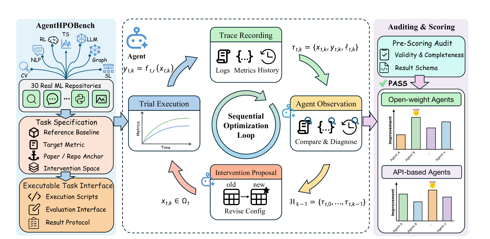

<h1 align="center">AgentHPOBench: A Benchmark For Evaluating LLM Agents as Sequential Hyperparameter Optimizers</h1>

<p align="center">
  <a href="https://arxiv.org/abs/2607.29626"></a>
</p>

<p align="center">
  
</p>

As LLMs evolve from code completion systems into autonomous scientific agents, evaluating their ability to conduct experiments has become increasingly important. Existing benchmarks typically focus on static code generation, paper replication, or final answer correctness, but do not directly assess whether agents can interpret experimental evidence and use it to guide subsequent hyperparameter decisions. To address this gap, we introduce AgentHPOBench, a sequential benchmark comprising 30 executable machine learning tasks across seven research categories. Each task begins with a validated baseline run, after which an agent performs several sequential interventions. At each step, the agent observes the accumulated configurations, metrics, and logs before proposing the next valid configuration. We evaluate 12 widely used agents and conventional HPO baselines under a unified protocol. The results show that current agents exhibit measurable experimental optimization ability across domains, but still face clear limitations in sustained iterative refinement, complex log diagnosis, and consistent progress toward reported reference performance.

## Benchmark Overview

AgentHPOBench evaluates whether an autonomous agent can improve executable machine learning experiments through sequential hyperparameter interventions. The benchmark contains 30 repository-level tasks spanning language, vision, time series, graph learning, reinforcement learning, generative modeling, and structured learning.

Each task provides:

- a validated baseline configuration;
- a target metric and paper or repository reference;
- a constrained intervention space derived from official repository resources;
- an execution adapter for a baseline run and five sequential interventions;
- complete configuration, metric, log, and decision provenance in the result JSON.

<p align="center">
  
  <br>
  <sub>AgentHPOBench task construction, sequential optimization protocol, and result auditing workflow.</sub>
</p>

## Benchmark Tasks and Upstream Repositories

Each benchmark task is derived from a real research repository and runs against an audited, commit-pinned source snapshot. The complete task-to-repository mapping is listed below; see [Task Repositories](docs/task-repositories.md) for provenance details, compatibility patches, and reproduction notes.

| # | Task | Upstream repository | Pinned revision |
|---:|---|---|---|
| 1 | `llm_c_fineweb10b` | [karpathy/llm.c](https://github.com/karpathy/llm.c) | `f1e2ace` |
| 2 | `torch_conv_kan_cifar10` | [IvanDrokin/torch-conv-kan](https://github.com/IvanDrokin/torch-conv-kan) | `7a0e83c` |
| 3 | `open_r1_math500` | [huggingface/open-r1](https://github.com/huggingface/open-r1) | `1416fa0` |
| 4 | `agent_lightning_room_selector` | [microsoft/agent-lightning](https://github.com/microsoft/agent-lightning) | `c746af2` |
| 5 | `uni2ts_lsf_etth1` | [SalesforceAIResearch/uni2ts](https://github.com/SalesforceAIResearch/uni2ts) | `7a4e77c` |
| 6 | `timesfm_etth1_long_horizon` | [google-research/timesfm](https://github.com/google-research/timesfm) | `d720daa` |
| 7 | `modernbert_mnli_accuracy` | [AnswerDotAI/ModernBERT](https://github.com/AnswerDotAI/ModernBERT) | `c6d9423` |
| 8 | `cifar10_airbench94` | [KellerJordan/cifar10-airbench](https://github.com/KellerJordan/cifar10-airbench) | `4c1b6d1` |
| 9 | `noisygl_cora_uniform30_gcn` | [eaglelab-zju/NoisyGL](https://github.com/eaglelab-zju/NoisyGL) | `b6ac057` |
| 10 | `tabmini_molecular_biology_promoters_auc` | [RicardoKnauer/TabMini](https://github.com/RicardoKnauer/TabMini) | `385961e` |
| 11 | `binary_diffusion_adult_rf` | [vkinakh/binary-diffusion-tabular](https://github.com/vkinakh/binary-diffusion-tabular) | `101825d` |
| 12 | `xlstm_parity` | [NX-AI/xlstm](https://github.com/NX-AI/xlstm) | `032a6fb` |
| 13 | `vbll_yacht_rmse` | [VectorInstitute/vbll](https://github.com/VectorInstitute/vbll) | `142f21e` |
| 14 | `tabm_california_rmse` | [yandex-research/tabm](https://github.com/yandex-research/tabm) | `28e47ae` |
| 15 | `timexer_pjm_168_24_mse` | [thuml/TimeXer](https://github.com/thuml/TimeXer) | `7601190` |
| 16 | `ablkit_hwf_reasoning_accuracy` | [AbductiveLearning/ABLkit](https://github.com/AbductiveLearning/ABLkit) | `46803a9` |
| 17 | `tunedgnn_cora_gcn_accuracy` | [LUOyk1999/tunedGNN](https://github.com/LUOyk1999/tunedGNN) | `23f9604` |
| 18 | `verl_grpo_gsm8k` | [volcengine/verl](https://github.com/volcengine/verl) | `59f53cc` |
| 19 | `forest_diffusion_iris_f1fake` | [SamsungSAILMontreal/ForestDiffusion](https://github.com/SamsungSAILMontreal/ForestDiffusion) | `818ac3b` |
| 20 | `var_imagenet256` | [FoundationVision/VAR](https://github.com/FoundationVision/VAR) | `78b9539` |
| 21 | `align_anything_ragen_bandit` | [PKU-Alignment/align-anything](https://github.com/PKU-Alignment/align-anything) | `3f9decc` |
| 22 | `chronos_t5_tiny_monash_weather_wql` | [amazon-science/chronos-forecasting](https://github.com/amazon-science/chronos-forecasting) | `3211108` |
| 23 | `hyperboliccv_cifar100_accuracy` | [kschwethelm/HyperbolicCV](https://github.com/kschwethelm/HyperbolicCV) | `fe1646d` |
| 24 | `itransformer_ettm2_96_mse` | [thuml/iTransformer](https://github.com/thuml/iTransformer) | `c2426e6` |
| 25 | `timemixer_ettm2_96_mse` | [kwuking/TimeMixer](https://github.com/kwuking/TimeMixer) | `e246105` |
| 26 | `art_2048_win_rate` | [OpenPipe/ART](https://github.com/OpenPipe/ART) | `4cbfa15` |
| 27 | `open_r1_multimodal_mathvista_accuracy` | [EvolvingLMMs-Lab/open-r1-multimodal](https://github.com/EvolvingLMMs-Lab/open-r1-multimodal) | `232b7ba` |
| 28 | `rankup_utkface_mae` | [pm25/semi-supervised-regression](https://github.com/pm25/semi-supervised-regression) | `7ed6d26` |
| 29 | `sparsetsf_ettm1_96_mse` | [lss-1138/SparseTSF](https://github.com/lss-1138/SparseTSF) | `b8c2740` |
| 30 | `simple_rl_reason_qwen25_05b_math500` | [hkust-nlp/simpleRL-reason](https://github.com/hkust-nlp/simpleRL-reason) | `cf1c785` |

Clone all upstream repositories at these revisions with:

```bash
python3 scripts/clone_repositories.py
```

The cloning utility verifies every existing checkout against its pinned commit
and expected compatibility patch. It stops on revision drift, unexpected
worktree changes, or a patch mismatch instead of silently reusing the directory.

## Repository Layout

```text
agenthpobench/                 Core agent, execution, and evaluation code
agenthpobench/agents/open_weight/  Model-family-neutral local Transformers agent
tasks/main/                    Main 30-task sequential intervention protocol
tasks/ablations/no_feedback/   No-intermediate-feedback task overlay
baselines/tpe/                 TPE and Random Search task adapters
baselines/bohb/                BOHB-style task adapters
runners/                       Multiseed and ablation launchers
analysis/                      Result validation and leaderboard generation
configs/                       Task, repository, and model manifests
results/summary/               Locally generated aggregate outputs
scripts/                       Setup and release validation utilities
```

Third-party repositories, datasets, model weights, checkpoints, credentials, and runtime logs are intentionally excluded from Git.

## Quick Start

Create a base environment and install AgentHPOBench:

```bash
git clone https://github.com/OpenMOSS/AgentHPOBench.git
cd AgentHPOBench
python3 -m venv .venv
source .venv/bin/activate
pip install -e ".[local,analysis,dev]"
```

Clone the upstream task repositories:

```bash
python3 scripts/clone_repositories.py
```

Run the release and task-definition checks:

```bash
make check
make test
```

The full benchmark is compute intensive and several tasks require their upstream repository's own environment, data license, or checkpoint. See [docs/setup.md](docs/setup.md) and [docs/task-repositories.md](docs/task-repositories.md) before executing tasks.

## Running Agents

All local open-weight checkpoints use the model-family-neutral
`LocalTransformersAgent`; separate model-specific agent files are intentionally
unnecessary. The runners select each checkpoint, generation limit, and
chat-template behavior. The former `open_source.qwen_agent.QwenAgent` path
remains only as a compatibility alias.

The runners accept a replicate seed and GPU index. They reject fallback decisions by default and preserve one result JSON per task.

```bash
# Qwen3-32B, seed 1, GPU 0
bash runners/qwen32/run_qwen32_seed.sh 1 0

# Open-weight model, seed 42, GPU 1
bash runners/open_weight/run_model_seed.sh llama3_1_8b 42 1

# No-intermediate-feedback ablation
bash runners/no_feedback/run_qwen32_no_feedback_seed.sh 1 0

# Conventional HPO baselines: Random Search, TPE, and BOHB
bash runners/hpo/run_hpo_seed_queue.sh 1 0

# Run one baseline phase directly
bash runners/hpo/run_hpo_seed_phase.sh random 0 0 nonray
```

Use `AUTOREP_DRY_RUN=1` to validate task and model paths without launching experiments:

```bash
AUTOREP_DRY_RUN=1 bash runners/qwen32/run_qwen32_seed.sh 1 0
```

Model paths, task overlays, result roots, and selected task subsets can be overridden through environment variables documented in [docs/setup.md](docs/setup.md).

The `AUTOREP_*` variable prefix is retained as a compatibility interface for
the scripts used in the reported experiments. It does not refer to a separate
dependency or repository.

## Result Integrity

AgentHPOBench records the raw model response and decision metadata. A valid local-model result must have:

- five completed interventions;
- `fallback_decision_count == 0`;
- nonempty raw responses attributed to the configured model;
- no task-level execution error.

Validate a completed result directory with:

```bash
python3 analysis/validate_results.py \
  results/qwen32_multiseed/qwen3_32b_seed1_final30 \
  --expected-seed 1 \
  --expected-model qwen3_32b
```

Strict validation requires an exact baseline-plus-five trace, exactly five
decisions and nonempty raw responses, a final metric, zero fallback markers,
no model or task error artifact, and the requested seed and model provenance.

## Reproducing the Paper

The paper uses the limited-budget protocol with one baseline run and five intervention opportunities. Open-weight model and conventional HPO results are aggregated across seeds `0`, `1`, and `42`; API-agent results use the protocol described in the paper. The no-feedback ablation withholds all post-baseline metrics and logs from each decision.

Aggregation scripts write tables and plotting inputs under `results/summary/`.
Generated summaries and raw run directories are not committed because they
contain derived outputs, large checkpoints, and duplicated upstream artifacts.
After placing raw result directories under a common root, audit all three seeds
and regenerate the compact summaries with:

```bash
python3 analysis/summarize_multiseed.py \
  --raw-results-root results/raw \
  --strict
```

The paper aggregation always checks the exact sequential protocol, fallback
markers, task errors, and task-specific final metric. When complete per-run
response artifacts are retained, add `--require-local-artifacts` to also
require five raw model responses, explicit seed metadata, and configured model
provenance for every open-weight result.

The run-to-seed provenance is recorded in `configs/multiseed_runs.json`;
`configs/scoring_reference.tsv` records metric directions, baselines, and
anchors used by the normalized score.

## Citation

To cite the paper:

```bibtex
@article{huai2026agenthpobench,
  author    = {Tianyu Huai and Tingshuo Fan and Xinchi Chen and Yining Zheng and Yuxin Wang and Shuang Chen and Jie Zhou and Xuanjing Huang},
  title     = {AgentHPOBench: A Benchmark for Evaluating LLM Agents as Sequential Hyperparameter Optimizers},
  journal   = {arXiv preprint arXiv:2607.29626},
  year      = {2026},
  url       = {https://arxiv.org/abs/2607.29626}
}
```

## Third-Party Components

The task manifests refer to external repositories with their own licenses and usage terms. AgentHPOBench does not redistribute those repositories, restricted datasets, or model weights. Review each upstream license before use.

## Contributing

`CONTRIBUTING.md` describes the validation and provenance requirements for
issues and pull requests. See the [contribution guide](CONTRIBUTING.md) before
adding tasks or changing runners, parsers, scoring, or result schemas.

## License

AgentHPOBench is released under the [Apache License 2.0](LICENSE).
