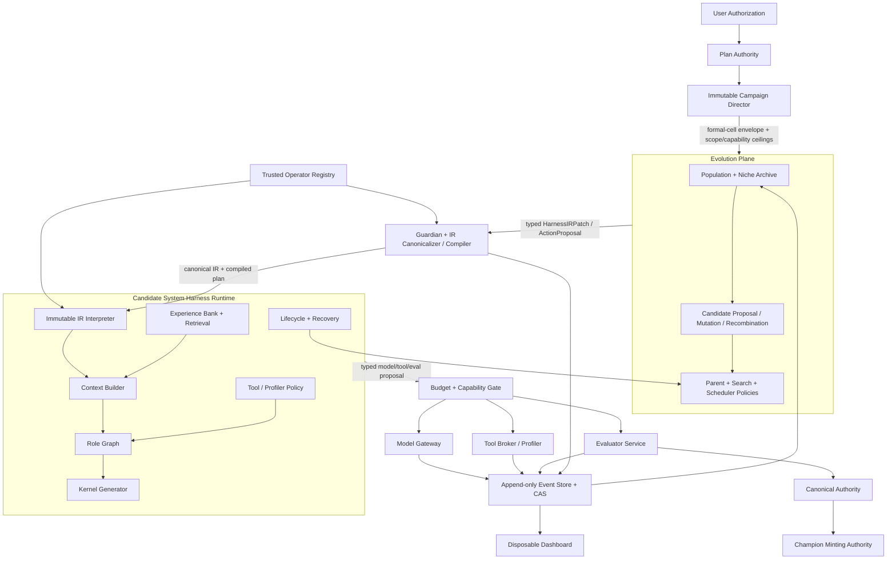
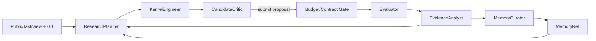

# KernelBench 系统级 Harness 自进化（SHE-1）

> 日期：2026-08-02  
> 状态：**设计草案，等待设计批准；未获得实现批准或正式运行批准**  
> 范围：固定 KernelBench commit、固定两道 benchmark instance、固定 A100 GPU4  
> 建议正式产物根：
> `/home/ubuntu/Projects/Moss/results/optimization_lab/kernelbench-system-harness-v1`

## 0. 决策摘要

本方案建立一个独立 campaign：**SHE-1（System Harness Evolution 1）**。它不是 P2b 扩轮，
也不是 P3。P3 继续保留为日后独立环境复测阶段；SHE-1 结束后只能冻结和报告，不能自动进入
P3。

SHE-1 把完整研究控制系统作为可版本化的基因型，包括 context builder、role graph、
Experience Bank record view/index/retrieval policy、proposal/mutation/recombination、parent selection、
tool/profiler policy、inner search、scheduler、recovery、candidate lifecycle、feedback
compression、stop/restart 和 Kernel generator prompt。SHE-1 v1 的每个后代是内容寻址的
`CanonicalHarnessIR`：它保存严格声明式 IR、惰性 Prompt/Skill 资产、带哈希的可信算子引用、
有界配置、组件来源和内容哈希，再由冻结解释器编译为执行计划。它不再是一份 Markdown，
也不允许模型携带 Python、shell、二进制、entrypoint 或运行时依赖。

但“系统级”不等于“所有东西都能改”。每个可进化组件只能提交 typed proposal；以下外部
Authority 永不进入基因型：

- Task/benchmark、公开可见性合同与冻结 source snapshot；
- scorer、correctness、timing、canonical 和 champion minting；
- GPU/软件环境、总预算和 capability ACL；
- append-only ledger、内容哈希验证、状态合法性 reducer；
- Reviewer 的接受合同和三重授权门。

主实验不从 reference 冷启动，而从 P1/P2/P2b 完成后冻结的本题 source incumbent 起步。Gate C
下先对其独立校准，以三次正式复测的 median 定义共同前沿 `G0`。所有实验臂得到同一个
`G0`、相同公开 TaskContract、相同模型和总成本上限。
这样直接回答当前最重要的问题：**当 Prompt-only 搜索已处于局部平台时，扩大到系统级基因型
是否能以更高样本效率得到可信新前沿？**

正式结论按 Task 分开：

- LayerNorm 的结果只支持该固定 instance；
- Matmul+Sigmoid+Sum 的结果只支持该固定 instance；
- 两题都改善才可称“两道固定 KernelBench instance 上重复成立”；
- 本阶段不产生跨 Task 泛化主张。

### 0.1 前置 benchmark 选择（SHE-1 不重新选题）

首发 benchmark 的完整调研、田渊栋相关线索和换题记录见
[`2026-07-31-instance-conditioned-ai-for-ai-benchmark-plan.md`](2026-07-31-instance-conditioned-ai-for-ai-benchmark-plan.md)
第 2、2.1 和 3.4 节。该调研比较了 KernelBench、Atrex、KernelBenchX、CompilerGym、PIE、
EffiBench、SWE-Perf、MLAgentBench、MLE-bench、ResearchGym 与 RE-Bench。SHE-1 选择
KernelBench，是因为它同时具备本地即时的 compile → correctness → speed 稠密反馈、固定实例
专化空间和 AI 生成 GPU Kernel 的直接相关性；田渊栋参与的 CompilerGym 提供了“反馈环境可驱动
优化策略学习”的重要启发，但其仓库已归档、环境和 LLVM 栈较旧，故不作为首发执行底座。Atrex
保留为后续第二阶段候选，本方案不自动进入。

P0 曾按预登记机械门禁在任何模型调用前淘汰会被全零退化解通过的
`level2/9_Matmul_Subtract_Multiply_ReLU.py`，并改用
`level2/56_Matmul_Sigmoid_Sum.py`。因此 SHE-1 固定
`level1/40_LayerNorm.py` 与 `level2/56_Matmul_Sigmoid_Sum.py`，不事后挑题，也不从两题外推
通用性。

## 1. 术语、对象和研究主张

### 1.1 统一术语

| 术语 | 本方案定义 |
|---|---|
| Task | 上游能力范围；这里是“为固定形状和语义生成正确且更快的 GPU Kernel” |
| Benchmark | 从 Task 抽取的有限测量集合；这里是固定 KernelBench commit |
| Benchmark instance | `level1/40_LayerNorm.py` 或 `level2/56_Matmul_Sigmoid_Sum.py` |
| System Harness | 管理一次完整搜索 campaign 的可执行控制系统 |
| Genotype | Bundle 中可遗传、变异和重组的声明式图、可信算子绑定、有界配置和 Prompt/Skill 资产 |
| Phenotype | Genotype 在固定 Runtime、TaskContract、工具能力和预算下的实际行为 |
| Harness child | 一个新的、内容寻址的 System Harness Bundle |
| Kernel child | 某个 Harness 运行时生成的 `ModelNew` 候选 |
| Authority | 校验或执行 proposal 的不可变外部控制面 |
| Canonical | 唯一能产生正式确认结果和晋升事实的独立裁决服务；search 评分不铸造冠军 |
| Campaign seed | 控制初始队列、tie-break、运行顺序和可支持模型随机性的复现实验 ID |
| TrustedOperatorRegistry | 由 plan 哈希冻结的算子实现、typed I/O、配置 Schema、能力类别和成本上界清单 |

确认性对象采用以下单义本体，后文不得把 search leader 简称为 champion：

```text
SearchEvaluation
  -> SearchFrontierCandidate             # 仅搜索期 leader，绝不 mint
  -> ProspectiveEligibleHarness          # 冻结 checkpoint，可进入前瞻确认
  -> ProspectiveHarnessEvaluation         # 新 seed、空 RUN_LOCAL 的算法复现
  -> KernelSelected                       # 按冻结 tie-break 选定不可变源码
  -> KernelArtifactRetest                 # 入选源码的 3 次 fresh retest
  -> ConfirmedKernelArtifact              # 仅表示 3/3 正确及其 median，不叫 champion
  -> CanonicalHarnessResult               # 绑定 prospective curve + retest set
  -> ChampionDecision
       -> SystemHarnessChampionToken / KernelChampionToken
```

两个 token 都必须带 campaign/Task/arm scope；前者评价冻结 checkpoint 作为搜索算法的整条成本
曲线，后者只评价某个不可变 Kernel 源码。`G_raw`、`G_credible`、search winner 或 dashboard 上的
best-so-far 都只是 frontier/leader，不能触发 champion minting。

Agent 运行体仍可表示为：

```text
Agent runtime = Model + System Harness + Tools + State + Environment
```

SHE-1 只在冻结的系统设计语言和 `TrustedOperatorRegistry` 内进化 System Harness；模型、解释器、
算子实现、评分环境和 Authority 固定。因此本阶段可以检验系统策略搜索，但不能声称模型发现了
新的控制代码。

### 1.2 预注册研究问题

**RQ1（主问题）**：在相同总模型调用、Token、GPU 秒和共同前沿 `G0` 下，system-level
Harness 是否比 prompt-only Harness 得到更高的 correctness-qualified best-score AUC？

**RQ2（机制问题）**：提升是否来自非 Prompt 组件，而不是 Kernel prompt 换一种写法？

**RQ3（搜索问题）**：组件级重组和 Experience Bank 是否比单父变异更有效地跨越平台？

**RQ4（可靠性问题）**：提升能否在独立 campaign seed 和 canonical 复测中保持，并且没有
正确率、成本或 reward-hacking 退化？

SHE-1 的确认性 estimand 是**净系统效率**：planner、IR evolution、repair、失败以及它们减少的
Kernel generation opportunity 都进入同一个总调用/Token/GPU 成本口径。四臂差异不得解释为
“固定 Kernel 数下 planner/scheduler 的纯决策质量”；后者需要另行预注册 sham-planner 对照。

### 1.3 允许和不允许的主张

| 结果 | 允许的表述 | 不允许的表述 |
|---|---|---|
| 单题单 seed 提升 | 发现一个数值更高的候选 | Harness 已可靠进化 |
| 单题多 seed canonical 通过 | 在该固定 instance 上可复现提升 | 跨 KernelBench Task 泛化 |
| 两题分别通过 | 系统级方法在两个固定 instance 上重复有效 | 通用 GPU 优化 Harness |
| 只提高 raw max | 产生一个更高数值点 | 样本效率或稳健性更好 |
| AUC、正确率和 canonical 均通过 | 在冻结预算下搜索效率更高 | 模型能力本身提高 |
| 固定 `C0` 与进化臂的等总成本差异 | 端到端系统资源效率不同 | 固定 Kernel 数下纯决策质量更好 |

## 2. 当前边界与目标边界

### 2.1 Prompt-level 与 system-level 对照

| 维度 | P1 | P2 | P2b | SHE-1 目标 |
|---|---|---|---|---|
| Kernel prompt | 固定 | 随 Markdown Harness 改 | 随结构化 policy 改 | 可进化组件之一 |
| Context builder | 固定拼装 | 固定拼装 | 固定代码解释 JSON | 声明式图可变、可信算子执行 |
| Role/通信图 | 无/固定 | 无/固定 | 固定单链 | 可变 DAG + typed contract |
| Experience Bank | lane 顺序历史 | lane 顺序历史 | 固定 memory view | record view、索引与 registry retrieval 可变 |
| Parent selector | 当前/历史最好固定规则 | 当前版本 | 冻结候选集合内固定代码 | 可提议多父选择 |
| Mutation/recombination | 只生成 Kernel | 文本重写 | policy 声明结构变化 | 组件 patch、联合 mutation、重组 |
| Tool/profiler policy | 固定 | 固定 | 字段可选，调用器固定 | 策略可变，ToolBroker 权限固定 |
| Scheduler/预算分配 | 固定 lane/轮次 | 固定 8 轮 | 固定 8 lane × 8 轮 | 可提议动作和 tranche，硬帽外置 |
| Failure recovery | 固定 runner 分支 | 固定 | 固定状态机 | recovery policy 可变，合法转移外置 |
| Archive/lineage | Kernel/Harness 分散 | 单父 Harness | policy/Kernel 单父 | Bundle/组件/Kernel 三层谱系 |
| 晋升 | 历史最好 | 历史最好 | 历史最好 | 独立 canonical + ChampionAuthority |

### 2.2 已有证据及其解释边界

只读重放
`/home/ubuntu/Projects/Moss/results/optimization_lab/kernelbench-pilot/ledger.jsonl`
可确认（本次审计时 548 行，SHA-256
`2b1048012857c50a487830da5c380a04c7d19954996dc7538b70ef7686c120c0`）：

- P1 共 22 个 Kernel 候选，17 个正确；LayerNorm 的固定
  `equal_budget_general` 在第三个候选达到
  `19.858299595141702×`；
- P2 共 47 个评分候选、45 个正确；LayerNorm 最强谱系的八轮为
  `5.163→19.738→19.659→19.738→19.778→19.778→19.699→19.818×`；
- Matmul+Sigmoid+Sum 从 P1 约 `1.006×` 提高到 P2 最好
  `4.102564102564103×`；
- P2 的一个八轮 lineage 通常消耗 8 次 Kernel 调用和 7 次 Harness 调用，而 P1 固定 Harness
  的八轮只消耗 8 次 Kernel 调用。因此旧结果不能作为“同总调用成本下 P2 更优/更差”的正式
  比较。

P2b 已写入 `p2b-phase:completed`，但这只表示旧 runner 报告八条路线均已停止，不自动等于可供
下游消费的冻结快照。SHE-1 不把中途状态或单个 phase event 直接当新 campaign 输入；prepare
只有在 P2b writer 退出、完成事实可审计、双锁可取得、源哈希稳定且全部 started/reserved 成本
可保守重放后才能冻结 source snapshot。`runner.pid`、
`state.json`、dashboard 或单个 `p2b_lane_completed` 都不是冻结证明；旧全局 GPU 检查也不能替代
逐 lane 硬帽重放、Task subtotal 报告和 global 硬帽复算。

这些事实支持扩大搜索空间，但不预先保证系统级进化一定超过 `G0`。LayerNorm 的强 P1 起点
很可能来自模型能力、简单任务结构和少量即时反馈共同形成的高平台；SHE-1 必须用等成本、
多 seed 和独立 canonical 区分系统贡献与偶然命中。

### 2.3 公开看题不是隐藏泄漏

本研究有意做 instance-conditioned optimization。Agent 可以看到公开题目、允许的 reference
和公开反馈；这必须出现在 TaskContract，而不是隐式“偷偷看题”。

为保留清晰起点，SHE-1 的 root Bundle `H0` 采用以下规则：

1. `H0` 的 canonical IR、默认算子绑定和 Prompt/Skill 资产在两题间逐字节相同；
2. prepare 只增加一个带哈希的 `task_binding.json`，不让模型根据题目临时生成 `H0`；
3. 运行时通过只读 Context API 注入公开 TaskContract；
4. `H0` 后代可以根据本题公开反馈专化，manifest 必须记录使用过的 visibility class 和事件 ID；
5. 任何结果都只称 instance specialization；若未来研究 task-blind/跨 Task 泛化，另建 campaign。

## 3. 总体架构与分权

### 3.1 五个平面



### 3.2 Proposal/authority 分离

| 可进化组件可以提出 | 不可变 Authority 决定 |
|---|---|
| 看哪些公开历史 | VisibilityGuard 是否允许返回 |
| 调哪个工具、何时 profile | ToolBroker 是否授权和执行 |
| 从机械合法全集选择哪些父代 | Guardian 校验 Task/arm/seed/snapshot scope；Director 不代选父代 |
| 消耗多少预算 | BudgetGate 是否有完整预留 |
| 如何从失败恢复 | LifecycleAuthority 是否允许该状态转移 |
| 哪个 Kernel 更好 | Evaluator 产生事实；Harness 只能读取公开摘要 |
| 哪个 Bundle 应晋级 | Canonical 与 ChampionAuthority 机械裁决 |
| 修改哪些 IR 节点/绑定 | IR Compiler、Reviewer 和 contract tests 是否接受 |

这条分离是系统级可变性的安全基础。Scheduler、parent selector 和 lifecycle **确实属于基因型**，
但它们输出 proposal；它们不能直接扣账、执行或给自己铸造冠军。Genotype 也不能实现这些算子：
它只能在 plan 冻结的 registry 内选择、组合并配置它们。

逐字段决策权冻结如下；Authority 对合法 proposal 只能**原样批准或拒绝**，不能改成它认为更优的
父代、动作或 tranche：

| 决策字段 | 提议/决定者 | 不可变 Authority 的唯一权限 |
|---|---|---|
| `eligible_parent_ids` | Population reducer：上一 sealed snapshot 内同 Task/arm/seed 的全部合法 Bundle | 重算集合与 digest；不做 niche pruning |
| 实际 parent IDs 与 mutation/recombination/reset | Genotype ParentSelector/Reproduction policy | 校验集合成员、数量、顺序、mask 和 sealed 状态 |
| `operator_owner_bundle_id` | Action provenance reducer 从当前 active Bundle 派生；Genotype 不可选择 | 强制等于该 reproduction action 的 decision/execution Bundle |
| action class/mix/order、目标 Bundle、请求成本、stop/restart | Genotype InnerSearch/Scheduler/Lifecycle | 校验 grammar、状态、capability 与完整预算预留 |
| cell horizon、epoch width、formal 顺序、并发和硬帽 | PlanAuthority/CampaignDirector | 按冻结合同执行；Genotype 不可提议修改 |
| niche/novelty descriptor | 机械 extractor | 只作 ParentSelector 输入与报告；不得进入外部 tie-break、pruning 或 quota |
| score、fitness、frontier 与 ChampionToken | Evaluator/Fitness/Canonical/Champion Authority | 机械计算；Genotype 无写权限 |

Director 只管理实验 envelope 和公平 barrier，不做 scientific parent ranking、top-k、niche quota、
动作混合或早停。ParentSelector/Scheduler 的好坏必须由同一 envelope 下的整条成本曲线体现。

### 3.3 独立命名空间

- phase：`SHE1`；
- plan：`system_harness_plan.json`；
- unified contract：`experiment_contract.json`；
- seed/registry：`seed_manifest.json`、`operator_registry.json`、`skill_registry.json`；
- source snapshot：`source_snapshot.json`；
- ledger：新产物根下独立 `ledger.jsonl`；
- Bundle：`she1-<task>-h-<sha12>`；
- Kernel：`she1-<task>-k-<sha12>`；
- run：`she1-<task>-<arm>-s<seed>-r<nn>`；
- P1/P2/P2b 产物只读，绝不追加 SHE-1 事件。

### 3.4 统一合同和一等制品

`ExperimentContract` 是内容寻址的 phase root，统一绑定此前分散在 TaskSpec、protocol、plan 和
授权中的不可变量：task/KernelBench/source hash、scorer bundle 与容器/依赖/GPU/software、
shape/dtype/precision/tolerance/trial/cache/order、public/private exposure、model/provider、工具
capability、registry/interpreter、全部层级预算、formal arm/seed schedule、所需授权级别和
`no_next_phase=true`。实际 `PhaseAuthorization` 单向绑定 contract hash 与 authorization ID，
合同不反向包含签名授权，避免自引用。correctness 私有输入/RNG schedule 保留在 evaluator 权限域，
合同只绑定其 digest。

SHE-1 合同还必须显式绑定 `evaluator_protocol_sha256`、`candidate_invocation_abi_sha256`、101→100
discard/mean/speedup 公式、paired order/L2/warmup policy、canary manifest、message Schema manifest、
OS sandbox manifest 与 checkpoint verifier/anchor manifest；这些不能仅藏在实现默认值中。

`SeedManifest` 把 Harness seed、模型/runner campaign seed、scheduler tie-break seed 和 evaluator
RNG schedule digest 分成不同字段/命名空间；不得把当前 incumbent 改名成 seed，也不得向 Harness
暴露 evaluator 私有 seed。下列对象均为独立、不可覆盖、带父/合同 hash 的 CAS artifact，而不是
dashboard 中的临时字段：

- `HarnessIRProposal`：父 Harness/Kernel 指针、observed fact event refs、hypothesis、IR diff、
  预期 observable、预算/工具请求、回滚点和 proposer provenance；任何修订产生新 proposal ID；
- `ReviewDecision`：mechanical Reviewer 的 `approve/reject + reason_code + evidence_refs`；Reviewer
  不改 proposal，也不生成替代内容；
- `CanonicalHarnessIR` / `CompiledHarnessPlan`：确定性 canonicalizer/compiler 的唯一结果；
- `KernelAttempt`：一次 finalizer 只封存一个完整 `ModelNew`，但同一 Harness phenotype 可在固定
  tranche 内产生多个 attempt，系统 fitness 仍按完整成本轨迹计算；
- `EvaluationEnvelope`：trusted supervisor 产生、nonce/hash-bound 的 correctness/timing 事实；
- `AllocationSnapshot`：Director 在冻结 decision epoch 上批准的下一小段预算，scheduler 只能
  proposal，不能原地改 allocation。

## 4. Genotype、Phenotype 与 Bundle 数据模型

### 4.1 Bundle 目录

```text
bundles/<bundle_id>/
  manifest.json
  provenance.json
  harness_ir.json
  compiled_plan.json
  prompts/
    kernel_generator.md
    role_prompts/*.md
    policy_payload.json
  skills/
    bindings.json
  self_tests/
    contract_cases.json
```

不是每个 Bundle 必须把相同文件重复复制。物理存储使用 content-addressed store（CAS），目录中的
资产是不可变 digest 引用；上面的树是逻辑视图。Bundle 不得包含 `.py`、shell、二进制、wheel、
自定义 entrypoint、依赖文件或可替换 root Schema。`compiled_plan.json` 是 immutable compiler
从 `harness_ir.json` 和冻结 registry 机械派生的产物，不能由 proposer 直接提交。
`harness_ir.json` 是唯一 semantic input：graph、operator binding/config、visibility/capability
请求以及 Prompt/Skill CAS ref 全部内嵌其中。manifest 的 `components[]` 和下列 graph/request hash
只是 compiler-derived projection；它们发生冲突时不是选择优先级，而是整个 Bundle 无效。

### 4.2 `SystemHarnessManifest`

`manifest.json` 分成不自引用的 payload 与派生 identity envelope。下表字段属于 payload，或明确
标注为派生字段；不能把最终 `manifest.json` 自身、签名、时间戳或任何已经含 child ID 的 projection
再放回 digest preimage：

| 所属层 | 字段 | 含义 |
|---|---|---|
| semantic | `schema_version` / `runtime_abi` | IR 解析和解释 ABI，启动后冻结 |
| derived | `semantic_sha256` | canonical IR、无派生 identity 的 compiled plan、semantic asset refs 与 contract/registry hash 的摘要 |
| semantic | `task_scope` | `instance:kernelbench_layernorm` 等，不得模糊成通用 |
| lineage | `parents[]` | 0–2 个 Bundle parent；顺序和角色冻结 |
| semantic | `components[]` | compiler-derived 的 IR node、typed interface、operator ref、bounded config、capabilities 摘要 |
| semantic | `artifact_refs{}` | 每个 semantic Bundle-owned regular file 的规范逻辑路径→digest；排除最终 manifest/identity/signature 及含 child ID 的 projection |
| lineage | `component_provenance[]` | 每组件来源 parent、mutation operator、patch digest；payload 内不含派生 child ID |
| semantic | `component_graph_sha256` | 从唯一 IR 机械投影的运行时依赖 DAG |
| semantic | `canonical_ir_sha256` / `compiled_plan_sha256` | 规范 IR 与确定性编译结果 |
| semantic | `operator_registry_sha256` / `skill_registry_sha256` | 冻结算子实现及 Skill slot/renderer/schema 清单；所有 arm/Task/seed 相同 |
| semantic | `visibility_request_sha256` / `capability_request_sha256` | 从唯一 IR 投影、在外部 ceiling 内请求的输入和工具子集 |
| semantic | `runtime_contract_sha256` / `compiler_manifest_sha256` | 外部解释器、编译器、依赖锁和镜像合同；只绑定、不可修改 |
| semantic | `experiment_contract_sha256` / `seed_manifest_sha256` / `task_contract_sha256` | 统一 phase root、分离 seed 命名空间与公开任务合同 |
| semantic | `source_snapshot_sha256` | 只读历史输入 |
| lineage | `proposal_sha256` / `review_decision_sha256` / `arm_mask_sha256` | 实际获批 proposal、独立 typed decision 和允许变异面 |
| lineage | `builder/reviewer_policy_sha256` | 谁构建和审查该 lineage edge |
| identity | `bundle_id` / `bundle_sha256` | 从下述 payload 派生；不进入自身 preimage |
| audit | `proposal_attempt_id` / `created_by_event_id` | 运行审计 envelope；Bundle digest 得出后绑定，不参与 semantic/lineage identity |

规范身份按四层机械派生：

```text
semantic_payload = canonical IR
                 + compiled plan without any derived semantic/Bundle identity
                 + semantic asset refs
                 + contract/registry/schema hashes
semantic_sha256 = sha256("SHE1-SEMANTIC-v1" || canonical_json(semantic_payload))

lineage_payload = semantic_sha256
                + ordered parent IDs
                + component provenance without child ID
                + proposal/review/mask hashes
bundle_sha256 = sha256("SHE1-BUNDLE-v1" || canonical_json(lineage_payload))
identity_envelope = {bundle_id: "she1-...-h-" + bundle_sha256[:12], bundle_sha256}
manifest_object_sha256 = sha256(final manifest bytes)  # external CAS key, not a manifest field
```

canonical JSON 使用 UTF-8、排序 key 和确定性数值编码。`manifest.json`、identity/signature/audit
envelope、`proposal_attempt_id`、`created_by_event_id` 以及任何含派生 child ID 的
`ComponentInheritanceMap` projection 不进入
`artifact_refs` 或上述 preimage；审计事件只能在 Bundle digest 得出后追加。Compiler 输出也不得
反向嵌入 `semantic_sha256`、最终 Bundle ID 或 lineage digest。逻辑目录只允许“`artifact_refs` 的 semantic 闭包 + 固定 Schema 列出的
`manifest.json`/`provenance.json` identity projection”；后两者由 Verifier 重算且各自以外部 CAS key
寻址，不能夹带新语义。Verifier 从 semantic/lineage payload 重算身份，并拒绝该精确并集之外的
额外文件、symlink、device、路径穿越和 digest 不符。任何 semantic 或 lineage 字节
变化都产生新 Bundle ID；相同 `semantic_sha256` 但不同 lineage 允许有不同 Bundle ID，已有 ID
永远不得重绑。

### 4.3 IR 节点与可信算子

| IR 节点类型 | 示例 | Genotype 可改变 | 固定解释语义 |
|---|---|---|---|
| Graph | role、hop、branch、reduce/finalize DAG | 节点选择、连接和有界 fan-out | immutable interpreter |
| Operator binding | context、retrieval、selector、scheduler | registry 内的 operator ID、组合和有界 config | `TrustedOperatorRegistry` 中的 hash-pinned implementation |
| Template/Skill | Kernel/role Prompt、任务内 Skill | 文本资产、选择和路由 | 固定 renderer、SkillRegistry 与长度上限 |
| Memory policy | record view、index、ranking、top-k | registry 算子与有界 query config | visibility-first resolver |
| State policy | recovery/lifecycle/stop | 合法规则 DSL 或注册算子 | Authority 校验后执行 |

每个 registry 条目固定 `operator_id/version/implementation_digest`、typed input/output、config
Schema、能力类别、成本上界、最大 step/fan-out 和副作用类别。Genotype 只能引用这些条目，不能
覆盖实现或 Schema。未知字段、未知算子、digest 漂移、歧义配置、无界循环或未实现语义全部
fail closed；任何 IR 字段都必须在 fake trace 中产生可观察行为，不能静默退化为提示词标签。
`SkillRegistry` 只冻结 slot type、renderer、输入/输出约束和长度/安全规则，不枚举可变 Skill 文本
本身；Bundle-owned Skill 文本是普通惰性 `P` 资产，其 CAS hash 进入 Bundle。Skill 的选择/路由
仍是 `S`，renderer 与 slot 语义属于 `R`。
`self_tests/` 只供归档和开发诊断，不能替代 Reviewer 持有的外部 IR/registry conformance suite。

### 4.4 Phenotype 记录

同一 genotype 在不同 seed、历史或预算下可能产生不同 phenotype。每次 run 必须单独保存：

- resolved component graph 和实际 capability grants；
- 每次 ContextPacket 的输入事件 ID、visibility labels 和 digest；
- role/hop DAG、model call、tool call 和 decision；
- Experience Bank 的新增记录与 query result ID；
- Bundle/Kernel 两套谱系；
- 每一步 used/reserved/settled budget；
- 精确 score curve、candidate-only curve 和 best-so-far curve。

Genotype hash 不包含这些运行状态；`run_manifest.json` 绑定 genotype、plan、task、seed、环境和
初始 `G0`。

## 5. IR 算子协议与可变边界

### 5.1 统一 typed messages

下列 Python 风格签名先描述 `TrustedOperatorRegistry` 中**纯计算或 proposal-only** 的 typed
协议，不表示 genotype 可以提交或执行 Python。IR 节点只能通过 JSON-compatible typed messages
连接这些算子，也不会获得 Authority 对象：

```python
ContextBuilder.build(
    operation: OperationSpec,
    task: PublicTaskView,
    evidence: PublicEvidenceView,
    memory_refs: tuple[MemoryRef, ...],
) -> ContextPacket

RoleGraph.plan(context: ContextPacket, budget: PublicBudgetView) -> ExecutionDAG
ExperienceRetriever.query(query: MemoryQuery, allowed_scope: ScopeGrant) -> tuple[MemoryRef, ...]
ParentSelector.propose(snapshot: PopulationSnapshot) -> ParentSetProposal
ProposalOperator.propose(parents: tuple[BundleView, ...], evidence: PublicEvidenceView) -> HarnessIRPatch
Recombiner.propose(parents: tuple[BundleView, ...], conflict_set: ConflictSet) -> HarnessIRPatch
InnerSearchPolicy.next(state: PublicSearchState) -> ActionProposal
Scheduler.propose(snapshot: DecisionSnapshot, budget: PublicBudgetView) -> AllocationProposal
ToolPolicy.propose(state: PublicSearchState, capabilities: PublicCapabilities) -> ToolRequest
ProfilerInterpreter.interpret(profile: PublicProfileSummary) -> ProfilerInterpretation
RecoveryPolicy.propose(failure: PublicFailureFact) -> RecoveryProposal
LifecyclePolicy.propose(state: CandidateState, event: PublicEvent) -> LifecycleProposal
StopRestartPolicy.propose(state: PublicSearchState) -> StopRestartProposal
FeedbackCompressor.render(events: tuple[PublicEvent, ...], operation: OperationSpec) -> ContextPacket
CandidateCritic.review(draft: CandidateDraft, task: PublicTaskView) -> CandidateCritique
KernelRequestRenderer.render(context: ContextPacket, intent: ActionIntent) -> ModelInvocation
CandidateFinalizer.finalize(result: ModelResult, opportunity: KernelOpportunityRef) -> FinalCandidate
MemoryCurator.propose(record: ExperienceRecordProposal) -> MemoryAppendProposal
```

以下是 `CapabilityBroker/BudgetGate` 在 proposal 通过全部 gate 后才能 dispatch 的外部 service
ABI；它们不在 registry，不暴露给 Genotype，controller 也不持有或转发完整 `CapabilityGrant`：

```python
CapabilityBroker.request(request: CapabilityRequest) -> OperationRef
ModelGateway.handle(call: AuthenticatedServiceCall[ModelInvocation]) -> ModelResult
ToolBroker.handle(call: AuthenticatedServiceCall[ToolRequest]) -> ToolResult
ExperienceBankAuthority.handle(call: AuthenticatedServiceCall[MemoryAppendProposal]) -> MemoryRef
EvaluatorService.handle(call: AuthenticatedServiceCall[FinalCandidateRef]) -> EvaluationEnvelope
```

controller 只能提交 `CapabilityRequest` 并取得 opaque `OperationRef`；完整 grant 始终留在 Broker
的私有状态中。Broker 是唯一 grant issuer、holder、consumer 和 dispatcher：它在唯一
`operation_started` 已耐久化后，通过目标 service 的单方法 socket 发送绑定该 operation 的
`AuthenticatedServiceCall`。service 只接受经 OS peer credential 验证的 Broker 连接，并逐项核对
operation ref、service/method、输入 hash、scope 与 nonce；它不接受 controller、IR runtime 或
artifact 自带的 grant/handle。结果仍经 Broker 关联回同一 `OperationRef`，因此 retry 只能走新的
request/attempt/grant 和唯一的 consume 路径。

这些名字不是松散 DTO。Gate B 必须冻结 `message_schema_manifest_sha256`；每个消息都有共同
envelope：`schema_version`、contract/run/action/attempt/producer/snapshot hash、provenance refs、
idempotency key，以及 bytes、records、nodes、edges、hop 的明确上限。root manifest 至少覆盖
`SearchHypothesis`、`ActionIntent`、`CandidateDraft`、`CandidateCritique{submit|discard|revise}`、
`EvidenceNote`、`ExperienceRecordProposal`、`ProfilerInterpretation`、`StopRestartProposal`、
`ModelInvocation`、`ModelResult`、`FinalCandidate` 和下文 `ReproductionInvocation`。v1 不支持运行期
Schema migration；未知版本、字段、输出类型或没有实现语义的字段一律 fail closed。Schema 或上限
变化必须生成新 plan 并重新授权。

返回对象先经冻结 root Schema、visibility、capability、budget 和 state-transition 校验；无效
proposal 只产生拒绝事件，不执行副作用。每个可变组件的“实现”是 IR 中的
`operator_id + implementation_digest + config`，而不是 Bundle 自带源码。

多个 policy 同时给出合法但冲突的 proposal 时，immutable `ControlArbiter` 只按以下顺序裁决，
候选不得配置优先级：Authority pause/forced stop → 未结动作恢复 → 已到达的 lifecycle terminal →
stop/restart → inner-search action → scheduler 的排序/资源请求 → Budget/Capability authorization。
只有上一 action settled 后才能进入下一层。Experience Bank 只能接收 proposal，由外部 Authority
追加新版本 record；任何角色都不能覆写、迁移或就地压缩旧 record。

### 5.2 可进化组件表

| 组件 | 基因型内容 | 允许读 | 允许输出 | 不允许 |
|---|---|---|---|---|
| Context Builder | 算子绑定、检索顺序、压缩和 operation view | 当前任务公开事实 | ContextPacket | 私有 scorer/raw secret |
| Role Graph | role、Contract、Hop、DAG 节点 | ContextPacket | ExecutionDAG | 自行发模型请求 |
| Experience Bank | record view、索引/检索算子、ranking config | 本 task/arm/seed 允许 scope | MemoryRef | 改旧记录、跨隔离 scope |
| Proposal Operator | IR patch 算子与配置 | 允许父 Bundle view | HarnessIRPatch | 原地改父代 |
| Parent Selector | 多目标/新颖度选择 | 冻结 PopulationSnapshot | ParentSetProposal | 把自己标为 champion |
| Recombiner | 组件继承和预注册冲突 adapter | 最多两个允许父代 | HarnessIRPatch + provenance | 丢失父组件来源 |
| Inner Search | kernel/bundle/profile 动作顺序 | 公开 search state | ActionProposal | 直接调用 scorer |
| Tool Policy | 工具选择和诊断级别 | PublicCapabilities | ToolRequest | shell/SSH/network |
| Profiler Interpreter | 证据→假设/下一动作 | sanitized ProfileSummary | typed hypothesis | 伪造 missing counter |
| Scheduler | exploration/exploitation/tranche | cost/fitness aggregate | AllocationProposal | 扩大总预算 |
| Recovery | retry/rollback/restart | public failure fact | RecoveryProposal | 覆写失败或免费重试 |
| Lifecycle Policy | 候选处置 | legal state summary | transition proposal | 改状态事实 |
| Feedback Compressor | 事件选择和格式 | public event refs | ContextPacket | 删除后台原始归档 |
| Stop/Restart | plateau/restart 条件 | public curve/cost | stop/restart proposal | 自动开启新 phase |
| Kernel Prompt | ModelNew 生成指令 | approved ContextPacket | model request | scorer/canonical 权限 |

为使四臂成为可解释的 2×2 设计，Gate B 必须把全部可变 genotype 路径机械划成两个互斥分区：

- `P`（Prompt partition）：仅含 `prompts/kernel_generator.md`、`prompts/role_prompts/*`、
  `prompts/policy_payload.json`、允许变化的 Skill 文本 CAS ref 及这些 Template component 的 slot default。`policy_payload.json`
  可以承载 P2b 风格的结构化策略文字，但固定 renderer 只能把它渲染进模型上下文，不能把它解释
  成 runtime 配置、权限或动作；
- `S`（System partition）：唯一 `harness_ir.json` 中的 graph/operator/config JSON Pointer、
  固定 Skill 的选择/路由、visibility/capability request 的收窄子集以及除模型可见
  文本外的全部运行配置；
- `R`（Root-of-trust partition）：Task/visibility 上限、renderer、IR interpreter、root Schema、
  TrustedOperatorRegistry/SkillRegistry、运行时依赖、evaluator、budget、ledger、canonical 等
  第 5.3 节对象，任何 arm 都不能修改。

Skill 的互斥路径固定为：`/skill_assets/<slot_id>/content_ref ∈ P`，
`/skill_routes/<role-or-step> ∈ S`，slot type/renderer/schema/length rule 属于 `R`。`P` 可以替换某
slot 的惰性文本 hash，但不能改变谁使用它；`S` 可以在已声明 slot 间路由，但不能改文本字节。
其他路径不得以别名重复表达同一语义。

prepare 生成 `arm_mask.json`，把通配路径展开成排序后的精确 component ID、CAS ref 和 JSON
Pointer；冻结后不得再保留 wildcard。Compiler 必须证明 `P ∩ S = ∅`，每个允许变异的路径恰好
属于一个分区，所有未列路径默认属于 `R`。每个 Bundle 同时记录 `prompt_partition_digest` 和
`system_partition_digest`；越过本 arm mask 的 Patch 在构建前机械拒绝。这样“结构化 workflow
文字”不会和真正执行 scheduler、role graph 或 tool policy 的 System 路径混在一起。

### 5.3 永不进化的 root of trust

以下对象不允许通过 IR 引用、wrapper 或配置间接替换：

1. `TaskSpec`、task file hash、KernelBench commit、SHE-1 evaluator protocol hash、
   correctness-bound trial/warmup/order 语义；
2. `KernelPolicyGate`、`BenchmarkAdapter` 的正式实现和 canonical 复测器；
3. GPU4/A100 身份、软件锁、cache/warmup 规则；
4. IR canonicalizer/compiler/interpreter、root Schema、TrustedOperatorRegistry、SkillRegistry、
   VisibilityGuard、ToolBroker；
5. BudgetGate、EventStore、合法状态 reducer 和 crash recovery accounting；
6. Reviewer accept/reject contract；
7. Population fitness calculator、formal arm matrix 和 seed schedule；
8. ChampionAuthority、授权文件解析和 phase transition；
9. private log store、credential stripping 和 content-hash verification。

为了允许“lifecycle/scheduler/parent selector 进化”而不破坏这条边界，候选 IR 只能选择并配置
registry 中拥有 `propose(...)` 语义的算子；相应 Authority 保留 `authorize/execute/record`。

### 5.4 `H0` 的角色与通信基线

`H0` 不是一段提前看题生成的 Prompt，而是一份跨两题逐字相同的最小 canonical IR seed；其全部
算子都来自同一个冻结 registry。默认逻辑角色：

| Role | 输入 Contract | 输出 Contract | 默认 Hop |
|---|---|---|---|
| ResearchPlanner | PublicTaskView、`G0`、选定 MemoryRef | `SearchHypothesis` + `ActionIntent` | → KernelEngineer / EvidenceAnalyst |
| KernelEngineer | hypothesis、base Kernel、公开约束 | 单个完整 `CandidateDraft` | → CandidateCritic |
| CandidateCritic | draft、TaskContract、静态合同 | `Submit` / `ReviseProposal` | → BudgetGate 或 KernelEngineer |
| EvidenceAnalyst | FeedbackCard、允许的 ProfileSummary | `EvidenceNote` + next-action proposal | → MemoryCurator / ResearchPlanner |
| MemoryCurator | typed action/evidence/outcome | `ExperienceRecordProposal` | → Experience Bank Authority |

这些是逻辑角色，不承诺每个 role 一次模型调用。RoleGraph/ContextBuilder 可以在 ABI 允许时合并
角色到一次调用，也可以拆分；实际 model call 和 Token 全部计入预算。CandidateCritic 不是外部
Reviewer：前者属于 genotype、只改善候选，后者属于 Authority、只做 Bundle accept/reject。

默认通信拓扑为：



后代可以改变 role 数量、选择 registry 中的 Contract ID、收窄允许字段、改变 Hop、并行/分支
结构和调用合并，但不能定义新 Schema、放宽 root Contract、绕过 Gate，也不能让任何 role 接收
`PRIVATE_EVAL`、`CANONICAL_ONLY` 或 `SECRET`。

## 6. Bundle 构建、版本化和谱系

### 6.1 从 Proposal 到可执行 Phenotype

一个 Harness 后代必须经过以下不可跳过的流水线：

```text
HarnessIRProposal submitted
  -> root patch schema validated
  -> frozen parent IR/assets resolved from CAS
  -> patch applied to an in-memory IR value
  -> parent/arm/evidence/budget and pinned registry references prevalidated
  -> independent Reviewer emits ReviewDecision bound to proposal/contract/parent/mask/registry hashes
  -> approved proposals only: graph type/dataflow, step/fan-out, bounded-config and capability checks
  -> deterministic canonicalize + compile repeated twice from the approved proposal
  -> Guardian verifies both outputs and all decision/hash bindings
  -> canonical IR, compiled plan and Bundle manifest sealed in CAS
  -> eligible for scheduling
```

任一步失败都归档原 proposal、编译输出和 reason code，但不产生 sealed Bundle ID。若调用模型
修复，修复是新 attempt；若已形成一个合法 Bundle 后再修改任何字节，则必须是新的 child
Bundle，不能覆盖。Reviewer 不修补歧义，也不生成替代 IR；canonicalizer/compiler 不改变 proposal
语义。任何修订产生新 proposal 和新 ReviewDecision。

### 6.2 三层谱系

SHE-1 不再把所有关系塞进一个 `parent_version_id`：

1. **Bundle lineage**：System Harness 的父代、mutation/recombination 和 fitness；
2. **Component lineage**：每个 IR 节点、operator binding、config 或资产具体来自哪个父代或 patch；
3. **Kernel lineage**：Kernel 的 base candidate、生成它的 Bundle/run/action 和代码 parent。

重组 child 必须保存 `ComponentInheritanceMap`：

```json
{
  "child_bundle_id": "she1-layernorm-h-...",
  "parents": ["parent-a", "parent-b"],
  "components": {
    "context_builder": {"source": "parent-a", "digest": "..."},
    "recombiner": {"source": "parent-b", "digest": "..."},
    "scheduler": {"source": "patch", "base": "parent-a", "patch_digest": "..."}
  },
  "conflicts": [
    {"interface": "MemoryQuery", "resolution": "registered-adapter-v2", "digest": "..."}
  ]
}
```

组件来源不完整、父代不在冻结 eligible set、conflict adapter 不在 registry、或 IR contract test
未通过时，Reviewer 必须拒绝。重组不得生成 adapter 代码。Bundle 谱系不能暗示 Kernel 源码
继承；Kernel 谱系另行记录精确 source hash。

### 6.3 `ReproductionInvocation` 与执行者归属

后代在 sealed 前不可能执行“自己的” selector/recombiner。每次繁殖因此先封存一等制品：

```text
ReproductionInvocation {
  invocation_id, run_id, snapshot_id, eligible_parent_set_sha256,
  operator_owner_bundle_id, selector_binding_digest,
  operation_kind, operator_binding_digest, ordered_parent_ids,
  base_parent_id?, reset_from_bundle_id?, arm_mask_sha256,
  evidence_refs, action_proposal_id, reservation_id, cost_owner_run_id
}
```

`operator_owner_bundle_id` 不是 proposal 字段，而由 reducer 从发起 action 的当前 active Bundle
派生；对 reproduction action 强制
`operator_owner_bundle_id == decision_bundle_id == execution_bundle_id`。v1 不支持跨 Bundle 委托，
若未来需要必须另建显式 delegation artifact 和授权。父代只是不可执行输入材料。mutation 用 owner 自己的 selector/operator，
两父 recombination 也用 owner 自己绑定的 selector/recombiner，`ordered_parent_ids[0]` 只是 base、
`[1]` 是 donor，不取得控制权。0-parent reset 仍由当前 active owner 执行，记录
`ordered_parent_ids=[]` 与 `reset_from_bundle_id`。唯一例外是由 SeedManifest/PlanAuthority 创建的
初始 `H0`。`contract_repair` 引用 `repair_of_proposal_id`、沿用原父集合并产生全新 proposal、review
和 attempt ID。

冲突 adapter 只能由 immutable compiler 根据 registry 中 hash-pinned 的固定映射插入，并在
`ComponentInheritanceMap` 记录 digest/provenance；owner、父代、child 或模型都不能生成、选择未
授权 adapter 代码。

### 6.4 分离的状态 reducer

状态都由 append-only 事件物化，但不同 identity 绝不共享一条“万能状态机”。合法转移表至少拆成：

```text
ProposalBuildAttempt(proposal_id)
  submitted
    -> precheck_rejected [terminal]
    -> prevalidated
         -> review_rejected [terminal]
         -> review_approved
              -> build_rejected [terminal]
              -> sealed [terminal; emits immutable Bundle]

Bundle(bundle_id)
  sealed [immutable identity; eligibility is a snapshot relation, not intrinsic mutable state]

HarnessRun(run_id)
  allocated -> scheduled -> running
    -> completed | stopped | operational_nondecision
    -> paused -> running | stopped | operational_nondecision

CampaignState(campaign_id)
  prepared -> active
    -> paused -> active | terminated
    -> completed | terminated

KernelOpportunity(opportunity_id)
  authorized -> generation_started
    -> model_failed | format_rejected | policy_rejected | critic_discarded |
       duplicate [terminal]
    -> candidate_sealed -> evaluation_pending
         -> closed(compile_failed | evaluation_timed_out | incorrect |
                   unique_correct | operational_nondecision)

EvaluationAttempt(evaluation_attempt_id)
  reserved -> started
    -> compile_failed | timed_out | incorrect | correct_scored | environment_invalid | abandoned

CanonicalCell(canonical_cell_id)
  planned
    -> checkpoint_ineligible [terminal]
    -> started
         -> no_unique_correct [terminal]
         -> candidate_selected
              -> retest_1 -> retest_2 -> retest_3
                   -> passed | failed | operational_nondecision

ChampionDecision(decision_id)
  pending -> rejected [terminal]
          -> minted [terminal; emits one immutable ChampionToken]
```

`environment_invalid` 只触发 Campaign reducer 的 pause 事实，不改变 Kernel artifact identity；
对应 EvaluationAttempt 保持 terminal，但 KernelOpportunity 仍为 `evaluation_pending`。每个 attempt
必须绑定同一个 opportunity ID、candidate source hash、protocol hash 与 reservation；同一
opportunity 同时最多一个 active evaluation。环境恢复后只能用新 attempt 重测同一 source，首个
authorized、Schema-valid 的 scientific terminal envelope 关闭 opportunity；迟到/并发结果不得
重绑。恢复期限耗尽才把 opportunity/cell 投影为 `operational_nondecision`。profile 是独立 operation，
也不决定 candidate 状态。

上表的 `generation_started`、EvaluationAttempt `started` 等 domain state 都只由第 14.2/16.1 节
唯一 `operation_started(grant_consumed=true)` 事件投影，不再追加第二条 type-specific start 事实。

repair 永远创建新 ProposalBuildAttempt，不能从 rejected terminal 倒流到 sealed。Champion
minting 引用已封存 canonical result set，不把普通 Bundle 改写为 `promoted`：

```text
ChampionToken {
  kind: system_harness | kernel,
  campaign/task/arm scope,
  authorization_sha256,
  experiment_contract_sha256,
  checkpoint_or_kernel_sha256,
  canonical_result_set_sha256,
  formula_sha256
}
```

`ChampionDecision` 必须按第 12.4/12.8 节唯一公式绑定 exact result IDs、scope 与授权 hash；相同
decision ID 只能得到同一 rejected/minted 事实，任何重算、补结果或换公式都必须新 plan/授权。

候选 lifecycle policy 可以提议 stop、rollback 或 restart，但只有 immutable reducer 能验证并追加
上述合法转移；任何未列 `(from,event,to)` 组合都 fail closed。

## 7. Experience Bank 和上下文可见性

### 7.1 Bank 不是大 Prompt

后台完整保存历史，前台按 operation 检索，这是 Meta-Harness 式完整诊断与受控上下文成本之间
的结合。Experience Bank 保存：

- Bundle canonical IR、operator binding/config、Prompt/Skill 资产与 Kernel 源码 hash 和可访问引用；
- 公开 score、correctness、compile/error category、cost 和 profiler summary；
- role/hop/action 决策及其结果；
- component diff、结构签名、失败假设、是否被后续事实证伪；
- mutation/recombination 的父贡献；
- raw model response 的私有归档引用。

Bank 不允许组件修改旧 record。新的解释使用新 record 引用原 event ID；事实纠正由 Authority
追加 `fact_corrected`。

### 7.2 Visibility classes

| Class | 内容 | 谁可见 |
|---|---|---|
| `PUBLIC_TASK` | 题目、允许 reference、shape/dtype、公开任务卡 | 所有本题 arm |
| `SOURCE_PUBLIC` | 冻结 P1/P2/P2b 公开候选、分数、公开 trace 摘要 | 所有本题 arm |
| `RUN_LOCAL` | 当前 task/arm/seed 的完整公开运行历史 | 本 run 组件 |
| `LINEAGE_LOCAL` | 当前 Bundle 的 IR/binding/config/Prompt 资产、Kernel 源码与 trace | 该 lineage |
| `TASK_AGGREGATE` | 当前 arm/seed 其他 niche 的聚合 fitness/结构签名，不含正文 | 本 run allocator |
| `RAW_UNTRUSTED` | 模型原文、候选 stdout 等可能含 prompt injection 的数据 | 仅隔离 query service |
| `PRIVATE_EVAL` | scorer/profiler 私有日志、绝对路径 | Evaluator/Canonical；不供 Bundle Reviewer |
| `CANONICAL_ONLY` | 重测顺序、未公开裁决和 champion token | Canonical/ChampionAuthority |
| `SECRET` | 凭据、SSH/环境 secret | 任何 Harness 均不可见 |

每个 ContextPacket 保存实际输入的 event/ref ID 和 visibility label。`RAW_UNTRUSTED` 不能原样
变成 system instruction；query service 把它作为带边界的数据，并去除路径、凭据和控制字符。

### 7.3 Scope 隔离

- 两道 Task 的 Bundle/Kernel 正文、运行 Bank 和预算完全隔离；
- 同 Task 不同 arm/seed 的新运行历史隔离；
- formal arm 共享的只有 prepare 阶段冻结的 `SOURCE_PUBLIC`；
- full-system arm 内允许跨 niche 读取聚合事实并在预注册时点重组；
- 不允许根据另一 formal arm 的中途结果改变当前 arm；
- prospective canonical run 使用全新空 `RUN_LOCAL`，只携带被冻结的 root Bundle 和共同 source snapshot。

### 7.4 可进化 retrieval 的硬边界

RetrievalPolicy 可以改变 query、排序、数量和压缩方式，但 VisibilityGuard 先构造允许集合，随后
才调用候选 retriever。候选返回的每个 `MemoryRef` 必须属于允许集合；越权引用直接拒绝并记
security violation，不能靠“检索策略进化”扩大权限。

## 8. 双层进化循环

### 8.1 内层：一个 System Harness 优化 Kernel

一个 Bundle 的 phenotype 在固定 campaign envelope 内重复：

1. ContextBuilder 从 TaskContract、`G0`、run history 和 Experience Bank 构造操作上下文；
2. RoleGraph 生成本轮 execution DAG；
3. InnerSearchPolicy 选择生成 Kernel、生成 child Bundle、profile、rollback、restart 或 stop；
4. Scheduler 给动作排序并请求预算；
5. Budget/Capability Gate 授权后，ModelGateway/ToolBroker/Evaluator 串行执行；
6. Lifecycle/Recovery policy 根据公开结果提议下一状态；
7. EventStore 保存完整事实，Experience Bank 建立不可变 record；
8. best-so-far 始终由外部 reducer 从正确 score 重建，Harness 不能删除历史最佳。

### 8.2 外层：比较和进化 System Harness

```text
freeze DecisionSnapshot
  -> reducer enumerates all same-scope eligible Bundles
  -> candidate ParentSelector proposes parent set
  -> Guardian validates exact parent set and ReproductionInvocation
  -> owner ProposalOperator or Recombiner emits HarnessIRPatch
  -> IR Canonicalizer/Compiler + Reviewer seal child
  -> owner Scheduler requests the next action/tranche
  -> Director validates scope, order and full reservation without editing it
  -> inner loop produces Kernel/cost curve
  -> external FitnessCalculator seals BundleFitness
  -> update population only at next decision epoch
```

一个 epoch 内已经分配的 Bundle 不会因先完成者的结果临时增减预算。这样避免并发/顺序和 GPU
漂移改变搜索规则。GPU4 与正式模型动作均全局串行；不同 arm/task 按预注册 round-robin 顺序
交错，下一 seed 反转首发顺序。

### 8.3 为什么外层仍有不可变 Director

如果候选 scheduler/selector 可以直接决定自己的正式 fitness、预算或冠军，系统会搜索出
“给自己更多资源/跳过失败”的策略。SHE-1 因而把**算法提案**放进 genotype，把**实验比较
合同**留在 Director。候选 parent selector 和 scheduler 的质量，正是通过它们在同一 envelope
内产生的整条 Kernel/成本曲线来评价。

## 9. Mutation、Recombination 和 Parent Selection

### 9.1 Operator portfolio

| Operator | 父代 | 修改范围 | 使用条件 |
|---|---:|---|---|
| `single_component_mutation` | 1 | 一个 IR 节点/绑定/配置/Prompt | 默认归因算子 |
| `joint_contract_mutation` | 1 | 2–3 个有 ABI 依赖的组件 | 必须列出 coupling reason |
| `parameter_mutation` | 1 | 有界参数，不改代码 | 低成本局部搜索 |
| `cross_niche_recombination` | 2 | 组件级继承和冲突 adapter | 两父在互补 niche 且均有正确结果 |
| `failure_bridge` | 2 | 正确性/恢复强父 + 性能/探索强父 | 失败签名互补 |
| `frontier_exploitation` | 1 | 围绕当前可信前沿的小范围改动 | 有新 `G_credible` |
| `plateau_restart` | 0/1 | 重建主要组件图，保留 TaskContract | 连续两个 tranche 无可信改善 |
| `architecture_reset` | 1 | role/memory/search/tool 拓扑联合重建 | 预注册 restart slot |
| `contract_repair` | 1 invalid draft | 只修 IR 以符合冻结 root Schema/operator config，不改变实验目标 | 每 artifact slot 最多一次 |

`contract_repair` 只是操作恢复，不算科学改进；其模型调用仍计费。`architecture_reset` 形成新
niche，不能伪装成原 lineage 的下一版本。

### 9.2 Niche descriptor

外部 `BehaviorDescriptor` 只使用可复算结构事实：

- context strategy：minimal / evidence-first / hypothesis-first / raw-query；
- role topology：single / planner-executor / planner-reviewer / branching DAG；
- memory strategy：recency / score-frontier / failure-index / diversity；
- search style：local / multi-parent / restart / counterfactual；
- tool style：score-only / light-profile / full-profile-gated；
- recovery style：rollback / repair / branch / pause；
- Kernel strategy family：fusion、reduction、layout、math、compiler schedule 等粗签名。

只改文字或 `num_warps/num_stages` 不产生新 system niche。Niche/novelty 只作 ParentSelector 的
只读输入和报告字段；不进入外部 fitness tie-break、archive pruning 或资源 quota，也不会越过
correctness、budget 或 canonical。

### 9.3 Parent proposal 和外部约束

Population reducer 对上一 sealed snapshot 机械枚举同 Task/arm/seed 的全部合法
`eligible_parent_ids` 并绑定集合 digest；Candidate ParentSelector 可以在该全集中提议：

- 当前 robust search frontier；
- 同 niche 最优；
- novelty archive；
- correctness/recovery leader；
- 与当前失败签名互补的 parent。

Guardian/Director 只机械校验以下 scope 与 envelope，不参与父代排序：

- mutation 最多一个父，recombination 恰好两个父；
- 父代必须同 Task、同 formal arm、来自已封存 epoch；
- 不可选其他 seed/arm 的正文；
- 单个 epoch 最多两个 cost-bearing action，但候选可把二者分配给任意允许 action class；
- 一个 Bundle 不能用自己的未封存结果选择自己；
- parent proposal、批准/拒绝理由和 tie-break 全部进入 snapshot。

### 9.4 Bundle fitness

Search fitness 不使用候选自报的分数。外部 FitnessCalculator 输出多目标向量：

```text
(
  safety_and_contract_valid,
  has_correct_kernel,
  opportunity_correct_rate,
  best_score_auc_by_total_model_call,
  credible_frontier_yield,
  final_best_ratio_to_G0,
  model_tokens,
  gpu_seconds,
  behavior_novelty
)
```

先执行 safety/contract 和 correctness gate，再对 AUC、credible yield、成本做 Pareto 分层。
同一层的固定 tie-break 为：

1. 更高 `best_score_auc_by_total_model_call`；
2. 更高 opportunity correct rate；
3. 更少 total model tokens；
4. 更少 GPU 秒；
5. 更早 sealed event；
6. `bundle_id` 字典序。

Novelty 作为可复算 descriptor 暴露给候选 selector，并用于报告同分行为；Director 不因 novelty
自动追加资源，它也不参与 canonical champion minting。

### 9.5 决策、执行和后代信用分开

每个 action 同时记录：

- `decision_bundle_id`：哪个 Scheduler/Selector/Operator 提议该动作；
- `execution_bundle_id`：哪个 Context/Role/Kernel 组件实际执行；
- `reproduction_invocation_id`：若产生 child，绑定 reducer 派生的 operator owner、snapshot 和有序
  父集合；此时 `operator_owner_bundle_id == decision_bundle_id == execution_bundle_id`；
- `produced_bundle_id` 或 `kernel_id`：动作产物；
- `cost_owner_run_id`：模型/GPU 成本归属的 formal cell。

外部 reducer 计算两种 fitness：

1. `local_bundle_fitness`：Bundle 自己直接执行的 Kernel tranche；
2. `system_run_fitness`：从 canonical root 开始，在固定 horizon 内包含所有提议 child、失败和
   控制开销的整条曲线。

ParentSelector 可读取前者来选组件父代；formal arm 和 `SystemHarnessChampionToken` 只比较后者。
这样一个 proposer 不能把失败成本推给 child、只把成功记给自己，也不会把后代 Kernel 的性能
误写成某个未执行组件的直接贡献。

## 10. 调度、自适应预算和停止

### 10.1 两级调度

候选 Scheduler 在单个 campaign cell 内提议 exploration/exploitation、动作类型和先后顺序；
外部 CampaignDirector 管理 formal arm、seed、Task 和 GPU4 的公平交错。两级均使用同一
append-only BudgetLedger，但候选只能看到脱敏的 remaining view。

候选可使用的动作词表包含：

1. **frontier exploitation**：沿当前 robust best；
2. **diagnostic**：正确性失败或 profiler 假设验证；
3. **novelty exploration**：新 system/Kernel niche；
4. **restart/recombination**：重启、单/联合 mutation 或两父重组；
5. **stop**：在剩余预算前主动停止。

这些是 typed action class，**不是 Director 预分配的固定席位或比例**。Scheduler 基因决定把
多少资源给 exploration、exploitation、diagnostic、Bundle child 或 Kernel；Director 只校验
action 是否属于当前 formal arm 的 capability mask、父代是否合法、是否只有一个未完成副作用，
以及能否完整预留预算。未用预算不能转给另一个 Task/arm/seed，也不能把 profile 配额变成额外
模型调用。

为防较早运行的 cell 吃掉较紧的 wave/global GPU 帽，每个公平 epoch 先收集所有 active cell 的
下一 ActionProposal，并为整组动作做原子 reservation；只有整组都能预留才按冻结顺序执行。
整组无法预留时停在上一完整 barrier，不能把尾部余额只给排在前面的 arm。候选仍自由选择动作
类型和成本；Director 只保证比较机会不受排队先后支配。

### 10.2 自适应分配规则

以下是外部不可变的**测量/安全规则**：

- child 只有在其当前 tranche 全部 settled 后才进入下一 PopulationSnapshot；
- 新 raw max 小于前一可信前沿的 2% 时只更新 `G_raw`；
- `score_new / G_credible >= 1.02` 且评分协议一致时才更新 `G_credible`；
- 父代只能来自上一个 sealed snapshot；
- 任一 action 必须先完整预留；剩余不足时预算停止；
- 连续两个非法/不可解析 action proposal 时 operational pause，防止异常循环；
- 最后一个 action 出现提升也不能增加硬帽。

“低正确率后诊断还是重启”“平台期继续 exploitation 还是转 novelty”“一个 child 获得几轮”
都由候选 Scheduler/Recovery/Stop policy 决定并成为 fitness 的一部分。`H0` 默认采用
“最小 tranche→两次无可信提升后一次 restart→停止”，但 `C2/C3` 可以进化这条规则。
Director 不设置科学早停、frontier/novelty 固定席位或 top-k 公式；它只在安全、隔离、公平和
总 envelope 上 fail closed。

### 10.3 层级硬帽

BudgetLedger 同时在 global、Task、formal arm、campaign cell、Bundle 和 action 六层预留与结算：

- model call count；
- input/output/reasoning token（若 provider 返回）；
- Kernel generation attempt；
- evaluator run 和 profiler run；
- GPU seconds；
- API/GPU dollar；
- wall-clock 和 artifact bytes。

候选 Scheduler 无法看到或修改未授权 dollar price；单价缺失时费用标为 `unpriced`，仍以调用、
Token 和 GPU 秒硬帽停止，禁止自动换 provider。

## 11. Candidate 生命周期和恢复

### 11.1 Kernel opportunity 和执行语义

每个获批 `generate_kernel` action 必须在 ModelGateway 副作用前铸造唯一
`kernel_opportunity_id`；一个 opportunity 最多产生一个 `FinalCandidate`，并恰有一个 terminal
outcome：

```text
model_failed | format_rejected | policy_rejected | critic_discarded |
duplicate | compile_failed | evaluation_timed_out | incorrect | unique_correct |
operational_nondecision
```

`CandidateCritic.revise` 不是同一 opportunity 的免费循环：它必须创建新 action/opportunity，并
消耗新的 Kernel-generation model call。Kernel candidate 只能由其生成时的 Bundle/run/action/
opportunity 唯一拥有；Bundle 回滚不改变旧 Kernel 来源。

精确重复可以绑定同 evaluator protocol 的旧 **search** 结果以节省 GPU，但当前 opportunity 仍以
`duplicate` 结算，消耗本次模型/Kernel attempt，不增加正确、yield/frontier numerator，也不能
作为独立 seed、prospective cell 或 canonical retest 样本。环境无效属于独立 EvaluationAttempt：
若同 opportunity 可以在环境恢复后重评，则不重发模型；若配对确认无法恢复，整个 cell 标记
`operational_nondecision`，不能删除该事实后继续比较。

SHE-1 v1 禁止 programmatic Kernel source generation。可信算子、renderer、critic 与 finalizer
只能选择/验证/封装 ModelGateway 的原始响应，不能生成或语义修改源码；一次模型调用即使同时完成
planning 和 Kernel generation，也至多铸造一个 opportunity。未来若加入程序化生成器，必须新建
实验方案和授权，并同样消耗 generation attempt、成本与固定横轴。

### 11.2 恢复表

| 中断或错误 | 恢复动作 | 成本 | 科学解释 |
|---|---|---|---|
| model started，完整 raw 已归档 | 校验 hash 后继续解析 | 原调用只计一次 | 同一 attempt |
| model started，无完整 raw | abandoned；新 attempt ID 重调 | 两次均计调用/Token | 不进性能比较 |
| HarnessIRPatch/Bundle 合同错误 | 归档 rejected；最多一次新 repair attempt | 均计费 | operational failure |
| Bundle 已 sealed，进程中断 | 从 CAS 和 ledger 零调用恢复 | 不新增 | 同一 Bundle |
| evaluation started，有结果归档 | 绑定结果并完成事件 | 不新增 GPU | 同一 evaluator run |
| evaluation started，无结果 | 新 eval attempt 重测相同 source | 每次 GPU 单列 | 未知旧结果不排名 |
| environment invalid | 全局 formal runner 熔断 | 已用成本保留 | 不算 incorrect |
| score 已保存，profile 中断 | 保留 score；可新 profile attempt | 不重评分，profile 计 GPU | profile 可 unavailable |
| lifecycle proposal 非法 | Guardian 拒绝 | proposal 成本保留 | security/contract failure |
| ledger 解释错误 | `fact_corrected` 引用旧 event | 不覆写旧事件 | 审计可追溯 |

started/reserved 未 settled 的动作恢复时按保守上界占用预算，直到有完成、abandoned 或纠正事实。
`abandoned` 只关闭状态，不把未知成本释放为 0：model 没有 trusted usage 时按本次预留的
input/output/reasoning 上界全部结算；eval/profile 没有 trusted result 时优先按 supervisor GPU
lease 实测结算，lease 也缺失则分别按 420/600 秒完整预留结算。对应 model/evaluator/profile
席位均已消费，成本推进 AUC 横轴；后续新 attempt 再独立计费。不允许以 crash 清零成本。

### 11.3 回滚和历史最佳

- rollback 创建新的 action，引用旧 Bundle/Kernel hash；不复制或覆盖旧 artifact；
- best-so-far 由 ledger reducer 从全部正确、同协议 score 计算；
- 候选 Harness 可选择不继续某 child，但不能隐藏其失败；
- raw search frontier 与 credible search frontier 分开；小于 2% 的变化不能进入后者，更不能 mint
  ChampionToken；
- P3/cross-environment ChampionToken 永远不由 SHE-1 runner 自动生成。

## 12. 正式实验设计

### 12.1 共同输入

`prepare` 必须先执行独立的 P2b source verifier。它按固定顺序非阻塞独占取得并持有
`.p2b-runner.lock → .ledger.lock`，直到最终 ledger/artifact manifest 复验和 snapshot 封存完成；
这样既阻止 runner，也阻止绕过 runner 直接调用 `ExperimentRegistry.append(...)` 的并发纠正。
PID 文件、`state.json` 或 dashboard 只作诊断，不能替代以下机械断言：

1. 完成事实有且仅有一条，并同时满足 `event_id == "p2b-phase:completed"`、
   `event_type == "p2b_phase_changed"`、`payload.phase == "P2B"`、
   `payload.status == "completed"`；冻结计划的 8 个 lane 均有 terminal `p2b_lane_completed`，但
   该事件只表示停止并封存，不等同于跑满八轮；
2. 每个 lane 单独记录 `sealed_rounds`、`stop_reason` 和 `full/terminal_incomplete`，无法归属的
   started event 或非 terminal lane 一律阻断；
3. 在两锁内做两遍完整读取，ledger 字节数、完整 JSON event 数、ledger SHA、P2b plan SHA 和
   全部 artifact manifest SHA 前后逐字节相同，且没有半行 JSON；
4. 精确重放 `p2b_model_call_started`、`candidate_started → candidate_evaluated` 和
   `p2b_profile_started → p2b_profile_completed`。`candidate_evaluated` 没有 `lane_id`，必须通过
   该 lane 的 candidate model-call `call_id/candidate_id + candidate_sha256` 关联，不能按 ID 前缀
   猜归属；所有 model-call started 都消费调用；
5. completed evaluation/profile 计 trusted actual GPU 秒；任何 unmatched started action 按其冻结
   payload reservation 计费，payload 缺失时仅可使用该冻结 P2b 合同的明确最坏上界，否则
   fail closed。测试 fixture 必须覆盖 unmatched full-profile 的 600 秒 reservation，但文档不
   假定冻结时仍存在该具体 attempt；
6. 逐 lane 校验原合同硬帽，Task 只汇总 subtotal、不追溯新增 Task cap，再校验 global 硬帽。
   任一 lane/global 越帽或成本无法解释都阻断。terminal unmatched profile 可在完整计费后作为
   `unresolved_attempt` 冻结，不提供 profiler 证据，但不抹掉此前已独立绑定的正确评分。

prepare 在 P2b 完成后冻结：

- KernelBench commit
  `423217d9fda91e0c2d67e4a43bf62f96f6d104f1`；
- 两个 `TaskSpec`、task 文件、task card、允许 reference 和 evaluator protocol；
- `gpt-5.6-sol` 身份与 ModelGateway 参数；
- `a100jump` GPU4 / A100-SXM4-80GB 与软件锁；
- P1/P2/P2b ledger/plan/artifact manifest 的 SHA-256 和事件数；
- 每题按冻结正确评分机械排序的唯一历史 source incumbent hash；
- 两题/四 arm/全部 seed 共用的 `TrustedOperatorRegistry`、`SkillRegistry`、root IR Schema 和
  immutable interpreter manifest SHA；
- `ExperimentContract`、`SeedManifest` 和 Gate C 前可公开字段的精确 hash；
- `H0` root Bundle 和四个 formal arm 的 mutation mask；
- arm/Task/seed 的运行顺序、预算和所有公式版本。

source incumbent 排序只看 prepare 前的冻结历史：correct 优先、精确 speedup 降序、事件时间和
candidate ID 固定 tie-break。Gate C 开始后先对它做三次正式复测，median 成为 `G0`；若
correctness 失败、环境无效、三次事实无法完整取得，或三次 process score 的
`max/min >= 1.02`，当前 plan 保持 paused/invalid，不静默换下一名或增加复测。换 source
candidate 或修改稳定性预算必须废弃尚未开始 search wave 的当前 plan、重新 prepare 并取得
新的 Gate C 授权。所有 arm 使用同一 `G0` 代码 hash 和数值。若 P2b 在 snapshot 后新增事件，
未启动 plan 必须废弃重做；任一 search started 事件出现后不得换源。

### 12.2 四个正式实验臂

| Arm | Prompt partition `P` | System partition `S` | 重组 | 目的 |
|---|---|---|---|---|
| `C0-fixed` | 新冻结、hash-bound 的 SHE-1 specialist `P0` | 冻结 `S0`；P1 式顺序反馈循环 | 否 | call-matched 静态专用吞吐基线 |
| `C1-prompt-only` | 可进化 `P1` | 冻结 `S0` | 仅 Prompt component 内 | P2b prompt-level 对照 |
| `C2-system-only` | 冻结 `P0` | 可进化 `S1` | 非 Prompt 组件级 | 隔离 System 主效应 |
| `C3-full-system` | 可进化 `P1` | 可进化 `S1` | 全组件级 | 完整系统与交互假设 |

`C0` 的 `P0` 是 Gate B 新建并在 Gate C 前冻结的跨题同字节 Prompt asset。它以
`specialist_v001.md` 的“读公开任务/顺序短反馈/保留历史最好”原则为 provenance，但不复用其
精确 SHA：旧文件明示 P2 的八轮上限，与 SHE-1 search=16/canonical=8 的合同不兼容。新 `P0`
只能引用 immutable `CurrentCellHorizon` slot，文本不得写死轮数或允许模型改变 horizon；两题使用
相同 Prompt 字节，题目专化只来自公开 `TaskContract/G0` 注入。它不创建 Bundle child，也不调用模型
planner/proposer/reviewer/repair；每次 started 模型调用都只获得一次 Kernel-generation
opportunity，无效输出仍消费调用且不免费补发。因此 16-call cell 最多产生 16 个 Kernel，通常会
比进化臂拥有更多 Kernel opportunity——这是端到端系统效率成本的一部分，不是不公平的账外优势。
选择 specialist 而不是 general 作为正式 `C0`，是因为本研究从共同本题前沿开始，主问题是平台后
增量搜索；call-matched static-general 与完全独立采样分别回答“初始专化价值”和“反馈相对
best-of-N 的价值”，本阶段不作这两项确认性主张。旧 P1 general 只作描述性历史；若加入新正式
baseline，必须重算 arm/seed/预算并重新批准，不能事后借旧 lane 补齐。

四臂使用新的共同 runner、source snapshot 和成本口径。历史 P2b 只作为灰色描述性曲线；
`C1` 必须在新 campaign 中重跑，不能把旧 P2b 分数当 formal control。

这是因子化 capability 设计，不表示不同 arm 会生成同一份 `P1` 或 `S1` 后代。确认性对比分别为
Prompt 主效应 `C1-C0`、固定 Prompt 下的 System 主效应 `C2-C0`、允许 Prompt 共同进化时的
System 效应 `C3-C1`，以及描述性交互
`(C3-C2)-(C1-C0)`。不得用 `C2-C1` 归因非 Prompt 贡献，因为两臂同时改变了两个因素。
这些 contrast 回答净系统效率，而非固定 Kernel 数的纯决策质量。事后把 `C0` 截断为相同 Kernel
数只作描述性诊断；若未来要声称 adaptive planner/scheduler 的决策本身更好，必须另建
sham-planner 实验，使 Kernel attempts、planner calls、Token/context/evidence 和 profiler 成本
全部相同，且 planner 输出机械映射为冻结 no-op 策略，再单独重算预算并授权。

### 12.3 Search wave

- 2 个 Task × 4 个 arm × 3 个预注册 campaign seed = 24 个独立 cell；
- 每 cell 最多 16 次总模型调用、16 次 Kernel generation attempt、16 次 evaluator run、
  1,200 GPU 秒；
- 每个 epoch 最多授权两个 cost-bearing action，全部 settled 后冻结新 snapshot；候选
  phenotype 自主决定生成 Kernel、创建几个 child、单/联合 mutation、recombination、profile、
  rollback、restart 或 stop；
- formal arm 只冻结“哪些组件/算子可用”的 capability mask，不冻结动作比例：
  `C0` 只能用 `H0` 固定动作，`C1` 只能改 `P`，`C2` 只能改 `S`，`C3` 可改 `P∪S`；
- `C0` 的固定动作表在每个可用 call slot 顺序生成一个 Kernel，并向下一 slot 暴露相同合同的
  public previous-candidate/FeedbackCard；除安全、环境或硬帽停止外，它不做科学早停，search/canonical
  分别使用满 16/8 个 call slot；
- Director 不强迫 child 得到最少 Kernel 数。把过少样本分给 child、从不创建 child 或把过多
  调用花在控制面，都会自然反映在 total-call AUC；安全硬帽之外不替候选修正搜索算法；
- 3 seed 无法构成 4 arm 的完整 Latin square，因此使用预注册 balanced-incomplete rotation：
  每个 arm 在每个 Task 的三个 seed 占三个不同位置，第二个 Task 使用反向互补 permutation；
  arm 在六个 Task-seed block 的每个序位出现 1–2 次。Search permutation 冻结为：

  | seed | LayerNorm 顺序 | Matmul+Sigmoid+Sum 顺序 |
  |---|---|---|
  | s0 | C0 → C1 → C2 → C3 | C3 → C2 → C1 → C0 |
  | s1 | C1 → C2 → C3 → C0 | C2 → C1 → C0 → C3 |
  | s2 | C2 → C3 → C0 → C1 | C1 → C0 → C3 → C2 |

  Canonical/revert 使用新 seed 并把上表循环偏移一行；精确顺序写入 plan。order 作为报告协变量，
  不宣称完全平衡；GPU/模型全局串行；
- 三个 seed 的 history 和 child Bundle 不共享，防止一条幸运 campaign 教会另一条。

### 12.4 Prospective canonical evaluation wave

Search wave 完成后，每个 Task/arm 由固定规则选择一个 root/checkpoint Bundle：

1. safety/contract 全绿；
2. 三个 search seed **各自**至少有一个正确 Kernel；
3. 在每个 search seed 内按第 9.4 节选出 seed winner；
4. 再按三个 seed cell 的 `AUC_call` 排序，取中位 seed 的 winner，而不是幸运的最高 seed；
5. AUC 完全相同时使用第 9.4 节固定 tie-break；
6. 选择事件冻结后才创建 prospective seed。

任一 search seed 没有正确 Kernel 时，不从另外两个 seed、`H0` 或 source incumbent 回退，也不
删除该 seed 后取中位数。该 Task/arm 写入 `checkpoint_ineligible(no_correct_seed)`，跳过其三个
canonical cell，未用预算不转移；所有需要该 arm 的 3/3 gate 机械失败。这样 operational failure
不会经 survivor-only checkpoint 选择被洗掉。

随后 2 Task × 4 arm × 3 个全新 prospective seed = 24 个 canonical cell。每 cell：

- 使用空的 `RUN_LOCAL` Bank；
- 最多 8 次总模型调用和 8 次 Kernel generation attempt；
- 所有候选按正式 `5 preflight correctness + 100 correctness-bound timing` 协议评分；每个 timed
  invocation 都使用新鲜私有输入并在计时区间外核验同一次输出，100/100 全过才产生 speed；
- cell 内部只在 `unique_correct` 中选一个 Kernel：精确未舍入 speedup 降序 → candidate runtime
  coefficient-of-variation 升序 → `evaluation_completed.seq` 升序 → Kernel SHA 字典序；选定并冻结
  hash 后，另做 **3 次全新** evaluator process 复测，canonical median 只由这 3 个新结果计算，
  选择时的原分数不进入 median；
- 执行顺序按 hash 盲化并交错 reference/candidate；
- 不额外注入旧 mutable history、live search ledger、其他 seed Bank 或 search 分数表。

Prospective evaluation 评估的是被冻结的 checkpoint **作为一套搜索算法**时产生的整条
`system_run_fitness`。它不是旧轨迹 replay，也不是从 `H0` 重做整个发现过程：checkpoint 的 IR、
Prompt、Skill 和 operator config 本来就是 search-conditioned product，可以编码搜索阶段形成的
假设与策略。空 `RUN_LOCAL` 只证明没有额外运行态历史/live ledger/跨 seed 状态注入；本 wave 是同一
instance 上的前瞻可复现性确认，不是独立 Task 数据验证或泛化测试。

Prospective run 内部可以生成临时 child Bundle 来体现其自进化行为，但这些 child
被标记 `canonical_descendant_nonpromotable`：不得回流 search population、不得成为下一 root，
也不得单独 mint `SystemHarnessChampionToken`。只有 prospective wave 前冻结的 checkpoint 才有
资格进入后述系统 token 决策；其产生并通过三次 fresh 复测的具体 Kernel 先只封存为
`ConfirmedKernelArtifact`，不因“正确”就叫 champion。

每个 prospective seed 的 AUC 只来自该 8-call run；其 final Kernel 值只使用同一不可变 source 的
3 次 fresh retest median。Task/arm 的 `canonical median final frontier` 是三个 per-seed retest
median 的 median。所有 3/3 正确的 artifact 都保留；每个 Task/campaign 先过滤 retest median
`>=1.02×G0` 的 eligible artifact，非空时才运行唯一 Kernel champion decision。令 eligible 中最高
retest median 为 `m_best`，inclusive 2% band 精确定义为
`{a | retest_median(a) >= m_best / 1.02}`；只在该集合内依次按更小
`max(retest_ms)/min(retest_ms)`、Kernel SHA 字典序、`canonical_cell_id` 字典序选唯一 artifact。
`canonical_cell_id` 已唯一绑定 Task/arm/seed/checkpoint，因此同一 Kernel SHA 跨 arm/seed 重现时也
不会出现多义 winning cell。mint 的 token 绑定 winning arm/seed/canonical cell、Kernel hash 和
全部 3 个 retest event ID；否则只报告 confirmed artifacts，不 mint。

`SystemHarnessChampionToken` 每 Task/campaign 最多一个，只能在 `C3` 完整通过 §12.8 的
`final_mechanism_gate` 后 mint；它绑定 plan/Task/arm/checkpoint、三个 CanonicalHarnessResult、对应
9 个 retest event ID、完整 cost/AUC/reliability vector 与判定公式 hash。`C2` 独立机制判定即使通过
也只得到相应 CanonicalHarnessResult 和允许结论，不冒充 full-system champion。两种 token 都不能
引用 discovery score 作为正式值，也不自动产生 P3 身份。

### 12.5 条件消融

只有 `C3` 在某 Task 先通过第 12.8 节第 1–6、8 条的 **`performance_pre_gate`**，才从其冻结 checkpoint
构造以下同期 attribution cells；第 7 条必须等消融完成后再判，避免“先通过才运行、运行后
才能通过”的循环。control 保持 checkpoint 不变，revert 是机械替换为 `H0` 组件，不调模型
生成 Bundle：

0. `A-c3-control`：不回退任何组件，作为 6-call 等预算同期 control；
1. `A-context-role`：重置 context builder、role graph、feedback compressor；
2. `A-memory`：重置 Experience Bank record view/index/retrieval binding；
3. `A-no-recombination`：只把 recombiner 替换为单父 mutation fallback，其他 selector/search
   组件保持不变；
4. `A-control`：重置 tool/profiler、scheduler、recovery/lifecycle、stop/restart。

`C1-C0`、`C2-C0` 和 `C3-C1` 已给出分区级因子对照；本节额外 revert 用于定位 `S` 内部的
具体组件组。每个触发 Task 使用 3 个全新 attribution seed；每个 seed 的 1 个 control 与 4 个
revert 都从同一 checkpoint、空 `RUN_LOCAL` Bank、同一 `G0` 和同一 6-call/Token/GPU envelope
启动，五个 cell 按预注册轮换顺序串行执行且互不共享历史。每 cell 最多 6 次总调用/Kernel
attempt，cell 最好再复测 1 次。15 个 cell 全部只做机制归因，不参与 champion 选择。

四个 revert 不允许用“挑任意一个显著的”通过主 gate。看到任何 attribution control/revert
结果前，
AttributionAuthority 从 checkpoint 的公开 causal action trace 选择唯一
`primary_revert_target`：只考虑 digest 相对 `H0` 变化且在三个 canonical phenotype 中实际
参与过 cost-bearing action 的组，按参与 action 数降序，tie-break 固定为
`context-role → memory → no-recombination → control`。只有这个预先封存的 target 可用于
第 12.8 节第 7 条；其余 revert 只作探索性机制报告。若没有合格 target，则消融不能替代
`C2>C0` 证据。

消融结束后才运行 **`final_mechanism_gate`**：它把已封存的 pre-gate 事实与第 7 条唯一允许的机制
证据合并。pre-gate 通过但 attribution 缺失/nondecision 时，只能报告性能复现，不得宣称 RQ2/RQ3
机制成立；所有 attribution 资源已在第 13 节预留，触发时不新增预算。

### 12.6 指标和曲线

对每个 Task 独立定义共同起点 `G0`。令 `G_b` 为结算第 `b` 次**总模型调用**后，`G0` 与此前
所有正确候选 speedup 的最大值：

```text
AUC_call(B) = (1 / B) * sum_{b=1..B} log(G_b / G0)
```

`B` 固定为该 formal cell 的调用硬帽（search=16、canonical=8、attribution=6），不是“实际用了
几次”。主动早停后的尾部以最后一个 `G_b` 持有到固定 horizon；从未改善则全程为 0，早期获得
可信提升并停止则保留样本效率收益。started/failed/repair/Reviewer 等无 Kernel 的模型调用仍
推进横轴，因而系统修改和失败开销不会消失。Token/GPU AUC 同样在预注册固定 cap 上用
right-continuous best-so-far 曲线积分，不能用较短的实际区间重新归一化。

精确定义：

```text
token_units = input_tokens + output_nonreasoning_tokens + reasoning_tokens
AUC_token(Ht) = (1 / Ht) * integral_0^Ht log(G(t) / G0) dt
AUC_gpu(Hg)   = (1 / Hg) * integral_0^Hg log(G(g) / G0) dg
```

`G(t)` 在一次模型调用全部 Token settled 后才更新，`G(g)` 在 evaluator/profile GPU 秒 settled
后更新；失败成本推进横轴，主动停止后的尾部持有最后前沿。`Ht` 为 cell 的 input + output/
reasoning token cap，`Hg` 为 cell GPU cap。provider 若不能可靠返回三类 token，formal preflight
失败，不能把缺失记 0；plan 必须冻结 provider 的非重叠计数语义，不能把已经包含 reasoning 的
output total 再重复相加。

必须同时展示：

- primary：`AUC_call`、`AUC_token`、`AUC_gpu`；
- raw best 与 2% credible best；
- time/calls/tokens-to-first-credible-improvement；
- opportunity correct rate、fixed-horizon correct yield、conditional evaluator correctness、compile
  rate 与 environment-invalid rate；
- credible frontier yield / 总模型调用；
- Kernel-opportunity-matched 曲线（将 `C0` 截断到其他 arm 的 Kernel 数；仅为描述性诊断，不能
  冒充 sham-planner 的纯决策实验）；
- total-cost-matched 曲线（主结论）；
- 每个 Bundle child 的 tranche 前后 delta 和 component diff；
- model/GPU/API 总成本、失败和恢复成本；
- 三个 seed 的全部点，不只均值或最佳 seed。

可靠性使用不可筛选的 opportunity 分母，不能只看“被送到 evaluator 的幸存者”：

```text
opportunity_correct_rate
  = unique_correct / all kernel opportunities
fixed_horizon_correct_yield
  = unique_correct / B_call
conditional_evaluator_correctness
  = correct / evaluator-adjudicated unique candidates
```

`model_failed`、format/policy reject、critic discard、duplicate、compile fail、timeout 和 incorrect
均进入前两个指标的失败侧；duplicate 即使绑定旧正确 search score，也不增加 numerator。第三项
只作 evaluator 诊断，不能作为 §12.8 的可靠性 gate。environment-invalid 单列成本与 pause；它不
被改写成错误 Kernel，但配对 cell 若无法完整恢复则是 `operational_nondecision`，不能当作输赢或
从 3/3 分母删除。planner/reviewer 等非 Kernel 模型调用不进入 opportunity 分母，但仍推进 total-call
AUC；主动 stop 后两个固定 horizon 指标不缩短分母。

两个 Task 的 speedup 不直接相加。可附描述性的 normalized geometric mean，但不能替代逐 Task
结论。

### 12.7 操作性效应阈值和 canonical

- 2% 是沿用并预注册的 **operational effect-size margin**，不是由本次 3 个 process 样本估计的
  95% 噪声区间；三次 `G0` 复测即使 observed range 小于 2%，也不能把它解释为总体置信界；
- 本文事件名中的 `credible` 只表示“正确且越过 2% 操作阈值、可进入 canonical”的机械状态，
  不表示统计置信度；所有未越线 raw score 仍完整保存；
- 小于 2% 的原始提升只更新 `G_raw`；达到精确
  `score_new / G_credible >= 1.02` 才成为 operational credible frontier 候选；
- search 阶段的 2% 只是进入 canonical 的必要条件，不是最终证明；
- canonical 使用选择完成后的三次 fresh evaluator process 的 median；选择分数不进入 median，
  任一次 correctness 失败则该候选不 mint；
- search-only result cache key 包含 task/evaluator/software/GPU/candidate hash；cache hit 不算独立
  样本，fresh retest 禁止 result/timing/writable cache；
- profiler 结果不能替代计时；理论 occupancy 必须与 achieved occupancy 区分。

### 12.8 预注册判定

对一个 Task，`C3-full-system` 支持主假设必须同时满足：

1. 无 security violation、scorer/canonical 越权或预算越界；
2. canonical 三个 prospective seed 的 `AUC_call` 全部高于 `C1-prompt-only`；
3. 三个配对 seed 的 median
   `AUC_call(C3) - AUC_call(C1) >= 0.005`；该阈值约等于把 2% 新前沿保持四分之一预算；
4. 三个 prospective seed 的 `AUC_token` 和 `AUC_gpu` 都不低于 `C1`；否则只能称 call-efficient，
   不能称总资源效率更高；
5. `C3` 的 canonical median final credible frontier 至少为 `1.02 × G0`；
6. `C3` 的 `opportunity_correct_rate` 与 `fixed_horizon_correct_yield` 均不比 `C1` 低超过
   10 个百分点；不得以 conditional evaluator correctness 替代；
7. `C3` checkpoint 至少有一个相对 `H0` 改变的 `S` component，且该 component 在 3/3
   canonical phenotype 中实际参与 cost-bearing action；在此前提下，非 Prompt 贡献还须满足
   以下之一：`C2` 在全部 3 个配对 seed 的 AUC 高于 `C0`，且 median
   `AUC_call(C2)-AUC_call(C0)>=0.005`；或预先封存的唯一 `primary_revert_target` 在全部
   3 个 attribution seed 的 6-call AUC 低于配对 `A-c3-control`，且 median
   `AUC_call(A-c3-control)-AUC_call(primary_revert)>=0.005`；
8. 每个 prospective canonical cell 的入选 Kernel 都由同一 source hash 做恰好 3 次不同 nonce、不同 evaluator
   process、禁 result/timing/writable cache 的 fresh 重测；三次全部 correctness 通过，且只用这三次的 median 作为
   canonical Kernel score。任何缺失、nonce 重用或 source hash 变化都使该 cell nondecision。

若 `C2-system-only` 通过而 `C3` 不通过，结论是“非 Prompt 系统组件有效，但与 Prompt 联合
搜索尚不稳定”。若只有 `C1` 通过，说明扩大 system genotype 未证明额外价值。只有两题分别
通过上述 gate，才称系统级方法在两个固定 instance 上重复。

`C2-system-only` 的独立机制判定使用 `C0-fixed` 作对照：无越权；3/3 配对 seed 的
`AUC_call(C2)>AUC_call(C0)` 且 median 差至少 0.005；3/3 的 token/GPU AUC 不低于 `C0`；
canonical median final credible frontier 至少 `1.02×G0`；上述两项 opportunity-based 可靠性
指标均不比 `C0` 低超过 10 个
百分点；fresh 复测保持；并且至少一个相对 `H0` 改变的 `S` component 在 3/3 canonical
phenotype 中实际参与 cost-bearing action。它不单独要求第 7 条，否则会自我循环。

每个 seed 都必须额外报告四个预注册 contrast：`C1-C0`、`C2-C0`、`C3-C1` 和
`C3-C2-C1+C0`；前三个分别对应固定 System 下的 Prompt 效应、固定 Prompt 下的 System 效应、
共同进化 Prompt 时的 System 效应，最后一个只描述交互。contrast 使用同一种 AUC 和配对 seed，
不跨 Task 汇总。

RQ 与证据的机械对应为：

| 研究问题 | 必要证据 | 通过后允许结论 |
|---|---|---|
| RQ1 system vs prompt | `C3>C1` 满足 call effect、token/GPU 不劣、2% frontier、正确率和复测 gate | 该 instance 上 full-system search 比 prompt-only 总资源效率更高 |
| RQ2 非 Prompt 贡献 | `C2>C0`，或唯一 primary revert 相对 6-call 配对 `A-c3-control` 在 3/3 seed 降低 AUC，且 median effect ≥0.005 | 提升不能只归因于 Prompt |
| RQ3 memory/recombination | 对应机制被实际调用；只有它是 primary target 且满足 3/3 + 0.005 才作确认性贡献，否则仅探索性 | 只对通过的具体机制做贡献陈述 |
| RQ4 可靠性 | 无越权/超帽；独立 prospective run 和 Kernel 三次复测通过 | 提升不是单次 search 数值点 |

若某机制从未被 phenotype 调用，其 ablation 是 nondecision，不能用“无下降”否定该机制，也
不能宣称它贡献了提升。

三个 prospective seed 是严格的复现 gate，不作为足以估计总体显著性的样本量；本文不报告依赖大样本
假设的 p-value。3/3 方向一致、预注册 effect size 和三次 fresh Kernel 复测共同用于固定
instance 的有限结论，任何 seed 方向相反都降级为“不稳定/未通过”。

## 13. 预算上限

下表是**拟议正式硬帽**，设计批准不授权消费。所有模型角色（Kernel generator、Bundle
proposer、repair、可选 Reviewer）共享模型调用和 Token 帽。

| Wave | 模型调用 | Kernel generation attempts | evaluator runs | GPU 秒 | API 美元 | GPU 美元 |
|---|---:|---:|---:|---:|---:|---:|
| Hardened evaluator preflight：2 Task × 6 frozen canary | 0 | 0 | 12 | 5,040 | 0 | 80 |
| `G0` 基线校准：2 Task × 3 retest | 0 | 0 | 6 | 2,520 | 0 | 40 |
| Search：24 × 16 | 384 | 384 | 384 | 28,800 | 300 | 400 |
| Canonical：24 × 8 + 72 fresh retest | 192 | 192 | 264 | 40,320 | 150 | 570 |
| 条件归因：30 × 6 + 30 retest | 180 | 180 | 210 | 25,200 | 125 | 365 |
| **SHE-1 全局硬帽** | **756** | **756** | **876** | **101,880** | **575** | **1,455** |

条件归因 wave 按 Task 独立触发，因此实际 campaign 上限为：

| 触发消融的 Task 数 | 模型调用 / Kernel | evaluator runs | GPU 秒 | API / GPU 美元 | input / output+reasoning tokens |
|---:|---:|---:|---:|---:|---:|
| 0 | 576 / 576 | 666 | 76,680 | 450 / 1,090 | 36M / 9M |
| 1 | 666 / 666 | 771 | 89,280 | 512.5 / 1,272.5 | 41.625M / 10.875M |
| 2 | 756 / 756 | 876 | 101,880 | 575 / 1,455 | 47.25M / 12.75M |

两题都触发时，每 Task 的绝对上限恰为 378 calls、378 Kernel、438 evaluator runs 和
50,940 GPU 秒；Task 间不可借用。

preflight 的 `canary_manifest.json` 在 Gate C 授权中冻结，每 Task 恰好 6 个手工、无模型来源的
transaction：known-slow reference、known-fast correct、known-incorrect、stateful call-counter、
async/non-default-stream，以及合并的 stdout/environment/cache/FD/escape boundary attack。它们即使
在 policy gate 提前拒绝，也占本 preflight transaction slot；每个临时预留 420 秒，每 Task 独立
硬帽 2,520 秒，成功/失败全部入账，未用余额不转给 `G0` 或 formal wave。known-fast 必须在正确性
全过后相对 known-slow 至少快 2%；任一预期 verdict 或方向/分辨率不符即全局 pause。

附加硬帽：

- input tokens：47,250,000；
- output + reasoning tokens：12,750,000（provider 分开报告时分别保留原值）；
- Search 每 cell：1,000,000 input + 250,000 output/reasoning；
- Canonical 每 cell：500,000 input + 125,000 output/reasoning；
- Ablation 每 cell：375,000 input + 125,000 output/reasoning；
- full Tier-A Profile：48（每 search cell 最多 2）；light profile：192，且 light 只能做
  不启动 GPU Kernel 的静态 artifact 检查，任何 GPU launch 都升级为 full profile；
- artifact bytes：100 GiB；
- active runner wall-clock：14 天；从 Gate C 初始化起的 calendar deadline：30 天。环境 pause
  不计 active time 但仍计 calendar time，任一到期都冻结 campaign，不能靠暂停无限延长；
- 每 Task 不能超过全局各资源的 50%，不可相互借用；
- 每个 preflight Task bucket：6 evaluator transactions / 2,520 GPU sec；
- 每个 `G0` Task cell：3 evaluator runs / 1,260 GPU sec；
- 每 search cell：16 calls / 16 Kernel / 16 evaluator runs / 1,200 GPU sec；evaluator cap 包含
  无结果重评，retry 会挤占新 Kernel 的评分机会；
- 每 canonical cell：8 calls / 8 Kernel generation / 11 evaluator runs / 1,680 GPU sec，其中
  3 个 evaluator 席和 1,260 GPU sec 受保护，只能用于 fresh 复测；选定 candidate 前不得消费；
- 每 attribution cell：6 calls / 6 Kernel generation / 7 evaluator runs / 840 GPU sec，其中
  1 个 evaluator 席和 420 GPU sec 受保护，只能用于最终复测；
- root/frozen control Bundle 受所在 cell 总帽约束；单个非 root child 最多 8 model calls /
  8 Kernel / 1,050 GPU sec，且最多 1 次 full profile；它可以完成一次最坏上界 evaluator + full
  profile 预留，但仍不能超出 1,200 秒 search cell 总帽；
- 单个 artifact slot 最多一次 contract repair。

所有层级硬帽取最先触发者。GPU cell cap 不可借用，且每个 wave 的 GPU cap 精确等于其全部
cell cap 之和；因此早运行的 cell 不能消费后来 cell 的预算。Scheduler 必须同时通过
Bundle/cell/arm/Task/wave/global 余额。

在 Gate B 证明更低安全上界前，每次 evaluator action 固定临时预留
`task timeout 300 + orchestration margin 120 = 420 GPU sec`，full profile 临时预留 600 GPU
sec；action 完成后按 trusted supervisor 测得的实际占用结算并释放差额。剩余 cell 预算不足
完整预留时不得启动。Canonical/attribution 的受保护余额保证至少“一个可评分候选 + 必需 fresh
retest”能各自取得最坏上界预留；更多候选只能使用结算后释放的差额。wall-clock 另设硬帽，
不得把 SSH 等待时间从账本删除来伪造 GPU 效率。

`evaluator runs` 大于 Kernel generation 是因为 canonical/revert 的独立复测。实际系统 arm 常把
部分模型调用用于 Bundle proposal，因此 Kernel 数会低于最坏硬帽；未使用预算不转移、不补满。
API/GPU 无可审计单价时记 `unpriced`/0，但调用、Token、GPU 秒仍硬停止。任何 provider fallback
都必须修改 plan 并重新授权，不能自动发生。

没有账外“恢复预算”：model retry、Bundle repair、evaluation retry、profile retry 都占同一
wave/cell/global 硬帽。若 crash 恢复挤占了 canonical 必需复测席位，该 cell 标记
`operational_nondecision`，不能减少复测次数后照常晋升。

## 14. 独立验证、权限和 reward-hacking 边界

### 14.1 四个独立角色

| 角色 | 能做什么 | 不能做什么 |
|---|---|---|
| Proposer/System Harness | 读批准的公开上下文，提出 Bundle/Kernel/tool/action | 评分、授权、mint champion |
| Reviewer | 检查 proposal/IR diff、父/证据、registry refs、arm mask 和权限 | 生成候选、修 proposal、看 canonical 未公开结果 |
| Canonical | 规范化任务/环境并正式复测 | 修改 Bundle、给搜索细粒度建议 |
| ChampionAuthority | 按冻结公式读取 canonical 事实并 mint | 改公式、调用模型、重新评分 |

Reviewer decision 是 typed `accept/reject + reason_code + evidence_refs`，并绑定 proposal、contract、
parents、arm mask 与 registry hashes。如果使用 LLM Reviewer，其调用计预算，输出仍须由
deterministic Guardian 验证；LLM 不能成为唯一安全边界。

`BundleCanonicalizer` 与评分 canonical 也必须区分：前者在 Reviewer 接受后把相同 proposal
确定性地规范化成唯一 Bundle hash，不接触分数；后者只运行冻结 scorer。ChampionAuthority
分别铸造 `SystemHarnessChampionToken`（按整条成本曲线）和 `KernelChampionToken`（按复测后的具体
源码），两种身份不得混用。

### 14.2 IR 解释器与 capability isolation

候选 `CanonicalHarnessIR` 是不可信数据，不是可加载代码。immutable interpreter 必须：

- 只接受 Gate C 绑定的 root Schema、registry manifest 和 exact implementation digest；禁止
  registry fallback、运行时替换、动态 import 或 plan 外 operator；
- 在执行前限制 IR/Prompt/Skill 总字节、DAG 深度、节点数、step、fan-out、branch、循环和每算子
  最坏成本；未知字段、未知算子或无界控制流直接拒绝；
- 只调用仓库内预注册、审计过的可信算子；算子自身无 `ssh`、shell、`subprocess`、任意文件枚举、
  网络或 Authority 对象，所有 Model/Memory/Tool/Eval 副作用只能提交 typed capability proposal；
- 每个 proposal 先经 visibility/capability/budget/state gate 并写 ledger，再由外部服务执行；当前
  Task/arm/seed 外的 artifact ID 即使猜到也无法读取；
- 给每次模型 operation 使用独立空目录和声明输入；Prompt、Skill、memory、候选注释与模型输出
  全部按 hostile data 处理，不能成为解释器指令；
- 在两次独立解释/编译中产生逐字节相同的 CompiledHarnessPlan，并让每个 IR 字段在 fake trace 中
  有可复算语义。

Registry 实现和解释器属于软件供应链 root of trust，Gate C 前冻结完整清单、来源、测试和 hash，
且两题/四 arm/全部 seed 使用同一份字节。Kernel 候选仍是不可信 Python，并继续在独立 GPU
评分权限域执行；它不能与 Harness interpreter 或可信算子共享可写状态。

每个副作用使用 Broker 内部持有的一次性、不可转授 `CapabilityGrant`，而不是把 artifact ID 当
权限：

```text
CapabilityGrant {
  grant_id, authorization_id, contract_hash,
  task/arm/seed/run/action/attempt,
  caller_service_identity, service, single_method,
  exact_input_refs_and_hashes, permitted_output_class, max_output_bytes,
  scope, cost_ceiling, nonce, expiry
}
```

grant 的 caller 固定为 Broker，dispatch peer 绑定目标 service、一项 method、一个 attempt 和一次
消费；完整 grant 不离开 Broker，不进入 controller、Prompt、IR 或模型输出，不能枚举、转授或扩大。
controller 取得的 `OperationRef` 不能用于 service 调用或 artifact dereference。任何 artifact
dereference 都重新校验 scope，系统不提供“按猜到的 ID 读取任意 artifact”的通用
Model/Memory/Tool/Eval RPC。状态固定为
`requested -> rejected | reserved -> granted -> operation_started -> completed|failed|abandoned`，以及
start 前的 `expired|revoked`。request 与完整预算 reservation 必须先 fsync；唯一
`operation_started{grant_id, operation_kind, attempt_id, reservation_id, grant_consumed=true}` 事件同时
是 grant 的消费事实和该具体 operation 的 started 事实，不再另写 `capability_consumed` 或
`*_started`。Broker 只有收到该事件的 fsync ACK 后才触发副作用；response/result 只能在副作用后
写 completed/failed。retry 必须使用新 attempt/grant，旧成本按恢复合同保守结算。

最小 OS 权限矩阵也是 Gate B 合同，而不只是“目录 0700”：

| Principal | 必需读写/接口 | 必须机械隔离 |
|---|---|---|
| EventWriter | 独占 ledger/CAS 写 FD、认证本地 append IPC；anchor store RO | 独立非 root UID；无 checkpoint signing key/写 FD |
| CheckpointAuthority/AnchorWriter | canonical ledger records RO、独立 WORM/签名 anchor store 写 FD | 与 EventWriter 分 UID；独立重放并只签合法单调 head，无 CAS/实验副作用 |
| CapabilityBroker/BudgetGate | authorization/budget/scope RO、内部 grant state、每 service 单方法 dispatch socket | 无 scorer/canonical、模型 credential 或通用 artifact RPC |
| Harness interpreter/operator | sealed IR/registry/public refs RO；一次性 Broker socket | 无网络、secret、private eval、通用文件枚举或任意 exec |
| Reviewer | proposal、公开 evidence、registry RO；typed decision sink | 无 `PRIVATE_EVAL`/`CANONICAL_ONLY`/`SECRET`、Tool/Eval/result socket；LLM 只获一次 public-input `review` ModelGateway grant |
| ModelGateway | 单 operation 输入目录、provider 网络和本调用 credential | 与 IR runtime/candidate 分 UID；credential/response 原文不共享 |
| CompilerBroker | typed compile request、hash-pinned Triton/ptxas helper、per-attempt build dir | 无 shell passthrough、result signer、private seed 或任意 binary/path |
| EvaluatorSupervisor | task/reference/private seed/timer/result signer；单 GPU lease | 与 candidate 分 PID/UID/mount/IPC/net namespace；私有 endpoint 不继承 |
| ProfilerWorker | 已正确 candidate RO、public profile contract、private raw/public summary sinks | 无 evaluator signer、expected output/private seed 或 champion/scorer 写权 |
| CanonicalAuthority | 冻结 checkpoint/task/kernel RO、`CANONICAL_ONLY` schedule、canonical-only Evaluator dispatch request、CanonicalHarnessResult sink | 无 Model/Tool/live Experience Bank、无搜索反馈或公式/token 修改权 |
| ChampionAuthority | sealed CanonicalHarnessResult/cost facts/frozen formula RO、ChampionToken sink | 无 Model/Tool/Eval、无 score/result/公式修改权；只能按 reducer mint/reject |
| Kernel candidate worker | candidate source RO、opaque 当前输入、限额 tmpfs scratch/cache、单张 GPU | 无 ledger/CAS/private/result/auth/host/SSH/Docker socket；禁网、只读 rootfs |

所有服务独立非 root UID/GID、drop capabilities、`no_new_privs`、hash-pinned seccomp、独立 PID/mount/
IPC/net namespace及 pids/CPU/RAM/file/log/time cgroup 上限。candidate 启动前 `close_range`，只保留
有界 stdout/stderr 和明确 data IPC，不能通过 `/proc/*/fd`、同 UID 目录或 Unix socket 找到 result
FD；退出/超时杀死整个进程组。scorer/reference/driver libs 只读，candidate 只有本 attempt 的
tmpfs cache/scratch 可写。若 Triton/ptxas 必须 exec，由 hash-pinned compiler helper 的窄 allowlist
承担；不得为此给整个候选域开放 shell/subprocess。模型网络/凭据只在 ModelGateway，Harness 与
candidate runtime 均禁网。

### 14.3 Canonical 防漂移

- Task hash、evaluator hash、镜像/依赖 lock、GPU UUID/class、trial 数写入每个结果；
- 正式 cell 开始前做只读 preflight，失败记 environment pause；
- arm 执行顺序使用预注册 rotation，结果产生后不能改；
- scorer 自建 cache namespace，Harness 无权预热、清理或选择；
- 完整 stdout/private logs 不反馈给 Harness，只生成固定公开 FeedbackCard；
- canonical 只报告 pass/fail、正式聚合和 event ref，不提供可用于继续搜索的细粒度诊断；
- 运行完仍停在 SHE-1，若需新容器/新环境 P3，另行授权。

### 14.4 Kernel 仍是不可信程序

System Harness 的声明式边界不能替代 Kernel scorer 的防作弊。每个 `ModelNew` 在上 GPU 前必须经过
不可变 `KernelPolicyGate` 和现有生成合同，运行时再隔离：

- candidate worker 不能与 trusted scorer 同进程，禁止导入、修改或 monkeypatch evaluator、计时器、
  reference、expected output、result object 或私有路径；
- 禁止网络、子进程、宿主文件枚举和跨候选持久写；
- 输入由 supervisor 在 5 个 preflight、全部 warmup 和每个 measured trial 动态构造；每次使用新鲜、
  私有 seed 的同分布值并绑定 input commitment，候选看不到 future input 或 expected output；
- shape/stride 专化在本 instance 研究中允许，但返回常量、缓存旧输出或跳过当前输入不允许；
- trusted supervisor 在每个 candidate/reference invocation 前后同步 GPU，固定 paired order/warmup/
  trial；候选异步工作必须完成并计入时间，超时杀死整个候选进程组；
- 100 个 measured candidate invocation 的**同一次输出**都在计时区间外与 reference 核验；任一
  preflight、warmup 或 measured output 不正确，整个 attempt 不产生 speed；
- writable candidate cache/scratch 按 evaluation attempt + nonce 隔离，候选结束后不可污染下一 arm；
- policy reject、timeout、进程退出和异步错误是正式失败事实，不能被 Harness 重分类；
- canonical 使用与 search 相同 hash 的 Kernel 源码，不接受 Harness 在复测时替换文件。

Reviewer 审查 System Bundle，`KernelPolicyGate` 审查每个 Kernel；二者均不能访问或更改正式
score。

### 14.5 当前 scorer bridge 是 Gate B 阻断项

只读代码审查发现，现有
`optimization_lab/adapters/ssh_kernelbench.py` 把官方 evaluator 和候选进程的合并 stdout 传给
`KernelBenchAdapter.parse_result(...)`，后者用正则寻找 `compiled=True`、
`correctness=True` 和 timing 文本，也用字符串判断 environment failure。候选 Python 同样能写
stdout；当前 remote root 还复用 UV/XDG/Triton/torch-extension cache。旧候选没有被证明利用了
这些通道，但在面向系统级搜索的对抗模型下，以下攻击理论上不能排除：

- 候选打印伪造 correctness/timing，让 parser 命中错误行；
- 候选打印 environment signal，诱发全局 pause；
- 候选写共享 cache 或持久文件，影响后续 arm；
- candidate log 与 trusted result 混流，使 canonical 无法证明结果来源。

因此 SHE-1 **禁止直接复用 stdout parser，或在导入候选 Python 的同一进程内计算/签名正式事实**。
Gate B 必须新增并红队验证
`HardenedEvaluatorBridge`：

1. 拓扑固定为 trusted controller/supervisor 持有 task/reference、private input schedule、expected
   output、可信 timer 和 result signer；ephemeral untrusted candidate worker 只获得 candidate
   source 与当前 opaque input handle，返回的 output handle/log 全按不可信输入处理；
2. candidate worker 与 supervisor 分 PID/UID/namespace；候选看不到、不可枚举或写入 supervisor
   executable、result endpoint、nonce/signing key、private seed/expected output 或 private result path；
3. 正式协议改为 `5 preflight correctness + fixed verified warmup + 100 correctness-bound timing`：
   101 个 timing invocation 全部使用新鲜输入，首个 timing 仅作 discard、后 100 个形成正式均值；
   candidate/reference timing 分别在固定 paired trial 中测量，101 个同次 candidate 输出都在计时
   区间外由 supervisor 校验，正式 100/100 全过才产生 speed；
4. typed result 绑定 candidate/task/evaluator/environment/protocol hash、private schedule digest、
   `evaluation_attempt_id`、一次性 process/retest nonce、retest ordinal、return code，以及每个 trial
   的 input commitment、correctness、candidate/reference timing；只由 supervisor 计算和签名；
5. parser 只接受一份完整、Schema-valid、hash-bound 的 trusted result；EventStore 对 nonce 做唯一
   消费并拒绝旧结果重放为新 attempt/fresh retest；候选 stdout/stderr 永不参与状态判定，environment
   failure 只来自 supervisor 的 out-of-band health probe；
6. 每个 candidate 使用新的限额 scratch/cache namespace，supervisor-owned reference/cache 只读，
   结束后封存/销毁；下一候选不继承前一候选可写状态；
7. 无论 Python 实例变量、模块全局、CUDA 端计数器、旧输出 cache、按 preflight/warmup/timing 调用
   次数分支或后台 GPU work，任何错误 measured output 都必须被同 trial 校验捕获；
8. 恶意候选打印完整伪造协议/environment signal、控制字符或超长日志，尝试枚举 FD、写 cache/result
   路径或逃逸进程组时，正式结果保持不变或候选被拒并触发安全熔断。

`CandidateInvocationABI-v1` 是本阶段唯一允许的 timing backend，不得在 Gate B 临时换回候选进程内
CUDA event：

```text
trusted supervisor 准备本 trial；reference 依预注册次序先/后执行，candidate 看不到 input/output
  -> 预初始化且无当前输入权限的 ephemeral worker 就绪
  -> supervisor 在 t0 先启动 host monotonic timer
  -> one-shot grant 使当前 input handle 只读，并只授予 supervisor 预分配 output buffer 的写权限
  -> worker 恰好执行一次 forward；不能自选 output handle、timer、stream、fence 或 result endpoint
  -> supervisor 等待整个 worker cgroup 退出、其唯一 CUDA context 销毁且 exclusive GPU lease quiescent
  -> supervisor 撤销 output 写权限，在 t1 停止 timer
  -> worker 已无写者后，supervisor 在计时区间外核验固定 output buffer
```

每个 measured invocation 使用新的、预初始化/预编译 worker；启动、源码解析和编译发生在 t0 前，
但当前 input 在 t0 前不可访问。reference 始终读取 supervisor-owned immutable twin；candidate 无权
写 input、读 reference output 或改变 input commitment。每个 worker 只有一个 runtime-created primary CUDA context/default
stream；KernelPolicyGate 与 GPU broker 禁止创建其他 stream/context、child process 或共享 GPU lease。
结束条件只认 supervisor 观察到的 process-group/context teardown 与 device quiescence，worker 的 RPC、
CUDA event、stdout 或“完成”标志都不是 fence。Gate B 必须用 fake driver/进程模型证明状态与权限
合同且不留 alternate backend；Gate C 的预算内真实 GPU preflight 再验证 runtime/driver 和已知快/慢
canary 的方向与 2% 分辨率。任一失败都保持 campaign paused，不能改成 self-reported timing。

正式数值也冻结：先做 5 个独立 preflight correctness worker；然后做 101 个 paired trial，每个
candidate/reference worker 在拿到 measured input 前各完成恰好 3 个不同私有 throwaway input 的
正确性已验证 warmup。每个 paired trial 使用一个全新输入；reference-first/candidate-first 按私有
nonce 的预注册交错算法决定，且丢弃 trial 后的 100 个正式 trial 必须恰好 50 个 reference-first、
50 个 candidate-first，完整顺序及 hash 在评分前冻结。每一侧 invocation 都在自己的 3 次 warmup
完成后、对应 t0 前由 supervisor 执行相同的 cold-L2 reset；reset 在 timer 外且 reference/candidate
各执行一次，不能只放在两侧之间。第一个 paired trial 的两侧 timing 都丢弃，但输出仍须正确；
其余 100 个不删除 outlier、不 winsorize，
按以下唯一公式评分：

```text
reference_runtime_ms = arithmetic_mean(reference_ms[1:101])
candidate_runtime_ms = arithmetic_mean(candidate_ms[1:101])
speedup_vs_eager = reference_runtime_ms / candidate_runtime_ms
```

任一 output mismatch、非正/非有限 timing、worker/lease timeout、缺 trial 或 ABI violation 都使整个
evaluation 不产生 speed。输入/输出/reference worker 属不同权限对象；即使 reference-first，candidate
也只在自己的 t0 才获得当前 input。该 end-to-end invocation 指标与旧 KernelBench 同进程
`cuda_event` 数值不是同一 protocol，所以只在 SHE-1 新 `G0` 与四臂内部比较。

fresh retest 的 writable scratch/cache 按 `evaluation_attempt_id + retest_nonce` 新建，不能只按
candidate hash 命名。同一源码只允许复用由 source/compiler/runtime hash 绑定的只读编译产物；不得
复用模型实例、输入、output、result、可写 overlay、CUDA context 或 timing cache。

这是一项在 Gate A 前冻结的 **SHE-1 evaluator protocol 修订**，不是对已经运行的 P1/P2/P2b
历史分数追溯改写。`G0`、四臂 search、prospective 与 attribution 全部使用同一新 protocol；历史
分数仅作 source ranking/描述。协议内部逐 trial 校验不增加 formal evaluator transaction 或三次
fresh retest 数；但 Gate C 后的 12 个零模型 GPU canary 已作为独立 preflight transaction 明列第
13 节，因此全局为 876 evaluator / 101,880 GPU 秒 / $1,455 GPU hard cap。preflight 必须复算每
eval 实耗、cell 可支持的预注册机会和 active wall-clock 上限。若 paired correctness-bound
协议不能在已授权 envelope 内完成，campaign 必须暂停并重签预算，不能减少 trial、抽样校验或
静默提前停止来通过。

若无法证明 result channel 对候选不可写、可信 timing/comparison 与 candidate Python 进程分离，或
100 个 measured 输出（及首个 discarded timing 输出）逐一绑定 correctness，Gate B 不得通过，Gate C/`G0` 校准和任何 SHE-1
正式评分均不得启动。P1/P2/P2b 历史分数只作 source ranking 和描述性证据；SHE-1 的 `G0` 与
formal score 必须由 hardened bridge 重新产生。

## 15. 威胁模型

信任基座只有用户/Authorization Authority、冻结 controller/canonicalizer、EventWriter、
CapabilityBroker/BudgetGate、CheckpointAuthority/AnchorWriter、CanonicalAuthority、
ChampionAuthority、可信 evaluator supervisor/image，以及宿主 kernel/GPU driver/hardware。这些
高权限 principal 都属于 Gate C 内容寻址并冻结的 controller TCB，但保持第 14.2 节的独立 UID、
最小接口和相互不可代行权限。所有模型输出、Bundle、Kernel、
候选日志与外部文本均按 hostile input。宿主 root、kernel/driver 或硬件本身被攻陷属于本阶段明确
out-of-scope；但共享主机绝不因此被默认视为隔离，Gate B 仍必须落实第 14.2 节的 UID/namespace/
mount/FD/socket/cgroup 边界与全局熔断。

| 威胁 | 可能的假提升 | 机械防线 |
|---|---|---|
| 修改/替换 scorer | 直接伪造速度或正确性 | evaluator hash、独立进程、genotype 无 import/执行能力 |
| registry/解释器替换 | 用不同控制语义获得隐藏优势 | plan-bound manifest/hash、无 fallback、每动作重验 |
| 非法算子/config/无界 DAG | 越权调用或无限消耗 | strict root Schema、operator digest、step/fan-out/成本上界 |
| 读取 private/canonical | 针对隐藏裁决过拟合 | visibility ACL、物理目录隔离、capability RPC |
| Harness 自给预算 | 通过更多调用获胜 | 外部多层 BudgetGate + started/reserved/settled |
| 自选 champion | 跳过差结果 | Canonical/ChampionAuthority 分权 |
| 删除失败历史 | 提高表面正确率 | append-only ledger，fitness 从事实重建 |
| 利用 cache/预热 | 制造错误速度优势 | scorer-owned cache、固定 warmup、独立复测 |
| 重复候选充样本 | 把 cache hit 当多 seed | hash 去重；重复不算独立样本 |
| profiler 伪造计数器 | 用理论值冒充实测 | capability fact + missing metric typed field |
| raw trace prompt injection | 历史文本控制系统角色 | RAW_UNTRUSTED 数据边界、typed extraction |
| 跨 arm/Task 泄漏 | 用竞争对手中途发现 | scope-bound one-shot grant、独立 Bank；artifact ID 不是 capability |
| lineage laundering | 不知提升来自谁 | IR node/operator/config inheritance map + CAS hash |
| crash 退费 | 反复重试直到幸运 | 未 settled 保守预留、新 attempt、旧成本保留 |
| 调度顺序漂移 | 快速 arm 总在更有利时段 | epoch snapshot、预注册 balanced-incomplete rotation、GPU 串行 |
| 超大 Context/输出 | 用更多 Token 换分 | call + token 双硬帽、AUC_token |
| 动态依赖/网络 | 下载外部解法或改变执行语义 | Bundle 禁止依赖/代码；冻结 registry/runtime lock；服务禁网 |
| 有状态 Kernel 攻击 scorer | 前 5 次正确、计时阶段 no-op/旧输出 | 100 次 timing 全部 fresh-input、同 invocation 输出逐一校验 |
| 恶意 Kernel 攻击 scorer | 缓存输出、异步计时、跨候选污染 | KernelPolicyGate、可信 supervisor、同步、进程/cache 隔离 |
| stdout/result spoof | 打印伪造 correctness/timing 或 environment signal | trusted side channel、hash-bound typed result、候选日志分流 |
| confused deputy / grant replay | 借通用 RPC 或旧 handle 越权副作用 | peer-bound、single-method、one-shot CapabilityGrant + durable consume |
| ledger 整链重写/torn tail | 重写失败成本或冠军来源 | 单写者 fsync/CAS + 外置 hash-head checkpoint anchor |
| 把 instance 结果称泛化 | 研究结论膨胀 | task_scope 写入 Bundle/报告，逐 Task 判定 |

检测到 scorer/canonical 越权、secret 访问、registry/解释器漂移、Kernel sandbox escape 或 ledger
tampering 时，不只是拒绝单个 Bundle：formal campaign 全局熔断，保留证据并要求新的人工审查。

## 16. 账本、审计和看板

### 16.1 事件族

所有事件带 `phase=SHE1`、`plan_sha256`、`source_snapshot_sha256`、task/arm/seed/run
（适用时）、event content hash 和预算前后状态。

| 事件族 | 关键事件 |
|---|---|
| 计划/授权 | `she1_plan_frozen`、`source_snapshot_frozen`、`authorization_verified`、`phase_changed` |
| Bundle | `bundle_patch_proposed`、`proposal_precheck/review/build_rejected`、`bundle_sealed`、`component_inherited` |
| 审查/能力 | `review_completed`、`capability_requested/reserved/granted/expired/revoked/rejected`、`operation_started(grant_consumed=true)`、`security_violation` |
| Population | `decision_snapshot`、`parents_proposed/authorized`、`reproduction_invocation_sealed`、`tranche_requested/authorized/completed` |
| Model | `model_call_reserved/completed/failed/abandoned`；开始事实统一投影自 `operation_started(kind=model)` |
| Kernel | `kernel_opportunity_authorized/closed`、`candidate_archived/rejected/duplicate` |
| 评分/工具 | `evaluation_reserved/completed/failed/abandoned`、`profile_reserved/completed/failed/unavailable`、`tool_reserved/completed/failed`；开始事实统一投影自 `operation_started` |
| Memory | `experience_record_proposed/recorded`、`memory_query_reserved/completed/rejected/failed`；开始事实统一投影自 `operation_started` |
| Fitness | `bundle_fitness_sealed`、`credible_frontier_updated`、`bundle_frozen` |
| Canonical | `canonical_cell_started/completed`、`retest_completed`、`champion_minted/rejected` |
| 恢复 | `attempt_recovered/abandoned`、`fact_corrected`、`environment_paused/resumed` |
| 停止 | `cell_stopped`、`task_stopped`、`phase_completed` |

EventStore 采用单写者耐久合同：只有独立 EventWriter service 持有 ledger/CAS 写 FD 和 campaign
writer lock，其他 principal 只能通过认证本地 IPC 请求 append，目录不以 RW mount 暴露。每条事件
使用严格递增 `seq`、canonical event bytes 与 `expected_prev_hash` 做 compare-and-append；同
`event_id` 仅在 canonical bytes 完全相同时幂等，异内容重用是 security violation。retry 必须新
attempt ID；纠正事件引用旧 event，不删除旧行。

Writer 写完整 canonical record + newline 后执行 `fdatasync/fsync` 才 ACK；CAS 使用同目录临时文件
→ file fsync → atomic rename → directory fsync。partial/torn/corrupt tail 一律 fail closed，不能
静默截断或“修复”。每个公平 barrier、prospective/canonical 开始与结束、phase completion 都由
EventWriter 提交 claimed head 给独立 `CheckpointAuthority/AnchorWriter`。Authority 不信任这个 head
值：它持有 canonical ledger records 的只读视图，必须从 genesis 或上一已签 anchor 的下一条记录
开始独立重放至 claimed seq，逐条重算 canonical event bytes/hash，并验证连续 seq、
`expected_prev_hash`、campaign、authorization 与 contract binding。只有重放得到的 head 与 claim
逐字节相同、且不存在 gap、rollback、fork、未知 tail 时，才可生成：

```text
LedgerCheckpoint {
  checkpoint_id, campaign_id, authorization_id, contract_hash,
  seq, head_hash, prev_checkpoint_sha256, signer_key_id, signature
}
```

签名/MAC key 不向 EventWriter 暴露；也可使用等价的外部 WORM append，但不接受“再算一个裸 hash”。
权威 anchor store 由 CheckpointAuthority 独占写入，EventWriter 只读；正式产物根的 `checkpoints/`
只是 Authority 写入的只读镜像。Gate C 绑定 verifier、公钥/key ID 与 anchor-store manifest。恢复从
genesis 验证到最新 anchor，最终报告绑定 final signed head。hash chain 只提供可验证顺序，不冒充
对同权限整链重写的防线；`state.json` 和 dashboard 仍是可丢弃物。

### 16.2 Artifact 布局

```text
kernelbench-system-harness-v1/
  system_harness_plan.json
  source_snapshot.json
  authorization/
  ledger.jsonl
  checkpoints/
  state.json
  cas/sha256/
  bundles/
  runs/<task>/<arm>/<seed>/
  kernels/<task>/<arm>/<seed>/
  public_feedback/
  private/{evaluator,profiler,model_raw}/
  canonical/
  reports/
  dashboard.html
```

`private/` 默认 `0700`，看板不得显示其绝对路径，只显示 hash/ref 和 unavailable reason。

### 16.3 看板

看板只从 ledger + CAS public manifest 重建，至少显示：

- 顶部固定“设计/实现/正式运行授权状态”和“P3 未授权/未启动”；
- P1/P2/P2b 灰色只读 source curve 与 SHE-1 分阶段曲线；
- 每 Task、arm、seed 的 candidate-only 与 best-so-far 曲线；
- 横轴一键切换 total calls、tokens、Kernel attempts、GPU 秒；
- Bundle DAG、ComponentInheritanceMap 和逐 child component diff；
- mutation/recombination/restart/rollback 标记；
- correctness/compile/format/environment/security 状态；
- Experience Bank query 只显示公开 ref 和命中理由；
- global/Task/arm/cell/Bundle 六层预算；
- `G0/G_raw/G_credible/canonical median`；
- 每个点对应 event ID，精确分数不四舍五入成晋升依据；
- source、incremental search、canonical、recovery 成本分栏。

## 17. 与现有 `optimization_lab` 的文件级迁移

### 17.1 原则

不把 `p2b_runner.py` 逐步改成万能 runner，也不修改旧 P1/P2/P2b 事件语义。新增独立 package，
通过 adapter 只读复用成熟能力。

### 17.2 保留、包装和新增

| 现有文件 | 处理 | 理由 |
|---|---|---|
| `task_spec.py` | 只读复用 | 已冻结 Task/commit/GPU/trial 合同 |
| `adapters/base.py` | 复用 immutable result/status 数据合同 | scorer 必须在基因型外 |
| `adapters/kernelbench.py`、`ssh_kernelbench.py` | 旧阶段冻结；仅复用 hash/SSH/preflight 思路，SHE-1 不使用其 stdout parser | 现有 result channel 不满足对抗信任边界 |
| `adapters/ssh_profiler.py`、`profiling.py` | 由 ToolBroker 包装 | 复用真实能力与 missing metric 语义 |
| `codex_generator.py` | 包在 ModelGateway 后 | 统一 call/Token/credential 记账 |
| `generation.py` 的 Candidate 解析 | 提取为 immutable Kernel contract adapter | 不给 Bundle 修改 |
| `registry.py` | 旧阶段保留；SHE-1 新建 hash-chained typed store | 当前 registry 无 event schema/hash chain |
| `budget.py` | 旧阶段保留；SHE-1 新建分层 reservation ledger | 当前对象仅单层内存计数 |
| `harness_evolution.py`、`p2b_policy.py` | 只读 importer/control adapter | 它们不是系统 Bundle |
| `controller.py`、`p2_runner.py`、`p2b_runner.py` | 冻结不改 | 防止破坏历史恢复合同 |
| `p2b_dashboard.py` | 只作 source curve 解析参考 | 新看板事件/谱系不同 |

建议新增：

```text
optimization_lab/system_harness/
  __init__.py
  contract.py
  seed_manifest.py
  ir_schema.py
  operator_protocol.py
  operator_registry.py
  skill_registry.py
  bundle.py
  artifacts.py
  cas.py
  canonicalizer.py
  compiler.py
  interpreter.py
  message_schema.py
  control_arbiter.py
  reducers.py
  reviewer.py
  visibility.py
  public_evidence.py
  context.py
  experience_bank.py
  role_graph.py
  operators.py
  population.py
  fitness.py
  scheduler.py
  lifecycle.py
  tool_broker.py
  capability_broker.py
  compiler_broker.py
  model_gateway.py
  candidate_invocation.py
  hardened_evaluator.py
  budget_ledger.py
  resource_governor.py
  operation_journal.py
  event_store.py
  checkpoint_authority.py
  source_snapshot.py
  campaign_plan.py
  inner_runtime.py
  outer_controller.py
  canonical.py
  dashboard.py
  controls/prompt_only.py
  seeds/h0/

scripts/
  prepare_kernelbench_system_harness.py
  run_kernelbench_system_harness.py
  review_kernelbench_system_harness.py
  replay_kernelbench_system_harness.py

tests/
  test_system_harness_contract.py
  test_system_harness_ir.py
  test_system_harness_registry.py
  test_system_harness_interpreter.py
  test_system_harness_bundle.py
  test_system_harness_visibility.py
  test_system_harness_experience.py
  test_system_harness_operators.py
  test_system_harness_scheduler.py
  test_system_harness_lifecycle.py
  test_system_harness_budget.py
  test_system_harness_operation_journal.py
  test_system_harness_event_store.py
  test_system_harness_snapshot.py
  test_system_harness_hardened_evaluator.py
  test_system_harness_candidate_invocation.py
  test_system_harness_canonical.py
  test_system_harness_campaign.py
  test_system_harness_dashboard.py
```

### 17.3 实现顺序（获得实现批准后）

1. ExperimentContract/SeedManifest、root IR/message Schema、TrustedOperatorRegistry/SkillRegistry、
   canonicalizer、CAS/artifact types、无环 Bundle hash、分离 reducer、source snapshot verifier 和
   single-writer typed EventStore；
2. `HardenedEvaluatorBridge`、trusted supervisor/untrusted worker 进程分离、100 次
   correctness-bound timing、候选日志分流、每 attempt/nonce cache/scratch 隔离及 stateful/spoof 红测；
3. OperationJournal、分层 BudgetLedger/ResourceGovernor、VisibilityGuard、PublicEvidenceProjector、
   one-shot CapabilityBroker 和 OS ACL runtime；
4. operator typed protocol、`H0` compiler/interpreter 和 deterministic Reviewer；
5. Experience Bank、inner runtime、Kernel/Eval/Profiler adapters；
6. population、ReproductionInvocation/owner、operators、scheduler、opportunity fitness 和 outer controller；
7. 四个 formal arm mutation mask、fake two-task campaign；
8. canonical/ChampionAuthority、dashboard 和 CLI；
9. crash matrix、threat tests、offline preflight report；
10. 冻结 implementation report，等待正式运行批准。

Gate B 必须为 role topology、Memory query/ranking、tool/profile gate、scheduler、recovery/restart、
parent selection/recombination 和 Prompt/Skill routing 各实现至少两个有不同真实语义的 registry
变体，并用 fake trace 证明修改相应 IR 字段会改变执行行为；仅把字段渲染进 Prompt 或静默忽略
都不能通过实现验收。

实现批准阶段只允许本地 fake/mocked 测试，不允许 TokenRouter/Codex 真实调用、SSH GPU4 或正式
artifact root 写入。实现验收完成且 P2b 已冻结后，允许用 `--staging-root` 做一次纯本地、只读的
offline prepare：它只读取冻结旧产物并生成待签字的 `system_harness_plan.json`、
`source_snapshot.json` 和 implementation report；不得调用模型、SSH/GPU 或写正式产物根。
Gate C 必须绑定这三者的精确 hash，正式 runner 只把相同字节复制进新产物根。任何需要远端
只读 preflight 的动作放到正式运行批准之后，且发生在 `G0` 或模型消费之前。

## 18. 测试矩阵和验收门禁

| 类别 | 必测场景 | 关键断言 |
|---|---|---|
| Contract/Seeds | task/scorer/runtime/registry/authorization 单字节漂移、seed 命名空间混用、`no_next_phase` 缺失 | contract hash 变化或 fail closed；私有 evaluator seed 零暴露 |
| Manifest/CAS | semantic/lineage/identity 三层、key 顺序、相同语义不同谱系、单字节修改、manifest/provenance 间接自引用、未引用文件、symlink/path traversal、重绑 ID | hash 确定且无环；semantic 去重与 lineage identity 分离；篡改拒绝、不可覆盖 |
| IR/Registry | 每个 typed input/output/message envelope、未知 schema/operator/config/字段、digest 漂移、循环/无界 DAG、registry fallback | compiler 机械拒绝；解释语义唯一；v1 无静默 migration |
| Provenance | single/joint mutation、两父重组、0-parent reset、repair、预注册 conflict adapter、owner/parent 对调 | ReproductionInvocation owner 唯一；每个 IR 节点/绑定/config 来源完整可复算 |
| Root of trust | patch scorer/budget/ledger/canonical/interpreter/registry | 全部不可进入 Bundle |
| Interpreter | 超大 IR、step/fan-out 逃逸、隐藏副作用、路径/网络/secret 请求、policy 冲突顺序 | fail closed；只有 typed proposal；ControlArbiter trace 确定 |
| Visibility | 跨 Task/arm/seed、RAW injection、private path | ACL 先于 retriever，零泄漏 |
| Experience | append、query、纠正、压缩、完整后台历史 | 不覆写；ContextPacket refs 完整 |
| Proposal/authority | 自给预算、自批 parent、自 mint champion、Director 改 parent/tranche、stale/replayed/delegated grant、通用 ID lookup/confused deputy | proposal 被拒，无副作用；grant 一 peer/一 method/一 attempt/一次消费 |
| Operators | 单/联合 mutation、recombination、failure bridge、restart | niche/父代/slot 符合规则 |
| Fitness | AUC golden cases、无动作调用、critic discard、format/policy reject、duplicate、incorrect、environment-invalid、2% 边界 | opportunity 分母与固定 horizon 精确复算；不能少报失败或只看 raw max |
| Fairness | arm 顺序、seed rotation、同 `G0`、相同 visibility、C0 16/8 个纯 Kernel call slot | snapshot 后结果不改分配；C0 无隐藏 planner call |
| Budget | 六层 reservation、actual 超预留、dollar unpriced、12-canary preflight bucket | 任一层硬帽停止，不能借用；preflight 成败都入账且不转移 |
| Kernel lifecycle | model/format/policy/critic/duplicate/compile/incorrect/unique-correct、revise、新机会 | 每个 opportunity 恰一 terminal；重复不增正确/yield；状态、成本、样本量正确 |
| Crash/EventStore | 每个 reserved/started 点有/无 artifact、grant consume/start 崩溃窗、重复 resume、双 writer、异内容 event ID、torn tail、fork/整链替换/伪 anchor | 单一 operation_started 后才副作用；零重复、旧成本保留；signed external anchor 检出重写 |
| P2b source snapshot | stale PID、少于八轮的 terminal lane、unmatched reservation（含 600 秒 full-profile fixture）、candidate 无 lane_id 的 hash 关联、旧 global checker 与逐 lane 重放不一致、两锁顺序/双读 hash 漂移 | 仅合同允许的 terminal-incomplete 可保守冻结；其余 fail closed |
| Environment | GPU/SSH/scorer preflight 失败 | 全局 pause，不算科学失败 |
| Trusted result | 计时前偷读输入预计算、自选 output/fence/timer、stdout/env/timing spoof、Python/模块/CUDA 计数器、前 5 次正确后 no-op、warmup/timing 分支、旧输出/同指针变值 cache、额外 stream/context/后台 GPU work、FD/`/proc`/socket 枚举、同 UID/mount traversal、fork/exec/ptrace/network、共享 cache、旧 nonce | t0 前输入不可读，结束只认 cgroup/context quiescence；100 个 measured output 逐一正确；worker 无 trusted computation/result 权限；spoof/replay/跨候选污染无效 |
| OS sandbox | UID/namespace/mount/seccomp/FD/socket/process tree/cgroup 与 compiler-helper allowlist | candidate 无 host/private/result/auth 通道；超限杀完整进程组；Reviewer 无 PRIVATE 权限 |
| Canonical | search history 注入、checkpoint conditioning 标注、candidate tie-break、attempt-scoped cache、三次复测、confirmed-vs-champion、token scope | prospective run 不读 live 状态；三次 retest 排除 selection score；普通确认不 mint；ChampionDecision 绑定精确 result set/formula |
| Authorization | 缺设计/实现/run token、plan hash 不同、P3 请求 | fail closed，无真实调用 |
| Fake E2E | 2 Task × 4 arm × 3 seed 最坏路径 | 所有硬帽、谱系、曲线和 stop 可审计 |
| Dashboard | mutation/recomb/error/budget/canonical | event ref 精确，无 private path |
| Legacy | P1/P2/P2b 原测试与 ledger hash | 旧合同、产物和恢复不变 |

实现验收必须同时满足：

1. 全部新增 unit/property/integration tests 通过；
2. 现有 optimization/P2/P2b 测试通过；
3. fake 最坏路径在每个 crash point 至少恢复一次；
4. source snapshot prepare 零模型、零 GPU；
5. 两次独立 IR canonicalize/compile 的 Bundle 与 CompiledHarnessPlan hash 相同；
6. interpreter/registry/capability 与 hardened evaluator 的 fake driver/进程红队测试无越权；真实
   GPU 上已知快/慢的方向/2% 分辨率及作弊 canary verdict 留给第 13 节预算内 Gate C preflight，
   未通过时 runner 保持 paused；
7. 静态搜索不存在 P3/P4、自动 provider fallback 或自动扩预算入口；
8. 初始 dashboard 可从空 ledger + snapshot 重建；
9. implementation report 列出仍未解决风险；
10. 用户另行签发正式运行批准前，runner 必须 fail closed。

## 19. 三个授权点

### Gate A：设计批准

批准对象：本文的架构、研究问题、实验臂、预算上限和权限边界。

允许：修改本文。  
不允许：实现代码、生成正式 plan、调用真实模型、连接 GPU、启动 SHE-1。

### Gate B：实现批准

批准对象：按第 17–18 节实现 package、tests、fake campaign 和 implementation report。

允许：本地代码、fake generator/adapter、离线静态审查，以及实现验收后写入非正式 staging
root 的零模型/零 GPU offline plan/source snapshot。  
不允许：真实 Codex/TokenRouter 调用、SSH GPU4、正式 scorer、写正式 artifact root、P3。

### Gate C：正式运行批准

批准对象：实现 commit、test report、source snapshot、`ExperimentContract`、`SeedManifest`、
registry/interpreter/message/`CandidateInvocationABI`/canary/checkpoint-verifier manifest、
`system_harness_plan.json` 的精确 hash，及
756/756/876/101,880/$575/$1,455 上限和授权 ID。

run CLI 必须同时验证：

- Gate C 授权文件与 plan hash；
- staging plan/source/implementation report 与授权 hash 逐字节一致，并原样初始化正式根；
- P2b 已停止并冻结，按 `.p2b-runner.lock → .ledger.lock` 取得两锁且锁内双读稳定；source
  verifier 的逐 lane 保守预算重放、Task subtotal、global 复算、terminal/incomplete 分类和
  unmatched reservation 报告 hash 与授权一致；
- source snapshot 和所有源 artifact hash；
- model/GPU/evaluator/software identity，以及 correctness-bound protocol/message/ABI/OS sandbox manifest；
- 预算/price 状态；
- `G0`/模型消费前的零模型 GPU canary preflight：参考实现通过，stateful/spoof/escape canary 被拒，
  每 eval 实耗与 cell/global hard envelope 可支持计划；否则 pause 并重新授权预算；
- preflight、EventStore writer、CheckpointAuthority 公钥/key ID/anchor store 与磁盘/私有目录权限；
- phase 尚无 started 或与同一 plan 可恢复。

Gate C 只授权 SHE-1。P3、新 Task、增预算、换模型/GPU/scorer 或跨 Task 共享历史都需要新方案和
新授权。

## 20. Apex-Tune 借鉴与 Moss 新增

### 20.1 明确借鉴

依据用户提供的
[Apex-Tune `v9-recombinant` docs](https://github.com/apexin-ai/Apex-Tune/tree/v9-recombinant/docs)
审计结论，本方案借鉴：

- 从预注册 task contract 和 seed/baseline solution 启动；
- Agent 可见公开题目与允许 reference，但隔离旧 campaign、外部解法和隐藏裁决；
- proposal、archive、recombination、scheduler、canonical、Reviewer 分权；
- 完整保存候选和历史，而不是只留最终 Prompt/分数；
- child 不自我晋升，canonical/scorer 不进入搜索空间；
- 用谱系与重组维护多条搜索路线。

### 20.2 Moss 新增

- Bundle/Component/Kernel 三层谱系与组件级 inheritance map；
- canonical declarative IR、TrustedOperatorRegistry/SkillRegistry 与 proposal/authority firewall；
- instance specialization 的显式 visibility classes 和逐 ContextPacket 证据引用；
- total-call/Token/GPU 三条 best-score AUC，修复旧 P1/P2 成本不等比较；
- profiler missing-metric 语义和 GPU4 单设备公平交错；
- hash-chained event sourcing、六层预算恢复和 crash 不退费；
- `C0/C1/C2/C3` 的 Prompt-only、system-only、joint/full 分解；
- conditional component-revert ablation；
- 设计、实现、正式运行三重授权，以及 P3 独立关闭。

### 20.3 不复制

- 不让候选系统读 Git 历史、旧外部 campaign 或任意互联网；
- 不采用开放式无上限自修改；
- 不把 arbitrary repository write 或 dependency install 当成进化能力；
- 不让 Reviewer/Canonical 反馈反向成为下一轮细粒度搜索信号；
- 不从两道 instance 推断通用 Harness；
- 不把 Apex-Tune 的名称、分数或机制结论当作 Moss 的实验证据。

## 21. 启动前检查表与完成边界

### 21.1 prepare 前

- [ ] Gate A 和 Gate B 均有明确授权及 hash；
- [ ] P2b 已完成/冻结，runner 退出；按 `.p2b-runner.lock → .ledger.lock` 非阻塞独占取得两锁，
      锁内双读 ledger/hash 稳定；
- [ ] P2b 8 个 lane 均 terminal，逐 lane 保守预算重放含所有 unmatched reservation；逐 lane 与
      global 未越帽，Task subtotal 已报告但不虚构 Task cap；不以 PID、state、dashboard 或旧
      global checker 代替；
- [ ] 两题 TaskSpec、commit、task hash 和 SHE-1 correctness-bound evaluator protocol 一致；
- [ ] 旧 P1/P2/P2b 产物只读且 snapshot 前后 hash 不变；
- [ ] `H0` canonical IR/Prompt/Skill 资产在两题逐字节相同，仅 task binding 不同；
- [ ] TrustedOperatorRegistry、SkillRegistry、root IR/message Schema、解释器和运行时 lock 的 manifest/hash
      已冻结，所有 Task/arm/seed 共用；Bundle 中不存在代码、entrypoint、依赖或可替换 Schema；
- [ ] 四 arm mutation mask 和 seed/order schedule 冻结；
- [ ] DecisionRightsMatrix、ReproductionInvocation owner、分离 reducer、opportunity denominator 和
      one-shot capability trace 在 fake E2E 中逐字节可复算；
- [ ] fake E2E、IR/registry/interpreter、恢复、预算、visibility、EventStore anchor、legacy tests 全绿；
- [ ] hardened evaluator 的 stateful 5→timing、100 次逐输出正确性、stdout/result spoof、FD/namespace
      和共享 cache 红队测试全绿；
- [ ] 正式产物根不在 worktree，private 目录权限正确；
- [ ] 不存在 P3/自动扩预算/provider fallback 入口。

### 21.2 run 前

- [ ] Gate C 精确绑定 implementation commit、plan/source hash 和预算；
- [ ] `gpt-5.6-sol` identity 可验证；
- [ ] `a100jump` GPU4 是 A100-SXM4-80GB，GPU/scorer preflight 通过；
- [ ] trusted supervisor/untrusted worker 分进程，100 次 correctness-bound timing、可信结果通道、候选
      日志分流和每 attempt/nonce cache namespace 已在远端只读预检验证；
- [ ] interpreter/registry manifest 与 Gate C hash 一致，未知 operator/config 和 registry fallback
      红测全绿；
- [ ] `nsys`、Triton cache、`cuobjdump` 能力重新记录；
- [ ] `ncu`/hardware counter 不可用时明确标记 unavailable；
- [ ] EventStore/CAS/dashboard 从空 campaign 可重建，single-writer fsync 与外置 head anchor 可验证；
- [ ] global lock、Task/arm/cell budget 初始余额正确。

### 21.3 完成

SHE-1 只有在所有已授权 wave 到达 completed/budget/scientific stop，并封存 source hash、
Bundle/Component/Kernel 谱系、全部成本、canonical 和威胁审计后才算完成。完成时：

1. 生成逐 Task 报告，不混称跨 Task 泛化；
2. 报告所有 seed、失败、recovery 和未使用预算；
3. 冻结 dashboard 和 machine-readable summary；
4. runner 退出，writer lock 可取得；
5. 页面和账本明确显示“P3 未授权/未启动”；
6. 不因上限处仍有动量自动追加任何调用。

## 22. 待用户批准的设计决策

本方案建议批准以下选择：

1. 新阶段命名 `SHE-1`，不占用 P3；
2. 从冻结共同前沿 `G0` 起步，旧曲线只作历史证据；
3. `H0` canonical IR 跨两题相同、公开题目只通过 TaskContract 注入；
4. SHE-1 v1 只进化声明式 IR、registry binding/config 和 Prompt/Skill 资产，禁止模型生成 System
   Harness Python/plugin；
5. 可进化组件只提 proposal，所有 Authority 外置；
6. 使用 `C0/C1/C2/C3` 四臂、3 个 search seed、3 个 prospective canonical seed；`C0` 是 16/8-call
   固定 specialist throughput control，纯决策质量需另行 sham-planner 实验；
7. 主指标为 total-call/Token/GPU best-score AUC，raw max 仅为次指标；
8. 采用 `5 preflight correctness + 100 correctness-bound timing`，每个 measured 输出都由独立
   trusted supervisor 在计时区间外核验；旧阶段分数不追溯改写；
9. 采用第 13 节 `756 calls / 756 Kernel / 876 evaluator / 101,880 GPU 秒 / $575 API /
   $1,455 GPU` 全局硬帽，未用预算不转移；GPU preflight 不满足时暂停并重新授权，而非降级协议；
10. 先 Gate A，之后另行 Gate B；实现验收后仍需 Gate C 才能真实运行。

本文获批前不进入实现；实现获批也不等于正式运行授权。
